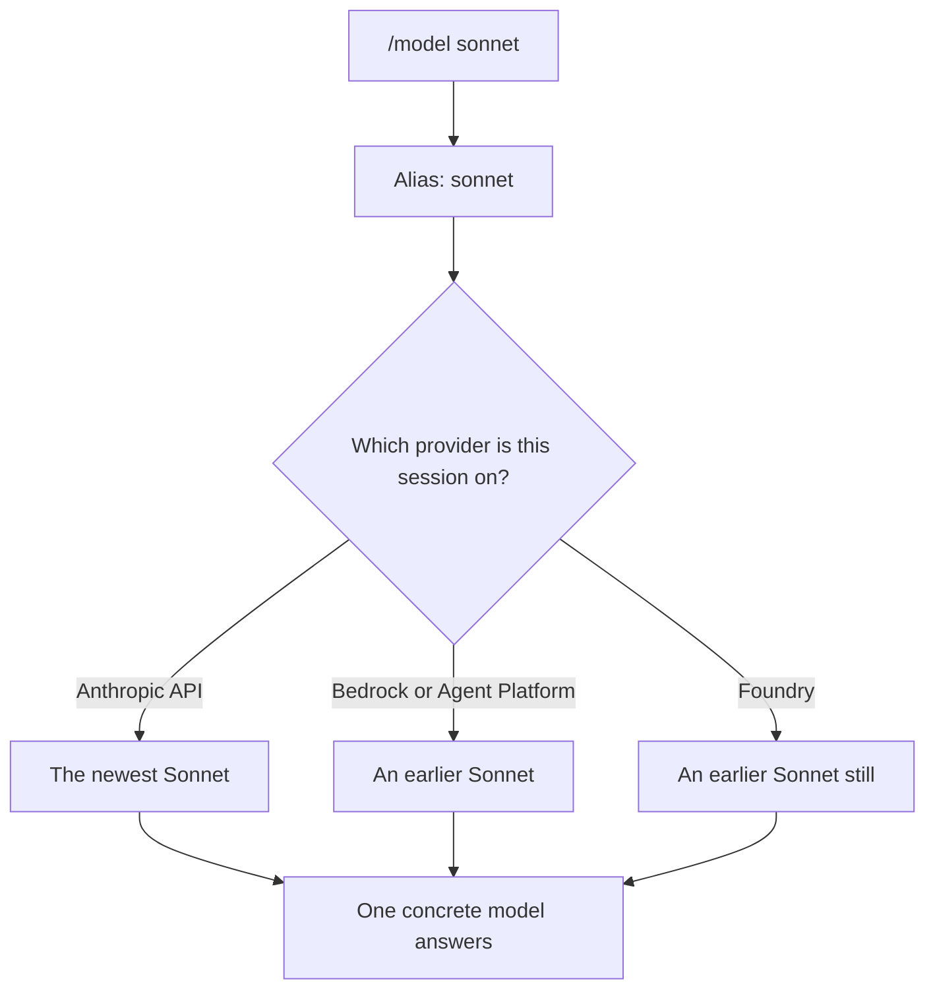

# Model Aliases and Routing — teach `sonnet`, never hardcoded IDs

> You name a model by the job you want done, so a provider's version bump stops breaking your setup.

**Type:** Learn
**Prerequisites:** Lesson 19, Open-Weight vs Frontier
**Time:** ~30 minutes

---

## Learning Objectives

By the end of this lesson, you can:

- Switch models by alias (`sonnet`, `opus`, `haiku`) instead of by version string
- Say which model an alias resolves to right now, on your provider
- Move a model choice out of a script and into one place you can change
- Name the places a model can be set, and say which of them wins
- Explain why a hardcoded model ID rots and an alias does not

---

## The Problem

A team pinned `claude-sonnet-4-5` in an automation script. It worked for months, then it didn't: requests started failing with a message about the selected model. Nobody had edited the script. The model had simply moved on.

Now the fix needs a code change, a review, and a deploy — because a name inside the script expired.

There is a quieter version of the same failure. On a different provider, the same model name resolves to an *earlier* version than the one you tested against. The script keeps running. The answers change. You find out weeks later, from a bug report.

One string, typed once, and now you maintain it forever.

---

## The Concept

A model has two kinds of name, and they do different jobs.

A **model ID** names one specific version: `claude-sonnet-4-5`. Exact. Frozen. It refers to one thing that existed at one moment.

An **alias** names a family and a job: `sonnet` means "the latest Sonnet, the one for daily coding work." The alias keeps working when the version behind it changes.

You have met this shape already. A branch name is a movable label; a commit hash is a frozen moment (Lesson 13). An alias is the label. A model ID is the hash.

As of October 2026 the built-in aliases are `default`, `best`, `fable`, `sonnet`, `opus`, and `haiku`, plus `opusplan` and `[1m]` variants for a longer context window. The list changes. Read [the model configuration page](https://code.claude.com/docs/en/model-config) for the set your build ships, rather than trusting this sentence.

**The reframe:** an alias is a promise about a job and a model ID is a promise about a moment — teach the job, because the moment expires.



### The same alias is not the same model everywhere

An alias resolves against your provider. On the Anthropic API, `sonnet` can point at the newest release. On other providers it can point at an earlier one, because the newest model is not yet enabled or available there.

That is not a bug. It is the alias doing its job: "a Sonnet, the right one for this provider." When you need a specific version — to reproduce a benchmark, or on a provider where the alias lags — you name it in full, on purpose, and write down why.

### Where the choice lives

You can set the model in a few places. The first one that applies wins:

| Where you set it | How | What it covers |
|---|---|---|
| During a session | `/model sonnet` | This session, and saved as your default |
| At launch | `claude --model sonnet` | That one launch |
| Environment | `ANTHROPIC_MODEL=sonnet` | Sessions launched with it set |
| Account default | Set once | Every new session |

Phase 04 covers the settings files and the full precedence rules. What matters now: **there are several places, and the right answer is one place you can change — not a literal id sprinkled through scripts.**

---

## Build It

### 1. See what your alias resolves to

In a session, ask for the model by alias:

```text
/model sonnet
```

Then ask for the real model underneath:

```text
/status
```

`/status` shows the actual model, not the alias. Write both down: the alias you typed, and the version it resolved to.

✅ You pass when you can state your provider's current resolution for `sonnet` and for `opus`, read from `/status` rather than from memory.

### 2. Switch, and feel the cost

With a conversation already going, run the three main aliases in turn:

```text
/model haiku
/model sonnet
/model opus
```

Each switch is a new model, and everything in the conversation has to be re-processed for it. The next turn is slower and more expensive than the one before. Lesson 22 explains exactly why. For now, watch it happen.

✅ You pass when you can describe the slow turn that followed a switch, and name the lesson that explains it.

### 3. Put the choice where you can change it

Take one command you run that names a model, and replace the version string with an alias:

```bash
claude --model sonnet -p "summarise the changes in this repo"
```

The command now survives a version bump.

✅ You pass when the script contains no version number in its model name, and it still runs.

### 4. Pin on purpose, once

Some work must not move: a benchmark, a cache-behaviour reproduction, a comparison against a fixed baseline. There, the full name is the correct answer:

```bash
claude --model claude-sonnet-4-5 -p "count the tokens in the system prompt"
```

Write one sentence next to it saying why it is pinned. A pin with no reason is a pin nobody dares remove.

✅ You pass when every deliberately pinned model has a written reason, and every other model reference in your setup is an alias.

---

## Use It

| Command or alias | When you reach for it |
|---|---|
| `sonnet` | Daily coding work; the tier you reach for most |
| `opus` | Hard reasoning, architecture, work where a mistake is expensive |
| `haiku` | Small, fast, cheap steps — classification, short edits |
| `opusplan` | Plan with Opus, execute with Sonnet, inside one session |
| `default` | "Whatever my account starts on"; clears an override |
| `[1m]` suffix | A long session that would otherwise fill a 200K window |
| `/model <alias>` | Changing the model mid-session |
| `claude --model <alias>` | One session at a chosen tier |
| Full model name | Only to reproduce a specific run, with a reason next to it |

Read current alias behaviour at [Model configuration](https://code.claude.com/docs/en/model-config). Prices and resolutions move; this table is the shape, not the values.

---

## Exercises

1. Pick a task you do often. Run it twice by alias, once on `haiku` and once on `opus`, with an identical prompt. Record which answer was better, and which was cheaper.
   ✅ You pass when you have two answers, two costs read from `/usage`, and one sentence naming the task's real difficulty.

2. A teammate's setup script contains `claude-opus-5-5`. Rewrite the model reference so it survives the next version bump, without changing which tier it uses.
   ✅ You pass when the script names a tier rather than a version, and you can say what that tier resolves to today.

3. Your organisation allows only `sonnet` and `haiku`. You wrote `opus` in a config. Predict what happens at launch, check the model-configuration page, then check your own setup.
   ✅ You pass when your prediction matches the documented behaviour, and you can say which of the four places in this lesson the setting came from.

---

## Key Terms

| Term | What people say | What it actually means |
|---|---|---|
| alias | "a shortcut" | A name for a family and a job that resolves to the current model on your provider. Survives version bumps. |
| model ID | "the model name" | One exact version, frozen in time. Correct to reproduce a run; rots as a default. |
| resolution | "it just picks one" | Alias → provider → concrete model. The provider decides, and it can differ between providers. |
| `default` | "the default model" | A special value that clears an override and returns you to your account's runtime default. It is not a family. |
| `opusplan` | "Opus for everything" | Opus in plan mode, Sonnet in execution. Two models, one session, two caches (Lesson 22). |
| pin | "hardcoding" | Naming a specific version deliberately. Legitimate with a written reason; a bug without one. |

---

## What this lesson skipped

**Fallback chains and automatic fallback.** When a model is overloaded, or a safety classifier flags a request, Claude Code can switch models for a turn. Real and documented — read the model-configuration page when you need it.

**Provider deployment ids.** On Bedrock a model is an inference-profile ARN, on Foundry a deployment name. Same idea, different spelling. Relevant only when you deploy through a cloud provider.

**Enterprise allowlists.** `availableModels` restricts which models a team may select. An administrator topic, on the model-configuration page, not something you configure as a user.

**Model choice as a cost decision.** This lesson is about *naming*. Whether to use a small model, a decision model, or the frontier at all is Lessons 24–26 — and that is where the money actually is.
