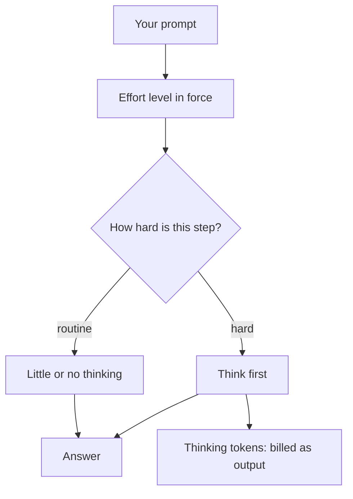

# Effort Levels and Extended Thinking

> You can dial how hard the model thinks on a task, and predict what that dial does to the bill.

**Type:** Learn
**Prerequisites:** Lesson 20, Model Aliases and Routing
**Time:** ~30 minutes

---

## Learning Objectives

By the end of this lesson, you can:

- Set the effort level for a session, and read which level is in force
- Explain the difference between effort and extended thinking
- Choose a level from the shape of the task, not from a habit
- Demonstrate that thinking output is billed, using `/usage`
- Get one-off deeper reasoning on a single turn without changing the session

---

## The Problem

A one-line rename took forty seconds and cost more than the previous twenty turns combined. Nothing about the task was hard.

Earlier that morning, the effort level had been turned up to `max` for a security review, and never turned back down. Every turn since — the renames, the typo fixes, the questions with obvious answers — had been bought at maximum reasoning price.

The opposite failure is quieter and worse. A hard bug gets a confident, wrong fix, and you conclude the model is not good enough. It was never asked to think: the level was low, or thinking was off, and a single shallow pass is exactly what you paid for.

Both failures are one dial, set by habit rather than by task.

---

## The Concept

Two related ideas, often used as if they were one.

**Effort level** controls *adaptive reasoning*: how much the model is willing to think before it answers, decided per step from the difficulty of that step. Lower effort is faster and cheaper on easy work. Higher effort spends more on reasoning when a task rewards it.

**Extended thinking** is the reasoning itself — the tokens the model emits before its answer. Those tokens are real output. You are billed for all of them, whether they are shown, collapsed, or redacted.



**The reframe:** effort buys thinking and thinking is billed, so the question is never "is higher better" but "does this task need the model to think before it answers."

### The levels

As of October 2026 the levels are `low`, `medium`, `high`, `xhigh`, and `max`, with `medium` or `high` as the common default depending on the model, and levels differ by model. A level a model does not support falls back to the highest supported level below it. Read the live table at [Model configuration](https://code.claude.com/docs/en/model-config); the names move.

Roughly:

| Level | For |
|---|---|
| `low` | Work you review step by step anyway: sketches, renames, brainstorming |
| `medium` | Day-to-day engineering with a clear scope |
| `high` | Work where verification matters and edge cases are likely |
| `xhigh` | Deeper reasoning, higher spend |
| `max` | Problems you want worked through without you; test before adopting broadly |

Two honest cautions. Higher effort shows diminishing returns, and it can overthink: more reasoning is not automatically a better answer. And the effort scale is calibrated per model, so the same level name does not mean the same amount of thinking across two models.

### Turning it, and showing it

| Control | How you set it |
|---|---|
| The picker | `/effort` with no argument, or `/effort <level>` to set one |
| One launch | `claude --effort high` |
| Environment | `CLAUDE_CODE_EFFORT_LEVEL=high` |
| Saved default | An `effortLevel` or per-model setting (Phase 04 covers settings) |
| One turn only | Put `ultrathink` anywhere in the prompt |

The session header shows the level next to the model name, for example "with low effort", and `/effort status` reports it. `ultrathink` is the small, useful exception: it asks for deeper reasoning on that one turn and leaves the session's level alone.

Thinking output is collapsed by default. Press `Ctrl+O` to expand it and watch the reasoning. On some models you cannot turn thinking off at all — the model decides per step, and effort is the only control you have.

---

## Build It

### 1. Read the level in force

```text
/effort status
```

Then look at the session header: the level sits next to the model name. Write down both.

✅ You pass when you can state the current level without opening a settings file, and say which control set it.

### 2. Make effort visible in the bill

Pick a task with a right answer — a bug fix, a tricky git command, a small script. Run it once at `low`, then again, identical, at `high`:

```text
/effort low
... run the task ...
/usage
/effort high
... run the same task ...
/usage
```

Record the cost of each. If the model's thinking changed, the output-token count moved; that is where the money went.

✅ You pass when you have two costs for the same task at two levels, and can point at the token count that changed.

### 3. See the thinking

Run any task, then press `Ctrl+O` to expand the reasoning. The gray text before the answer is the thinking you are paying for.

✅ You pass when you can point at the expanded reasoning and say which bucket in `/usage` it landed in.

### 4. Ask for depth on one turn

Leave the session's level where it is, and use the keyword instead:

```text
ultrathink: find the race condition in this file before suggesting a fix.
```

The effort level sent to the model is unchanged; the instruction is added for this turn only.

✅ You pass when the deeper turn happens without the session's level moving, and you can say why that matters for the rest of the session.

### 5. Meet the cost of changing your mind

Change the level in the middle of a conversation and watch the next turn. On most models a change of effort is a change the cache cannot help with, so the whole conversation is reprocessed. That is the next lesson's subject, and seeing it here makes it land.

✅ You pass when you have observed the slow turn after an effort change and can name the lesson that explains it.

---

## Use It

| Control | When you reach for it |
|---|---|
| `/effort` | Choosing a level interactively |
| `/effort status` | Confirming what is actually in force |
| `--effort <level>` | One session at a specific level |
| `CLAUDE_CODE_EFFORT_LEVEL` | Setting a level for everything you launch |
| `ultrathink` in a prompt | One turn of deeper reasoning without changing the session |
| `Ctrl+O` | Expanding thinking to see what you are paying for |
| `/usage` | Checking what a level change cost |
| `low` | Work you will review anyway; you are the reasoning here |
| `max` | A hard problem you want worked through unattended, tested first |

Values and level names move — check [Model configuration](https://code.claude.com/docs/en/model-config) before quoting them.

---

## Exercises

1. Take a task from last week that you found hard. Run it at `low` and at `high`, identical prompt, and compare both the answer and the cost.
   ✅ You pass when you can say whether the extra effort changed the answer at all, with two costs from `/usage` to back it up.

2. Find a task you do repeatedly and would never want deep reasoning for. Set the session to the lowest level that still does it well, and record the cost difference against `high`.
   ✅ You pass when the cheap level produces an answer you would ship, and you have the two costs written down.

3. Deliberately set `max`, run an easy task, and measure the waste. Then decide the rule you will follow for choosing a level.
   ✅ You pass when you can state your rule in one sentence and point to the measurement that justified it.

---

## Key Terms

| Term | What people say | What it actually means |
|---|---|---|
| effort level | "how smart it is" | How much adaptive reasoning the model is willing to spend, decided per step. A cost dial, not an intelligence dial. |
| adaptive reasoning | "thinking" | The model deciding, step by step, whether thinking is worth it. Effort sets the appetite; the step decides. |
| extended thinking | "the reasoning" | The tokens the model emits before its answer, billed as output. Visible with `Ctrl+O`. |
| thinking tokens | "free scratchpad" | Output tokens like any other. You pay for thinking even when it is collapsed or redacted. |
| `ultrathink` | "a magic word" | A keyword that requests deeper reasoning for one turn without moving the session's level. |
| `max` | "the best setting" | The deepest level, session-only unless set through the environment. Prone to overthinking; test it before adopting it. |

---

## What this lesson skipped

**`ultracode` and dynamic workflows.** A toggle that has Claude plan a workflow for each substantial task. It depends on concepts from Phase 12; come back when you have them.

**Per-skill and per-subagent effort.** A skill or subagent can carry its own effort level. Those live in Phases 05 and 06, and they need this lesson first.

**Organisation effort caps.** An administrator can cap the level a model may use. Documented on the model-configuration page; not something you set as a user.

**Fast mode.** A separate speed setting on some plans, with its own cost trade-off. Adjacent to this lesson and covered in the model-configuration page.

**How effort interacts with caching.** Deliberately deferred to Lesson 22, where the mechanism explains why changing effort mid-session has a price.
