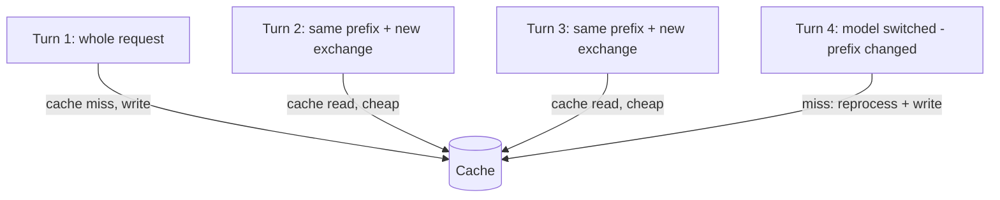

# Prompt Caching — why switching models makes a turn slow

> You can predict which of your actions makes the next turn slow and expensive, before you take them.

**Type:** Learn
**Prerequisites:** Lesson 21, Effort Levels and Extended Thinking
**Time:** ~30 minutes

---

## Learning Objectives

By the end of this lesson, you can:

- Explain why every turn re-sends the whole conversation
- Say what a cache hit and a cache miss are, in terms of the request prefix
- Predict which actions will force a full re-read, and which will not
- Read the cache numbers in `/usage` and say whether a session was efficient
- Choose the cheap moment to change your model or effort level

---

## The Problem

Forty minutes into debugging, you switched from `sonnet` to `opus` to get a better theory. The next turn took a minute and cost more than the previous twenty put together.

Nothing about the conversation had changed. Only the model had. And that one turn — not the debugging, not the long history — is the line item that made the session look expensive.

The same thing happens every time an effort level moves, a long session is resumed after lunch, or a team member tweaks a settings file mid-task. All of it is one mechanism, and once you can see it you stop being surprised by it. Lesson 11 gave you the symptom — a "cold cache". This lesson gives you the cause.

---

## The Concept

The model has no memory between requests. Each turn, the client re-sends the whole conversation: the system prompt, the project context, every earlier message and tool result, and your new message.

That should be enormously wasteful. It is not, because providers **cache the prefix**.

The cache matches the **exact start** of the request against something recently processed. Most of a turn is identical to the turn before, so the unchanged prefix is served from cache at a reduced rate, and only the new part is processed fresh. There is no per-file or per-section caching: a change anywhere in the prefix invalidates everything after it.



**The reframe:** the cache matches the exact start of your request, so the only cheap change is one appended at the end — anything that edits the prefix makes the next turn pay for the whole conversation again.

### The layers, in order

The client orders each request so content that rarely changes comes first:

| Layer | What is in it | Changes when |
|---|---|---|
| System prompt | Core instructions and the definitions of the tools the session can call | The set of those definitions changes |
| Project context | The instructions loaded at session start | A new session, or a clear |
| Conversation | Your messages, the model's answers, tool results | Every turn |

A change in the conversation layer leaves the first two layers cached. A change to the system prompt sits *behind* everything, so it invalidates the lot. That ordering is not an accident — it is the whole trick.

Two settings sit outside the layers and still break the prefix:

- **The model.** Each model has its own cache. Switching recomputes the entire request even when the content is identical.
- **The effort level.** On most models each level has its own cache, so changing effort mid-session recomputes the whole request too. Lesson 21's slow turn was this.

### Reading it

Two token counts tell the story, and `/usage` summarises them:

| Number | Meaning |
|---|---|
| Cache write (creation) | Tokens written into the cache this turn, at the cache-write rate |
| Cache read | Tokens served from cache, at a rate below standard input |
| Hit ratio | How much of the input was a read rather than a write |

A high read-to-write ratio means caching is working for you. Writes staying high turn after turn mean something is changing at the front of your request — usually a model or effort change, an instruction file edited mid-task, or a fresh session.

Two more facts, both load-bearing:

- **The cache expires after a period of inactivity.** The timer resets on every hit. After a long enough gap, the next turn recomputes everything and re-establishes it. That is why the first turn back after stepping away is slow.
- **The cache is effectively scoped to a machine and a directory.** Two sessions in different folders build different prefixes and cannot share each other's cache.

Read the mechanism and current numbers at [Prompt caching](https://code.claude.com/docs/en/prompt-caching).

---

## Build It

### 1. Watch the cache work

In a fresh session, run three or four turns of ordinary work. Then:

```text
/usage
```

Find the prompt-cache line in the session block. Read the hit ratio, the miss count, and whether the cache is warm right now.

✅ You pass when you can state this session's hit ratio and name one action that caused a miss.

### 2. Break it on purpose with a model switch

With the conversation warm, switch models and send one more message:

```text
/model opus
... send a normal follow-up ...
/usage
```

The turn after the switch is the outlier: no cache read, a large write. Compare it to the turns before it.

✅ You pass when you can point at the turn that followed the switch and name it as a cache miss, not a slower model.

### 3. Break it with effort, and notice the warning

Change effort mid-session and send a message. On most models the same re-read happens — and the tool may ask you to confirm the switch first, precisely because of that cost.

✅ You pass when you can explain, in one sentence, why changing effort mid-session is not free.

### 4. Prove the cheap change

Now do the opposite. With the cache warm, append a normal message — no model change, no effort change, no restart. The next turn reads the prefix from cache.

✅ You pass when the appended message's turn shows a cache read, and you can say what was different about it.

### 5. Let it go cold

Warm a session, then step away long enough that the cache expires. Send one more message and read `/usage`.

✅ You pass when you can distinguish a cold-cache turn from a model-switch turn using only the numbers, and both are attributable to the prefix rather than to the task.

---

## Use It

| Command or concept | When you reach for it |
|---|---|
| `/model <alias>` | Pick the model at the *top* of a session, before the conversation grows |
| `/effort <level>` | Same: set it early, change it rarely |
| Appending a new message | The only change that is reliably cheap — it sits at the end |
| `/usage` prompt-cache line | Judging whether a session was efficient, and why a turn was slow |
| Cache hit ratio | Reading a session's efficiency at a glance; a run of misses is a signal, not a bug |
| Cold-cache turn | Explaining the first slow turn after a break; expected, it settles |
| New session in a new directory | Remembering that the cache does not follow you there |

---

## Exercises

1. Take one real session and narrate its cache history from `/usage` alone: where the hits were, where the misses were, and what caused each miss.
   ✅ You pass when every miss you identify is attributed to a specific action you took, not to "slow model".

2. Run the identical task twice: once having switched model just before it, once having switched model at the start of the session. Compare the two costs.
   ✅ You pass when you have both costs and can explain the gap in terms of the prefix.

3. You must change model mid-task. Write down the cheapest moment to do it and why, then demonstrate that a mid-task switch is more expensive than the same switch made at the session's start.
   ✅ You pass when your written prediction matches the measured difference, and both numbers are recorded.

---

## Key Terms

| Term | What people say | What it actually means |
|---|---|---|
| prompt cache | "it remembered" | Server-side reuse of a request prefix you recently sent. Not memory between turns. |
| prefix | "the start" | The exact beginning of the request matched against the cache. A change anywhere in it recomputes everything after. |
| cache read | "free" | Reduced-rate reuse of cached tokens. High read-to-write means caching is working. |
| cache write (creation) | "the miss" | Tokens written into the cache on this turn, at the cache-write rate. High every turn means your prefix keeps changing. |
| invalidation | "cold cache" | The prefix no longer matches, so the next turn reprocesses the whole request and writes a new cache entry. |
| TTL | "how long it lasts" | The idle period the cache survives. Every hit resets it; a long gap means the next turn can miss. |

---

## What this lesson skipped

**Making caching a design constraint.** This lesson explains the mechanism. Phase 13 turns it into architecture — ordering an agent's context so the prefix changes as rarely as possible.

**Compaction, and what it costs.** Replacing a long conversation with a summary is its own cache event. Phase 04 covers the command; the interaction with the cache is covered on the prompt-caching page.

**Caching through a gateway or cloud provider.** Where the cache lives, and whether it works at all, depends on how your requests are routed. Real, and only relevant once you deploy.

**Choosing a cache lifetime.** The default TTL is per request type and follows your billing; you can override it. Not needed for interactive work.

**Caching for subagents and workflows.** Separate request buckets with their own behaviour. It arrives with Phases 06 and 12.
