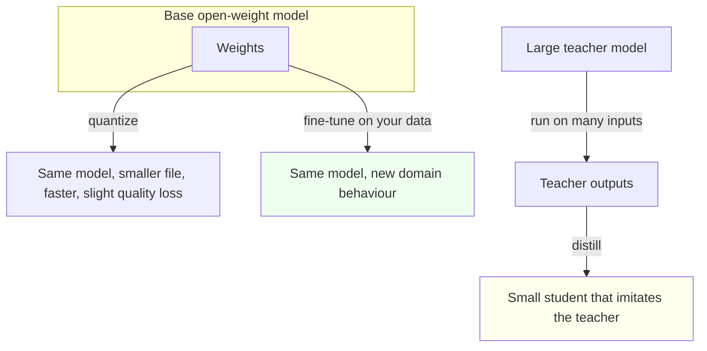

# Quantization, Distillation, Fine-Tuning

> You can tell three look-alike levers apart, so you reach for the one that actually solves your problem.

**Type:** Learn
**Prerequisites:** Lesson 22, Prompt Caching
**Time:** ~30 minutes

---

## Learning Objectives

By the end of this lesson, you can:

- State what quantization changes, and what it leaves alone
- Explain distillation as a teacher producing a smaller student
- Say what fine-tuning requires that the other two do not
- Pick the right lever for a stated problem, and name what each one costs
- Build a small check set that keeps a fine-tune from teaching the model your mistakes

---

## The Problem

You downloaded a 7B open-weight model. It wants more memory than your laptop has, and it generates text slower than you can read it.

Someone says "just quantize it." You do, it fits, and it is fast. Then you notice the answers on the one task you actually cared about got a little worse, and it still does not know your domain.

A week went by. You never needed a smaller model. You needed a model that knew your part numbers and your house style — a completely different lever, with a completely different cost. Lesson 19 promised this lesson; here it is.

---

## The Concept

Three levers, three different changes to a model. They are constantly confused because they all sound like "make the model mine, or make it smaller."

**Quantization** — store the same weights at lower precision. Fewer bits per number, so the model is smaller, fits in less memory, and runs faster. It does not add knowledge and does not change what the model knows. You accept a small quality loss for a large size and speed win. It is usually already done for you: a downloaded file tagged `Q4_K_M` is a 4-bit quantized build.

**Distillation** — train a small *student* model to imitate a larger *teacher*. You run the teacher on a lot of inputs, keep its outputs, and train the student on them. The student ends up much smaller but behaves like the teacher on the inputs you covered. This is how a small model gets to be useful on a narrow task.

**Fine-tuning** — continue training a downloaded model on your own data, so it picks up your domain, your style, your labels. It changes what the model has learned; it does not change its size. It requires the weights, which is exactly why it is only possible with open-weight models (Lesson 19).

**The reframe:** quantize for size, distill for cost, fine-tune for behaviour — only one of the three teaches the model anything about you.

### Choosing between them

| Lever | Changes | Leaves alone | Real cost | Reach for it when |
|---|---|---|---|---|
| Quantize | Precision of the weights | Knowledge and behaviour | A little quality, mostly hidden | It does not fit or runs too slowly |
| Distill | Which model answers at all | Nothing — it makes a new model | Compute to run the teacher and train the student | You want a small, cheap stand-in for a big model on a narrow task |
| Fine-tune | Behaviour on your domain | Size and speed | Data, an eval set, training time, and the risk below | The model needs to know your domain, style, or labels |

### The discipline of not teaching it to lie

Fine-tuning learns whatever is in your data — including the mistakes. Train on support tickets that contain a few confidently wrong answers and the model will learn to sound confident and be wrong, which is worse than an honest refusal because nothing looks off.

So fine-tuning is not just "gather data and train." It is:

1. A held-out **check set** — twenty or more examples with known good answers, never used in training.
2. A **before** score on that check set, so you know what you started with.
3. An **after** score, so you can tell improvement from confident drift.

If you cannot measure it, you cannot tell whether fine-tuning helped or made the model more articulate about being wrong.

---

## Build It

### 1. See quantization do its one job

Using the runtime you installed in Lesson 19, list the available tags for one model and pick two builds of the same model at different precisions — for example a `Q4_K_M` tag and a larger-precision tag of the same weights.

Note the file size of each, and how much memory each uses when it loads.

✅ You pass when you can state both sizes and say, in one sentence, what the smaller build traded away.

### 2. Check that the behaviour barely moved

Run the same prompt through both builds. Compare the answers.

Quantization is supposed to shrink the model, not change it. If the small build is dramatically worse on your prompt, you may be comparing two different models, not two precisions of one.

✅ You pass when both builds answer in the same shape, and you can point to the small, expected difference rather than a change in what the model knows.

### 3. Build the check set that makes the rest measurable

Pick a task you would fine-tune for — a domain label, a house style, a fixed output format. Write twenty inputs with their correct outputs. Keep them out of any future training data.

Run both model builds against all twenty and score them.

✅ You pass when you have twenty inputs, twenty known-good answers, and a before score for each model, written down.

### 4. Decide the lever, three times

For each scenario, name the single lever and one sentence of justification:

1. A model you like is too big for the machine it must run on.
2. You have a large model answering a narrow classification task in production, and want a cheap version of it.
3. The model must follow your company's naming rules and never invent a part number.

✅ You pass when all three answers are different levers, and each justification uses this lesson's vocabulary rather than a slogan.

### 5. Spot the confidently wrong

Look at your check set's failures under the cheaper model. Sort them into "wrong but sounds unsure" and "confidently wrong."

That split is the reason the check set exists. A confidently wrong model can survive review for a long time.

✅ You pass when you can name how many of the failures were confidently wrong, and why that number is the one you watch.

---

## Use It

| Concept | When you reach for it |
|---|---|
| Quantization | The model does not fit or is too slow, and its knowledge is already good enough |
| Distillation | You want a small cheap model to imitate a big one on a narrow, well-defined task |
| Fine-tuning | The model needs your domain, style, or labels, and you can measure the result |
| The check set | Before *and* after any fine-tune; without it, improvement is a feeling |
| "Confidently wrong" | The failure mode fine-tuning can amplify; count it, do not eyeball it |
| Held-out data | Keeping the check set out of training, so the score means something |

Current tooling and file formats move quickly. Treat named formats and tags as examples of the shape, not as fixed truth.

---

## Exercises

1. Take one model you use and find two precision builds of it. Record the size difference and one observed quality difference.
   ✅ You pass when you have the sizes and a specific, observed quality difference rather than a vague impression.

2. Write a twenty-example check set for a task you actually care about, with known good answers, and score one model against it.
   ✅ You pass when the twenty examples exist as a file and the score is a number you could hand to someone else.

3. A colleague proposes fine-tuning to fix slow responses. Say what is wrong with that plan and which lever they actually want.
   ✅ You pass when you name the correct lever and the reason fine-tuning would not change speed.

4. For a task of your choosing, argue for distillation over fine-tuning, or the reverse. Name the cost you are accepting.
   ✅ You pass when the argument names what each lever changes and the specific cost your choice accepts.

---

## Key Terms

| Term | What people say | What it actually means |
|---|---|---|
| quantization | "compressing the model" | Storing the same weights at lower precision. Smaller and faster, knowledge unchanged, slight quality loss. |
| precision / bit-width | "how many bits" | How many bits store each weight. Eight, four, and smaller are common; lower means smaller and a little lossier. |
| distillation | "shrinking the model" | Training a small student to imitate a large teacher's outputs. A new, smaller model with the teacher's behaviour on covered inputs. |
| teacher / student | "the big one and the little one" | The capable model producing training targets, and the small model learning from them. |
| fine-tuning | "training it more" | Continuing training on your own data so the model picks up your domain. Needs the weights, and a check set. |
| check set | "the tests" | Held-out examples with known good answers, scored before and after, so you can tell improvement from drift. |
| confidently wrong | "hallucinating" | A fluent, wrong answer. The failure mode fine-tuning can amplify, because it learns your data's errors too. |

---

## What this lesson skipped

**Actually running a training job.** Fine-tuning and distillation need GPUs, a data pipeline, and time. This lesson is the decision; the mechanics are a different course.

**Preference tuning and reinforcement learning.** Teaching a model *which* of two answers is better, rather than imitating outputs. More advanced, and out of this course's scope.

**LoRA and adapters.** Small add-on weights that change behaviour without rewriting the whole model. Useful, and a detail under "fine-tune" rather than a fourth lever.

**Serving and distribution.** How you host a distilled or fine-tuned model at volume. Phase 17 territory.

**Evaluation methodology.** A twenty-example check set is a floor, not a rigorous benchmark. Doing evaluation properly is its own discipline, and this course only asks you to be honest about what you measured.
