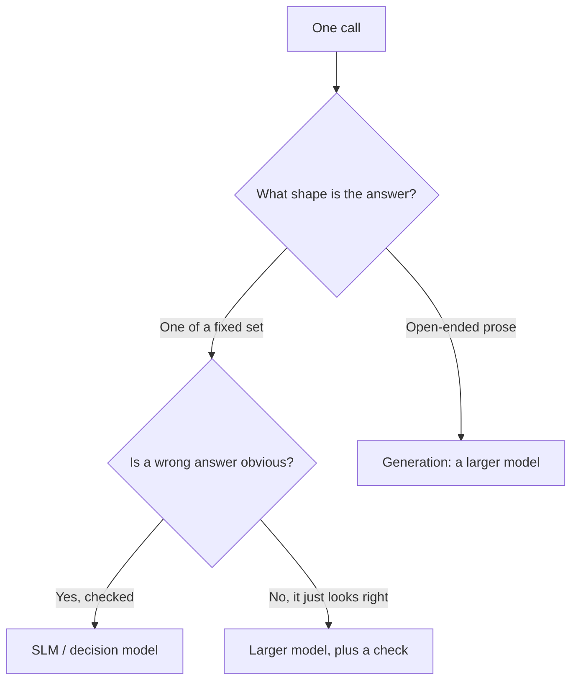

# SLMs — When a 350M Model Wins

> You can spot the tasks where a tiny model beats the frontier, and the ones where it will embarrass you.

**Type:** Learn
**Prerequisites:** Lesson 23, Quantization, Distillation, Fine-Tuning
**Time:** ~30 minutes

---

## Learning Objectives

By the end of this lesson, you can:

- Say what an SLM is, and why parameter count is a description and not a definition
- Name the task shapes where a small model wins, and where it loses
- Measure a small model against a larger one on a task, with a number
- Compute the volume at which a small model's cost advantage matters
- Decide the tier for a task from its shape rather than from a brand

---

## The Problem

A pipeline classified two hundred thousand support tickets with a frontier model. The bill was enormous. A colleague swapped in a small model running locally, and the labels barely changed. Same pipeline, a fraction of the cost.

The same team tried the swap on a different task — summarising customer complaints for a report — and got fluent, confident, subtly wrong summaries. They shipped them. Nobody noticed for a month.

Same tiny model. Opposite outcomes. The difference was never the model. It was the *task*: one wanted a label from a fixed list, the other wanted writing.

---

## The Concept

An **SLM** — small language model — is, roughly, a model small enough to run on a laptop or a single modest machine. In practice that means from a few hundred million parameters to a few billion.

Do not over-read that number. Lesson 19's reframe applies here too: size is a description, not a definition. What matters is what the model is being asked to do.

A small model wins when the task is:

- **Narrow** — a fixed set of possible answers, not open-ended prose
- **High-volume** — you run it thousands of times
- **Shape-constrained** — "one word", "a number", "a category" rather than a paragraph
- **Private** — the input cannot leave the machine
- **Simple-but-tedious** — extracting a field, routing a message, tagging a commit

A small model loses when the task is:

- **Open-ended** — reasoning about a novel problem with no known answer shape
- **Long-chained** — many steps where an early small error compounds
- **Invisible when wrong** — any fluent answer looks plausible, so a confident error slips through

**The reframe:** a small model does not win by being smart; it wins when the task is narrow enough that smart is not what you need.



### Why small stopped meaning bad

Two levers from Lesson 23 are why this is now practical rather than a stunt.

**Quantization** makes a small model fit and run fast on ordinary hardware. **Distillation** makes a small model behave like a big one on a narrow task, because it was trained on that big model's answers for exactly those inputs. Add a fixed output shape and you have a model that is small, cheap, fast, and right where it matters.

### The honest comparison

The comparison that matters is not "is the small model as good." It is:

> On *this task*, what does the small model lose in accuracy, and what does that loss cost me — in money, latency, or a wrong answer nobody catches?

| | Small, local | Large, hosted |
|---|---|---|
| Cost per call | Electricity and hardware | Billed per token |
| Latency | Local, no network | Round trip, larger model |
| Privacy | Input stays put | Input leaves the machine |
| Capability | Enough for narrow tasks | Broad and open-ended |

The small model usually wins on the first three. The question is always whether the fourth is enough.

---

## Build It

### 1. Pick a narrow task with a real answer

Choose something with a fixed label set, so accuracy is a number and not a feeling. A good one: read a commit message and classify it as `feat`, `fix`, `docs`, `test`, or `chore`.

### 2. Build the check set first

Twenty examples — a message and its correct label. This is the same check set pattern from Lesson 23. Write it before you run anything, so you cannot pick examples that flatter a model.

✅ You pass when the twenty inputs and their correct labels exist as a file, before any model has scored them.

### 3. Run the small model, constrained

Give the small model an exact output shape:

```text
Classify the git commit below as exactly one word: feat, fix, docs, test, or chore.
Answer with the word only.
```

Score it against the twenty.

✅ You pass when you have an accuracy number for the small model, and can say how many it missed.

### 4. Run the large model on the same twenty

Same prompt, same check set. Score it, and record latency per call.

✅ You pass when you have both accuracies and both latencies side by side.

### 5. Find the crossover

Cost is volume multiplied by cost per call. At your real volume, a one-percent accuracy gap can be worth very little or a great deal.

Write down: how many calls a day this task makes, what each tier costs you at that volume, and what the accuracy gap is.

✅ You pass when you can state the tier you would choose and the number that decided it.

---

## Use It

| Situation | Reach for |
|---|---|
| Fixed label set, thousands of calls a day | A small model, run locally |
| Input cannot leave the machine | A small model, run locally |
| Open-ended reasoning about a new problem | A larger model |
| Long multi-step chain with no check between steps | A larger model, or add a check |
| Fluent output that nobody verifies | A larger model *and* a check set; the task is dangerous for any tier |
| One-off request, tiny volume | Whichever answers best; volume is not a lever at this size |

Tooling and model names move quickly. Nothing here names a specific small model on purpose — the pattern is the lesson, and the current best small model will be different next quarter.

---

## Exercises

1. Take a narrow task you run often. Write a twenty-example check set and score both a small and a large model against it.
   ✅ You pass when both scores are numbers, on the same twenty inputs, recorded together.

2. Find one task in your own work where a small model would be *dangerous* — fluent when wrong, and unchecked. Say what makes it dangerous.
   ✅ You pass when you can name the specific property (invisibility of errors) and the check that is missing.

3. Take a task for which you currently use a large model. Compute, from your real volume, whether a small model's accuracy gap costs more or less than the money it saves.
   ✅ You pass when the answer is a comparison of two numbers, not an opinion.

---

## Key Terms

| Term | What people say | What it actually means |
|---|---|---|
| SLM | "a weak model" | A small language model, roughly hundreds of millions to a few billion parameters. Weak at open-ended reasoning; often enough for a narrow task. |
| parameter count | "how big it is" | The number of learned weights. A description, not a definition of capability (Lesson 19). |
| narrow task | "simple task" | A task with a small, fixed set of correct answers. Narrow is about the output space, not the difficulty of the input. |
| throughput | "how fast" | Calls handled per unit time, locally and without a network round trip. Why small models win at volume. |
| crossover | "the break-even" | The volume at which a per-call cost difference outweighs an accuracy difference. It is arithmetic, not taste. |
| confidently wrong | "hallucinating" | Fluent and incorrect. The failure a small model hits hardest when the task is open-ended and unchecked. |

---

## What this lesson skipped

**Serving small models at scale.** Batching, GPU scheduling, and concurrency for high volume. Phase 17 territory.

**Evaluation frameworks.** A twenty-example check set is a floor. Rigorous evaluation is its own discipline, and this course only asks you to be honest about what you measured.

**Training a small model yourself.** Distillation and fine-tuning are Lesson 23; this lesson assumes you pick one off the shelf or accept the one you built.

**Decision models.** A small model used specifically to output a label, rather than text, is the next lesson — and it is the sharper version of this idea.
