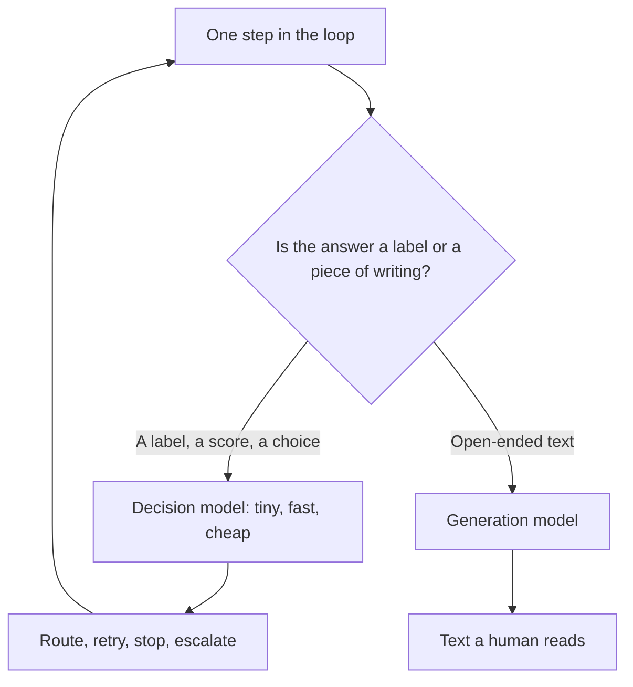

# Decision Models Beat Generation on Cost

> You can find the calls that only need a label, and stop paying for paragraphs nobody reads.

**Type:** Learn
**Prerequisites:** Lesson 24, SLMs — When a 350M Model Wins
**Time:** ~30 minutes

---

## Learning Objectives

By the end of this lesson, you can:

- Tell a decision call from a generation call, up front
- Explain why a decision's cost is dominated by output tokens
- Rewrite a decision call so it returns a label instead of prose
- Say when a decision model is the wrong tool
- Name the decision-model pattern without naming a product

---

## The Problem

An agent loop made about forty calls to finish one task. The hard call — the one that actually reasoned — was not the expensive one.

The expensive part was thirty-five easy calls. Each asked a small question: is this step done? should I retry? which file comes next? And each one answered in a full sentence, because that is what a generation model does. A sentence where a single word would do.

You paid, every time, for output tokens nobody was ever going to read. Multiply by forty, multiply by every task. The bill was dominated by prose that was thrown away the moment it arrived.

---

## The Concept

Every model call answers one of two questions, and they cost differently.

- A **generation** call produces open-ended text: `write the migration guide`, `summarise this thread`, `explain this error`.
- A **decision** call chooses from a fixed set, or returns a score: `done or not done`, `retry or escalate`, `which of these six categories`, `is this safe to run`.

A **decision model** is built and served for the second kind. It returns a label or a probability, not a paragraph. It is usually small — often an SLM (Lesson 24) that was distilled or fine-tuned for a fixed output (Lesson 23).

**The reframe:** most calls in a loop produce a label, not a paragraph — and a model that only ever outputs a label can be far smaller than one that has to write.



### Why the decision is so much cheaper

Cost is input plus output, priced differently. For a decision in a loop, the input is often the same chunky context regardless of which model you use — but the output is the surprise:

| | Generation model answering a decision | Decision model |
|---|---|---|
| Output | A sentence, an explanation, sometimes a plan | One label, a few tokens |
| Latency | Larger model, longer output | Small model, tiny output |
| Cost | You pay for prose nobody reads | You pay for the label |

The generation model can be *right* and still be the wrong tool: it is charging for words the caller discards. That is the whole insight. The loop asked a yes/no question and bought an essay.

### Most of a loop is decisions

Inside an agentic loop (Lesson 10), most steps are choices, not writing:

- should this step run at all
- which one of the available actions comes next
- did that succeed
- is the task finished
- is this result good enough, or does it need escalation

Only the small remainder produces something a human reads. Route the decisions to a decision model and keep the generation calls for the parts that end up in front of someone — and the cost falls where the volume is, not where the intelligence is.

### Naming the pattern, not the product

Some vendors market model families built specifically for decisions. You may encounter names like **Jev**, **Jeff**, or **LFM** as examples of that pattern.

As of October 2026 this course has not verified those as specific, current products, and it will not title a lesson on a guess. Treat any such name as *an example of the pattern* — a model that outputs a decision — and check whether it exists and fits before you adopt it. The pattern is the lesson.

### When a decision model is wrong

- The task is genuinely open-ended and has no fixed answer set.
- You need the reasoning *as the deliverable*, not just the answer.
- You cannot define what "correct" means, so you cannot tell a good label from a bad one.
- A wrong label is invisible downstream. Then you need a check, not just a smaller model.

---

## Build It

### 1. Inventory a real loop

Take a loop you actually run — a script, a retry pattern, a workflow you drive by hand. List every model call it makes, in order.

✅ You pass when the list has every call in the loop, not a sample.

### 2. Label each call D or G

Mark each one **D** if the answer is a label, a score, or a choice from a fixed set. Mark it **G** if it produces open-ended text.

✅ You pass when every call carries a D or a G, with no blanks.

### 3. Find where the money actually is

For a single run, estimate the output tokens each call produced. Sort by total output tokens across the run.

The most expensive call is rarely the hardest one.

✅ You pass when you can name the call with the largest output-token total and say whether it was a D or a G.

### 4. Collapse one decision

Take a D call and rewrite the prompt so the answer is a single token:

```text
Answer with exactly one word: yes or no. Do not explain.
```

Compare the cost of that call before and after.

✅ You pass when the same decision costs measurably less, and you can attribute the difference to output tokens rather than to the task.

### 5. Route one decision down

Point one D call at a small local model and keep the G calls where they are. Measure accuracy on the D call with your check set from Lesson 24.

✅ You pass when the decision still makes the same choice on your check set, at a lower cost.

---

## Use It

| Call type | Answer shape | Reach for |
|---|---|---|
| Route / classify | One label from a set | A decision model |
| Gate / retry / stop | Yes or no | A decision model |
| Extract a field | A short, fixed value | A decision model |
| Write a summary | Open-ended prose | A generation model |
| Explain a failure to a person | Open-ended prose | A generation model |
| Decide *and* explain | Label plus text | A decision model for the label, a generation model only if the text is read |

Confidence gates — escalating to a bigger model only when the decision is unsure — are how this pattern was designed to be used. That is Phase 14's subject, and it is where this idea pays off.

---

## Exercises

1. Take a loop with at least ten calls. Label every call D or G, and estimate output tokens per call.
   ✅ You pass when the inventory is complete and the largest output-token total is identified with its type.

2. Find one call you currently send to a large model that is really a decision. Rewrite it to return a single label, and compare cost against the old version.
   ✅ You pass when the cost difference is measured and attributed to output tokens.

3. A teammate wants every decision to also write out its reasoning "for auditability." Argue for or against, and name the cost.
   ✅ You pass when your answer states that this converts a decision into a generation call, and gives the price in output tokens.

---

## Key Terms

| Term | What people say | What it actually means |
|---|---|---|
| decision model | "a classifier" | A model built to return a label, score, or choice rather than open-ended text. Small, fast, cheap. |
| generation model | "the chatbot" | A model that produces open-ended text. Right for writing, wasteful for a yes/no. |
| decision call | "a simple call" | A call whose answer is one of a fixed set. Cost is dominated by the output you did not need. |
| label set | "the options" | The fixed choices a decision can return. A small, closed set is what makes a small model viable. |
| output tokens | "the reply" | What the model generated. The cost driver when a decision is answered with a paragraph. |
| confidence gate | "escalate when unsure" | Sending only the uncertain decisions to a bigger model. Phase 14 builds this; here you only need the pattern. |

---

## What this lesson skipped

**Confidence gates and escalation in detail.** How to score a decision's confidence and route only the unsure ones upward. Phase 14.

**Building or training your own decision model.** The levers are Lesson 23; this lesson is about *when* a decision model is the right shape.

**Harness design.** Where in a real system the decision calls sit, and how they are wired. Phase 14 is the harness phase; this lesson is the model-level pattern it uses.

**Prompt engineering for reliable labels.** Getting a model to always return exactly one token is a craft. This lesson asks you to try it once; refining it is a skill you build elsewhere.
