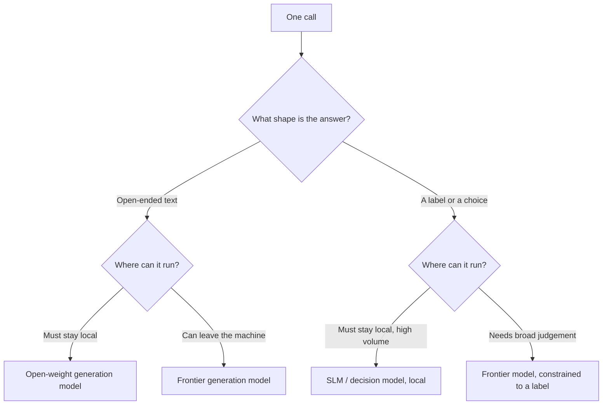

# The Taxonomy: LLM / Decision Model / SLM

> You can place any model on one map and pick by task shape instead of by brand.

**Type:** Learn
**Prerequisites:** Lesson 25, Decision Models Beat Generation on Cost
**Time:** ~35 minutes

---

## Learning Objectives

By the end of this lesson, you can:

- Sort any model by two independent questions: what it outputs, and where it runs
- Explain why "small" and "decision" are different axes, not rungs on one ladder
- Route a call to a tier from the shape of its answer, with a stated reason
- Say when the frontier model genuinely earns its price
- Defend a routing choice against the obvious objection

---

## The Problem

A team benchmarked a small model against a frontier model by asking both the same open-ended question: "review this architecture and suggest improvements."

The small model gave a shallow answer. They concluded small models were not ready, wrote it in a slide, and kept paying frontier prices — for a workload that was actually a 500-way classification with a fixed label set. The task they tested was not the task they ran.

They had compared two models on one axis — size — while their real decision turned on a different one: the *shape of the answer*. That is the last confusion this phase removes.

---

## The Concept

The words people throw around — "LLM", "SLM", "decision model", "frontier", "open-weight" — are not alternatives at the same level. They answer two separate questions.

**Question 1: What does it output?** Open-ended **generation**, or a **decision** — a label, a score, a choice from a fixed set. (Lesson 25.)

**Question 2: Where does it run?** **Open-weight** on your own hardware, or **frontier** on someone else's, billed per call. (Lesson 19.)

"SLM" is a third thing: a size band that mostly sits on the open-weight side, and is most useful when the output is a decision. It is a description that crosses both axes; it is not a separate rung.

**The reframe:** the taxonomy is two questions, not one ladder — what shape is the output, and where does the model run — so "small" is never the same question as "worse."

### The map

|  | Decision output | Generation output |
|---|---|---|
| **Runs on your machine** | SLM or fine-tuned small model: classify, route, extract | A local open-weight model writing text |
| **Runs on someone's servers** | A frontier model constrained to a label | A frontier model writing text |

Each quadrant is legitimate. The mistake is comparing across a row or a column and calling it a fair fight: an open-ended question is a generation task, so a decision-optimised small model will lose it — and that loss says nothing about the classification work you actually needed.

### The three questions that pick a tier

For any call:

1. **What shape is the answer?** A fixed set → a decision model. Open-ended → a generation model.
2. **How narrow is the task?** Narrow and high-volume → a small model is viable. Broad and novel → a larger model.
3. **What are the constraints?** Private or offline → it runs locally. Latency-tolerant and quality-critical → the frontier can earn its price.

The three questions from Lessons 19, 24, and 25 — serving, size, output shape — become one decision procedure.

### When the frontier earns its price

A bigger model is not wasted money by default. It pays for itself when:

- The task is open-ended and its answer ends up in front of a person.
- The volume is low, so per-call cost barely matters.
- A wrong answer is expensive and invisible, and the extra capability is your safety margin.
- The task is novel, or long-chained, and small errors compound.

Everywhere else, the larger model is being used for a job that does not need broad capability — and *that* is the waste the practice module asks you to find.

---

## Build It

### 1. Sort your own calls

Open your `/usage` records, or another log of your model calls, and list the last twenty. For each, write:

- output shape: **D** or **G**
- where it ran: **local** or **hosted** — or which tier you believe you used

✅ You pass when twenty calls are each placed in one of the four quadrants.

### 2. Find the misplaced frontier call

Look for a call that ran on a large hosted model but has a **D** shape — a decision answered by a generation model.

✅ You pass when you can name at least one such call and the reason it was sent to a large model.

### 3. Answer the three questions

Take that call and write the three answers: shape, narrowness, constraints. From those answers, name the tier it should use.

✅ You pass when the tier follows from the three answers, and you can point to the answer that drove the choice.

### 4. Price the change

Estimate the call's cost at your real volume, under the current tier and the proposed one. Subtract.

✅ You pass when you have two cost estimates and a difference, with the arithmetic written down.

### 5. Keep one on the frontier, on purpose

Name one call in your workload that should stay on a large model, and say which of the four conditions above makes it worth the price.

✅ You pass when the kept call has a written reason drawn from this lesson, not from habit.

---

## Use It

| Question | Answer → tier |
|---|---|
| Fixed label set, high volume, private data | Open-weight SLM or decision model, local |
| Fixed label set but needs broad judgement | Frontier model, constrained to a label |
| Open-ended prose a human reads, high value | Frontier generation model |
| Open-ended prose, offline or private | Open-weight generation model, local |
| Novel, long-chained task with no check | Frontier, and add a check |
| One-off, low volume | Whichever answers best; volume is not a lever here |

The map is stable. The models on it are not — names, sizes, and prices move constantly, so always check current figures rather than trusting a remembered number.

---

## Exercises

1. Take five real calls from your own work and place each in the four-quadrant map, with a one-line reason.
   ✅ You pass when all five sit in a quadrant and each reason names the output shape or the serving constraint.

2. Find a comparison someone made between two models that answered different questions — a small model on an open-ended task, say — and explain what went wrong in taxonomy terms.
   ✅ You pass when you can name the two axes the comparison confused.

3. Write a routing rule for one workload using only the three questions. Then defend it against the objection "just use the biggest model, it's simpler."
   ✅ You pass when your defence names the specific call where the bigger model is wasted, with a number attached.

---

## Key Terms

| Term | What people say | What it actually means |
|---|---|---|
| LLM | "the model" | A large language model. A size description; says nothing about output shape or where it runs. |
| SLM | "the weak one" | A small language model. A size band, mostly on the open-weight side, most useful for narrow decisions. |
| decision model | "a classifier" | A model that returns a label or choice. An *output-shape* category, independent of size. |
| generation | "talking to the model" | Open-ended text output. The category that needs a larger, broader model to do well. |
| open-weight | "you can download it" | The weights are public, so you run it yourself (Lesson 19). A *serving* category. |
| frontier | "the best model" | The most capable model at a given time, hosted for you. A serving category, and it moves. |
| output shape | "the answer type" | Label versus open-ended text. The axis that decides which model to use. |
| routing | "picking a model" | Choosing a tier per call from task shape, and defending the choice. |

---

## What this lesson skipped

**Training any of these models.** Out of scope; this course assumes you use models rather than build them.

**Serving and infrastructure.** How to host a local model at volume. Phase 17.

**Evaluation methodology.** Rigorous measurement of a routing change. The practice module below asks for a twenty-example check, which is a floor, not a benchmark.

**The same taxonomy inside a running system.** Where these calls sit in a loop, and how a harness routes between them, is Phase 14 — and it is where this phase's cost argument becomes a system.

**Products and family names.** This phase teaches the pattern. Where a specific product would help, it says so and points you at the docs, rather than shipping a name that will be stale next quarter.

---

## Next

This is the last lesson of Phase 03. **Module 03.1 — Route a real workload across model tiers** is where you take a workload you actually run, find where the frontier model was wasted, and defend the routing. If you can do that and explain the trade-off, the phase is done.
