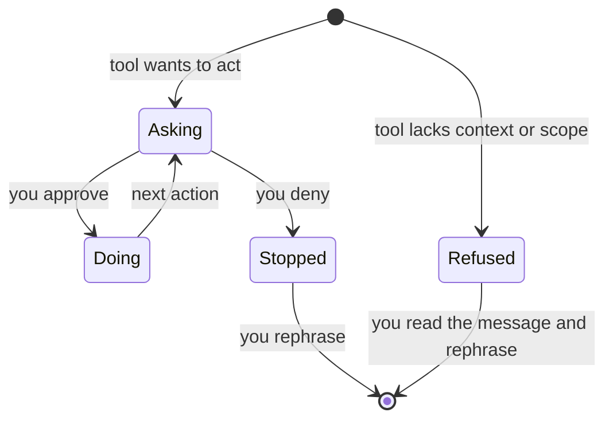

# Files and Edits — and When It Refuses

> A refusal is information, not a wall. It names the boundary you just crossed.

**Type:** Learn
**Prerequisites:** Lesson 28 (Install, First Run, Verify)
**Time:** ~30 minutes

## Learning Objectives

By the end of this lesson you can:
- Read a file with the tool
- Make a small edit to a file
- Recognize when the tool is asking versus when it's refusing
- Tell a permission question from a refusal
- Configure the tool to stop asking for one specific operation in this directory

## The Problem

A user installs Claude Code. They ask it to fix a typo. A prompt appears in the terminal. They don't know what it's asking. They click no. They click no again. They give up and fix the typo by hand.

The whole "agent in your terminal" promise just evaporated. Not because the tool failed. Because the permission flow surprised them.

This lesson exists to prevent that. The tool's first interaction with your files will involve a question. The question is the lesson.

## The Concept

The tool is conservative by default. Every file write. Every shell command that could change state. Every network call. The tool checks first.

Three states:

- It asks. The most common. The tool wants to do something and is waiting for you.
- It does. Rare by default. Reserved for things you've already approved.
- It refuses. The tool decided it can't do this. It tells you why.

The default is "asks." That state can be configured later. For now: assume the tool will ask before almost anything that touches your machine.

**The reframe:** a refusal is information, not a wall. The tool is telling you it doesn't have enough context to act safely. Read the message. It names the thing it couldn't do, and usually the reason.

A question prompt and a refusal are different things. A question prompt is "may I run `rm src/foo.py`?" with a yes/no. A refusal is "I can't delete files outside this directory" — no button, just text.

Both deserve reading.

## Build It

1. Make a new empty directory. `mkdir claude-files-lesson && cd claude-files-lesson`.
2. Inside it, create one file by hand: `echo "hello wrold" > note.txt`. Save the typo on purpose.
3. Launch the tool in that directory: `claude`. Wait for the prompt.
4. Type: `read note.txt`. The tool reads. Usually no prompt. Reading your project files is silent.
5. Type: `fix the typo in note.txt`. A prompt appears. It names the file and the change. Read it before answering.
6. Approve. The tool writes. Verify by opening `note.txt`. The typo is gone.
7. Type: `create a file called done.txt with the word yes`. Another prompt. Look for a "don't ask again for files in this directory" option if it fits your workflow. Pick it or don't. Either is correct.

End state: you have used the tool on your own files. You have seen at least one question prompt. You read the prompt before answering it.

## Use It

The categories of things the tool will ask about:

| Action | Example prompt | When to grant | When to refuse |
|---|---|---|---|
| Read a file in your project | (usually silent) | Always | Never — reading is safe |
| Edit a file | "Edit note.txt: replace 'wrold' with 'world'?" | When you asked for it and the diff matches | When you didn't ask, or the diff is bigger than expected |
| Run a shell command | "Run `npm install`?" | When you asked for it and the command is what you meant | When the command does more than you expected (e.g., `rm -rf`) |
| Network call | "Fetch https://example.com?" | When you need it | When you didn't ask for any network activity |
| Delete a file | "Run `rm note.txt`?" | When you genuinely want it gone | Pause and re-read. Delete is hard to undo. |

The skill: read the prompt. It names the action. It names the target. It sometimes shows a diff. Match what the prompt says to what you wanted. If they match, approve. If they don't, deny and rephrase.

## Exercises

**Exercise 1.** In a fresh directory, create a file called `doomed.txt`. Ask the tool to delete it. Pass criterion: a confirmation prompt appears naming the file and the deletion command. You deny it. The file is still there when you `ls`.

**Exercise 2.** Ask the tool to read a file that doesn't exist. Pass criterion: the tool tells you the file is missing — a refusal with a reason. You can name the reason from the message.

**Exercise 3.** Ask the tool to make an edit larger than you meant — for example, "rewrite note.txt to be more polite." Read the proposed diff in the prompt. Deny it. Re-ask with smaller scope: "change 'wrold' to 'world'." Approve that one. Pass criterion: the smaller edit lands; the larger one didn't.

## Key Terms

**Permission** — *what people say:* "is the system secure." *What it actually means:* the rule that says whether the tool can act without asking you each time. The system is conservative by default; security is a side effect, not the point.

**Approve** — *what people say:* "make it stop asking." *What it actually means:* agree to this specific action, right now. Approval is per-action by default. "Don't ask again" is a separate option in the prompt when offered.

**Refusal** — *what people say:* "I can't do that." *What it actually means:* the tool is naming a constraint it hit. The message usually includes the reason. Read it before rephrasing.

**Ask vs. refuse** — *what people say:* "the tool said no." *What it actually means:* two different events. A question is waiting on a yes/no. A refusal is text only — no button. Conflating them is how users give up.

## What this lesson skipped

Slash commands (Lesson 30), the full permission modes table (Lesson 33), and the inner loop the tool runs to decide what to ask about (Lesson 31). You don't need them yet. You need to recognize a question, answer it, and read a refusal when you see one.
