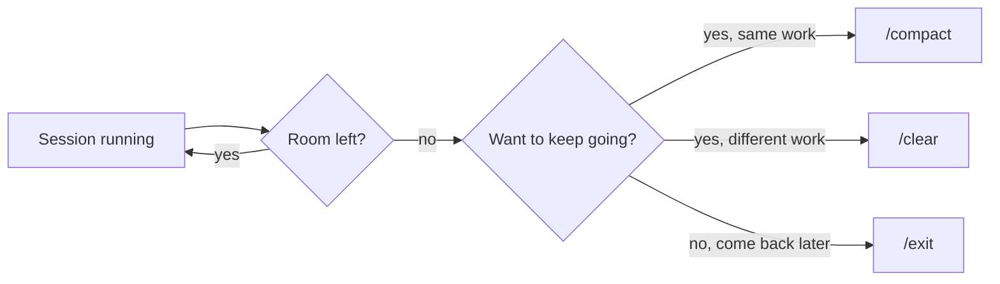

# Sessions, `/clear`, `/compact`

> A session has memory, and memory fills up. `/clear` drops it. `/compact`
> compresses it.

**Type:** Learn
**Prerequisites:** Lesson 29 (Files and Edits)
**Time:** ~25 minutes

## Learning Objectives

By the end of this lesson, you can:

- Start a session.
- End a session cleanly.
- Recover when the tool says it has run out of room.
- Tell a "new session" from "continue the previous one."
- Reach for the right slash command when the budget runs out.

## The Problem

You have been working for an hour. Long conversation, lots of files read, edits made, a few background tasks finished. You ask the tool to summarize what you two have done. It says: "I can't — the conversation is too long for me to fit."

You stare at the screen. What does that mean? What broke? Did you do something wrong?

You did nothing wrong. There is a limit to how much of the conversation the tool can see at once. You hit it. The fix is small. You just need to know which of three moves to make:

- Keep going from here, in the same session.
- Get a summary, keep working in a new session.
- Start over, fresh.

Pick the right one and the tool keeps helping. Pick the wrong one and you lose state, or you keep paying for memory you don't need.

## The Concept

A **session** is the unit of conversation with the tool. Not a chat. A session has a beginning, a middle, and an end. It has state. The state includes:

- The conversation so far — your messages and the tool's replies.
- The files the tool has read this session.
- The edits the tool has made.
- Any background work still in progress.

A **conversation** is just the words exchanged. A session is the words plus everything that hangs off them. Two sessions can have the same opening message and diverge from there. The opening line is cheap; the state is the weight.

The session has a memory. That memory fills up. Three operations on that memory:

| Command | What it does | What's left |
|---|---|---|
| `/clear` | Wipes the session's memory. The tool forgets everything: the conversation, the files it read, the edits it made. | Nothing. A blank slate. |
| `/compact` | Asks the tool to summarize the conversation so far, then keeps the summary in place of the long version. Files read and edits made are still tracked. | A short version of the conversation. State preserved. |
| `/exit` | Ends the session. State is saved to disk. You can resume later with `--continue` or the resume flag. | Everything, but on disk, not in front of the tool. |

**The reframe:** when the tool says it is out of room, it is telling you a budget problem, not a capability problem. The right move is whichever matches what you want next — keep going from here, get a summary, or start over. None of the three is "better." They are three different decisions.

The tool gives you a signal before the wall. A warning, a slowdown, a refusal. Watch for the slow.

Slash commands are how you talk to the tool outside the conversation. They begin with `/`. You have been using one already: `/exit`. The full list lives in Phase 05. For this lesson, four matter: `/clear`, `/compact`, `/exit`, and the flag `--continue` (or `claude --continue` to resume the last session).

## Build It

A short exercise you can run in five minutes.

1. Launch a fresh session. Type `claude` in your terminal.
2. Paste in something long. A chapter from a book, a long log file, a stack trace from a real bug. Twenty pages or more.
3. Watch what happens. The tool will start to slow. It may warn you. It may stop answering mid-thought.
4. Type `/clear`. Watch the state reset. Ask the tool what it remembers. It remembers nothing.
5. Re-paste the long text. Let it fill up again.
6. This time, type `/compact`. The tool writes a summary, then continues. Ask it what it remembers. It remembers the summary, not the original.
7. Type `/exit`. The session ends.
8. Re-launch with `claude --continue`. The state is back — the summary, the files, the edits, all of it.

The point: touch the three operations. See what each one does to the state. After this, none of them will surprise you.

## Use It

| Situation | Reach for | Why |
|---|---|---|
| The tool is slowing, the work is the same, you want to keep going | `/compact` | Cheaper than clearing. State stays. You lose detail in the summary. |
| The work changed — new task, new files, no continuity needed | `/clear` | Free up room. Stop paying for context the next task will not use. |
| You are done for now and will come back later | `/exit` | State is saved. Resume with `--continue` next time. |
| You want a clean start, no carry-over, no previous session | New `claude` launch | A fresh session is a blank slate. Nothing carries over. |
| You want to come back to where you stopped | `claude --continue` | Resumes the most recent session, exactly where it left off. |

The unit the tool tracks is the **session**, not the conversation. Two sessions can share an opening message; they are still separate. A long chat inside one session is one session, even if you took a coffee break. Treat the session as the thing you are managing.

## Exercises

**1. Fill it up, then choose.**

Pick a long document. A book chapter, a dump of git log, a CSV with 10,000 rows. Paste it in. Keep asking the tool questions about it until the tool warns you, slows down, or refuses. Then make a decision: do you want the same work to continue, or is the task done?

- If same work: `/compact`. Verify by asking the tool to summarize what it knows. The summary should match the document.
- If task done: `/exit`. Re-launch with `claude --continue`. Verify the state carried over.

**Pass:** You can name which command you used and why, without looking back at the table.

**2. Resume a session.**

Start a session. Do something small — read two files, edit one, run one command. Then `/exit`. Close the terminal. Open a new one. Run `claude --continue`. Verify:

- The conversation is there.
- The edits you made are still on disk.
- The tool knows which files it read this session.

**Pass:** All three of the above are true. If any one is missing, you did not actually exit-and-resume — you started a fresh session by accident.

**3. The wrong move.**

Start a session. Paste in a long document. The tool starts to slow. You type `/clear` — but you did not mean to. You wanted the document in memory. Notice what is gone. Notice what is not. Now you know the cost of `/clear` and you will not pick it by accident again.

**Pass:** You can list three things `/clear` removes that `/compact` would have kept.

## Key Terms

**Session** — the unit the tool tracks. A beginning, a middle, an end, and a state.
- What people say: "a chat."
- What it actually means: a chat plus the files read, edits made, and work in progress. The state is the weight, not the words.

**Conversation** — the messages exchanged inside a session. The words only.
- What people say: same as session, used interchangeably.
- What it actually means: only the messages. A session can survive its conversation being cleared. A conversation cannot survive its session ending.

**Context** — everything the tool sees as input on a given turn. The conversation, the files, the edits, the results of past tool calls.
- What people say: "what's been said."
- What it actually means: more than what's been said. The tool's input on the next turn is the conversation plus everything the tool did in earlier turns. Files read are part of the context. Edits are part of the context. A long log file is part of the context once you paste it.

**/clear** — wipe the session's memory. Start over, in the same session.
- What people say: "delete the tool" or "reset everything." Half-right. It does not delete the tool or the session. It wipes the session's memory.

**/compact** — summarize the conversation so far, keep working.
- What people say: "make it shorter" or "save space." Close. It replaces the long conversation with a summary; the rest of the state stays.

**/exit** — end the session. Save to disk.
- What people say: "close the chat" or "quit." Almost right. It does not just close. It saves the session so you can resume.

## What this lesson skipped

The size of the budget — the actual numbers, when the tool starts to slow, when `/compact` is cheaper than `/clear` — is Lesson 32. Slash commands in full (every one of them, when to reach for each) live in Phase 05. The pattern of message, tool call, result, next message is Lesson 31. For this lesson, only the three operations on a session's memory, and the four commands that perform them.
