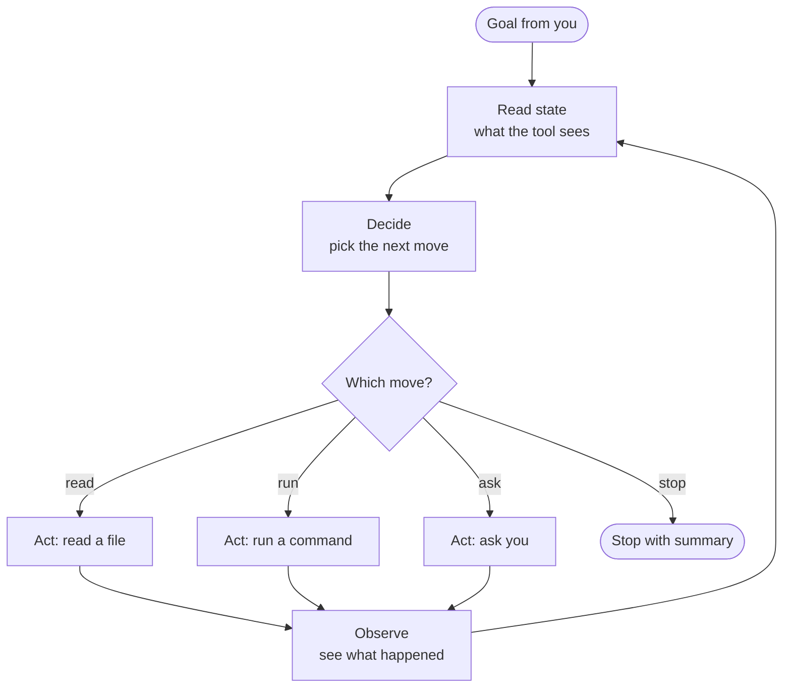

# The Agentic Loop

> Read, decide, act, observe — and repeat until done. The one concept everything
> later in this course hangs on.

**Type:** Learn
**Prerequisites:** Lesson 30 (Sessions, /clear, /compact)
**Time:** ~30 minutes

## Learning Objectives

By the end of this lesson you can:

- name the four steps of the agentic loop
- predict what kind of step the tool is about to take from what you just said
- tell which decisions the tool makes and which you make
- tell the difference between "the model" and "the agent"
- recognize whether the tool is in the "decide" step or the "act" step

## The Problem

A user sits down. They type something. The tool does something they didn't expect. It read a file they didn't ask about. It ran a command. It asked a question in the middle of a task. They thought they were "talking to AI."

The mental model is wrong. The tool isn't a chat partner. It's something with its own internal cycle, and that cycle decides what happens next — including the parts that feel surprising.

Once the cycle is visible, the surprises stop. When the tool asks, it's because it decided to ask. When it acts, it's because it decided to act. When it stops, it's because it decided it was done. Every behavior the user has seen so far — permission prompts, refusals, slowdowns, summaries — falls out of one picture.

This lesson is that picture.

## The Concept

The tool works by repeating a cycle. That cycle is **the agentic loop**. It has four steps.

1. **Read state.** The tool looks at the conversation so far. Your words, its words, the results of any tool calls. This is what it sees at the start of the turn.
2. **Decide.** The tool picks the next move. There are four kinds of moves it can pick.
3. **Act.** It does that one thing. Not several. One.
4. **Observe.** It sees the result. Then the loop runs again from step 1.

The four moves the "decide" step can pick:

- read a file
- run a command
- ask you
- stop

That's the whole menu. Every action the tool ever takes is one of those four.

The diagram is a cycle, not a list. The loop runs until the "decide" step picks "stop." Every turn is one trip around this loop.

### The reframe

**The reframe: You provide a goal. The tool provides the iteration.** That's the division of labor. The user is not in the loop unless the tool asks. The tool chooses the next step each turn — the next read, the next command, the next question, or the stop.

This explains everything the user has seen so far:

- A permission prompt — that's the "act" step. The tool decided to act.
- A question in the middle of a task — that's the "decide" step. It picked "ask you."
- A long pause reading a long file — the "read state" step ran long.
- "Done, here's a summary" — the "decide" step picked "stop."
- A refusal — the "decide" step decided the goal isn't reachable and picked "stop" with a reason.

The user doesn't drive the loop. The tool does. The user sets the destination. The tool picks the route, one step at a time.

### One sentence on model vs agent

The **model** is the part that picks the next move. The **agent** is the loop that wraps the model and runs the four steps around it. They are not the same thing, and later lessons will lean on that distinction.

A "turn" is one trip around the loop. A "tool" is the thing the loop calls when it picks "read" or "run."

## Build It

The reader watches the loop run three times. They don't drive it. They need to see the cycle, not run it.

1. Start a fresh session.
2. Give the tool a goal that requires reading a specific file in the repo. Something like: "What does `package.json` say the test command is?"
3. Watch the tool emit a tool call. That was the "act" step. The "read a file" move.
4. Give the tool a goal that requires a shell command. Something like: "Run the tests and tell me which ones failed."
5. Watch the tool ask permission. That was the "act" step. The "run a command" move. The permission prompt is part of the act, not a separate step.
6. Give the tool a goal it can't satisfy. Something like: "Find the database password in the codebase."
7. Watch the tool stop with a stated reason. That was the "decide" step picking "stop."

End state: the reader has watched the loop run three times. They've seen all four moves — read, run, ask, stop — without doing anything themselves.

## Use It

When something happens in the tool, this is the lookup table.

| What you see                                  | Where the loop is         |
| --------------------------------------------- | ------------------------- |
| The tool is reading a long file               | Read state                |
| A "thinking" block is on screen               | Decide                    |
| The tool is asking you a question             | Decide (picked "ask you") |
| The tool is calling grep / reading a file     | Act (picked "read")       |
| A permission prompt appears                   | Act (picked "run")        |
| The tool is summarizing what it did           | Decide (picked "stop")    |
| The tool says it can't do something           | Decide (picked "stop")    |

If the tool is silent, it's almost always in "decide." If it's producing output, it's in "act" or "observe." If it's waiting on you, the loop is paused on "ask you."

## Exercises

1. **Three-step task.** Give the tool a real goal that needs three moves: read a file, edit a file, run a test. As each tool call appears, label it with the loop step it was.
   Pass: every tool call is correctly identified as read, run, ask, or stop, and the reader can say out loud which step (read state, decide, act, observe) was happening for each one.

2. **Impossible goal.** Ask the tool to do something it can't — read a file that doesn't exist, access a system it has no path to, or recover a deleted branch.
   Pass: the tool stops with a stated reason, and the reader can point to the "decide → stop" move that produced it. The reader does not accept a hallucinated result.

3. **One turn, timed.** Run a single-turn task that takes a few seconds. Watch the wall clock.
   Pass: the reader can name which of the four steps was the slow one. Most of the time it's "act" — the tool call itself dominates wall time. Sometimes it's "read state," when the input is large. Knowing which is which is the start of predicting the tool's pace.

## Key Terms

**The model.** What people say: "the thing that types." What it actually means: the part that decides what the next move is. The model does not read files, run commands, or talk to you. It picks a move; the loop executes the move.

**The agent.** What people say: "the chat tool." What it actually means: the loop that wraps the model. The agent runs the four steps. The model is one step inside the agent.

**A turn.** What people say: "one message from me, one message back." What it actually means: one trip around the loop. A turn can produce zero, one, or many model outputs. The trip ends when the "decide" step picks "stop."

**The agentic loop.** The read–decide–act–observe cycle the tool runs until it decides to stop. The cycle is the agent; the model is the "decide" step.

**Tool.** One of the four moves the loop can pick: read a file, run a command, ask you, or stop. The word "tool" shows up a lot because "read" and "run" are tool calls.

## What this lesson skipped

The context window as a number — that's Lesson 32, and it's where "read state" gets a size. Extending the loop with subagents — that's Phase 06, and it's how one agent becomes many. Observing the loop — logs, traces, hooks — those are later lessons too, and they only make sense once the loop itself is in view. The point of this lesson is the picture: each turn is a trip around a four-step cycle, the tool picks each step, and the user is in the loop only when the tool asks.
