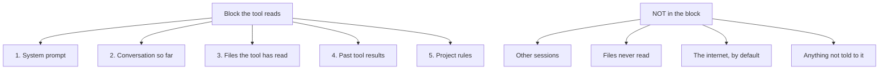

# What Loads Into the Window, and What Doesn't

> Before the tool writes a single word, it reads a block of text. That block is
> its world.

**Type:** Learn
**Prerequisites:** Lesson 31 (The Agentic Loop)
**Time:** ~25 minutes

The block is fixed in size. Roughly the size of a short book, give or take. Everything the tool knows during a turn came from that block. Nothing else is in reach.

## The Concept

The block is filled in this order, top to bottom:

1. The system prompt. Instructions the tool was given before the conversation started.
2. The conversation. Your messages, its messages, in order.
3. Files it has read. Each time the tool calls a tool to read a file, that file lands here.
4. Tool results. The output of every past tool call.
5. Project rules. Anything the project has placed to tell the tool how to behave.

When the tool is about to act, that is the whole picture. The tool does not 'remember' anything outside this block. It does not know about the rest of your computer. It does not know about your other sessions.

## Build It

For this conceptual lesson, the work is one short scenario in a Claude Code session to confirm the section landed:

1. Open a fresh session in any project folder.
2. Apply the idea in the section above to your project in a way that fits.
3. Notice what happens when the condition in the section is met, and when it is not.

Pass: you can describe the difference between the two cases in one paragraph.
## What's not in the block

The block does not contain:

- Your other open sessions.
- Files it has not been told about.
- The internet, unless the tool is the kind that fetches.
- Anything that was not put there this turn or a past turn.

If the tool hasn't read a file, it cannot quote from it. If you opened another terminal in another window, the tool cannot see it. If a coworker changed a file between two of your turns, the tool does not know.

## The block, as a diagram

The box on the right is real. The arrows on the left are also real. They are separate things.

## Learning Objectives

By the end of this lesson you can:

- Name the five categories of content that fill the block at each turn
- Predict what the tool does and does not know about your environment
- Spot when a request requires the tool to read a file it has not yet read
- Explain why the tool can forget an instruction you gave ten turns ago
- Identify which inputs are most expensive to the block's fixed size

## The Problem

You paste a long log into the tool. It reads the log, answers your question. You ask a follow-up about an earlier part of the log. The tool says it does not see that part anymore.

That is not a bug. That is the block filling up. The first half of the log got pushed out by the second half, and the tool is reading from what is left.

The block has a fixed size. Everything in it costs. Long inputs push out earlier content. The tool's behavior when 'out of room' is the budget mechanic, not a fault.

## The reframe

**The reframe:** What the tool sees is a budget. Every tool call, every file read, every system prompt word costs against that budget. When the budget is gone, the tool forgets. It is not losing capability. It is running out of room.

This is the one sentence to remember from this lesson. Hold it.

## What costs the most

Not all inputs cost the same. Rough ordering, cheapest to most expensive per item:

- A line of your message: cheap.
- A system prompt word: cheap.
- A short tool result: medium.
- A long file the tool just read: expensive.
- A giant log dump from a failed command: very expensive.

Long, repeated reads of the same file cost twice: once for the read, again every turn the file is kept around. Tests that print megabytes of output cost every time you run them.

## Why the tool 'forgets'

If you have ever had the tool ask the same question twice in a session, this is why. The earlier answer fell out of the block. The block has a fixed size. When new content comes in, old content leaves. The tool is not being rude. It can no longer see what it said twenty turns ago.

If the tool seems to forget an instruction you gave at the start, that instruction may have been pushed out by something longer that came later. The system prompt is the longest-lasting thing in the block, because it sits at the top. Your first messages are shorter-lived, because they sit below everything you have done since.

## Three practical consequences

**1. The tool can only act on what it can see.** If it edits a file but has never read that file, it is editing blind. Have it read first.

**2. Past errors stay in the block.** A failed command from ten turns ago is still using space. If you are running out of room, the early failures are the first thing to trim.

**3. Project rules matter.** Files like a project memory file get loaded into the block at start. The longer that file is, the less room you have for everything else. Keep it tight.

## Use It

| What you see | Where the cost came from |
|---|---|
| Tool is slow on the first turn after launch | The block is being assembled; system prompt + project rules + first message |
| Tool seems to forget your early instructions | Earlier content was pushed out by later, longer content |
| A long read happens early in the session | That read is sitting in the block for the rest of the session |
| Tool refuses to read a third long file | The first two reads filled the block; the third does not fit |
| You can scroll back and see an old answer in the transcript | The transcript is on disk, but the tool's block is not — the tool cannot scroll back |

## Exercises

1. **Run a long read and watch the block fill.**
   Take a project with at least one source file over 200 lines. In a fresh session, ask the tool to read the file and summarize it. Then ask a question that requires looking at the first 10 lines. The tool can still see them. Now paste a 5000-line log into the same session. Ask the question again. The tool may have lost the first file.
   Pass: you can explain which content fell out and why, naming the size of the file you read and the size of the log you pasted.

2. **Catch the cost ordering in the wild.**
   In a session, do three things in order: send a long message, run a command that returns a large result, ask the tool to summarize a 1000-line file. After each, ask the tool to recall a fact from earlier in the session. Note which one loses the fact first.
   Pass: the file read is the one that costs the most per turn, and you can name the cost ordering from cheapest to most expensive without looking at the table.

3. **Spot the hidden read.**
   In a session, ask the tool to make a small edit. The tool reads the file first without telling you. You see no explicit 'reading' message — only the edit result. State, out loud or in writing: did the tool have to read the file? Where in the block did the read live, and for how many turns?
   Pass: the read happens during the act step, lives in the block for the rest of the session, and costs every turn it sits there.

## Key Terms

| What people say | What it actually means |
|---|---|
| 'The tool forgot what I said.' | Earlier message was pushed out of the block by later content. The tool is not losing capability; it is running out of room. The misconception is that the tool has memory of its own. It does not. |
| 'Context window.' | The fixed-size block. Until Lesson 34 we call it 'the block' or 'the budget.' |
| 'It's hallucinating.' | Usually: it is answering from a partial block where the answer to your question was not present. |

## What this lesson skipped

We have not named the size of the block in numbers. That is Lesson 34. We have not talked about how to clear the block on purpose. That comes after.

This lesson was only about what is in the block, and what is not.
