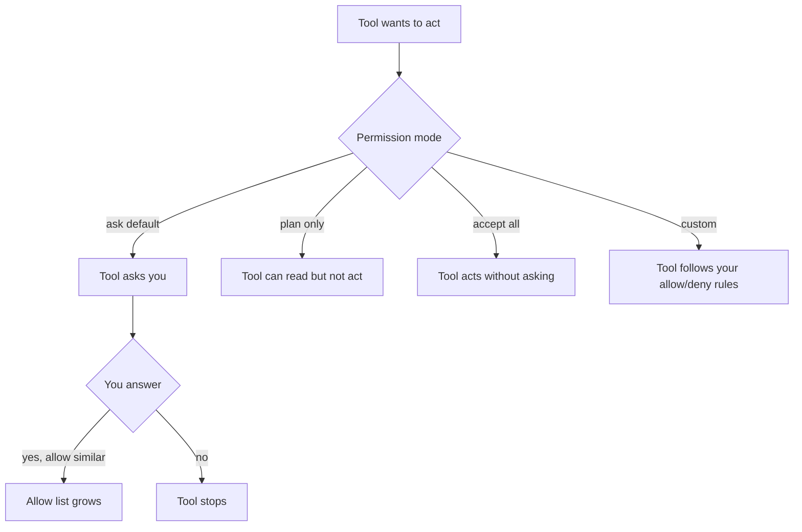

# Permissions and Permission Modes

> Every action the tool takes is a tool call, and every tool call has to pass a
> check. That check is the permission system.

**Type:** Learn
**Prerequisites:** Lesson 32 (What Loads Into the Window)
**Time:** ~30 minutes

The permission system is not security. We will say that again in bold, later. For now, learn what it does.

## The Concept

The permission system has five named parts. Name them out loud:

1. **Tool.** The verb. Read, edit, run a command, search the web. Tools have names.
2. **Allow list.** The tools and paths you have already said yes to. These run without asking again.
3. **Deny list.** The tools and paths the tool is never allowed to touch, even if you ask.
4. **Permission mode.** A named bundle of defaults. The default is "ask." Others change the defaults in a coherent way.
5. **Session-level vs project-level.** Permissions set in this conversation are session-level. Permissions saved to a project file are project-level, and they travel with the project for everyone.

That's the lot. Five things. Most permission confusion comes from mixing up two of them.

## Build It

For this conceptual lesson, the work is one short scenario in a Claude Code session to confirm the section landed:

1. Open a fresh session in any project folder.
2. Apply the idea in the section above to your project in a way that fits.
3. Notice what happens when the condition in the section is met, and when it is not.

Pass: you can describe the difference between the two cases in one paragraph.
## What "ask" means

When the tool wants to do something, it asks. You see the tool name, the path, the command. You say yes or no.

If you say yes once, the next similar action can be allowed without asking, depending on how broad the scope is. A yes to "edit `src/auth/login.py`" is not the same as a yes to "edit any file."

That is why you are sometimes asked again, even after saying yes earlier.

## Permission modes, the diagram

The mode is not a switch you flip and forget. It is the rulebook in effect for this turn.

## Learning Objectives

By the end of this lesson you can:

- Name the five parts of the permission system
- Tell the difference between a permission prompt and the boundary
- Predict when a previous yes covers a new request
- Distinguish session-level from project-level permissions
- Use deny rules to block tools and paths you never want touched

## The Problem

You run the tool on a folder for the first time. A prompt appears: "do you trust this folder?" You say yes. You ask the tool to read `package.json`. The tool asks again. You say yes. You ask it to run `npm test`. The tool asks again. Three prompts, three yeses, no work done.

That is the permission system working. Each ask is a different scope: the folder, the file, the command. The lesson exists to make the scopes visible so you know which yes covers what.

## Allow and deny in practice

Allow and deny can both be set by:

- Answering a prompt (allow, session-level).
- Editing a project file (project-level).
- Choosing a mode that pre-populates them.

Deny always wins over allow. If a tool is on the deny list, it does not run. If a path is denied, no tool touches it. One of the few hard rules in the system.

A useful pattern: deny the things you never want, like destructive flags or writes to secret files. Then allow the rest.

## The reframe

**The reframe:** Permissions are not the security boundary. They are a convenience layer. The directory trust prompt IS the boundary.

The first time you point the tool at a folder, it asks: "do you trust this folder?" That is the boundary. Everything else is finer-grained.

If you trust the folder, the tool can read it. If you do not, you have to grant access turn by turn. The permission modes and allow/deny lists make that work smoother, but they do not change what is trusted. They change how often you are asked.

## Session-level vs project-level

Session-level permissions live in this conversation. They are gone when the conversation is gone.

Project-level permissions live in a project file. They show up for you and for anyone else who opens the project. They are committed.

Pick which kind you want before you start saying yes a lot. Saying yes many times in a session is fine. Saving the same yeses to a file is a different act.

## Three practical consequences

**1. "It didn't ask this time" is not magic.** A previous yes is in scope.

**2. The default mode is fine for most work.** Most surprises come from a different mode being on, not from the default.

**3. Deny paths you do not want touched.** One line per path, fewer surprises later.

## Use It

| Situation | Reach for |
|---|---|
| You want one quick thing done, and you are watching | Default "ask" mode. Answer each prompt. |
| You want the tool to do a long multi-step task without you in the loop | Switch to a more permissive mode for the session. Stay in the session to watch. |
| You want certain paths or tools blocked for everyone on this project | Deny rules in the project's shared settings file. Committed. |
| You want certain paths or tools blocked just for you on this project | Deny rules in your project-local settings file. Uncommitted. |
| You want to undo a "yes" you regret | Stop the tool, rewind to before that step. |

## Exercises

1. **See the difference between the boundary and the convenience layer.**
   Open a folder the tool has not opened before. Note the folder-trust prompt.
   Pass: you can name the boundary (the folder trust prompt) and the convenience layer (the per-action prompts that follow). The boundary is one prompt per folder. The convenience layer can produce many prompts per turn.

2. **Read three prompts and tell what scope each one covered.**
   In a session, do three things in order: read a file, run a command, edit a different file. Read each prompt before answering.
   Pass: for each prompt, you can name whether it was for a path, a tool, or a scope of similar actions.

3. **Deny something on purpose.**
   Pick one path you never want the tool to touch, like `.env` or `node_modules`. Add a deny rule. Try to make the tool read it.
   Pass: the tool refuses, and you can show the rule in the settings file that stopped it.

## Key Terms

| What people say | What it actually means |
|---|---|
| "I blocked the tool." | You put something on a deny list, or you are in a restrictive mode. You did not close the boundary; the boundary was the folder-trust prompt. The misconception is that allow/deny is the security. It is convenience. |
| "It's asking again." | The new request is outside the scope you previously allowed. The scope is per-tool and per-path. |
| "Permission mode." | A named bundle of defaults. The default is "ask." Others relax or tighten the defaults. |
| "Session permissions." | Permissions for this conversation only. They are not committed. |

## What this lesson does not cover

We did not give a full reference table of permission modes. We did not talk about how to script permissions for non-interactive use.

This lesson was about the five parts of the system, and where the boundary actually is.
