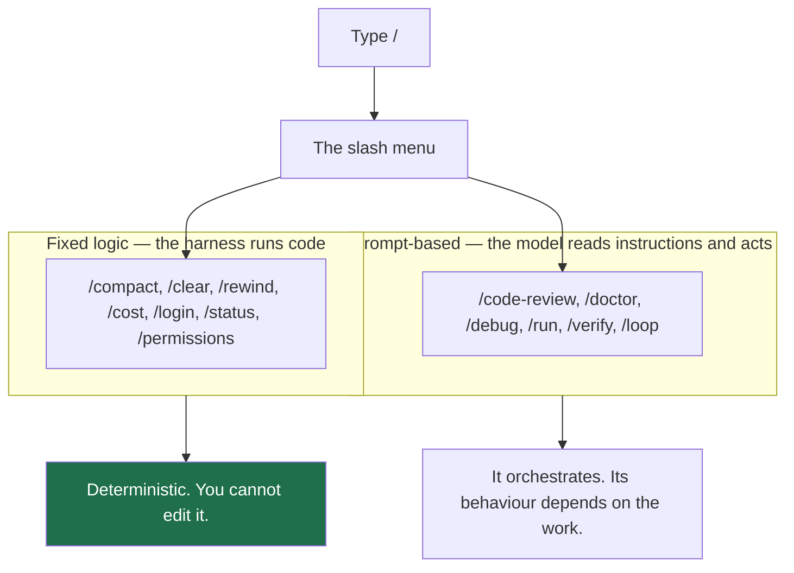

# Built-in Commands

> You can read the `/` menu, tell which entries run fixed code and which hand
> the model instructions, and stop guessing at names that don't exist.

**Type:** Learn
**Prerequisites:** Phase 04, Lesson 37, Troubleshooting — Reading Errors Properly
**Time:** ~30 minutes

---

## Learning Objectives

- Open the `/` menu and find the command you wanted without asking
- Sort any menu entry into "fixed logic" or "prompt-based" and act differently on each
- Reach for `/help`, `/status`, `/skills`, and `/context` at the right moments
- Confirm a command exists on your install instead of assuming it does

---

## The Problem

You type `/review`. Nothing. You try `/code-review`, `/review-changes`,
`/review-changes main`, `/pr-review`. Three of those don't exist. Then you give
up and paste the review instructions you wanted anyway — a paragraph of prompt
text you now retype every single review, which is exactly the job a command is
for.

Nothing warned you. The `/` menu was right there, autocompleting on every
character, and you never opened it.

The cost isn't the four typos. It's the paragraph. **You have retyped the same
instructions more times than you've run them by hand.** The tool already ships
two dozen saved entry points; most people discover three.

---

## The Concept

Type `/` at the start of a message and Claude Code shows you the menu. Everything
on it is invoked the same way — a slash and a name — but **two different
mechanisms sit behind that one surface**.

The docs put it plainly: most built-in commands execute fixed logic directly,
while bundled skills are prompt-based — they hand Claude detailed instructions
and let it do the work with its tools.

So `/compact` always does the same thing. `/code-review` is Claude reading a
checklist, and a bad review is its fault, not a bug in your install.

### Reading the menu

| You want | Do this |
|---|---|
| Find a name that exists | Type `/` and read the list — autocompletion is the search |
| Know what an entry is | Hover/select it; the hint line tells you if it takes arguments |
| Know for sure | Run `/help` |

`/help` is the honest answer to "does this exist". Every guess you make instead
of opening the menu is a guess the menu already answered.

### The handful worth knowing cold

| Command | Job |
|---|---|
| `/help` | The full list, on your install |
| `/context` | Where the window's tokens went |
| `/cost` | What this session has spent (alias of `/usage`) |
| `/status` | What session is loaded, what model, what directory |
| `/permissions` | What the agent may do without asking |
| `/skills` | Which skills are installed — Lesson 40 territory |
| `/doctor` | Health check, and it estimates skill-listing cost |
| `/rewind` | Undo a turn or restore a file |

Learn those eight. The rest you look up.

### Fixed vs prompt-based changes how you debug

| | Fixed logic | Prompt-based |
|---|---|---|
| Deterministic? | Yes | No |
| Can you change it? | No — you can only avoid it or script around it | Yes — that's the next lesson |
| When it goes wrong | Check the harness | Re-read the instructions you're feeding it |
| Tool to inspect | `/help`, `--debug` | The skill's own file |

> **The reframe:** the slash menu is one list but two mechanisms — knowing
> whether an entry runs fixed code or hands the model a prompt tells you
> whether "it went wrong" is a bug or a bad conversation.

Verified against the [commands reference](https://code.claude.com/docs/en/commands)
and the [skills page](https://code.claude.com/docs/en/skills) on 2026-10-15.
Both lists move as Claude Code ships. Run `/help` for yours.

---

## Build It

### 1. Open the menu and count

In any session, type `/` on an empty line.

✅ You pass when you can name at least eight entries and say which two you had
never used before this lesson.

### 2. Sort five entries by mechanism

Take five entries you recognise. For each, write down: fixed logic or
prompt-based? Check `/help` or the docs page for any you're unsure of.

✅ You pass when all five are sorted and you can name the page you checked
against.

### 3. Find the honest names

You want to review a diff. Before typing anything, open the menu and find the
entry that does it. Write down its exact name and any alias.

✅ You pass when you have the exact name plus its alias, or confirmation that
the name you assumed doesn't exist.

### 4. Baseline the window

Run `/context` now, before adding any custom skills to this project. Save the
grid.

✅ You pass when you have a saved "before" grid with the Skills row noted,
including if the row is absent.

### 5. Ask what the menu actually costs

Run `/doctor` and look for the skill-listing estimate.

✅ You pass when you can say in one sentence what the listing is charging you
today, even if the answer is "nothing, because no skills are installed".

---

## Use It

| Command | When you reach for it |
|---|---|
| `/` (bare) | Any time you half-remember a command name |
| `/help` | "Does this exist?" — before you retype the prompt by hand |
| `/context` | Window filling; also baseline before adding skills |
| `/cost` | End of a long session, before starting another |
| `/status` | Session feels wrong; confirm which conversation is loaded |
| `/permissions` | Before a run that touches a lot of files |
| `/skills` | After installing anything in Lesson 43 |
| `/doctor` | Listing costs too much, or something refuses to load |

---

## Exercises

1. Build yourself a cheat sheet of the eight commands above, with one line each
   saying what it answers. Keep it where you'll see it.
   ✅ You pass when you can blank out the "when" column and re-derive it from
   memory within a minute.

2. Invent three plausible command names for tasks you'd want one-liners for.
   Open the menu and mark each one real or fictional.
   ✅ You pass when you have three verdicts and at least one you were wrong
   about — a wrong guess is the evidence the exercise was worth doing.

3. Run `/help` and write down the count of commands listed on your install.
   Run it again next week and compare.
   ✅ You pass when you have two numbers with dates and a one-line note on what
   changed.

---

## Key Terms

| Term | What people say | What it actually means |
|---|---|---|
| slash command | "a shortcut" | Any entry invoked by typing `/name`. One surface, two mechanisms. |
| built-in command | "a command" | Fixed logic the harness runs. Same input, same result. |
| bundled skill | "a command" | Prompt-based: instructions the model follows using its tools. |
| invocation | "running the command" | Putting the slash-name at the start of a message. Mid-sentence is not invocation. |
| alias | "the other name" | A second name for one entry, e.g. `/review` for `/code-review`. |
| "it doesn't exist" | "it's broken" | Usually it was never a name. Open the menu and read. |

---

## What this lesson skipped

**Custom commands and skills.** The whole point of `/` beyond reading it is that
you can add your own entries. That is Lessons 39–44.

**Arguments.** `/deploy staging`, `/code-review 42` — most entries take
arguments and the hint line shows them. Covered where it matters, in Lesson 41's
`arguments` field.

**Hook-driven commands and scheduled tasks.** Both can invoke things on a
schedule or an event. Phase 08 and Phase 12, in that order.

**Aliases beyond the ones listed.** Alias behaviour is documented per-entry and
drifts. Check `/help`.