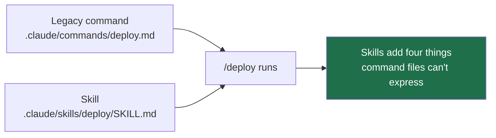

# Why Custom Commands Merged Into Skills

> You can explain why your `.claude/commands/deploy.md` still works, name the
> four things it can never do, and say which one will bite you first.

**Type:** Learn
**Prerequisites:** Lesson 38, Built-in Commands
**Time:** ~30 minutes

---

## Learning Objectives

- Say why a legacy command file and a skill produce the same `/name`
- Name the four capabilities a command file cannot express
- Pick the migration moment for one of your own command files — and the moment to leave it alone
- Explain "custom commands have been merged into skills" without overclaiming

---

## The Problem

You wrote `.claude/commands/ship-it.md` last year. It worked. It runs tests,
builds, deploys staging.

Then you need three things, one at a time:

1. The deploy needs to run a script that lives next to the instructions. The
   command file can't reference it — the file is the whole thing.
2. It needs the file inside it, because `.md` is one blob.
3. Claude keeps triggering it during unrelated work, because a command file has
   a description that goes largely unread.

You convert it twice, both times by hand, both times half-successfully. Nothing
told you the two formats had converged — one just quietly stopped being the
right shape.

The cost is small each time and adds up to an afternoon. The bigger cost is not
knowing *why* the new format is better, so you convert again next year.

---

## The Concept

The docs say it in one line:

> **Custom commands have been merged into skills.**

That means two things, and people routinely hear only the first:



**One: equivalence.** Both files create and run the same command:

```text
.claude/commands/deploy.md
.claude/skills/deploy/SKILL.md
```

Both produce `/deploy`. A legacy file is not deprecated-and-broken. It works.
The docs are explicit that existing `.claude/commands/` files continue to work,
and that there is **no hard removal or breaking-change notice** — this is a
soft direction, with backward compatibility.

**Two: supersession.** Skills accept every field a command file accepts, and two
more — `name` and `paths`. A command file is a skill with the folder removed.

### The four things a command file cannot do

| Capability | Why the old shape can't |
|---|---|
| **Supporting files** | A command is one `.md`. A skill is a *directory*, so it ships scripts, references, templates alongside the instructions. |
| **Frontmatter controls** | `disable-model-invocation` doesn't exist on a command file. You cannot say "only run this when I ask." |
| **Automatic invocation** | Only skills get matched against `description` by the model. Commands wait for you. |
| **Dynamic context injection** | Skills can run `` !`command` `` and ```` ```! ```` blocks to load fresh state at invoke time. |

That last one is the quiet one. A command file is a frozen prompt: whatever it
says about "the current branch" was true when you wrote it. A skill can ask.

### When to migrate

| Migrate | Leave it alone |
|---|---|
| You need scripts or reference files next to the instructions | It's a three-line prompt with no state |
| You need it to run *only* when asked | You want it to be purely manual already and it works |
| It's going to a teammate, or into a plugin | It works and nothing about it is hurting you |
| You're editing it again anyway | It's shared across many files and a rename is risky — migration gains nothing here |

New work goes to `.claude/skills/<name>/SKILL.md`. The docs say so directly.

> **The reframe:** a command file was always a skill that had its folder
> deleted — the merge isn't a new feature bolted on, it's you getting the
> folder back, which is where the scripts and the trigger rules were hiding.

Legacy files accept the same frontmatter **except** `name` and `paths`. Their
command name comes from the filename. That's the whole of the compatibility
surface.

Verified against [the skills page](https://code.claude.com/docs/en/skills) on
2026-10-15. The direction is stable; the field list moves. Check the page
before you quote a field count.

---

## Build It

### 1. Run the same thing twice

Create both files in a scratch project, identical body text:

```text
.claude/commands/warmup.md
.claude/skills/warmup/SKILL.md
```

Run `/warmup` from each.

✅ You pass when both run and produce the same command name from two different
directory shapes.

### 2. Find the field that proves the difference

Add `disable-model-invocation: true` to the skill. Leave it out of the command
file. Try both against a request that would plausibly match.

✅ You pass when you can say which one the model may choose on its own and
which one it may not, from observation rather than from the docs.

### 3. Confirm the two-field gap

Check whether a legacy command file honours `name` and `paths`. Put a `name:`
in the frontmatter of `warmup.md` and see whether it changes anything.

✅ You pass when you can state whether `name` and `paths` are the two fields
the legacy shape drops, and you observed it rather than assumed it.

### 4. Try to add a supporting file

Create a script next to `warmup.md` and have the prompt reference it. Then move
the prompt into the skill folder and reference it from there.

✅ You pass when the first arrangement cannot reach the file and the second
can, and you can say which one that is.

### 5. Audit your own command files

List every `.claude/commands/*.md` you own. Mark each: migrate, or leave.

✅ You pass when every file has a verdict and a one-line reason, and at least
one is "leave it alone".

---

## Use It

| Thing | When you reach for it |
|---|---|
| `.claude/skills/<name>/SKILL.md` | All new work |
| `.claude/commands/<name>.md` | Existing file that works; leave it |
| Migrate when you need a folder | Scripts, references, templates |
| Migrate when you need a trigger rule | `disable-model-invocation` |
| "Merged" | Equivalence today, supersession tomorrow. Not removal. |
| `name` / `paths` | Skill-only fields; a command file ignores them |

---

## Exercises

1. Take one real command file you own. Write the migration as a diff — file
   move, frontmatter change, nothing else — and apply it. Run the command
   before and after.
   ✅ You pass when the command still runs and you can point at the one line
   of the diff that actually bought you something.

2. Write a one-paragraph explanation of "custom commands have been merged into
   skills" for a colleague who has never heard of either format. Then find one
   sentence in it that would still be true if the format later gets removed.
   ✅ You pass when you can quote that sentence and say why it is the one that
   survives.

3. Find one legacy command file — yours, a colleague's, or an installed one —
   and find something it does that the skill form would let you do better.
   ✅ You pass when you have named the capability and shown the command file
   structurally cannot express it, not just "the skill is newer".

---

## Key Terms

| Term | What people say | What it actually means |
|---|---|---|
| merged | "slash commands are gone" | They produce the same command. Legacy files still work; skills are the direction. |
| legacy command | "the old format" | A single `.md` in `.claude/commands/`. Works. Loses `name` and `paths`. |
| skill | "the new format" | A *directory* with a `SKILL.md`. Same invocation, plus a folder to put things in. |
| soft migration | "it's deprecated" | Backward compatible, with a preferred direction. No removal date. |
| automatic invocation | "the model finds it" | Skills only, matched against `description`. Command files wait for your slash. |

---

## What this lesson skipped

**Every frontmatter field.** Twenty-odd of them, and choosing between them is
the whole of the next two lessons. Lesson 41 is the table.

**Where skills live** — personal, project, nested, plugin, synced. Lesson 43.

**`context: fork`.** A skill can run in a forked subagent context. That is
Phase 06 (Subagents); the field appears here so the shape is familiar, but
nothing in this lesson depends on it.

**Dynamic context injection syntax.** `` !`command` `` and ```` ```! ````
blocks were named, not taught. They show up for real in Lesson 44.

**Plugin distribution.** A plugin ships skills, but the packaging layer is
Phase 09.