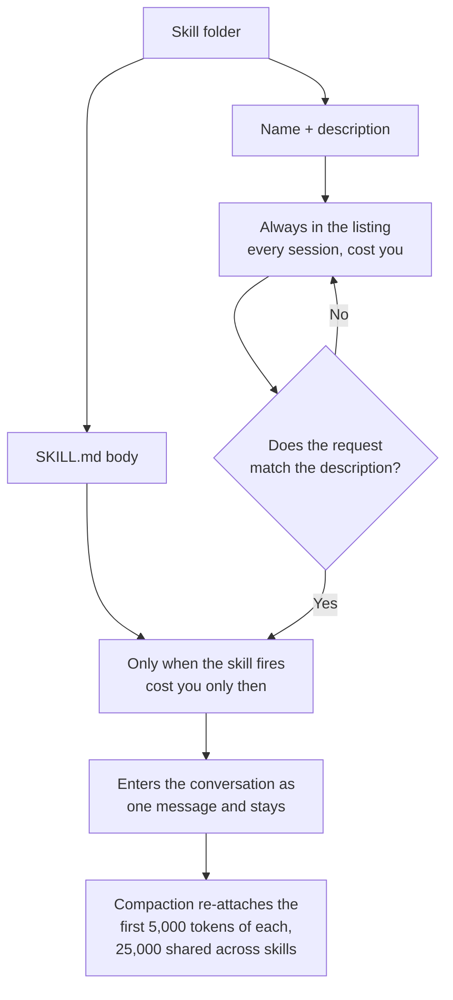

# What a Skill Is

> You can write one, see exactly what it costs your context when it is idle
> versus when it fires, and explain why adding ten of them is not free.

**Type:** Learn
**Prerequisites:** Lesson 39, Why Custom Commands Merged Into Skills
**Time:** ~35 minutes

---

## Learning Objectives

- Create a working skill directory and invoke it two ways
- Measure the difference in `/context` between a skill that is installed and a skill that fired
- Explain why the description is the only part that always costs you
- Put a supporting file next to a `SKILL.md` and load it on demand

---

## The Problem

You have a review checklist. Forty lines. It is good, it has been good for
months, and you paste it into a fresh session every time.

Then you install a colleague's skill. And another. And another. Your window gets
noisier, `/context` shows a Skills row you didn't have before, and you cannot
tell whether the slowdown is the skills or the work.

The instinct is to keep installing: skills are free, they only load when needed.

They are not free. Every skill's **name and description** sit in the window at
all times. Only the body waits. That distinction is invisible until you look at
`/context`, and until you look, "free" is what everyone assumes.

---

## The Concept

A skill is a **directory with a `SKILL.md` in it.** The file starts with YAML
frontmatter, then markdown instructions. Anything else in the directory ships
alongside and is loaded only if the instructions point at it.

```text
.claude/skills/deploy-staging/
├── SKILL.md          the instructions
├── preflight.sh      referenced only when needed
└── deploy-notes.md   referenced only when needed
```

### Two halves, loaded at two different times



This is the whole idea. The listing is what lets Claude *decide* to load
something it has never read. That is only possible if a cheap summary of every
skill is already present.

So a skill costs you **twice**, at two very different prices:

| Part | Loaded | Cost |
|---|---|---|
| Name + description | Every session, always | Small, but multiplied by every skill you own |
| `SKILL.md` body | Only on invocation | The real weight, paid only when you actually need it |

Adding a skill is therefore a trade, not a freebie: you are buying *fewer
retypes* at the price of *some permanent listing cost*. With many skills the
listing gets squeezed — when it exceeds its budget the harness drops whole
descriptions, starting with the skills you invoke least, which quietly removes
the keywords Claude needs to match. That failure is Phase 13's material.

### Two ways it fires

| Who | How |
|---|---|
| You | Type `/name` at the start of a message |
| Claude | Reads the description, decides it's relevant, loads it |

Mid-sentence is not the second one. `go ahead and /deploy to staging` does not
invoke it — it grants Claude *permission* to use the skill while answering.
Without the slash, you're discussing it.

### After it fires

The rendered content enters the conversation as **a single message and stays
there**. Claude Code does not re-read the file on later turns. So:

- Write standing instructions ("run the tests after every edit"), not one-time
  steps ("run the tests"), or it will follow them once and drift.
- If it gets invoked again with identical content, you get a note rather than a
  second copy. With *different* content — different arguments, different
  dynamic output — you get the full body again.

> **The reframe:** a skill is a file that doesn't load until it's needed, so
> the description is the only part you pay for whether you use it or not —
> which makes writing a good description the highest-leverage line in the
> skill.

Where skills can live, and how to install one, is Lesson 43. The frontmatter
fields are Lesson 41. This lesson is the shape.

Verified against [the skills page](https://code.claude.com/docs/en/skills) on
2026-10-15. Budget fractions, caps and re-attach limits are version-gated —
check the page rather than quoting these numbers as permanent.

---

## Build It

### 1. Write the smallest one that works

In a scratch project:

```text
.claude/skills/check-git-status/SKILL.md
```

```markdown
---
name: check-git-status
description: Report the current branch, staged and unstaged changes, and untracked files. Use when the user asks where the working tree stands or whether there is anything to commit.
---

Run `git status --short --branch` and report:
- the current branch
- each staged, unstaged, and untracked path
- whether anything is staged at all

Do not stage or commit anything.
```

Run `/check-git-status`. Then ask Claude "what have I got uncommitted?" in the
same session, without typing the slash.

✅ You pass when you can say whether the second one fired the skill or just
answered from the conversation — and you checked, rather than assumed.

### 2. Measure the idle cost

Run `/context` before the skill exists. Add it. Run `/context` again.

✅ You pass when you have a before and after and can name which row grew.

### 3. Measure the fire cost

Invoke the skill, then run `/context` a third time.

✅ You pass when you can say how much more the window costs while the skill is
loaded than while it was merely listed, and roughly which part is which.

### 4. Add a supporting file

Add `references/staged-what.md` to the folder, with anything at all in it. Have
the skill body point at it with a relative link and tell Claude to read it only
when the user asks about staging.

✅ You pass when the file is not read on a plain invocation, and is read when
you ask the follow-up — observable in what Claude tells you.

### 5. Prove the difference from a legacy command

Copy the same instructions to `.claude/commands/check-git-status.md`. Ask the
same mid-conversation question against each.

✅ You pass when you can say which one the model can choose and which it
cannot, from what you observed.

---

## Use It

| Thing | When you reach for it |
|---|---|
| A skill | A prompt you would otherwise paste more than once |
| `description` | First and last thing you edit on a skill that won't fire |
| Supporting files | Long references, scripts, templates — anything the body only needs sometimes |
| Relative link in the body | Pointing at a supporting file, so it loads on demand |
| `/context` | Before and after installing, to see what it's costing |
| `/skills` | Confirming it loaded at all |
| Middle-of-sentence mention | Granting permission, not invoking |

---

## Exercises

1. Write a skill for something you have retyped at least three times. Keep it
   under 40 lines.
   ✅ You pass when `/name` runs it and its description would make a stranger
   know when to use it.

2. Install it, run `/context`, and record the listing cost. Now write a
   deliberately terrible description — "a helpful skill" — and record again.
   ✅ You pass when you have two measurements and can say which one broke
   automatic invocation and how you know.

3. Take a skill you did not write (a bundled one, or a colleague's) and find
   where its body points at supporting files. Identify one file that was not
   read during your use of it.
   ✅ You pass when you can name the file and say what would have had to happen
   for it to load.

---

## Key Terms

| Term | What people say | What it actually means |
|---|---|---|
| skill | "a plugin" | A directory with `SKILL.md`. No plugin, no manifest, no install step. |
| listing | "loading the skill" | Name + description, present in every session whether or not you use it. |
| body | "the skill" | The `SKILL.md` markdown. Loads on invocation only. |
| supporting file | "an attachment" | Any file in the skill folder, loaded only if the body points at it. |
| invoked | "called" | Slash-name at the start of a message, or Claude deciding the description matches. |
| "it didn't trigger" | "it's broken" | Often the description doesn't contain the words a human would say. |

---

## What this lesson skipped

**Frontmatter.** Every field, and which ones earn their place. Lesson 41.

**Who can invoke it.** Invocation control is two independent switches and its
own lesson. Lesson 42.

**Installing from elsewhere.** Personal scope, marketplaces, plugin skills,
what can go wrong. Lesson 43.

**Writing one well.** Structure, substitutions, the three documented reasons
Claude stops following a skill partway through. Lesson 44.

**Context budgeting.** The listing budget, why descriptions get dropped
oldest-invoked-first, and what to do about it. Real material, but Phase 13
gives it the frame it needs.