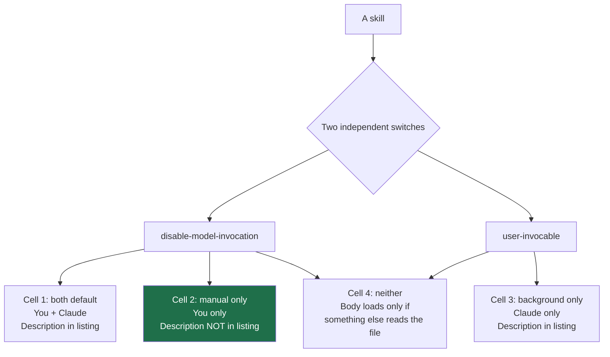

# The Invocation Matrix — Who Can Trigger It

> You can place any skill in one of four cells, predict who will run it and what
> it costs you, without reading the docs again.

**Type:** Learn
**Prerequisites:** Lesson 41, Anatomy — the Frontmatter Field Table
**Time:** ~30 minutes

---

## Learning Objectives

- Place a skill in one of four cells using two independent frontmatter switches
- Predict, before running anything, who may invoke a skill and whether its description is in your window
- Handle a name collision and know what `/apps/web:deploy` means
- Say when a skill should be neither automatically nor directly invocable

---

## The Problem

You write a skill for a workflow you run on Fridays. On Wednesday, mid-refactor,
it fires on its own. It doesn't break anything — but you didn't ask for it, you
can't predict when it'll happen again, and you stop trusting the whole skill
directory.

So you add a switch to stop it. Now it can't fire on its own. And then a
colleague asks you to run it, and typing `/friday-flow` does nothing. You had
one switch and two problems.

The instinct is to find the single "who can run this" field. There isn't one.
There are **two**, they are independent, and conflating them is what produced
the second failure.

---

## The Concept

Two switches. Nothing else controls invocation.

| Field | Set it when | Effect |
|---|---|---|
| `disable-model-invocation: true` | Claude must never choose it | Claude can't auto-load it. **You still can.** Description is also removed from the model's available-skill context. |
| `user-invocable: false` | You should never type it | Hidden from the `/` menu; typing the name does nothing. **Claude still can.** |

Set both and it is neither. That's a real cell, not a paradox — see below.



### The matrix

| Cell | `disable-model-invocation` | `user-invocable` | You can type it | Claude can pick it | In your listing cost |
|---|---|---|---|---|---|
| 1. Both (default) | absent / `false` | absent / `true` | Yes | Yes | Yes |
| 2. **Manual only** | `true` | absent / `true` | Yes | No | No |
| 3. Background only | absent / `false` | `false` | No | Yes | Yes |
| 4. Neither | `true` | `false` | No | No | No |

### Which cell each thing belongs in

| Thing | Cell | Why |
|---|---|---|
| Deploy, commit, push, send mail, delete | 2 | Side effects. A surprise is worse than a keystroke. |
| A review checklist, a style guide | 1 | Both callers, neither is dangerous |
| Project conventions Claude should absorb without you typing | 3 | Reference, not a command |
| Reference material something else reads directly | 4 | Deliberately dormant |

Cell 3 is the one people get wrong. `user-invocable: false` reads like "hide
this" and actually means "Claude, you handle it." A skill nobody types and
Claude never matches is a folder of text — useful only if a hook or another
tool reads it. That is a Phase 08 concern, not a skill concern.

### Cell 2 also saves you money

The docs say a `disable-model-invocation: true` skill has its description
removed from Claude's available-skill context. So a manual-only skill costs you
**no listing budget**. If you own twenty manual-only workflows, they are
effectively free until typed.

That is the whole argument for cell 2 on anything you're not sure about: it is
the reversible one.

### What else can invoke it

Not just you and Claude. A `disable-model-invocation: true` skill is also
prevented from being **preloaded into subagents**, and from running when a
**scheduled task** fires with the skill's name as its prompt. Both are later
phases (Subagents, Orchestration); the point here is that cell 2 is stricter
than just "you, interactively."

### Names, when two skills want the same one

| Where the skill lives | Command name comes from |
|---|---|
| `.claude/skills/deploy-staging/` or `~/.claude/skills/` | `name` field, else the directory name |
| Nested `.claude/skills/` that clashes | Path relative to the working dir, then the name: `apps/web/.claude/skills/deploy/` → `/apps/web:deploy` |
| Legacy `.claude/commands/deploy.md` | Filename, no extension |
| Plugin `skills/review/` | `name`, else directory name — prefixed: `/my-plugin:review` |

`name` wins over the directory name, **unless another command already uses that
name** — then the directory name still invokes it.

> **The reframe:** there is no "who can run this" flag, there are two switches
> that cross to make four cells, and the one that surprises people is that the
> manual-only cell is also the one that costs you nothing.

Verified against [the skills page](https://code.claude.com/docs/en/skills) on
2026-10-15. Name-resolution details are version-gated — check the page when the
collision rules matter.

---

## Build It

### 1. Fill all four cells

One skill. Copy it four times with different names — `cell1` through `cell4` —
one per switch combination.

✅ You pass when all four exist and you have not yet tested any of them.

### 2. Test the user column

In a fresh session, type `/cell1`, `/cell2`, `/cell3`, `/cell4`.

✅ You pass when you can say which two respond and which two are absent from
the menu, and can point at the menu itself as evidence.

### 3. Test the model column

With no slash anywhere, ask for each task in natural language:

```text
I need to run the cell-N workflow now.
```

✅ You pass when you have four results and exactly the two cells you predicted
loaded without a slash.

### 4. Check the listing cost

Run `/context` and look at the Skills row with all four installed. Then delete
the frontmatter `description` from cell2 and cell4 and re-check.

✅ You pass when you can say which descriptions are charged for and why the
manual-only ones are not, in terms of the switch rather than a guess.

### 5. Force a name collision

Create `apps/web/.claude/skills/deploy/SKILL.md` and `.claude/skills/deploy/SKILL.md`.
Find the command that runs each.

✅ You pass when you can name both commands and say which form one of them takes.

---

## Use It

| Situation | Cell |
|---|---|
| It changes the outside world | 2 — `disable-model-invocation: true` |
| You'd rather type it than have it guessed | 2 |
| Claude needs the knowledge, you never would | 3 — `user-invocable: false` |
| Safe either way, and useful both ways | 1 — the default |
| You genuinely want it dormant | 4 — both switches, deliberately |
| Unsure? | Start at 2. It's the reversible one and it's free. |

---

## Exercises

1. Take every skill you own and put it in a cell. Write down any that move as
   a result.
   ✅ You pass when any skill that moved has a one-line reason naming who was
   wrongly able to run it before.

2. Build the cell-4 case on purpose, then deliberately break it: have Claude
   never mention it, never be asked for it, and see whether anything ever reads
   the file.
   ✅ You pass when you can say what, if anything, loaded the body, and what
   would have to exist for the skill to earn its place there.

3. Write a rule — one sentence — that decides cell for every new skill you
   author. Test it against three skills you already own.
   ✅ You pass when the rule gives the same answer for all three, or you can
   say which one it gets wrong and why.

---

## Key Terms

| Term | What people say | What it actually means |
|---|---|---|
| `disable-model-invocation` | "don't auto-run" | Claude can't pick it. You can still type it. Also drops the description from the listing. |
| `user-invocable` | "hidden" | *You* can't type it. Claude still can. |
| manual only | "user-invocable: true" | Cell 2 — the `disable-model-invocation` side. The default for `user-invocable` is true. |
| background only | "auto-only" | Cell 3 — reference knowledge Claude absorbs. |
| preloaded into subagents | "it works everywhere" | Cell 2 skills are explicitly excluded. Phase 06. |
| `/apps/web:deploy` | "a weird command" | Name collision handling: the path is prefixed to the command. |

---

## What this lesson skipped

**Subagents as callers.** A subagent can use a skill; cell 2 excludes preloading
them. Phase 06, lessons 45–48.

**Scheduled tasks.** A scheduled task firing with a skill name as its prompt is
suppressed for cell-2 skills. Phase 12, Orchestration.

**Settings-level overrides.** `skillOverrides` in settings can change listing
visibility and set entries to `"name-only"`. That is context budgeting, and it
belongs to Phase 13.

**Plugin namespacing.** Named so `/my-plugin:review` isn't a surprise. Phase 09.