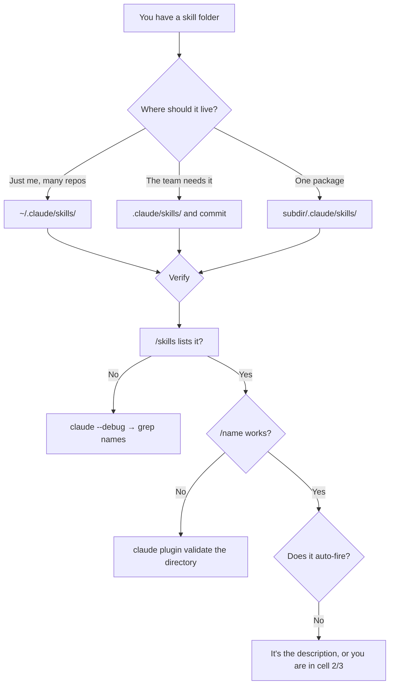

# Install a Skill

> You can install a skill at the right scope, prove it loaded, and recover it
> when Claude Code moves it into the trash without telling you why.

**Type:** Learn
**Prerequisites:** Lesson 42, The Invocation Matrix
**Time:** ~35 minutes

---

## Learning Objectives

- Install a skill at personal, project, or nested scope and say who gets it
- Verify a skill loaded, and identify whether the problem is discovery, YAML, or the name
- Check a skills directory for unparseable frontmatter in one command
- Recover personal skills that were moved to `.trash/`

---

## The Problem

A week ago you had eleven personal skills in `~/.claude/skills/`. Today you have
none. The folders are gone from where they were.

They are not gone. They are in `~/.claude/skills/.trash/`, moved there silently
by a file named `manifest.json` that you — or a tool — dropped into the skills
directory. Before Claude Code v2.1.280, that filename made the harness sweep
every skill folder the file listed into a timestamped trash folder. Those skills
stopped loading. No error. The menu simply had fewer entries.

They stay there for 30 days by default, then a retention sweep deletes them.

Two lessons: personal skills are a directory, not a database, so the failure
mode is file placement — and "it just vanished" is a real reported shape, not
an exaggeration.

---

## The Concept

Installing a skill means putting a folder in one of the documented locations.
There is no install command for the local case. That is the whole of it, and
that is why it can go wrong silently.

| Scope | Where | Who gets it |
|---|---|---|
| Enterprise | managed settings directory | Everyone, policy-managed |
| Personal | `~/.claude/skills/<name>/SKILL.md` | You, every project on this machine |
| Project | `.claude/skills/<name>/SKILL.md` | Anyone who clones the repo — **commit it** |
| Nested / monorepo | `<subdir>/.claude/skills/<name>/SKILL.md` | Loads when working under that subdir |
| Extra directory | `.claude/skills/` under an `--add-dir` path | Whoever granted that directory |
| Plugin | `<plugin>/skills/<name>/SKILL.md` | Anyone who installs the plugin |
| Synced from claude.ai | `~/.claude/skills/synced/` | Downloaded, separate subfolder |
| Legacy command | `.claude/commands/<name>.md` | Same as its containing scope |

Personal skills load across projects on your machine but **not** in cloud
sessions. Project skills load from the starting directory and its parents up to
the repository root; skills *below* the starting directory load after Claude
first reads or edits a file there.

### Which scope

| Use | Scope |
|---|---|
| Your own workflow, every repo | Personal |
| Your team's workflow, versioned | Project — commit it |
| One package of a monorepo | Nested |
| Anything you want to hand to a colleague | Project or plugin, never personal |

If a skill only works on your machine, personal is right. If someone else needs
it, personal is the wrong scope by definition — they will not see it.



### Verifying, in the right order

Ask these in sequence. Each rules out one failure and hands you to the next.

| Step | Command | Tells you |
|---|---|---|
| 1 | `/skills` | Is it discovered at all |
| 2 | Ask "What skills are available?" | Is the description present to the model |
| 3 | `/name` | Does it load and run |
| 4 | `claude plugin validate <dir>` | Do any `SKILL.md` files have unparseable frontmatter |
| 5 | `claude --debug`, grep for `[names]` | Was a name refused |

Step 4 needs Claude Code v2.1.233 or later. If yours is older, skip to step 5
and read the debug log by eye — which is the situation most people are in
without knowing it.

After a rename or a `name:` edit, **restart the session** unless the file sits
in a directory Claude Code watches for changes. `/reload-skills` is in the
command menu; try it, and if your build doesn't do what you expect, restart.

### The trash

`~/.claude/skills/.trash/` is where swept skills land, in a timestamped folder.
Recovery is a move:

```text
~/.claude/skills/.trash/2026-10-08T14-22-11/my-skill/
  → ~/.claude/skills/my-skill/
```

Do it before 30 days pass. After that the retention sweep takes them.

> **The reframe:** installing a skill is placing a folder, so every failure
> here is a placement failure — discovered by asking three questions in order,
> not by reading a stack trace that never comes.

Verified against [the skills page](https://code.claude.com/docs/en/skills) on
2026-10-15. The trash incident and the `claude plugin validate` minimum version
are both version-gated; re-read the troubleshooting section before repeating
either as fact.

---

## Build It

### 1. Install at both scopes, on purpose

Put the same skill in `~/.claude/skills/` and in `.claude/skills/` of a scratch
project.

✅ You pass when you can say which one your teammates would receive and which
one you would, from the scope table rather than from a guess.

### 2. Verify in order, not in one jump

Run `/skills`, then ask "What skills are available?", then `/name`. Stop at the
first failure and record which step failed.

✅ You pass when you have a named step that failed and the command that proved
it — not just "it didn't work".

### 3. Break the YAML and find the right command

Insert a malformed line into the frontmatter. Run `/name` (still works) and then
a natural request (doesn't fire). Run `claude plugin validate` on the
directory.

✅ You pass when the validator names the file and you can explain why `/name`
still worked anyway.

### 4. Break the name

Rename a skill folder so its name holds a character Claude Code refuses — a
zero-width space or a `<`. Look in the menu, then in `claude --debug` for
`[names]`.

✅ You pass when the debug log names the refused character and you can say why
the skill vanished entirely rather than merely failing to fire.

### 5. Simulate the trash

Create `~/.claude/skills/.trash/2026-10-08T14-22-11/`, move a skill into it, and
confirm the skill is gone from the menu. Move it back and confirm it returns.

✅ You pass when you have the before and after `/skills` output for the move and
the move-back.

### 6. Restart vs reload

Edit a `description` in place and run `/reload-skills`. If nothing changes,
restart the session and check again.

✅ You pass when you can say which mechanism actually re-read the file on your
install, and your answer is observed rather than assumed.

---

## Use It

| Thing | When you reach for it |
|---|---|
| `~/.claude/skills/` | Personal, machine-wide, never committed |
| `.claude/skills/` | Team-facing — commit it |
| `<subdir>/.claude/skills/` | One package of a monorepo |
| `/skills` | First question when a skill "isn't there" |
| `claude plugin validate <dir>` | Frontmatter you suspect is malformed |
| `claude --debug` + `[names]` | A skill missing from the menu entirely |
| `/doctor` | Listing too expensive, or a suspected sync problem |
| `~/.claude/skills/.trash/` | A skill folder that vanished |

---

## Exercises

1. Install one skill at project scope in a real repo, commit it, and hand the
   path to a colleague or a fresh clone.
   ✅ You pass when the clone loads it and you can state the one line of the
   install that makes the difference.

2. Take every skill you own and check its scope. Move at least one to a
   different scope.
   ✅ You pass when you can say which scope was wrong and what specifically
   broke because of it — a teammate not seeing it, or a stale global skill.

3. Break a skill four ways — wrong folder, bad YAML, refused name, missing
   directory — and record which command diagnosed each.
   ✅ You pass when you have a table of four failures with the command that
   named each one, and none of them say "restart and hope".

---

## Key Terms

| Term | What people say | What it actually means |
|---|---|---|
| install | "adding a plugin" | Copying a folder to a documented path. No install step. |
| personal scope | "global" | `~/.claude/skills/`. This machine, this user. Not cloud. |
| project scope | "repo" | `.claude/skills/`, committed. What teammates get. |
| "it's not showing up" | "the install failed" | Four different causes, four different commands. Ask `/skills` first. |
| `.trash/` | "it deleted my skills" | Swept to a timestamped subfolder, recoverable until the retention sweep. |
| `claude plugin validate` | "the linter" | Finds `SKILL.md` files whose frontmatter doesn't parse. v2.1.233+. |

---

## What this lesson skipped

**Marketplace installation.** `/plugin marketplace add` and friends. The plugin
is the packaging layer and Phase 09 owns it.

**Synced skills from claude.ai.** They land in `~/.claude/skills/synced/`, are
prefixed `anthropic-skills:`, and have their own behaviour. Real, and Phase 09
again.

**Enterprise and managed-settings scope.** Policy-managed, not yours to place.

**Settings-level overrides** (`skillOverrides`, `"name-only"` entries) and the
listing budget. Phase 13.