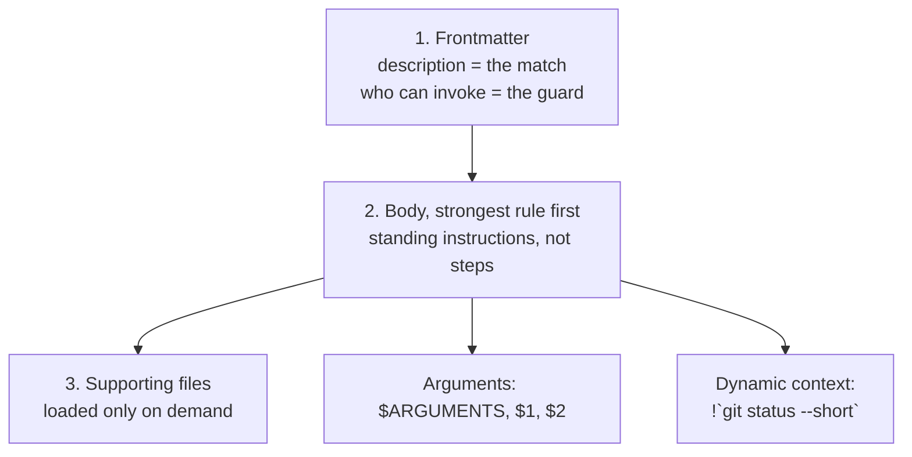

# Author a Skill From Scratch

> You can write a skill someone else can use without reading your head: matching
> description, standing instructions, arguments, on-demand files, and the three
> documented reasons it silently stops being followed.

**Type:** Build
**Prerequisites:** Lesson 43, Install a Skill
**Time:** ~50 minutes

---

## Learning Objectives

- Author a `SKILL.md` that passes every check in the runnable script in `code/`
- Write instructions as standing rules, so they survive turn fifteen
- Pass arguments into a skill and load supporting files only when needed
- Diagnose "it fired once and then stopped" from the three documented causes

---

## The Problem

Your pasted review checklist worked. Then it didn't.

Turn one, Claude runs the whole thing. Turn fifteen, it's reviewing files without
running the check you spent forty lines writing. Nothing broke. Nothing errored.
The skill is still installed, still in the menu, still described correctly.

You have three real causes and no way to tell them apart, because all three
present as "Claude quietly stopped obeying":

- The rule was written as a **one-time step**, so after it ran once it was done.
- The conversation was **compacted**, and only the start of the skill came back.
- The rule **must hold every time**, and a prompt is a request, not enforcement.

The first is a wording bug you can fix. The third is a phase you haven't reached
yet. The second is why "keep the important stuff at the top" is a real
instruction and not folklore.

---

## The Concept

A skill is a maintained prompt. Three parts, in this order of importance.



### The description is a matching rule, not a label

It decides whether the skill exists for a given request. Write the words a human
would type, and put the key use case first — `description` + `when_to_use` is
truncated at 1,536 characters in the listing.

> ✓ "Run the project's full check suite. Use when the user says run the tests,
> verify, check this, or before any commit."
>
> ✗ "A skill for testing. Helpful for developers."

### Write standing instructions

The rendered body enters the conversation as **one message and stays there**.
The file is **not re-read on later turns**. So the body describes what should be
true for the whole task:

| Don't write | Write |
|---|---|
| "Run the tests." | "Run the tests after every edit." |
| "Check the error handling." | "Every error path you add must have a test that fails without it." |
| "Use the project's formatter." | "Before reporting done, format every file you touched." |

Same length. Completely different lifespan.

### Keep the important part at the top

After compaction, Claude Code re-attaches the most recent invocation of each
skill and keeps the **first 5,000 tokens** of each, with a **25,000-token**
combined budget, filling from most-recently-invoked — so older skills can be
dropped entirely if you invoked many.

Put the rule that must not be lost at the top of the file.

### Arguments

`argument-hint` shapes autocomplete. `arguments` names positions. The body
substitutes them.

```markdown
---
name: fix-issue
description: Fix a GitHub issue end to end.
argument-hint: "[issue-number]"
arguments: issue
disable-model-invocation: true
---

Issue to fix: $issue

1. Read the issue, reproduce the failure.
2. Fix it. Test before reporting.
3. Report the diff and the test output.
```

`$ARGUMENTS` is the whole raw argument string. Positional `$1`, `$2` map to the
`arguments` names in order.

### Dynamic context

The difference between a frozen prompt and a live one:

````markdown
Current state, fetched fresh each time:

!`git status --short`
````

```bash
!`git log --oneline -5`
```

The command runs at invoke time and its output enters the conversation. This is
what a legacy command file cannot do — and the reason "the current branch is
`main`" belongs here rather than in the text.

### Supporting files

Anything else in the folder ships alongside. Point at it with a relative path and
tell the model when to read it. It costs nothing until then.

```text
.claude/skills/review/
├── SKILL.md
└── references/
    └── security-checklist.md
```

### The three reasons it stops being followed

| Symptom | Cause | Fix |
|---|---|---|
| Followed turn one, not turn fifteen | Guidance read as a one-time step | Rewrite as standing instructions |
| Followed, then the conversation compacted | Only the skill's first 5,000 tokens come back | Strongest rule at the top |
| Skipped a rule that must hold every time | A prompt is a request | A hook (Phase 08) enforces it |

The third is the honest limit of this whole phase. If it must hold every time,
write it down here and *also* plan the enforcement; do not expect prose to do it.

> **The reframe:** a skill is a prompt you now maintain, so its quality is
> judged by what it prevents — the rule at the top that survives compaction and
> the standing instruction that still applies on turn fifteen, not by how
> thorough the prose reads.

Verified against [the skills page](https://code.claude.com/docs/en/skills) on
2026-10-15. Token caps, minimum versions and the `validate` command age; the
shape does not.

---

## Build It

There is a runnable checker in this lesson's `code/` directory. Use it.

```bash
node code/check-frontmatter.mjs .claude/skills/review
```

### 1. Start from the template

Copy `code/SKILL.md` into a scratch project at
`.claude/skills/review/SKILL.md`. Run the checker on it.

✅ You pass when the checker reports no problems and you can name each check it
ran.

### 2. Write the description last, and write it wrong first

Put "A skill for reviewing code." Run it against three natural requests a
reviewer would type. Then rewrite it with the words those requests use and run
the same three again.

✅ You pass when at least one request changed outcome, and you can quote the
words you added.

### 3. Convert one step into a standing rule

Take a line the body gives as a step. Rewrite it so it holds for the whole task.
Invoke the skill, ask for a second file, and see whether it still applies.

✅ You pass when you can quote the second-turn behaviour and say which phrasing
produced it.

### 4. Move your strongest rule to line one of the body

Put the must-not-be-lost rule first. Compact the session. Check what came back.
Move the same rule to the bottom and repeat.

✅ You pass when you can say which position survived and why, using the cap
rather than intuition.

### 5. Add an argument and a dynamic command

Add `argument-hint`, `arguments`, and one `` !`git status --short` `` line.
Invoke with an argument.

✅ You pass when the argument appears in the body and the git output is current
rather than the state from when you wrote the file.

### 6. Add a supporting file

Move the longest checklist into `references/`. Point at it. Confirm it isn't
read on a plain invocation and is read when you ask for the security review.

✅ You pass when you can show both states, and `/context` shows no cost for a
run where it never loaded.

### 7. Run the checker on a deliberately broken skill

Break four things: the opening `---` not first, an unterminated block, an
unknown field, a name with a `<` in it.

✅ You pass when the checker finds all four and names the line for each.

---

## Use It

| Thing | When you reach for it |
|---|---|
| `description` | First and last thing you edit on a skill that won't fire |
| `when_to_use` | Trigger phrases that would bloat `description` |
| `disable-model-invocation: true` | Anything with side effects |
| `argument-hint` / `arguments` / `$name` | Any skill that takes input |
| `` !`command` `` | Anything the skill asserts about *current* state |
| `references/` + relative link | Long checklists you don't want in the window |
| Strongest rule at the top | Any skill you expect to survive compaction |
| `code/check-frontmatter.mjs` | Before you commit a skill |
| A hook | When a rule must hold every time and a prompt is not enough |

---

## Exercises

1. Author a real skill for a workflow you actually run. Under 60 lines. Share
   it with one person who has to use it without you explaining anything.
   ✅ You pass when they run it correctly with no follow-up question from you,
   and you can point at the lines that made that possible.

2. Break your own skill three documented ways — one-time phrasing, weakest rule
   at the top, a must-hold-every-time rule. For each, record the symptom before
   you fix it.
   ✅ You pass when you have symptom-then-fix for all three and can say which
   one no amount of wording will fix.

3. Take a skill you did not write. Improve only its `description`, measure
   before and after across five realistic requests, and report the numbers.
   ✅ You pass when you have five before/after results and at least one change
   in either direction — a measurement that never moves means the description
   was not the problem.

---

## Key Terms

| Term | What people say | What it actually means |
|---|---|---|
| `SKILL.md` | "the prompt file" | YAML frontmatter, then markdown. One message, kept in the conversation. |
| standing instruction | "a rule" | Wording that applies for the whole task. The opposite of a step. |
| `$ARGUMENTS` | "the input" | The raw argument string. `$1`, `$2` are positional. |
| `` !`cmd` `` | "an include" | Runs at invoke time. Output enters the conversation now, not when you wrote it. |
| supporting file | "an attachment" | Loads only if the body points at it. The cheapest way to hold detail. |
| first 5,000 tokens | "it got truncated" | Per-skill re-attach budget after compaction. Put the important rule first. |
| prompt vs hook | "the skill should enforce this" | A prompt asks. A hook enforces. Different phases. |

---

## What this lesson skipped

**Running a skill in a subagent.** `context: fork`, `agent`, `background`, and
what changes when a skill no longer shares your window. Phase 06, lessons 45–48.

**Skills inside subagents.** The genuinely confusing case, and its own lesson.
Phase 06.

**Enforcement.** If a rule must hold every time, a prompt is the wrong tool.
Phase 08, hooks — including the `hooks` frontmatter field that keeps a hook
alive for the session.

**Packaging.** A skill plus hooks plus subagents as one installable unit is a
plugin. Phase 09.

**Listing budget tuning.** `skillListingBudgetFraction`, `skillOverrides`,
`name-only` entries. Phase 13.