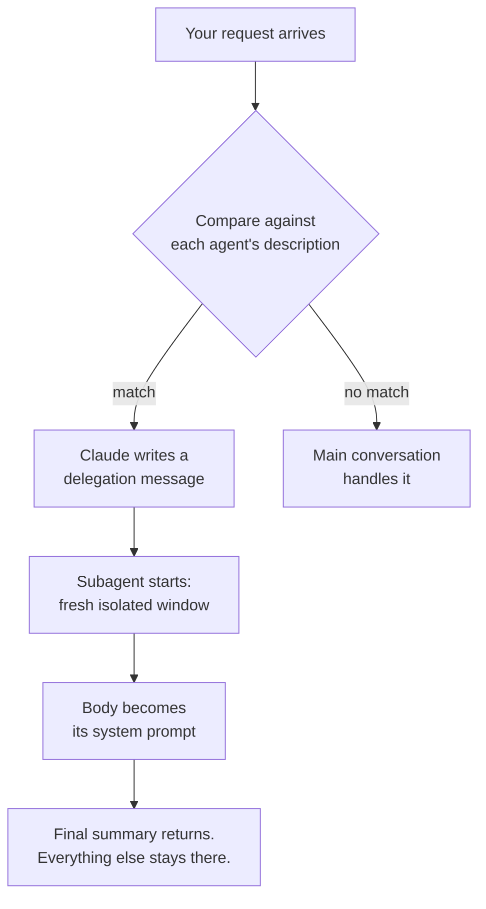

# Subagent Markdown Format

> You can write a subagent that Claude picks for the right job — and you know
> which field did the picking.

**Type:** Learn
**Prerequisites:** Phase 01 Lesson 8 (The Context Window), Phase 04 Lesson 31 (The Agentic Loop), Phase 05 Lesson 41 (Skill Frontmatter)
**Time:** ~30 minutes

---

## Learning Objectives

- Write a subagent file from memory: frontmatter block, then a Markdown body
- Say which field controls *routing* and which controls *behaviour*, and not mix them up
- Restrict a subagent's tools with one line
- Point at the file, from a file, and tell which of the five scopes wins

---

## The Problem

An agent was asked to review a 400-file repo for one specific class of bug. It
read ninety files into the conversation, found nothing it could prove, and came
back with a nine-paragraph essay about code quality in general.

Nothing crashed. The review was *plausible*. The problem is that ninety file reads
landed in the same window as the conversation — the window from Lesson 8, the one
budget for instructions, tool definitions, file reads, and chat alike. By the
time the agent wrote its conclusion, the two actual bugs it had spotted at file
twelve were a summary line in a compacted history.

The same task, done as a separate agent with its own window, would have carried
all ninety reads, held the findings in context to the end, and handed back a
five-line answer.

The gap between those two runs is a Markdown file. This lesson is that file.

---

## The Concept

A subagent is a Markdown file. YAML frontmatter, then a body. The body becomes
the agent's system prompt — it replaces the normal Claude Code system prompt
rather than adding to it.

```markdown .claude/agents/code-reviewer.md
---
name: code-reviewer
description: Reviews code for quality and best practices
tools: Read, Glob, Grep
model: sonnet
---

You are a code reviewer. When invoked, analyze the code and provide
specific, actionable feedback on quality, security, and best practices.
```

That's it. There is no schema file, no registration step, no build. Put the file
in the right folder and the next session knows it exists.

### Two fields doing two different jobs

The single most common authoring mistake is putting the same content in both
places. Split them:

| Field | Job | Reads like |
|---|---|---|
| `description` | **Routing.** When should Claude hand work to this agent? | "Use proactively after any change to an API handler." |
| Markdown body | **Behaviour.** What does it do once it starts? | "You are a reviewer. Run git diff. Report by priority." |

`description` is the only thing Claude reads *before* it decides. It is compared
against your request and the current context. If it doesn't say *when*, Claude
will never pick the agent — no matter how good the body is.

And the body is never seen until after that decision. If you put the trigger
conditions in the body, it is too late: Claude already decided not to run it.

### The frontmatter field reference

`name` and `description` are the only two required fields. Everything else is
optional.

| Field | What it does | Notes |
|---|---|---|
| `name` | Unique identifier. Max 256 chars, no `:`. | Identity comes from here, **not** the filename. |
| `description` | When Claude should delegate. | Keep short — see the budget below. |
| `tools` | Allowlist, comma-separated or a YAML list. | Omit it to inherit what subagents get. |
| `disallowedTools` | Denylist, removed from the inherited pool. | Applied **first**, then `tools` resolves. |
| `model` | `sonnet`, `opus`, `haiku`, `fable`, a full ID, or `inherit`. | Teach the alias. Aliases don't age. |
| `permissionMode` | `default`, `acceptEdits`, `auto`, `dontAsk`, `bypassPermissions`, `plan`, `manual`. | |
| `maxTurns` | Cap on agentic turns before partial output returns. | |
| `autoCompactWindow` | Token count, `100000`–`1000000`, at which this subagent compacts. | Phase 04 Lesson 30 owns the concept. |
| `skills` | Names of skills whose **full content** is preloaded. | Lesson 48 does this properly. |
| `mcpServers` | MCP servers available to this subagent. | Phase 07. Named here only so the field isn't a surprise. |
| `hooks` | Lifecycle and tool hooks scoped to this subagent. | Phase 08. |
| `memory` | `user`, `project`, or `local`. | Phase 10. |
| `background` | `true` keeps it running in the background where possible. | |
| `omitClaudeMd` | `true` drops user, project, and local `CLAUDE.md` at startup. | Managed policy files still load. |
| `effort` | `low`, `medium`, `high`, `xhigh`, `max`. | Phase 03 Lesson 21. |
| `isolation` | `worktree` runs it in an isolated temporary Git worktree. | Phase 11 / 16. |
| `color` | One of the eight session colours. | Cosmetic. |
| `initialPrompt` | Prompt auto-submitted when this agent is the main session agent. | |
| `experimental` | Currently `cacheTtl: 5m` or `1h`. | Moves. Read the docs before using. |

Unrecognized fields are **silently ignored**. A typo doesn't warn you. If a field
seems to do nothing, check the spelling before assuming the feature is broken.

### The description budget

Descriptions load into the *main* session's context — every one of them, whether
or not it ever runs. If your custom descriptions pass **15,000 tokens** combined,
Claude Code shows a startup warning and still loads them all.

That is a real budget with a real cost, and it is the reason descriptions stay
short. Detail goes in the body.

### Where the file goes

| Priority | Location | Scope |
|---:|---|---|
| 1 | Managed settings `agents/` | Organization-wide |
| 2 | `--agents` CLI flag | This session |
| 3 | `.claude/agents/` | This project |
| 4 | `~/.claude/agents/` | This user, all projects |
| 5 | An enabled plugin's `agents/` | Where the plugin is enabled |

- Project and user directories are scanned **recursively**.
- Project agents are discovered walking upward from your current directory to the
  repo root.
- For a duplicate `name` in nested project scopes, the definition **closest to
  the working directory wins**.
- Plugin subfolders become part of the name: `my-plugin:review:security`.

Nested directories are just organization. They don't scope anything by
themselves — only the file location does.



That last box is the whole point. What the subagent did not need to say back, it
does not say back.

> **The reframe:** a subagent is a Markdown file whose `description` decides
> whether it runs and whose body decides what it does — put the trigger in the
> first and the instructions in the second, or the agent is either never picked
> or picked for the wrong reason.

Claude Code ships weekly and this field list moves. Check
[the subagents page](https://code.claude.com/docs/en/sub-agents) and
`https://code.claude.com/docs/llms.txt` before trusting a row here.

---

## Build It

### 1. Write the smallest valid subagent

```bash
mkdir -p .claude/agents
```

Create `.claude/agents/note-taker.md`:

```markdown
---
name: note-taker
description: Records one-line decisions from the conversation. Use after any design choice is made.
---

When invoked, list the decisions made in the task you were handed. One line
each, with the reason. Nothing else.
```

Restart the session — agent definitions are discovered at startup.

✅ You pass when `@` shows `note-taker` in the typeahead.

### 2. Prove the description is doing the routing

Look at what you wrote. `description` says *when*; the body says *what*. Now
break it on purpose: change the description to `description: A helpful agent`.

Restart. Ask the agent something that obviously needs note-taker. It handles it
in the main conversation.

✅ You pass when you can state, without looking, which line you broke and why
that line was load-bearing.

### 3. Restrict the tools

Add a read-only agent at `.claude/agents/repo-scout.md`:

```markdown
---
name: repo-scout
description: Finds files and reports paths only. Use when asked where something lives. Read-only.
tools: Read, Glob, Grep
model: haiku
---

Find the files relevant to the request. Report paths and one-line descriptions.
Never edit. Never suggest edits.
```

The omitted `Edit` and `Write` are not merely discouraged — they are not in the
tool pool at all.

✅ You pass when the agent completes a search and reports that it cannot edit,
naming the missing tool rather than "being careful".

### 4. Test the two directions of restriction

Create `.claude/agents/no-writes.md` with `disallowedTools: Write, Edit` and no
`tools` field. It inherits everything else.

Now think about which you would pick for "review this, then apply the trivial
renames". Only one of the two can apply the renames.

✅ You pass when you can say which file permits edits and which forbids them,
and name the field that does it in each.

### 5. Check the description budget

```bash
node -e "const fs=require('fs');for(const f of fs.readdirSync('.claude/agents')){const m=fs.readFileSync('.claude/agents/'+f,'utf8').match(/^description:\s*(.*)$/m);console.log(f, m? m[1].length : 'NO DESCRIPTION')}"
```

Rough token count is characters ÷ 4. Check yours against the 15,000-token
combined warning threshold.

✅ You pass when every agent file has a description and the total is well under
the threshold, or you have a reason it isn't.

### 6. Find out which scope actually won

Create `~/.claude/agents/note-taker.md` with a different description from the
project one. Both exist. Restart.

✅ You pass when the project-level definition is the one in effect, and you can
name the rule — closest to the working directory wins.

---

## Use It

| Field / move | When you reach for it |
|---|---|
| `description` | Whenever Claude *isn't* picking the agent you wrote. First suspect. |
| Markdown body | Whenever the agent runs but does the wrong thing. |
| `tools:` allowlist | Read-only work, review, anything that should not touch your files. |
| `disallowedTools:` | You want the full pool minus one tool. |
| `model:` | A cheap job that doesn't need your main model. Aliases, never IDs. |
| `maxTurns` | An agent that would otherwise explore forever. |
| `.claude/agents/` | Anything your team should share — it commits. |
| `~/.claude/agents/` | Personal agents, available in every project. |
| `--agents` JSON | One-off, session-only. The prompt is `prompt`, not the body. |
| `omitClaudeMd: true` | The project rules are noise for this agent. |

---

## Exercises

1. Write `lesson-auditor.md` — reads files under `phases/`, reports which
   lessons lack a pass criterion, changes nothing. Then deliberately remove the
   `tools` line and see what it does now.
   ✅ You pass when you can state, from the tool list alone, whether the agent
   *can* edit, and what the removal changed beyond the risk.

2. Make two agents with the same `name` in `.claude/agents/` and
   `.claude/agents/nested/`. Figure out which one Claude Code loads and why.
   ✅ You pass when you have the correct winner and can name the rule that
   decided it in one sentence.

3. Take an agent you like and cut its `description` in half, moving the removed
   half into the body. Test both versions against three realistic prompts.
   ✅ You pass when you can say which version routed more reliably, and the
   routing wasn't luck — you checked three prompts, not one.

---

## Key Terms

| Term | What people say | What it actually means |
|---|---|---|
| subagent | "a second Claude" | A separate agentic loop with its own window, its own tool list, its own model. It returns a summary. |
| delegation message | "the prompt you gave it" | Written by Claude from your request and the agent's `description`. You usually don't write it. |
| body | "the prompt" | Markdown after the frontmatter. It *replaces* the Claude Code system prompt for that agent. |
| `description` | "documentation" | The routing input. Read before the decision to delegate. |
| `tools` | "permissions" | The pool. Not in the list, not callable. Distinct from your permission settings. |
| `disallowedTools` | "a blacklist" | Applied first; `tools` resolves against what's left. |
| silent failure | "it's a bug" | Unrecognized frontmatter fields are ignored with no warning. Check spelling first. |

---

## What this lesson skipped

**Fork context.** A subagent normally starts with an empty window. There's one
case where it inherits everything instead, and it changes which agent you want.
That's Lesson 47.

**The built-in agents.** `Explore`, `Plan`, `general-purpose`. Two of them skip
your `CLAUDE.md` for a reason that surprises people. Lesson 46.

**Skills inside subagents.** The `skills` field is listed above and means
something specific and non-obvious. Lesson 48.

**Worktree isolation.** The `isolation: worktree` field is Phase 11 and 16. The
only thing worth knowing here: it changes where *files* land, not what lands in
the window.

**Permissions in depth.** `permissionMode` exists. What each mode does to the
agentic loop is Phase 04 Lesson 33 and Phase 08.

**Prompt caching.** A subagent's first request is a cold cache unless it shares a
parent's. Real cost, not yet actionable — Phase 03 Lesson 22.