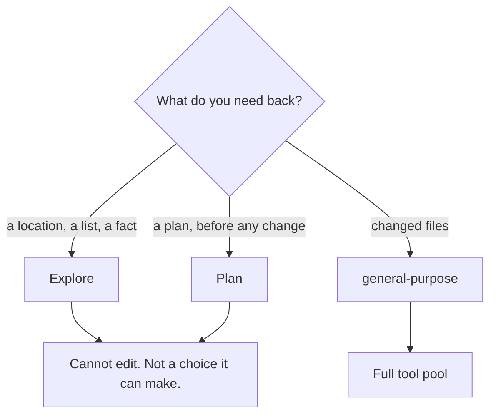

# Built-in Subagents — Explore, Plan, general-purpose

> You can say which of the three built-ins a task needs without reading the
> docs — and know why two of them ignore your CLAUDE.md.

**Type:** Learn
**Prerequisites:** Lesson 45, Subagent Markdown Format; Phase 04 Lesson 31 (The Agentic Loop)
**Time:** ~30 minutes

---

## Learning Objectives

- Pick between `Explore`, `Plan`, and `general-purpose` for a given task in one sentence
- Say what "read-only" means there — absent from the pool, not discouraged
- Explain why `Explore` and `Plan` start without `CLAUDE.md` and git status
- Name when a built-in is the wrong tool and a skill or a fork would be better

---

## The Problem

Somebody asked Claude to "find everywhere we call the pricing function and tell
me if any of them look wrong." Claude read forty files into the main conversation,
answered from what it had, and was confidently incomplete — three of the call
sites lived in files it never opened, because the conversation window was
already full of the forty files it *had* opened.

Then, three days later, the same person added a `no-pricing-changes` rule to
CLAUDE.md and asked for the same review. This time Claude honoured the rule
sometimes — in the main conversation. When it delegated to an agent to do the
searching, the agent didn't see the rule at all, because one of the built-ins
deliberately starts without CLAUDE.md.

Neither failure is a bug. Both are the design working, and both surprise people
exactly once.

---

## The Concept

Three built-ins ship with Claude Code. They are ordinary agents with predefined
bodies and prompts — you didn't write them, and you can override any of them.

### The three

| Agent | What it's for | Write/Edit | Model |
|---|---|---|---|
| **`Explore`** | Read-only codebase discovery and analysis. "Where is this? What calls that?" | **Denied** | Normally the main conversation's; special routing when the main session uses Fable |
| **`Plan`** | Read-only research, used during plan mode | **Denied** | Generally inherits the main conversation's |
| **`general-purpose`** | Complex tasks needing exploration *and* modification, complex reasoning, or multiple dependent steps | Allowed | From its definition |

Also present: `claude` as a catch-all, plus `statusline-setup` and
`claude-code-guide`.

**Overriding is supported.** A custom agent you write named `Explore` replaces
the built-in. That is a blunt instrument — you lose the routing behaviour along
with the prompt — but it is a real escape hatch.



### Read-only means absent

"Write and Edit are denied" is not a strong hint in the prompt. Those tools are
not in the agent's pool. It cannot edit files at all, and when asked to, it
reports that it has no way to.

That matters more than it sounds. A prompt that says "never edit" is a request
the model may honour on Tuesday. A missing tool is a capability that isn't
there.

### Why Explore and Plan skip your instructions

`Explore` and `Plan` start with **no CLAUDE.md files and no git-status snapshot.**

The reason is budget. Their whole value is that they can read a lot of a codebase
— and every instruction file you have is paid for on every single one of those
reads, in a context window that then competes with the actual work. A `CLAUDE.md`
that says "never touch vendor/" is pure overhead for an agent whose only job is to
locate files.

The cost is that **your rules don't reach them.** If a rule must apply — "ignore
`vendor/`", "this repo uses British spelling" — you have to restate it in the
message you use to delegate. Nothing propagates automatically.

`general-purpose` does load CLAUDE.md, like any other custom agent. And any agent
you write gets it unless you set `omitClaudeMd: true`.

> **The reframe:** `Explore` and `Plan` are deliberately amnesiac about your
> project rules because your instructions would compete with the codebase inside
> a window that has to hold both — so the rules you can't restate at delegation
> time are rules those two agents will not follow.

### Choosing between a subagent and something else

Not every "delegate this" moment wants a subagent.

| Situation | Reach for |
|---|---|
| Needs back-and-forth, iterative refinement | Main conversation |
| Several phases share significant context — plan, implement, test | Main conversation |
| Quick targeted change | Main conversation |
| Latency matters and the work is small | Main conversation |
| Output is verbose and you don't want it in your window | **Subagent** |
| You want tool or permission restrictions enforced | **Subagent** |
| Self-contained, returns a summary | **Subagent** |
| Reusable prompt or workflow that belongs in *this* conversation | **Skill**, not a subagent |
| A question about something already in your conversation | `/btw` — sees full context, no tools, answer not added to history |

`/btw` is the one people miss. "What did that stack trace mean again?" is a
question about your conversation. A subagent cannot see the conversation. It
would have to be re-explained, and the answer would then be paid for in your
window instead.

---

## Build It

### 1. Watch the read-only refusal for real

Ask the main agent:

```
Use the Explore subagent to find every function named calculateTotal.
```

Then follow up on the same task and ask it to fix something it found.

✅ You pass when the refusal names a missing tool or missing permission rather
than a policy, and you can say which mechanism produced it.

### 2. Prove CLAUDE.md didn't reach Explore

Your `CLAUDE.md` has rules. Ask `Explore` to describe what it's been told about
this project, then ask the main conversation the same question.

The answers differ. That difference *is* the lesson.

✅ You pass when you have both answers and can point at the row of the startup
table that explains the gap.

### 3. Force the rule back in

Restate a project rule inside the delegation message itself:

```
Use the Explore subagent to find the auth entrypoints. Ignore everything under vendor/.
```

✅ You pass when the agent's search respects the restated rule and you can say
what would have happened without it.

### 4. Compare against `general-purpose`

Ask for the same file search, but delegate to `general-purpose` and ask it to
also note whether the entrypoints are tested.

✅ You pass when you can say which of the two would be right for "and now fix
them" and why, naming the tool pool rather than the prompt.

### 5. Override a built-in — then undo it

Create `.claude/agents/Explore.md` with a body that makes it report file sizes
alongside paths. Restart, and delegate a search.

Now delete the file and restart again.

✅ You pass when you can say which run used your override, and can name what you
gave up along with it.

### 6. Find the case a subagent is the wrong answer

Ask a question about something already established in your conversation:

```
/btw what was that stack trace again?
```

✅ You pass when you can say what `/btw` sees that a subagent couldn't, and why
that makes it the better tool for this shape of question.

---

## Use It

| Agent | When you reach for it |
|---|---|
| `Explore` | "Where is X?", "What calls Y?", "Is there anywhere else that does this?" |
| `Plan` | Research during plan mode, before anything is written |
| `general-purpose` | Multi-step work that ends in modified files |
| `claude` | Catch-all when you don't want to name a type |
| A custom agent of yours | The task recurs and the description is stable |
| A skill instead | The work belongs in *this* conversation, not an isolated one |
| `/btw` | The question is about what's already in front of you |
| Nothing — main conversation | Back-and-forth, latency, or shared context across phases |

---

## Exercises

1. Take three real requests from your own work this week. For each, name the
   built-in — or explicitly say *none of them* — and give the one-sentence reason.
   ✅ You pass when at least one answer is "none of them" and the reason is about
   shape, not preference.

2. Write a project rule that Explore provably will not follow. Demonstrate it
   twice: once without restating, once with. Keep both outputs.
   ✅ You pass when the first run missed the rule and the second honoured it, and
   you can explain the difference without checking the docs.

3. Override `Explore` for one experiment and describe what you lost by doing so.
   ✅ You pass when you can name both what your override gained and which
   built-in behaviour you gave up.

---

## Key Terms

| Term | What people say | What it actually means |
|---|---|---|
| built-in subagent | "a default prompt" | An agent with a shipped body and routing behaviour. Overridable by name. |
| read-only agent | "told not to edit" | Write and Edit aren't in its tool pool. A capability, not a rule. |
| `Explore` | "the search agent" | Read-only discovery. No CLAUDE.md, no git status. |
| `Plan` | "plan mode" | A read-only research agent. Plan mode is the surrounding feature; the agent is one participant in it. |
| `general-purpose` | "the full agent" | Every tool available to subagents. Loads CLAUDE.md. |
| restate the rule at delegation | "tell it what to do again" | The only way a rule reaches a no-CLAUDE.md agent. The delegation message is the whole channel. |
| `/btw` | "ask a side question" | Full conversation context, no tool access, answer not added to history. |

---

## What this lesson skipped

**Fork context.** The one subagent that *does* inherit your conversation, and the
case where that's what you actually want. Lesson 47.

**Custom `skills` preloading.** How you hand a subagent knowledge it couldn't
discover on its own. Lesson 48.

**The concurrent subagent limit.** There's a cap on how many run at once and a
depth cap on nesting. Both are numbers that move; both are Phase 11.

**Why `Explore` routes differently under Fable.** Real, documented, and not
something you should design around. Check the docs when you use that alias.

**Worktree isolation** for agents that write files. Phases 11 and 16.