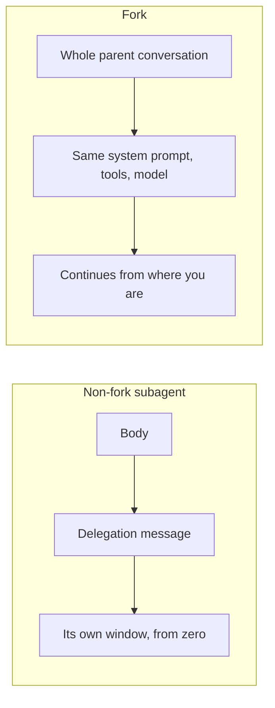

# Author a Subagent — and the Fork-Context Subtlety

> You can write one subagent that does a narrow job and refuses the rest — and
> you know when the *opposite* is right: a subagent that inherits everything.

**Type:** Build
**Prerequisites:** Lessons 45 and 46; Phase 05 Lesson 44 (Author a Skill From Scratch)
**Time:** ~45 minutes

---

## Learning Objectives

- Author a subagent that succeeds on its job and declines work outside it
- Separate a skill from a subagent by asking what the result is *for*
- Check your own file for the failure modes that don't announce themselves
- Explain what a fork inherits, and name the two costs you pay for it

---

## The Problem

An agent was given a tool restriction it could not use. The task was read a
report, decide whether it needs a human, and file it. The subagent it was
delegated to — written weeks earlier by someone else — had `Bash` in its pool,
because the description said "reviews incident reports" and the author had not
thought about what would happen when the same agent was handed a ticket.

The agent ran a shell command it had no business running. Not because the prompt
told it to. Because the capability was there and the task was ambiguous enough
that it looked useful.

Narrowness isn't a property of the description. It's a property of the file. And
most subagents get authored the other way round: task-shaped prompt, tools
whatever was convenient, and a body that hopes for the best.

---

## The Concept

Two decisions, and they are independent.

**Which kind of agent is this?**

| | Skill (Phase 05) | Subagent (this phase) |
|---|---|---|
| Runs in | Your conversation | Its own window |
| Sees your history | Yes | No |
| Returns to | Your window, in place | A summary |
| Restricts tools | Not by default | Yes, at the pool |
| Use when | A workflow you want to run *here* | Work whose output you don't want *here* |

The test: **where should the result land?** If you want it interleaved with your
next thinking, it's a skill. If you want it summarized back and the mess left
behind, it's a subagent.

### The narrowness you can actually enforce

Three layers, weakest to strongest:

1. **The body asks nicely.** "Report only. Do not modify anything." A request.
2. **`description` narrows routing.** Anything that doesn't sound like this agent
   won't get here. Prevents most wrong delegations, not all — an explicit
   @-mention bypasses it entirely.
3. **The tool pool makes it impossible.** `disallowedTools: Bash, Write, Edit`
   removes them. The agent cannot do the thing. There is no prompt that gets it
   there.

Build the subagent from layer 3 backwards. Decide what it must not be able to do,
then write the body for the job that remains.

### What a subagent actually receives

Not nothing. Not everything. This is the part people get wrong.

A non-fork subagent starts with:

- **Its own system prompt** — the Markdown body, which *replaces* the Claude Code
  system prompt, plus environment details like the working directory
- **The delegation message** — written by Claude from your request. You usually
  don't write this.
- **`CLAUDE.md`** — every level the main conversation loads: user, project, local,
  managed policy, `AGENTS.md`. (`Explore` and `Plan` skip this.)
- **Git status** — a snapshot read at startup. (`Explore` and `Plan` skip this.)
- **Preloaded skills** — full content of anything in its `skills` field
- **Nothing else.** Not your conversation. Not the files you've already read.
  Not the skills you've already invoked. Not your output style. Not your auto
  memory.

Its **context window size comes from its own model**, not yours. Delegating to a
smaller model gives it a smaller window. That is a quiet way to run out of room
mid-task.

It returns a summary. Everything intermediate stays in its window.

### The fork subtlety

There is one exception to "starts fresh". **A fork inherits the entire parent
conversation.**



| | Fork | Non-fork subagent |
|---|---|---|
| Context | Full conversation history | Fresh, with the prompt you pass |
| System prompt, tools | Same as main session | From its definition file, filtered in background |
| Model | Same as main session | From its `model` field |
| Prompt cache | **Shared** with main session | Separate |
| Spawns further forks | No | Yes, up to a depth limit |

Two costs, both real:

**You lose isolation.** The fork sees everything, including the parts of the
conversation you were keeping out. For a side experiment that's a feature. For
anything that must not see the main context, it is the wrong tool.

**You may get the wrong thing by default.** Fork mode is on by default in
interactive sessions — so when Claude spawns a subagent without naming a type, it
may spawn a *fork*, and the fork brings your conversation along. If you wanted a
clean agent for that work, you now have one carrying your history.

`/subtask <task>` starts a fork yourself. The env var
`CLAUDE_CODE_FORK_SUBAGENT` overrides the default (`1` on everywhere, `0` off
everywhere); to keep fork mode but stop Claude from using it, deny the `fork`
subagent type in your settings.

Because a fork's system prompt and tool definitions are identical to the
parent's, its first request reuses the parent's prompt cache. For a task needing
the same context, a fork is cheaper than a fresh subagent. Same context, minus
the re-send.

> **The reframe:** a subagent is a *narrow* agent whose tool pool defines what it
> can be — and a fork is the opposite trade, buying a full inherited conversation
> at the price of every isolation guarantee you had.

Claude Code ships weekly; fork defaults have changed more than once. Verify
against [the subagents page](https://code.claude.com/docs/en/sub-agents) and
`https://code.claude.com/docs/llms.txt` before teaching anyone a specific default.

---

## Build It

### 1. Decide the floor before the prompt

Pick a job you actually repeat. For this lesson:

> Read an incident report file, classify it, and append one line to a triage file.
> Refuse anything that is not an incident report file.

Before writing a word of body, answer: what must it never do? Answer: edit
anything other than the triage file, run arbitrary shell, open the network.

That answer is the file's real design.

### 2. Write it

Create `.claude/agents/incident-triage.md`:

```markdown
---
name: incident-triage
description: Reads an incident report file and appends one classified line to incidents-triage.md. Use only when handed a path to a report file. Refuses everything else.
tools: Read, Grep, Glob, Edit
model: sonnet
---

You triage incident reports. You do one thing.

## What you do

Given a path to an incident report file:

1. Read it.
2. Classify it as one of: outage, data-loss, security, cosmetic, unknown.
3. Append exactly one line to `incidents-triage.md`:
   `<date> | <path> | <class> | <one-line summary>`
4. Report the line you appended.

## What you refuse

If the request is anything other than "triage this report file":

- Say what you do in one sentence.
- Stop. Do not approximate the task another way.
- Do not read files that were not named.

If asked to edit anything other than `incidents-triage.md`, say no and stop.
`Edit` exists in your pool because you must append to one file. It is not
permission to edit others.
```

### 3. Check it with a real linter

This lesson ships one:

```bash
node phases/06-subagents/47-author-a-subagent/code/check-subagent.mjs .claude/agents/incident-triage.md
```

It checks the things that fail silently — required fields, description length,
tools-vs-disallowedTools overlap, a body that's empty of instructions,
unrecognized field names.

✅ You pass when it reports zero errors and you can explain what each check is
protecting you from.

### 4. Test the refusal, not just the success

Three requests:

```
Use the incident-triage subagent on docs/incident-2024-03.md
```
```
Use the incident-triage subagent to rename every file in src/ to kebab-case
```
```
Use the incident-triage subagent to triage these and also fix the typo in line 3
```

The first should work. The second and third should be declined — and the third
is the real test, because the "and also" is exactly how scope creeps.

✅ You pass when 2 and 3 are declined and you can say which layer did the
declining: routing, the body, or the missing tool.

### 5. Find where the enforcement is weak

The `rename` request above would be declined by the body — `Edit` is available,
so nothing structurally stops it. Now set `disallowedTools: Edit` temporarily
and retry.

✅ You pass when the second version declines at the capability level instead of
the request level, and you can say which one you'd trust more unattended.

### 6. Now do the opposite, on purpose

You've established what a narrow agent looks like. Now find a task where narrow
is wrong: "try two approaches to this migration, starting from everything we've
decided, and tell me which is better."

Ask for `/subtask` twice rather than delegating to two fresh agents.

✅ You pass when both attempts begin from the current conversation and neither
pasted your history back in, and you can name the cost you just paid.

---

## Use It

| Situation | Move |
|---|---|
| Same narrow job keeps coming up | Write a subagent. Start from `disallowedTools`. |
| Claude picks the wrong agent | Fix `description` first, always |
| Agent runs but misbehaves | Fix the body |
| Agent does something it shouldn't | Fix the tool pool, not the prompt |
| Result belongs in your window | Skill, not subagent |
| Task needs your existing context | Fork or `/btw` |
| Task must stay clean | Fresh subagent, explicit type |
| `--agents` JSON | One-off, session-only. Prompt lives in `prompt`, not the body. |
| `claude --agent <name>` | Whole session runs as that agent, tool restrictions and all |

---

## Exercises

1. Author a subagent for a job you actually repeat. Run the checker. Then write
   one request it should decline and confirm it does.
   ✅ You pass when the checker is clean and the refusal names the boundary
   rather than apologising for it.

2. Take your agent and remove its `description` line entirely. Run three
   realistic requests through it.
   ✅ You pass when you can report what changed and whether the failures were
   routing failures or behaviour failures.

3. Pick a task from this week that you handled in the main conversation. Write
   two lines saying whether it belonged in a skill, a fresh subagent, or a fork —
   and what would have told you at the time.
   ✅ You pass when your reason names *where the result should land*, not how
   comfortable each option felt.

---

## Key Terms

| Term | What people say | What it actually means |
|---|---|---|
| narrow subagent | "a focused agent" | One whose tool pool makes out-of-scope work impossible, not merely discouraged. |
| skill vs subagent | "prompt vs agent" | Where the result lands: interleaved in your window, or summarized back. |
| delegation message | "the prompt" | Written by Claude from your request. The only channel to a no-CLAUDE.md agent. |
| fork | "a subagent with context" | Inherits the whole parent conversation, system prompt, tools, model, and prompt cache. No isolation. |
| `/subtask` | "run it in the background" | Starts a fork yourself, named from the task. |
| fork mode | "a setting" | On by default interactively; changes what Claude gets when it spawns a subagent with no type. |
| prompt cache sharing | "it's faster" | A fork's first request reuses the parent's cache. Cheap only because it inherited everything. |
| silent field ignoring | "it's not supported" | Unknown frontmatter keys are dropped with no warning. Check spelling. |

---

## What this lesson skipped

**Skills preloaded into subagents.** The `skills` frontmatter field and the exact
opposite thing, `context: fork` on a skill. The case is genuinely confusing and it
is Lesson 48.

**Worktree isolation.** `isolation: worktree` and `isolation` on the Agent call.
Nothing here concerns where *files* land — Phases 11 and 16.

**Nested subagents.** A subagent can spawn its own, to a depth limit. Useful for
fan-out, and the depth limit is a number that changes. Phase 11.

**Permission modes per subagent.** `permissionMode` exists in frontmatter.
What each mode does to the loop is Phase 04 Lesson 33.

**Subagent output scanning.** Claude Code scans a subagent's final report for
instruction-shaped text and annotates it. Real, worth knowing, Phase 07 does the
trust model.