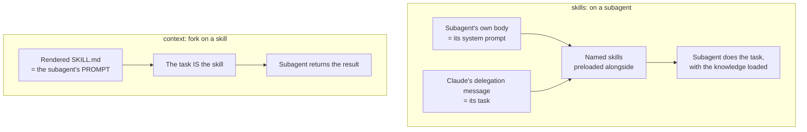

# Skills Inside Subagents — the genuinely confusing case

> Two fields that sound like the same thing do opposite jobs. Get this wrong and
> you either pay for context twice or get an agent that knows nothing.

**Type:** Learn
**Prerequisites:** Lessons 45–47; Phase 05 Lesson 42 (The Invocation Matrix), Lesson 44 (Author a Skill From Scratch)
**Time:** ~35 minutes

---

## Learning Objectives

- Tell `skills:` on a subagent apart from `context: fork` on a skill, in one sentence each
- Decide which direction you need before you write either field
- Say what a preloaded skill costs and what it saves
- Explain why a skill with `disable-model-invocation: true` can't be preloaded

---

## The Problem

An agent needed to write API endpoints matching a team's conventions. Delegating
to a subagent produced plausible endpoints that ignored every convention the team
had written down — different error shape, different naming, no auth header. The
conventions existed. They were in a skill. The subagent never saw them.

The fix was one line, `skills:` in the agent's frontmatter, which preloads the
full content of named skills before work starts.

Then somebody tried the same thing the other way round. They set `context: fork`
on the convention skill itself, expecting it to "apply to subagents too." It ran
in a fresh subagent with the skill text as its only prompt, no history, and
returned something useless — because the skill said "follow these conventions"
and a subagent with no task to perform has nowhere to apply them.

Two fields. Opposite directions. One of them failed for a reason that looks like
it should have worked.

---

## The Concept

There are two arrows. They point opposite ways, and they do different things.

### Direction one: knowledge *into* a subagent

The `skills` field on a subagent preloads the **full content** of named skills
into that subagent's context at startup.

```markdown .claude/agents/api-developer.md
---
name: api-developer
description: Implement API endpoints following team conventions
skills:
  - api-conventions
  - error-handling-patterns
---

Implement API endpoints. Follow the conventions and patterns from the preloaded skills.
```

The subagent controls the system prompt. The skill is reference material sitting
next to it, loaded before work starts.

**What it does not do:** restrict anything. A subagent can still invoke *other*
project, user, and plugin skills through the `Skill` tool during the run. `skills:`
selects what's preloaded, not what's reachable.

To actually block skill invocation, remove `Skill` from `tools`, or add it to
`disallowedTools`. Those are enforcement. `skills:` is not.

Limits and rules:
- Up to **32 distinct names** are preloaded; the rest are ignored.
- Skills with `disable-model-invocation: true` **cannot** be preloaded — preloading
  draws from the set of skills Claude is allowed to invoke.
- A missing or disabled skill is skipped with a warning in the debug log. Not an
  error.
- Built-in agents don't preload skills at all.

### Direction two: a skill *into* a subagent

`context: fork` on a skill runs the skill's content in a fresh subagent.

```markdown
---
name: deep-research
description: Research a topic thoroughly
context: fork
agent: Explore
---

Research $ARGUMENTS thoroughly:

1. Find relevant files using Glob and Grep
2. Read and analyze the code
3. Summarize findings with specific file references
```

The subagent is the **task**. It gets the rendered skill as its prompt, runs
`agent` (which sets model, tools, permissions), and returns its result.



Same words, inverted roles. In one, the skill is *reference for* a task. In the
other, the skill *becomes* the task.

### The comparison table

| | `skills:` on a subagent | `context: fork` on a skill |
|---|---|---|
| System prompt | The subagent's markdown body | The agent type named in `agent` |
| Task | Claude's delegation message | The rendered SKILL.md |
| Also loads | Named skills + CLAUDE.md, per the subagent's startup | CLAUDE.md, per the agent type's startup |
| Starts with your history? | No | No |

### The trap in the name

`context: fork` does **not** fork your current conversation. It creates a new
isolated context. That's the exact opposite of the `fork` from Lesson 47, which
does inherit everything.

If your task depends on the conversation, `/subtask` (Lesson 47) is what you
want. `context: fork` on a skill is the wrong tool and will not be fixed by
turning it on.

### When `context: fork` is pointless

`context: fork` only makes sense for skills with **explicit instructions**.

A skill that says "use these API conventions" is a guideline. In a forked
subagent it becomes a prompt with no task — the subagent gets the guidelines, has
nothing to do, and returns without meaningful output.

Guidelines → put them in a subagent's `skills:` field, where a real task is
waiting next to them.

### Behaviour worth knowing before you use it

- Forked skills normally run in the **background**. You keep working; the result
  arrives when it finishes. Set `background: false` to wait.
- A backgrounded fork also runs with the **narrower background-subagent tool
  set**. If your skill's steps need a tool outside that set, `background: false`.
  Note the asymmetry with Lesson 47: a `/subtask` **conversation** fork is
  exempt from that filter and keeps your full tool pool. A `context: fork` skill
  is an ordinary subagent, so the exemption does not cover it.
- A backgrounded fork's edits fall **outside session checkpoints**. `/rewind`
  won't undo them. Use git.
- Claude Code waits anyway in non-interactive mode (`-p`, the Agent SDK), when
  another invocation of the same forked skill is running, when a scheduled task
  invokes it, and for some dynamic-workflow agent invocations.
- For side-effecting operations, model invocation on a forked skill is normally
  the safer default — Claude triggering your deploy should require a human to type
  `/deploy`.

> **The reframe:** `skills:` on a subagent loads knowledge *next to* a task the
> subagent already has, while `context: fork` on a skill *becomes* the task — and
> the one that runs in the background quietly gets a smaller tool set and no
> checkpoint safety net.

Skill frontmatter moves too. Verify against
[the skills page](https://code.claude.com/docs/en/skills) and
`https://code.claude.com/docs/llms.txt`.

---

## Build It

### 1. Build the failing case on purpose

Create `.claude/skills/api-conventions/SKILL.md`:

```markdown
---
name: api-conventions
description: Team conventions for API endpoints. Error shape, naming, auth headers.
---

Every endpoint returns `{"error": {"code": "...", "message": "..."}}` on failure.
Never return a bare error string. Authenticated routes require an `Authorization`
header. Handlers are named `handle<Resource><Verb>`.
```

Now create `.claude/agents/api-developer.md` **without** a `skills` field, same
body as the example above. Restart. Ask it to write an endpoint.

✅ You pass when the output ignores at least one convention and you can see the
convention was available in the repo the whole time.

### 2. Add the one line

Add to the agent's frontmatter:

```yaml
skills:
  - api-conventions
```

Restart. Ask again.

✅ You pass when the output now follows the error shape and the handler naming,
and you can name the line responsible.

### 3. Check that it preloads rather than restricts

Remove `Skill` from nothing — the agent has no `tools` field, so it inherits the
pool including `Skill`. Add a second skill to the repo that this agent was never
told about, and ask it to use it.

It can. `skills:` is a preload list, not an access list.

✅ You pass when the agent can reach a skill you never named, and you can say
what would actually block it.

### 4. Try the other direction and watch it fail

Add `context: fork` to the conventions skill itself. Remove `skills:` from the
agent. Restart. Invoke the skill.

The subagent receives the guidelines and no task.

✅ You pass when it returns something empty or confused, and you can say which
half of the problem that was.

### 5. Fix it by giving the skill a task

Rewrite the skill body as instructions with a task, and point `agent:` at
`Explore`:

```yaml
---
name: api-conventions
description: Audit API handlers in a repo against team conventions
context: fork
agent: Explore
---

Audit the repository's API handlers against these conventions:

- Errors return {"error": {"code": ..., "message": ...}}, never a bare string.
- Authenticated routes carry an Authorization header.
- Handlers are named handle<Resource><Verb>.

Report each violation as `path:line — convention broken`.
```

✅ You pass when it produces findings rather than nothing, and you can say what
changed: the skill went from guideline to instruction.

### 6. Feel the background cost

Set `background: false` on the forked skill. Run something in the main
conversation while it runs.

Then remove it and do the same.

✅ You pass when you can state what changes about *your* session — you can either
keep working or you can't — without rereading the docs.

---

## Use It

| Situation | Move |
|---|---|
| A subagent needs standing knowledge it can't discover | `skills:` in the subagent |
| You want to stop a subagent invoking skills at all | Remove `Skill` from `tools`, or `disallowedTools: Skill` |
| You want a skill to run isolated, in the background | `context: fork` on the skill |
| The task depends on your conversation history | `/subtask`, not `context: fork` |
| A skill is pure guideline with no task | Don't fork it. Preload it into a subagent that has a task. |
| A forked skill needs a tool the background set drops | `background: false` |
| A backgrounded fork edited files | Use git. `/rewind` won't reach it. |
| Something destructive, invoked by a model | `disable-model-invocation: true` |

---

## Exercises

1. Take a skill from your own repo. Decide whether it is a guideline or an
   instruction, and put it on the matching side of the arrow.
   ✅ You pass when the placement follows the task/no-task distinction rather than
   which one felt more isolated.

2. Author a subagent with a `skills:` list, then add a `tools:` field that omits
   `Skill`. Try to make it invoke an unlisted skill.
   ✅ You pass when it cannot, and you can say which of the two fields did the
   blocking.

3. Run the same task three ways: in the main conversation, as a fresh subagent,
   and as a fork. Note what each one knew at the start.
   ✅ You pass when you can name what the fork had that the fresh subagent
   didn't, and what it gave up to get it.

---

## Key Terms

| Term | What people say | What it actually means |
|---|---|---|
| `skills:` on a subagent | "give this agent skills" | Preloads full skill content into its window at startup. Up to 32 names. Not a restriction. |
| `context: fork` on a skill | "run this in a fork" | Starts a new isolated subagent whose prompt is the skill. Not a fork of your conversation. |
| preload vs access | "skills controls what it can use" | It controls what's *loaded*. Access is `tools` / `disallowedTools`. |
| `disable-model-invocation` | "manual-only skill" | Also makes the skill **unpreloadable** — preloading draws from the invocable set. |
| guideline vs instruction | "a skill" | Guidelines have no task and fork to nothing. Instructions fork usefully. |
| backgrounded fork | "running in parallel" | Narrower tool set, outside session checkpoints. `/rewind` doesn't reach its edits. |
| `agent:` on a forked skill | "which agent it uses" | Picks the subagent type — which decides model, tools, permissions. Defaults to `general-purpose`. |

---

## What this lesson skipped

**Auto-compaction inside a subagent.** `autoCompactWindow` exists, and the window
fills exactly as it does in the main conversation — Phase 04 Lesson 30 owns that.

**Prompt caching.** A subagent's first request is cold unless it shares a
parent's — a fork's does. This changes what a fork actually costs, and Phase 03
Lesson 22 is where caching makes sense as a budget.

**Agent teams and cross-session messaging.** Subagents that can message each
other, and roster injection at startup. Phase 11.

**How skills get packaged and shared.** A skill in a plugin is still a skill, but
scoped names and the discovery path change. Phase 09.