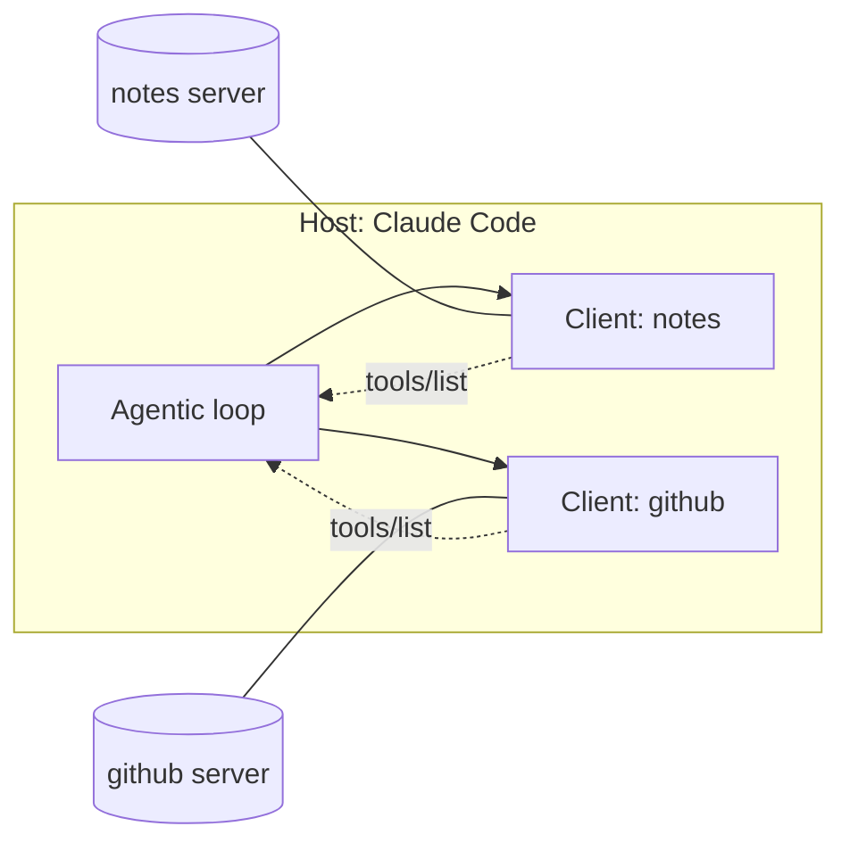

# What MCP Is

> You can connect a tool to Claude Code without writing a plugin, and you can
> say out loud what a server is allowed to touch before you let it near your repo.

**Type:** Learn
**Prerequisites:** Phase 04 — especially Lesson 31 (the agentic loop) and Lesson 33 (permissions)
**Time:** ~35 minutes

---

## Learning Objectives

- Use `claude mcp add` to connect a server and confirm it with `/mcp`
- Say which of the three things a server can expose — tools, resources, prompts — and pick the right one for a job
- Explain why a server is a separate program rather than a skill, in terms of what runs and whose permissions it uses
- Decide, before approving a server, what it would have the power to do

---

## The Problem

Your agent needs to read your issue tracker. It has no tool for that. You look
at what exists: a **skill** is a markdown file the model reads before acting. A
**subagent** is another model with its own window. Neither can open a network
connection to your tracker — they are text going into a window.

So you write a script that curls the tracker API. Now you have a second
problem: the agent can run `Bash`, which means it can run *your script*, but
nobody described that script's arguments, its output shape, or its failure modes
anywhere the model can see. You end up hand-writing the tool call syntax into
promts, and it works until the tracker returns an error, at which point the
agent has guessed.

MCP is the missing piece in the middle: **a standard shape for a program to
advertise its actions, and a standard way for the loop to call them.** Write
the script once, describe it once, and every client that speaks the protocol
can use it — not just Claude Code.

---

## The Concept

Three nouns. That's the whole protocol.

| Noun | What it is | Who it is |
|---|---|---|
| **Host** | The app the model lives in. Claude Code is a host. | You |
| **Client** | The thing inside the host that speaks MCP. One per server. | Claude Code, not you |
| **Server** | A separate program holding tools/resources/prompts. | Someone else's, or yours |

The client is the piece people skip. When Claude Code connects to three servers,
it is running three clients. Each one owns one connection, does the JSON-RPC
talking, and turns server-shaped JSON into things the loop already knows how to
call.



The flow for a single tool call, which is exactly the tool loop from Lesson 31
with a client in the middle:

1. Client sends `tools/list`. Server answers with every tool: name, description, JSON Schema for the arguments.
2. Those definitions join the model's context. They look like any other tool.
3. Model emits a tool call. Client sends `tools/call` with a name and arguments.
4. Server does the real thing — the API call, the file read, the query.
5. Server answers with content. Client hands it back. The loop continues.

Steps 1 and 3 are JSON-RPC 2.0: `initialize`, then request/response with ids, plus
notifications that get no reply. The transport that carries those messages is
what the next lesson is about.

### Three kinds of thing a server exposes

| Kind | Model-controlled? | Use it for |
|---|---|---|
| **Tool** | Yes — the model decides to call it | Actions: "create issue", "run query", "send message" |
| **Resource** | No — *you* reference it with `@server:protocol://path` | Content to read into the window: a schema, a doc, a record |
| **Prompt** | No — *you* invoke it as `/servername:promptname` | A canned starting shape for a task the server is good at |

The distinction is **who decides it happens**. A tool is a thing the agent may
reach for on its own. A resource and a prompt are things you name explicitly.
That difference is the whole security boundary: a resource can't do anything
unless you typed it.

### Why not just a skill?

A skill is text in the window. It can tell the model "run
`python tools/deploy.py --env prod`". What it cannot do is tell the model what
the script *returns* — the model finds that out by reading whatever came back,
including a stack trace, including an HTML error page from a proxy.

An MCP server carries its own description: names, prose descriptions, and a
schema for each argument. The model picks from a menu with types on it instead
of improvising command-line syntax. That's the difference between a
capability and a guess with a shell.

### The rule the docs lead with

> Verify you trust each server before connecting it. Servers that fetch external
> content can expose you to prompt injection risk.

This is not boilerplate. A server whose tool returns a web page is a server that
can hand the model text written by somebody else, in the exact position where
the model reads instructions. Lesson 53 is entirely about this.

> **The reframe:** an MCP server is not a tool the model gained — it is a
> separate program holding a conversation with the loop, and every message it
> sends is something the model will read with the same seriousness as your
> prompt.

### Not covered here

**Transport choice** — `http` vs `sse` vs `stdio` vs `ws`. That is Lesson 50, and
picking wrong makes a working server look broken.

**Where the config lives and which file wins.** Lesson 51.

**Writing your own server.** Lesson 52. Today you connect one.

**OAuth and tool search.** Lesson 54.

---

## Build It

You need `claude`, Node on your `PATH`, and network access.

### 1. Connect one server, local scope, stdio

```bash
claude mcp add --transport stdio fetch -- npx -y @modelcontextprotocol/server-fetch
```

Read the command left to right. `--transport stdio` picks how to talk. `fetch`
is the name the server will be known by. Everything after `--` is the literal
command Claude Code will spawn — the `--` exists so its own flags don't eat the
server's flags.

### 2. Look before you run

```bash
claude mcp list
claude mcp get fetch
```

`get` prints the resolved entry. Check one thing: the command matches what you
typed. This is the whole approval model for a local server — you read it once.

✅ You pass when `claude mcp get fetch` shows the command you wrote and nothing
else is in it.

### 3. Connect it in a session and see the shape

Start Claude Code, then:

```
/mcp
```

Pick the server. You get a status, the tool names it exposes, and — if it's the
first connection — an approval prompt. That prompt is the security boundary from
Lesson 33 doing its job.

✅ You pass when `/mcp` lists `fetch` as connected and shows at least one tool
under it.

### 4. Use the thing

```
Fetch https://example.com and tell me what that site is.
```

Watch the loop: the model already knew the tool existed from step 1's
`tools/list`. It did not need to be told the command line.

✅ You pass when the tool call appears in the transcript as a named MCP tool,
not as a Bash command.

### 5. See the client boundary — two servers, one host

```bash
claude mcp add --transport http context7 -- https://mcp.context7.com/mcp
```

Now `/mcp` again. Two servers, two independent connections. Now stop one and
keep the other:

```bash
claude mcp remove context7
```

Restart Claude Code. `fetch` still works, `context7` is gone. Nothing about the
host changed — you removed a client, not a capability of the model.

✅ You pass when after the removal and restart, one server still works and the
other is absent from `/mcp`.

### 6. Check where it actually wrote

`fetch` was added with no `--scope`, so it is local. Find it:

```bash
grep -n "fetch" ~/.claude.json | head
```

It is in `~/.claude.json`, under this project's entry — not in `.mcp.json`, and
not in `src/`. Lesson 51 is about why that distinction decides who else gets
your server.

✅ You pass when you can point at the exact file and the project key the entry
sits under.

---

## Use It

| Concept | When you reach for it |
|---|---|
| `claude mcp add --transport stdio <name> -- <cmd>` | A tool that runs on this machine, or is an npm package |
| `claude mcp add --transport http <name> <url>` | A hosted service with an MCP endpoint |
| `claude mcp get <name>` | Before approving anything — read the resolved command |
| `/mcp` | To see what's connected, what tools it has, or to authenticate |
| `@server:protocol://path` | Pulling content in, on your call, not the model's |
| `claude mcp remove <name>` | Cutting a server without touching the host |
| Client vs server | Debugging "is it the server or is it Claude Code?" — it's a separate program |

---

## Exercises

1. Connect a second stdio server you did not write, in `local` scope. Do not
   approve it until you have run `claude mcp get <name>` and can say in one
   sentence what the command does.
   ✅ You pass when `/mcp` shows it connected and your `NOTES` (or your message
   to the agent) contains the sentence describing what the command does.

2. Pick a job you'd currently do by hand: checking a deploy status, looking up a
   customer record, posting to a channel. Decide whether it needs a **tool**, a
   **resource**, or a **prompt**, and write down one sentence of why.
   ✅ You pass when you can name the kind and the deciding question was "who
   triggers it — the model, or me?".

3. Remove one server and confirm the loop still works. Then add it back at
   `user` scope instead.
   ✅ You pass when both changes survive a restart of Claude Code and `claude mcp
   list` reflects them.

4. Find a server you already trust on this machine and read its entry. Name one
   thing it could do that you did not know it could do.
   ✅ You pass when the answer names a real capability from the entry, not a
   generic worry.

---

## Key Terms

| Term | What people say | What it actually means |
|---|---|---|
| MCP | "the thing that lets Claude use tools" | A protocol. One wire format for a program to advertise actions and for a client to call them. Not a product, not a vendor. |
| host | "Claude Code" | The app containing the model and the loop. Claude Desktop, an IDE, Claude Code — all hosts. |
| client | "MCP" / "the connection" | The in-process object that speaks MCP to exactly one server. One per server, per host. |
| server | "the tool" | A separate program with its own permissions, its own failure modes, and its own author. Not the same process as the host. |
| transport | "the protocol" | The wire the JSON-RPC messages travel on. Four of them. Lesson 50. |
| `tools/list` | "discovery" | The handshake that tells the model what actions exist. Runs at session start or on demand. |
| `tools/call` | "the tool call" | The actual invocation: a name and a JSON object of arguments. |
| resource | "context" | Content you attach explicitly with `@server:protocol://path`. The model cannot fetch one on its own. |
| prompt | "a slash command from a server" | A canned task shape, invoked as `/servername:promptname`. Listed alongside built-in commands. |
| JSON-RPC 2.0 | "the message format" | Request has an id and gets a reply. Notification has no id and gets nothing back. |
| protocol version | "the version" | A string the server and client agree on at `initialize`. Sending a version your client can't speak is a real failure mode. |

---

## What this lesson skipped

**The four transports.** You used two of them. Why `sse` is deprecated, when
`ws` earns its keep, and how a stdio server actually dies — Lesson 50.

**Scopes and precedence.** You used `local` and `user` without being told what
wins when both define the same server name. Lesson 51 fixes that, and it's the
lesson that matters most if you ever commit a config.

**Writing a server.** You connected one. Lesson 52 builds one with no
dependencies, including the JSON-RPC framing by hand.

**Prompt injection.** Lesson 53. Today you were told to verify; the note called
`untrusted` in Lesson 52's server is there so that lesson has something real to
bite on.

**OAuth and tool search.** Lesson 54. Why a hundred-tool server costs you almost
nothing on startup, and why that's not obvious.

**Managed/organization MCP policy.** Real, and version-gated. When you're
behind a company gateway, read
[Managed MCP configuration](https://code.claude.com/docs/en/managed-mcp).

Current behaviour is documented at
[Connect Claude Code to tools via MCP](https://code.claude.com/docs/en/mcp).
Re-read it rather than trusting this page in six months — the transport table
in particular has changed.