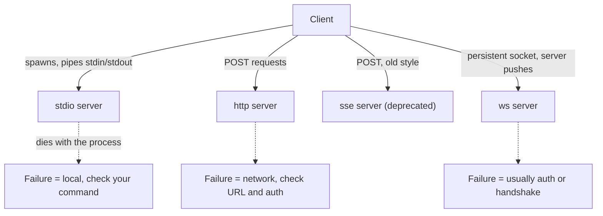

# Four Transports

> You can pick the right wire for a server — and tell the difference between "the
> server is broken" and "the wire is broken".

**Type:** Learn
**Prerequisites:** Lesson 49, What MCP Is
**Time:** ~35 minutes

---

## Learning Objectives

- Choose a transport for a server from one question: does it run on this machine?
- Tell from an error message whether the failure is the server, the wire, or the handshake
- Explain why `sse` still exists in configs you didn't write
- Write the `claude mcp add` command for `http`, `stdio`, and `ws` from memory

---

## The Problem

A server you wrote works fine when you run it by hand. You add it to Claude
Code and get `MCP server "notes" failed to connect` — a message that names the
server and nothing else. An hour later you find out you used `--transport http`
for a command that prints JSON-RPC to stdout and exits. The program was fine.
You asked it to speak HTTP to something that only speaks stdio.

Every transport failure looks like this. A server that genuinely crashed, a URL
that 404s, a handshake that timed out, and a wrong transport all produce one
line with a name in it. Learning the four transports is mostly learning to read
that line.

---

## The Concept

MCP's messages are JSON-RPC. A **transport** is just how those bytes move. Four
of them, and the choice follows from one question: *where does the program run?*

| Transport | The program | Use it for | Status |
|---|---|---|---|
| `stdio` | Claude Code **starts** it, as a child process | Local scripts, your own machine, npm packages | Recommended for local |
| `http` | Something is **already** running, you send requests | Hosted services, shared servers, anything a team uses | Recommended for remote |
| `sse` | Same as http, older style | Legacy servers you don't control | **Deprecated** |
| `ws` | Same as http, persistent socket | Server **pushes** events to you | Supported, narrower |

There is a fifth value, `"sdk"`, for in-process servers registered by a host
application. Claude Code CLI configuration skips it. You will not meet it here.



### stdio — the important mechanic

The client runs your command. Your process's **stdin** carries JSON-RPC
requests, its **stdout** carries replies, one JSON object per line. Its stderr
is yours — Claude Code shows it in logs.

Two consequences that will bite you:

- **Anything you print to stdout is protocol traffic.** A stray `console.log`
  in your server corrupts the stream, and the client reports a parse failure
  that looks like a corrupt server. Log to stderr.
- **The server's lifetime is the connection.** It starts when needed, dies when
  it's no longer needed. A crash is visible immediately and is easy to
  reproduce — which makes stdio the best transport for learning.

`--` matters: everything after it goes to the server, not to Claude Code.

```bash
claude mcp add --env API_KEY=xyz --transport stdio notes -- node server.mjs
```

### http — the default for remote

One endpoint, POST requests, responses come back on the same connection or the
next. `type: "http"` and `type: "streamable-http"` are equivalent in config —
the second is the protocol's own name for it.

```bash
claude mcp add --transport http notion https://mcp.notion.com/mcp
```

### sse — why it's still in your config

SSE was the original remote transport: a long-lived GET for events plus POSTs
for requests. It works and it's being retired. Claude Code will try HTTP first
and fall back to SSE for a URL that only speaks it — useful when you're handed
an old endpoint and don't control it. You don't choose it; you tolerate it.

Note the docs' own version gate: automatic HTTP-to-SSE fallback needs a recent
Claude Code (v2.1.265+ as of October 2026). If you're on an older build and a
server only speaks SSE, set `--transport sse` explicitly rather than assuming
the fallback will happen.

### ws — the one that's actually different

Everything above is request/response. WebSocket is a persistent bidirectional
socket, which is the point: the server can send you things you didn't ask for.
If your use case is "the server tells Claude something when it happens," this is
the transport. You cannot add it with `--transport` — it goes in as JSON.

```bash
claude mcp add-json events-server \
  '{"type":"ws","url":"wss://mcp.example.com/socket","headers":{"Authorization":"Bearer TOKEN"}}'
```

No OAuth story on this transport. That's a real limit, not an oversight —
Lesson 54 is where auth gets its own treatment.

### A remote entry with a `url` and no `type` is invalid

Claude Code skips it. No error, no server, no explanation in `/mcp` beyond an
absent entry. If a hand-written config "does nothing," check `type` first.

> **The reframe:** the transport isn't a setting on a server — it's a claim
> about who runs the program, so every "failed to connect" is naming a layer,
> and each layer has exactly one place to look: the process for stdio, the
> network path for http and sse, the socket for ws.

---

## Build It

### 1. stdio, with the command shown to you

```bash
claude mcp add --transport stdio time -- npx -y @modelcontextprotocol/server-everything
```

Then `claude mcp get time`. It prints the command it will spawn. Confirm it
matches character for character.

✅ You pass when `/mcp` lists `time` connected, and you can name the process
Claude Code is running on your behalf.

### 2. Prove the stdout rule

Create `noisy.mjs` in a scratch folder:

```js
console.log('starting up');
process.stdin.on('data', () => {
  console.log('saw a request');
  process.stdout.write(JSON.stringify({ jsonrpc: '2.0', id: 1, result: {} }) + '\n');
});
```

```bash
claude mcp add --transport stdio noisy -- node "$PWD/noisy.mjs"
```

Start Claude Code. It will fail or behave strangely. Move the first `console.log`
to `console.error` and watch it work.

✅ You pass when you can say in one sentence which byte stream was corrupted and
why the fix was stderr, not deleting the log line.

### 3. http, then look at what the entry claims

```bash
claude mcp add --transport http example -- https://example.com/mcp
claude mcp get example
```

That URL isn't a real MCP server, so it fails. That is the point — the error
tells you it is a *connection* problem, and there is no process to inspect. Note
what the message does **not** say.

✅ You pass when you can distinguish this failure from step 2's by the error text
alone.

### 4. Count the processes

While Claude Code is open with `time` and `noisy` connected:

```bash
ps -ef | grep -i "mcp\|server-everything" | grep -v grep
```

Two stdio servers, two processes, children of Claude Code. Now compare against
Lesson 49's http server — no process at all, because nothing local was started.

✅ You pass when you can see exactly the two child processes and no third one
for the http server.

### 5. Timeouts — the failure with no message

```bash
MCP_TIMEOUT=10000 claude
```

Ten seconds to start. Point at a stdio server whose command is `npx -y` on a
package that takes longer the first time, and watch it fail at startup rather
than mid-task.

Per-tool wall clock is separate:

```bash
MCP_TOOL_TIMEOUT=60000 claude
```

or per server, in the config entry:

```json
{ "type": "http", "url": "https://mcp.example.com/mcp", "timeout": 600000 }
```

✅ You pass when you can say which of the two timeouts you hit, based on
whether the server never connected or connected and then stopped responding.

---

## Use It

| Command / concept | When you reach for it |
|---|---|
| `--transport stdio <name> -- <cmd>` | The program runs here, on your machine |
| `--transport http <name> <url>` | Someone else runs it; you send requests |
| `--transport sse <name> <url>` | Only when a legacy server forces it — it's deprecated |
| `claude mcp add-json` with `"type":"ws"` | The server pushes events to you |
| `--` before the command | Always, for stdio |
| `--env KEY=value` | Secrets for a stdio server — readable only by that server |
| Logs on stderr, protocol on stdout | Every time you write a stdio server |
| `MCP_TIMEOUT` | A server that takes too long to start |
| `MCP_TOOL_TIMEOUT` / per-server `timeout` | A single slow tool call |
| Missing `type` on a remote entry | First thing to check when a hand-written server "does nothing" |

---

## Exercises

1. Take one server you would want to use and answer: does it run on my machine
   or someone else's? Write the exact `claude mcp add` command. Then run it.
   ✅ You pass when the command runs, `/mcp` shows it connected, and your
   one-sentence justification names which side of the question decided it.

2. Break a stdio server three ways — print to stdout, exit immediately, hang
   forever — and record the error text for each.
   ✅ You pass when you have three distinct error messages and can say which
   layer each one is reporting on (protocol, process, wall clock).

3. Take a `.mcp.json` entry someone wrote for you. Delete its `"type"` field,
   then run it. Write down what Claude Code does and what it *doesn't* say.
   ✅ You pass when your write-up names the silent-skip behaviour and you can
   point to the line in the docs that says so.

4. Decide, in writing, whether your project needs `ws`. Argue the case *for* it
   and then the case against.
   ✅ You pass when the answer names the requirement that would force `ws`
   (server-initiated events) and you can say what you'd use instead if you
   don't have it.

---

## Key Terms

| Term | What people say | What it actually means |
|---|---|---|
| transport | "the protocol" | How JSON-RPC messages physically move. Four options; the protocol itself is transport-agnostic. |
| stdio | "local" | Claude Code spawns the process and talks over its stdin/stdout, one JSON message per line. |
| `sse` | "the old one" | Deprecated remote transport. Kept for endpoints that only speak it; you tolerate it rather than choose it. |
| `http` | "the modern one" | Remote request/response. `streamable-http` is an accepted alias in config. |
| `ws` | "the streaming one" | Persistent bidirectional socket. The only transport where the server speaks first, unprompted. |
| handshake / `initialize` | "the connection" | First exchange: versions and capabilities, before any tool call. A failure here is not a tool failure. |
| startup timeout | "it failed to connect" | `MCP_TIMEOUT`. Bounds how long the client waits for the server to be ready. |
| tool timeout | "the tool hung" | `MCP_TOOL_TIMEOUT` or a per-server `timeout`. A wall clock on one call. |
| `--` | "the separator" | Stops Claude Code parsing flags. Everything after belongs to your command. |
| stdout is the protocol | — | One stray print and the stream is corrupt. stderr is free for humans. |

---

## What this lesson skipped

**Where the config lives.** Every command above used default scope, which meant
one specific file. Which file, and which scope wins — Lesson 51.

**Auth.** `--header "Authorization: Bearer …"` appeared in one example and
was not explained. Remote servers that need credentials, and OAuth for those
that don't take a static token, are Lesson 54.

**Notifications on `ws`.** You saw why the transport exists; the push contract,
and how Claude Code surfaces a server-initiated event, is deeper than this
phase goes.

**HTTP-to-SSE fallback specifics.** Mentioned, with a version gate. If you hit
it, read
[Connect Claude Code to tools via MCP](https://code.claude.com/docs/en/mcp)
rather than trusting a number quoted here — that table moves.

**Sampling and elicitation.** A server can ask *you* things mid-task
(`elicitation`), which is a different direction of the conversation. Reached
in the same doc page; come back when you write a server that needs input.