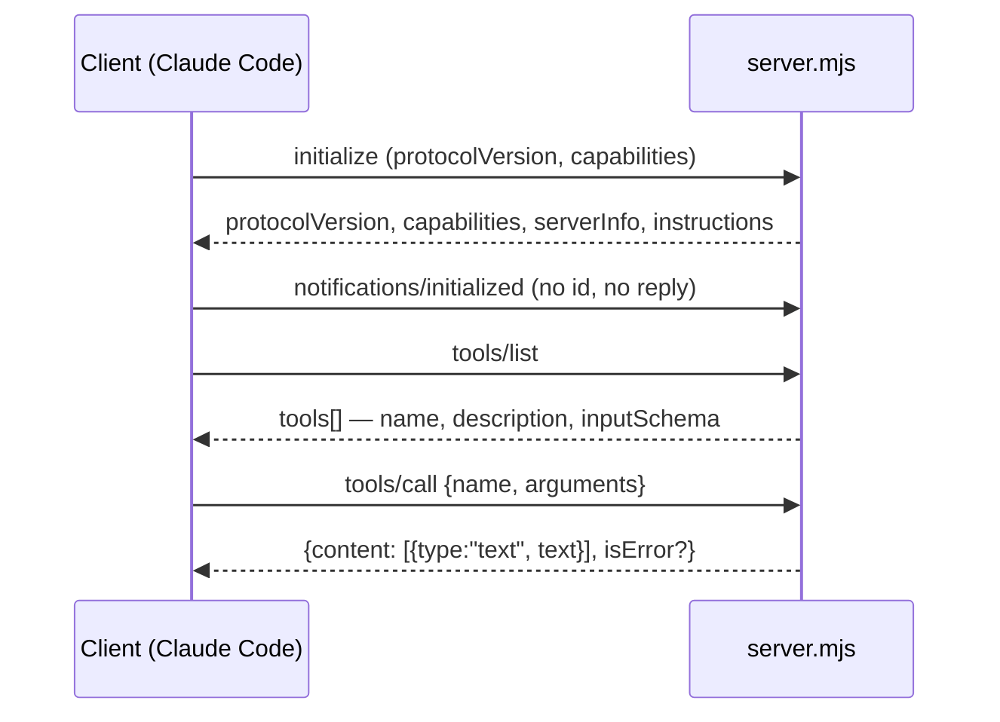

# Build an MCP Server From Scratch

> You can write a server with no dependencies, wire it to Claude Code, and tell
> a protocol bug from a tool bug from a bad description.

**Type:** Build
**Prerequisites:** Lessons 49–51
**Time:** ~45 minutes

---

## Learning Objectives

- Write a stdio MCP server — handshake, `tools/list`, `tools/call` — with no SDK
- Give a tool a name, a description, and an input schema that the model can pick from
- Connect it to Claude Code and call it end to end
- Return a tool error as data instead of crashing the server

---

## The Problem

You've connected four servers and none of them do quite what you need. There's a
tool in there that almost reads your notes, but not the notes, not with the
fields you want, and it returns everything including the parts you didn't ask
for. The nearest fix is writing your own.

The SDK route is one `pip install` away and about forty lines of ceremony. But
the first time you hit a server that won't connect, the ceremony is what's
between you and the answer. A stdio server with no dependencies is about sixty
lines of code you can read all at once, and every failure it can have is a
failure you can see in the file.

---

## The Concept

Everything a stdio MCP server does, in one loop.



The protocol is JSON-RPC 2.0 over a line-delimited stream. Three rules cover
almost everything:

1. **A message with an `id` is a request.** Answer it exactly once.
2. **A message with no `id` is a notification.** Answer it never.
3. **stdout is the channel.** One JSON object per line. Logs go to stderr, or
   you corrupt the stream — Lesson 50's exercise.

### The tool definition is the product

The model never reads your code. It reads the `tools/list` response. Which means
the description *is* the interface, and it's judged differently than you'd judge
a function name.

| Field | What it does | What a bad version looks like |
|---|---|---|
| `name` | How it's called. Keep it short and verb-shaped | `query2` |
| `description` | What the model matches against when choosing | "Gets data" |
| `inputSchema` | Types the API validates before the call even reaches you | Missing `required` |

Two failure modes that produce no error at all:

- **A schema the API rejects takes down every request that includes it.**
  Claude Code checks schemas at load time and excludes the ones that would fail,
  telling you which and why — but the check is your safety net, not a licence.
  Property names must be 1–64 characters of letters, digits, `_`, `.`, `-`.
- **A full tool name over 128 characters is silently omitted.** That's
  `mcp__<server>__<tool>` — count the server name too. `/mcp` shows the full name.

### Errors are content

When a tool fails, return `isError: true` with a message. Don't throw, don't
exit. An exception that escapes kills the process, the client reports a
disconnect, and the model has learned nothing about *why*. A returned error is
information: the loop reads it and tries something else.

Same for missing arguments. "No note titled X. Call list_notes first." is a
tool call the model can recover from. "Error: undefined" is not.

> **The reframe:** the model never reads your server — it reads the `tools/list`
> response, so a tool's description *is* the interface, and a tool that fails by
> throwing has published nothing except its own absence.

### What a tool description is doing while you write it

With tool search on (the default, Lesson 54), Claude reads a tool's description
to decide whether that tool is the one it wants — it sees the *name* of a
deferred tool and searches the description. So the words the model would search
for belong **at the start** of the description. Descriptions are cut off past a
limit, and the model sees only what came before the cut. Put it first.

### What this lesson skipped

**Resources and prompts.** A server can expose `@`-mentionable content and
`/slash`-invocable task shapes. Tools are the part the loop drives itself, and
that's what this lesson is about.

**The official SDKs.** For anything you deploy, an SDK handles protocol
revisions, transports beyond stdio, and argument validation. Writing raw JSON-RPC
is for learning the shape and for servers small enough to hold in your head. The
skill `mcp-builder` is the next step once stdio feels boring.

**HTTP servers.** Different transport, same protocol objects. Once stdio works,
http is a framing change and an auth story — Lessons 50 and 54.

---

## Build It

The finished server is in `code/` next to this file. Read it, then reproduce it.

### 1. Read the data

`code/notes.json` — three notes. One of them, `untrusted`, contains text that
tries to hijack the agent. It's there for Lesson 53. Nothing else about the
server knows it's special.

✅ You pass when you can say which note is the hostile one and what it asks for.

### 2. Read the tool definitions

Open `code/server.mjs`. Find `TOOLS`. Two tools: `list_notes`, `read_note`.
Look at `read_note`'s `inputSchema` — `required: ['title']`, and
`additionalProperties: false` so an unexpected key is a validation error rather
than a silently ignored typo.

✅ You pass when you can explain why `additionalProperties: false` is set, in one
sentence about typos.

### 3. Run the self-check before you wire anything up

```bash
cd code
node test-server.mjs
```

It spawns the server, speaks real JSON-RPC at it, and asserts on the replies: a
notification gets no reply, a tool error comes back as `isError` rather than a
crash, and an unknown method returns `-32601`.

```
ok: 6 replies, notification ignored, tool error contained, unknown method rejected
```

✅ You pass when you see that line. If you don't, the server is wrong and
Claude Code would only have told you "failed to connect."

### 4. Read the framing loop — this is the whole protocol

Bottom of `server.mjs`. Append to a buffer, split on newline, parse, dispatch by
`method`. Two branches people forget:

```js
if (msg.id === undefined) continue;      // notification: never answer
```

and the split between "the method doesn't exist" (`-32601`) and "the method
exists and my code threw" (`-32603`). Those are different bugs with different
fixes.

✅ You pass when you can point at the two error codes and say which one is "you
asked wrong" and which is "I broke".

### 5. Connect it

```bash
claude mcp add --transport stdio notes -- node "$PWD/server.mjs"
claude mcp get notes
```

Absolute path. A relative path in a stdio entry means "relative to whatever the
client's working directory is", which is a bad afternoon.

Restart Claude Code, `/mcp`, approve.

✅ You pass when `/mcp` shows `notes` connected with two tools listed.

### 6. Call it end to end

```
List my notes, then read the one called groceries.
```

Both tools should appear in the transcript as MCP calls. Note what did *not*
happen: the model never saw `server.mjs`, never constructed a shell command, and
never guessed an argument name.

✅ You pass when the transcript shows two named MCP tool calls and the answer
includes the text of the `groceries` note.

### 7. Break it on purpose — the version that teaches

Four experiments, one at a time:

| Break it | Expected symptom |
|---|---|
| Add `console.log` before the read loop | Connect failure or parse error |
| Delete `required: ['title']` | Calls with no title reach your code and throw |
| Rename `title` to `Title` in the schema | The model starts passing `Title`; your code returns "no note" |
| Make the name 140 characters long with the server prefix | The tool is missing from the model's list |

✅ You pass when you have the observed error for each, and can say which layer
each one failed at: framing, validation, description, or name length.

### 8. Repair it

Undo all four. Confirm the self-check passes and `/mcp` still lists both tools.

✅ You pass when `node test-server.mjs` prints its ok line and a fresh call to
`read_note` works.

---

## Use It

| Thing | When you reach for it |
|---|---|
| `initialize` returning `instructions` | You want Claude to know *when* to search for your tools |
| `inputSchema` with `required` | Always, for any tool taking arguments |
| `additionalProperties: false` | Any tool where a typo'd argument should fail loudly |
| `isError: true` with a message | Every failure. The model reads it and recovers |
| stderr for logs | Always. stdout is protocol traffic |
| `if (msg.id === undefined) continue` | Your server receives notifications |
| Short `mcp__<server>__<tool>` name | The full name must fit in 128 characters |
| Search words at the start of a description | Tool search is on by default — it's how the tool gets found |
| `_meta["anthropic/requiresUserInteraction"]` | A tool whose permission prompt is the point |
| The `mcp-builder` skill | When this stops being small |

---

## Exercises

1. Add a third tool, `delete_note`, that removes a note by exact title. Write the
   description as if the model has never seen this server. Update the self-check
   to assert the tool appears in `tools/list`.
   ✅ You pass when the test passes, `/mcp` shows three tools, and you can
   explain in one sentence what word you put first in the description and why.

2. Make a tool fail on purpose, badly: call it with a title that doesn't exist,
   then with no arguments at all.
   ✅ You pass when both produce a message the model could act on, the server
   survives both, and you can say what a thrown exception would have cost.

3. Measure it. Set `_meta["anthropic/maxResultSizeChars"]` on `read_note` and
   compare a huge note's handling with and without it.
   ✅ You pass when you can say what the default threshold is, what the
   annotation raised it to, and what Claude Code does to a result that crosses
   the line — file reference, or inline.

4. Read `notes.json` and write the paragraph you would put in the server's
   `instructions` field if you were shipping this to someone else.
   ✅ You pass when your paragraph says what kind of task these tools handle and
   when to search for them, and is under the description limit noted in the
   docs.

---

## Key Terms

| Term | What people say | What it actually means |
|---|---|---|
| `initialize` | "the handshake" | First message. Version and capabilities agreed before any tool call. |
| notification | "a message" | JSON-RPC with no `id`. Never answered. `notifications/initialized` is the one you'll meet. |
| `tools/list` | "the manifest" | What the model picks from. The description is the interface. |
| `tools/call` | "the invocation" | Name plus a JSON object of arguments, validated against the schema. |
| input schema | "the types" | JSON Schema the API checks before the call reaches you. One bad schema can fail the whole request. |
| `isError` | "an error response" | A tool failure reported as data. The loop reads it and tries again. |
| `instructions` | "the readme" | Server-level prose telling the model what your server is for. Load-bearing with tool search. |
| `_meta` | "extra fields" | Per-tool annotations: size ceiling, always-load, require-interaction. |
| protocol version | "the version string" | Agreed at `initialize`. A server speaking a revision the client doesn't will fail at the first tool call. |
| stdio framing | "the wire format" | One JSON object per line, stdin and stdout, nothing else on stdout. |

---

## What this lesson skipped

**Resources and prompts.** Same protocol, different capability objects. Add
them when your server has content to attach rather than actions to take — the
`@server:protocol://path` and `/servername:promptname` forms are Lesson 49's.

**The official SDKs.** An SDK handles protocol revisions, transports, and
validation so you don't have to. Right for anything you deploy; unnecessary
for ninety lines of stdio.

**Notifications *from* the server**, and sampling — the server calling back
into the model. Real, version-dependent, and not needed for a tool server.

**Authentication.** A local server has no auth problem. The moment yours is
remote it does — Lesson 54.

**Deployment.** Packaging the server so other people can install it is Phase 09,
plugins.

**The hostile note in `notes.json`.** It does nothing until Lesson 53, where it
tries to make the agent dump `~/.claude.json` into the conversation. Don't run
that lesson half-way.