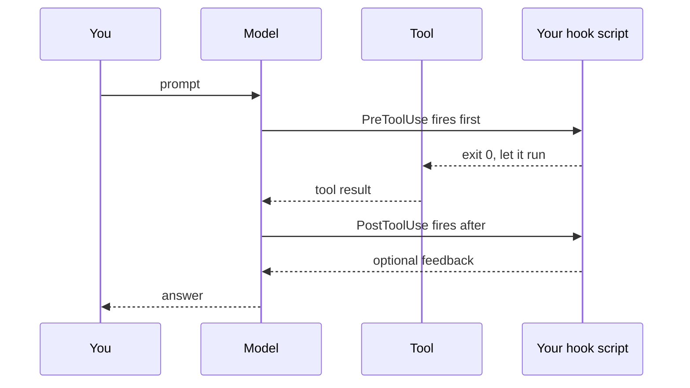

# What a Hook Is

> You stop asking the agent to be careful and start making the bad thing
> unreachable — the harness runs your code at fixed points on the loop, before
> the action, not after.

**Type:** Learn
**Prerequisites:** Phase 04, Lesson 31 (The Agentic Loop); Phase 04, Lesson 34 (Settings)
**Time:** ~30 minutes

---

## Learning Objectives

- Say what a hook is in terms of the agentic loop, without saying "it's a callback"
- Name the two classes of hook: one that can stop an action, one that cannot
- Point at the three places hooks can be declared and say which one wins
- Write a config block that fires on one specific tool

---

## The Problem

You put this line in your project instructions:

> Always commit before you create a worktree. Never push to main.

The agent reads it. The agent agrees. Twenty minutes later you look at your
worktree list and there are four new branches pointing at `main`, none of them
committed, and a commit message that says "feat: initial" for all of them.

Nothing lied. Nothing crashed. The rule was in the window the whole time.

The rule failed because a rule competes for attention with everything else in
the window (Phase 01, Lesson 8). A rule is a *request*. Every instruction you
have ever written to an agent is a request. A request is honored when the model
remembers it, has the context to care, and nothing more pressing shows up.

There is a mechanism that isn't a request. It runs whether the model is paying
attention or not, at a fixed point in the loop, in your code, outside the
window entirely. The model doesn't have an opinion about it.

---

## The Concept

A hook is your script, run by the harness at a named point on the loop.

The agentic loop (Phase 04, Lesson 31) is: **model decides → tool runs →
result returns → repeat.** Hooks attach to the seams of that loop.



Two things fall out of that diagram, and they are the whole lesson.

**One: the hook runs before the model gets to act.** `PreToolUse` fires after
the model has emitted a tool call but before the tool runs. Your script sees
`tool_name` and `tool_input` on stdin. If it objects, the tool call never
happens. The model is not persuaded out of the bad action — the bad action is
not available to it at that point.

**Two: your script is outside the window.** It gets its own JSON on stdin. It
does not read instructions, does not get compacted, does not forget. It runs the
same way at hour six as at minute one.

That's the difference from a skill (Phase 05), a subagent (Phase 06), or a line
in `CLAUDE.md`:

| Mechanism | Runs | Lives in the window? |
|---|---|---|
| `CLAUDE.md` rule | Whenever the model re-reads it | Yes — competes, compacts |
| Skill | When invoked, by judgment | Yes |
| Subagent | When delegated, by judgment | Yes, its own |
| **Hook** | **Whenever the event fires. No judgment.** | **No** |

### The two kinds

Every hook event falls into one of two buckets, and knowing which bucket an
event is in tells you whether your script can actually stop anything.

- **Blocking events.** `PreToolUse`, `UserPromptSubmit`, `PreCompact`,
  `Stop`, `SubagentStop`, `TaskCreated`, and a handful more. Exit code 2 stops
  the action. This is enforcement.
- **Non-blocking events.** `PostToolUse`, `SessionStart`, `Notification`,
  `Setup`, `MessageDisplay`, `StopFailure`. Your script can add context or write
  a log. It cannot un-run the thing that already happened.

`PostToolUse` is the trap. It sounds like the strong one — "after the tool
runs, check the result." It can feed a failure back to the model, and that is
genuinely useful. But if the tool wrote to a database, `PostToolUse` fires
after the write. Blocking there stops the *next* step, not this one.

### Where you declare one

Hooks live in settings files, and settings have a precedence order (Phase 04,
Lesson 34). For this phase, the two that matter:

| File | Scope |
|---|---|
| `.claude/settings.json` | This project. Committed. Shared with your team. |
| `.claude/settings.local.json` | This project. Yours only. Usually gitignored. |
| `~/.claude/settings.json` | Every project you open. |

They **merge**. A hook in your user file does not replace a hook in the project
file — both run. That surprises people who expect the closer file to win, and
it means "I removed the block" can leave a block behind in a file you forgot
about. Lesson 34 has the full precedence table; come back to it when a hook
fires that you cannot find.

### The shape

Three nesting levels. Event, matcher group, handlers.

```json
{
  "hooks": {
    "PreToolUse": [
      {
        "matcher": "Bash",
        "hooks": [
          {
            "type": "command",
            "command": "${CLAUDE_PROJECT_DIR}/.claude/hooks/check.sh",
            "timeout": 10
          }
        ]
      }
    ]
  }
}
```

Read it outward in: *on this event, when the tool matches this, run these.*

`${CLAUDE_PROJECT_DIR}` is substituted at run time with the project root where
the session started. Without it, a relative path resolves against whatever
directory the hook happens to run in, which is not a thing you want to rely on.

> **The reframe:** a hook is not an instruction the agent may follow, it is code
> the harness runs whether or not the agent agrees — which is the only reason it
> can make a bad action impossible rather than merely discouraged.

---

## Build It

### 1. Find out what's already there

```
/hooks
```

This is the fast check. It lists configured hooks, which settings file each one
came from, and whether it is enabled.

✅ You pass when you can name every hook currently configured, or state plainly
that there are none.

### 2. Write a hook that logs and never blocks

Create `.claude/hooks/log.sh`:

```bash
#!/bin/sh
# Reads the event JSON on stdin, appends one line, allows everything.
cat >> "${CLAUDE_PROJECT_DIR}/.claude/hook-log.txt"
echo "exit 0"
```

This is a `PostToolUse` hook — the weakest kind, deliberately. It observes.

Declare it in `.claude/settings.json`:

```json
{
  "hooks": {
    "PostToolUse": [
      {
        "matcher": "Bash",
        "hooks": [
          {
            "type": "command",
            "command": "${CLAUDE_PROJECT_DIR}/.claude/hooks/log.sh"
          }
        ]
      }
    ]
  }
}
```

Make it executable (`chmod +x`), restart the session, and ask the agent to run
any `Bash` command.

✅ You pass when `.claude/hook-log.txt` has at least one line of JSON in it after
a single Bash tool call.

### 3. Prove it is not the window

That log hook ran. Now compact (`/compact`), or run `/clear` and start again,
and trigger another Bash call.

The window is empty of that conversation. The hook fired anyway.

✅ You pass when the log file grows after the conversation that caused it is
gone.

### 4. Write a hook that blocks

Same structure, different event and a different script.
`.claude/hooks/no-force-push.sh`:

```bash
#!/bin/sh
input=$(cat)
case "$input" in
  *'"command":"git push'*|*'"command": "git push'*)
    echo "Blocked: no git push from this project." >&2
    exit 2
    ;;
esac
exit 0
```

Declare it on `PreToolUse` with matcher `Bash`. Then ask the agent to run
`git push`.

✅ You pass when the push does not happen and the reason text appears in the
session.

---

## Use It

| Thing | When you reach for it |
|---|---|
| `PreToolUse` + matcher `Bash` | Blocking a dangerous command shape |
| `PreToolUse` + matcher `Edit\|Write` | Forbidding edits outside a directory |
| `PostToolUse` + matcher `Edit\|Write` | Reminding the agent a file is generated |
| `UserPromptSubmit` | Rejecting or rewriting a prompt before it is read |
| `SessionStart` | Loading state into a fresh session |
| `Stop` | Refusing to let a turn end until something is verified |
| `/hooks` | Any time you cannot find the hook you expected |
| `settings.local.json` | A rule that is yours, not your team's |

---

## Exercises

1. Write a `PreToolUse` hook on matcher `Write` that refuses any file path
   containing `dist/`. Trigger it by asking the agent to write a file there.
   ✅ You pass when the write does not occur, the refusal reason is shown, and
   the same agent writes a file outside `dist/` without trouble.

2. Delete your project settings hook file, or comment it out, restart, and
   trigger the action again. Then check `~/.claude/settings.json`.
   ✅ You pass when you can say whether the hook kept firing after you "removed"
   it, and name the file that was actually responsible.

3. Find one event that sounds like it should block and confirm from the docs
   whether it can.
   ✅ You pass when you have named the event and quoted the docs line that says
   whether exit 2 stops the action.

---

## Key Terms

| Term | What people say | What it actually means |
|---|---|---|
| hook | "a callback" | Your script, run by the harness at a named point on the agentic loop. Not called by the model. |
| hook event | "the hook" | A named firing point — `PreToolUse`, `Stop`, `SessionStart`. One event can have many handlers. |
| matcher | "a filter" | The condition on which handler group activates. Tool name, regex, or `*` for all. |
| blocking event | "a real hook" | An event where exit 2 stops the pending action. `PostToolUse` is not one. |
| `${CLAUDE_PROJECT_DIR}` | "the cwd" | The project root where the session started. Not the process cwd, and in a worktree it points at the main checkout. |
| settings merge | "nearest file wins" | They don't. Every level's hooks run. Lesson 34 has the order. |

---

## What this lesson skipped

**The event list.** 30-odd names, what each one carries, and which can block.
That is Lesson 56 and you will want it as a reference, not as prose.

**Script internals.** How the JSON arrives on stdin, what to print, what each
exit code means. Lessons 57 and 58.

**Matchers that are regexes.** `"Bash"` is an exact string. `"Edit.*"` is a
JavaScript regex and it matches more than you expect. Lesson 56.

**Hook handler types other than `command`.** There are four others (`prompt`,
`agent`, `http`, `mcp_tool`). You do not need them to build a guardrail, and
they cost more. Lesson 56 names them; come back when a shell script stops being
enough.

**Async hooks.** A hook can run in the background and not block. Useful for slow
telemetry, wrong for policy — a decision printed after the harness stopped
waiting does not control anything. Lesson 60 touches it.

**Plugins and skills as hook sources.** A skill's frontmatter can declare hooks
for the length of a session, and a plugin ships a `hooks.json`. Both need Phase
05 and Phase 09 grounding respectively.

The event list and the exact behaviour of any given event are version-gated.
Claude Code ships weekly. Check
[the hooks page](https://code.claude.com/docs/en/hooks) and
`https://code.claude.com/docs/llms.txt` rather than trusting a number quoted
here.