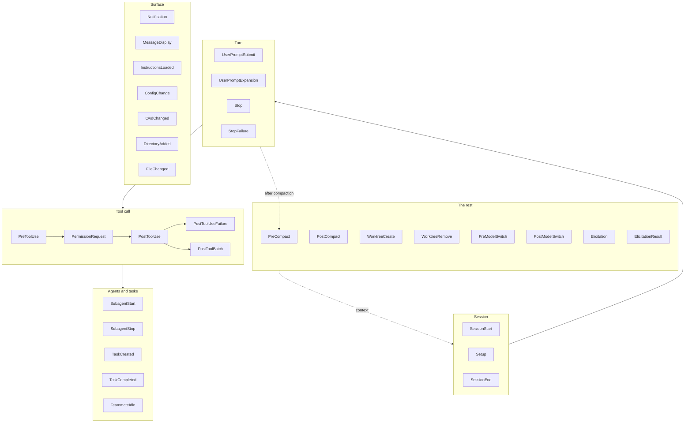

# All the Events, Matchers, Handler Types

> The reference page. Thirty-odd firing points, and for each one the only two
> things that matter: can you stop it, and what does it hand you.

**Type:** Learn
**Prerequisites:** Lesson 55, What a Hook Is
**Time:** ~40 minutes

---

## Learning Objectives

- Find the right event for a job without reading the whole list
- Read a matcher string and say what it matches — including the regex cases that
  surprise people
- Name the five handler types and say which one a guardrail wants
- Predict, from the event table alone, whether exit 2 will stop anything

---

## The Problem

You write a `PostToolUse` hook that checks whether the agent just wrote a file
with a secret in it, and denies the write when it finds one.

It runs. It finds the secret. It reports the problem. The file is still there,
because the file was written before `PostToolUse` fired.

Nothing about that hook was wrong. It was attached to the wrong seam. You picked
the event whose name sounded right — "after a tool runs, check the result" —
instead of the event that sits before the tool runs.

Picking an event is a decision about *when your code gets to speak*. Get it
wrong and everything downstream is a working script that is too late.

---

## The Concept

The events fall into six families, ordered by where they sit on the loop.



That is 33 names. The course catalog says 32, written when the list was one
shorter. **Treat the number as a moving target and the list as the thing to
check** — [the hooks page](https://code.claude.com/docs/en/hooks) is the
authority, and it changes as Claude Code ships.

### The event table

"Can block" is the column that decides where you attach a guardrail. "Carries"
is what arrives on stdin beyond the common fields.

| Event | Matcher matches | Carries | Can block? |
|---|---|---|---|
| `SessionStart` | `startup`, `resume`, `clear`, `compact` | `source` | Yes — can refuse startup |
| `Setup` | `init`, `maintenance` | `trigger` | No. Command hooks only; output unused |
| `SessionEnd` | `clear`, `logout`, `prompt_input_exit` | reason | No |
| `UserPromptSubmit` | — | `prompt` | Yes — refuse the prompt |
| `UserPromptExpansion` | `command_name` | `command_args`, `command_source` | Yes — refuse the expansion |
| `Stop` | — | `last_assistant_message`, `stop_hook_active` | Yes — refuse to end the turn |
| `StopFailure` | error type | `error`, `error_details` | No |
| `PreToolUse` | tool name / regex | `tool_name`, `tool_input`, `tool_use_id` | Yes — allow / deny / ask / defer |
| `PermissionRequest` | tool name / regex | `tool_name`, `tool_input`, `permission_suggestions` | Yes — allow or deny the prompt |
| `PermissionDenied` | tool name / regex | `tool_name`, `tool_input`, `reason` | No — may set `retry: true` |
| `PostToolUse` | tool name / regex | `+ tool_response`, `duration_ms` | **No.** Can add context; the tool already ran |
| `PostToolUseFailure` | tool name / regex | `+ error`, `is_interrupt` | No — can add corrective context |
| `PostToolBatch` | — | `tool_calls[]` | Yes — stop the loop before the next model turn |
| `SubagentStart` | agent type | `agent_id`, `agent_type` | No — can inject context |
| `SubagentStop` | agent type | `agent_type`, `last_assistant_message` | Yes — send the subagent more work |
| `TaskCreated` | — | `task_id`, `task_subject` | Yes — refuse task creation |
| `TaskCompleted` | — | `task_id`, `task_subject` | Yes — reject completion |
| `TeammateIdle` | — | `teammate_name` | Yes — keep the teammate working |
| `Notification` | notification type | `message`, `notification_type` | No |
| `MessageDisplay` | — | `message_id`, `delta`, `final` | No — only `displayContent` |
| `InstructionsLoaded` | `load_reason` | `file_path`, `memory_type`, `globs` | No — observability |
| `ConfigChange` | — | — | Yes |
| `CwdChanged` | — | — | No |
| `DirectoryAdded` | — | — | No |
| `FileChanged` | path glob | path | No |
| `PreCompact` | `manual`, `auto` | trigger | Yes |
| `PostCompact` | — | — | No |
| `WorktreeCreate` / `WorktreeRemove` | — | worktree path | — |
| `PreModelSwitch` / `PostModelSwitch` | — | from/to model | `Pre` yes, `Post` no |
| `Elicitation` / `ElicitationResult` | — | MCP elicitation data | Yes |

**Common fields on nearly every event:** `session_id`, `transcript_path`,
`cwd`, `permission_mode`, `hook_event_name`. Don't re-derive these — they're
already on stdin.

### Matchers

The matcher decides whether a handler group activates. There are three
behaviours and one string decides which you got.

| Matcher string | Behaviour |
|---|---|
| `"*"`, `""`, or omitted | Every occurrence |
| Only letters, digits, `_`, `-`, spaces, `,`, `\|` | Exact string, or alternatives split on `\|` / `,` |
| Anything else | Unanchored JavaScript regex, tested with `RegExp.prototype.test` |

That third row is where people get bitten.

- `"Edit"` matches only `Edit`. It does not match `NotebookEdit`.
- `"Edit.*"` matches `NotebookEdit` too. Regex is unanchored — it will match a
  substring anywhere.
- `"^Edit$"` matches only `Edit`, and only if the whole name is `Edit`.

Use `^...$` when you mean exactly one tool. Write it down deliberately.

Two events are stricter: `FileChanged` and `StopFailure` take exact values with
only letters, digits, `_`, and `|`. A space, comma, or hyphen in those matcher
strings pushes you onto the regex path, where `"pull_request_review"` is a
literal, not a pattern.

Events that don't support matchers ignore one you supply and run every time.

### MCP tool names

Tools from an MCP server (Phase 07) are named `mcp__<server>__<tool>`, so:

```
mcp__memory__create_entities
```

Matcher `^mcp__memory__` gets you all of that server's tools. A tool bundled by
a plugin gets a scoped name: `mcp__plugin_<plugin>_db__query` (Phase 09).

### Per-handler `if`

A tool-event handler can add one permission-rule expression instead of doing the
matching in your script:

```json
{
  "type": "command",
  "if": "Bash(git *)",
  "command": "./check-git-hook.sh"
}
```

One rule only. No `&&`, no `||`, no list. Two conditions means two handlers.
It is only evaluated on `PreToolUse`, `PostToolUse`, `PostToolUseFailure`,
`PermissionRequest`, and `PermissionDenied` — on any other event a handler with
`if` never runs, silently. That last part has cost people an afternoon.

And the docs are explicit that `if` matching is best-effort. For hard policy,
match in your script.

### Handler types

Five. Four of them are overkill for a guardrail.

| Type | What runs | Cost | Use it for |
|---|---|---|---|
| `command` | A script. JSON in on stdin, decision out via exit code or stdout. | Milliseconds | **Policy, blocking, logging.** Start here |
| `prompt` | A small model classifies the event. Deprecated in favour of `agent`. | A model call | Legacy only |
| `agent` | A full subagent with your instructions, possibly tools | Slow, expensive | Judgement a regex can't make |
| `http` | A POST to your endpoint; the response is the decision | Network | Central policy service |
| `mcp_tool` | A tool on an MCP server; the result is the decision | A tool call | You already built one in Phase 07 |

Reach for `agent` only after a script has failed you. Every guardrail that costs
a model call to evaluate is a guardrail you can't afford on every tool call.

### Precedence between handlers

When several hooks decide the same `PreToolUse` call, they don't merge:

```
deny  >  defer  >  ask  >  allow
```

One `deny` wins. There is no vote.

> **The reframe:** the only question when choosing an event is *when does my
> code get to speak* — before the action is `Pre`, after it is `Post`, and a
> `Post` hook that says no is a comment on something that already happened.

---

## Build It

### 1. Read the table against a real job

Pick a rule you actually want: "no edits outside `src/`", "no `git push`, no
force-push", "run the formatter after every edit". For each, name the event
before you write anything.

✅ You pass when each rule has an event chosen by *timing*, and you can say what
the tool call would look like if your hook did not exist.

### 2. Prove the `PostToolUse` trap

Take the "no edits outside `src/`" rule and wire it to `PostToolUse` with
matcher `Edit|Write`. Ask the agent to write a file outside `src/`.

The hook fires. Whatever it reports, the file exists.

Then move the same script to `PreToolUse` and repeat.

✅ You pass when you have the `PostToolUse` version's file on disk and the
`PreToolUse` version's file absent, and you can name the difference in timing.

### 3. Find a regex biting you

Set matcher `Edit` and ask the agent to use `NotebookEdit`. Then set matcher
`Edit.*` and repeat. Then `^Edit$`.

✅ You pass when you can show which of the three fired for `NotebookEdit` and
explain the unanchored match from the docs.

### 4. Check the merge, not the replace

Add a `SessionStart` hook to `.claude/settings.local.json` while one already
exists in `.claude/settings.json`. Run `/hooks`.

✅ You pass when `/hooks` shows both, sourced to the two different files.

### 5. Confirm a silent no-op

Add `"if": "Bash(git *)"` to a `SessionStart` hook. Trigger a Bash git
command.

✅ You pass when you can state that it did not run because `if` is only
evaluated on tool events, and you can name the five events where it is.

---

## Use It

| Need | Event | Why |
|---|---|---|
| Forbid a tool call | `PreToolUse` | Fires before the tool runs |
| Answer a permission prompt yourself | `PermissionRequest` | Fires at the prompt, with suggestions |
| Rewrite a tool's arguments | `PreToolUse` + `updatedInput` | Input not yet used |
| Remind after a write | `PostToolUse` + `additionalContext` | Only place it's true |
| Refuse to end the turn unfinished | `Stop` | Fires at turn end |
| Send a subagent more work | `SubagentStop` | Fires at subagent end |
| Log without touching the loop | `Notification`, `SessionStart` | Side effects only |
| Refuse a whole batch | `PostToolBatch` | Between batches, not inside one |

---

## Exercises

1. Pick five events from the table and write one sentence each on what a hook
   there could accomplish that a hook on the neighbouring event could not.
   ✅ You pass when every sentence names a timing difference, not a topic
   difference.

2. Write a matcher for "every tool from the MCP server named `memory`, but not
   the `create_entities` one", and verify it fires for a sibling tool.
   ✅ You pass when the right tool triggers it and `create_entities` does not,
   and you can quote the matcher syntax you relied on.

3. Find an event in the table that cannot block, and write the strongest thing
   you can do there. Then say out loud what it still cannot do.
   ✅ You pass when your answer names the irreversibility explicitly — "the tool
   already ran" — rather than describing the feature.

---

## Key Terms

| Term | What people say | What it actually means |
|---|---|---|
| event | "the hook" | A named firing point. Many hooks can share one event. |
| matcher | "a filter" | The condition activating a handler group. Exact string, `\|`-alternatives, or regex — determined by which characters you used. |
| blocking event | "one that stops things" | An event where exit 2 cancels a pending action. `PostToolUse` is not one. |
| handler type | "the hook type" | What runs: `command`, `prompt`, `agent`, `http`, `mcp_tool`. |
| `if` | "a second matcher" | One permission-rule expression, on five events only. Silently ignored elsewhere. |
| precedence `deny > defer > ask > allow` | "the strictest wins" | Right. One `deny` overrides an `allow` from another handler. There is no vote. |

---

## What this lesson skipped

**The full `hookSpecificOutput` schema per event.** Each event's decision object
has its own fields and its own shape, and the nesting differs between them.
Lesson 57 covers the three you will write by hand; the rest is a
copy-from-the-docs job.

**Timeouts in depth.** Defaults are 600s for command hooks, 30s on several
events, 10s on `MessageDisplay`, with a shared 1.5s budget for `SessionEnd`.
Relevant when a hook hangs. Lesson 60.

**`async` and `asyncRewake`.** Background hooks can't block, because a decision
printed after the harness stopped waiting controls nothing. Lesson 60, briefly.

**`Elicitation`, `TaskCreated`, `TaskCompleted`, `TeammateIdle`, `WorktreeCreate`.**
Real, and you will need them — but they lean on subagents, agent teams, and
worktrees from Phases 06, 12, and 16. They get used there, not here.

**Every field on stdin.** The table lists what each event adds; the input JSON
has more. Get the exact shape from the docs page for the event you're writing.

**Ordering guarantees within an event.** Whether two handler groups on the same
event run in file order, in parallel, or otherwise. Not documented clearly
enough to teach — check it in your own session before depending on it.

The event list, the handler types, and which events block are all
version-gated. Verified against
[the hooks page](https://code.claude.com/docs/en/hooks) on 2026-10-15. Re-check
`https://code.claude.com/docs/llms.txt` before trusting anything version-shaped
in this table.