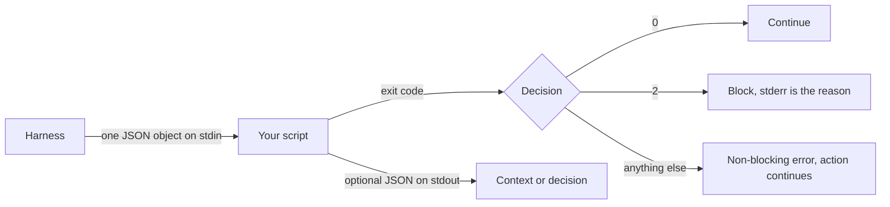

# Hook Script Shape — stdin JSON → stdout / exit code

> The script is a function of one JSON object with no arguments. Everything it
> knows arrives on stdin; everything it says goes out through its exit code and
> its stdout.

**Type:** Learn
**Prerequisites:** Lesson 56, All the Events, Matchers, Handler Types
**Time:** ~35 minutes

---

## Learning Objectives

- Parse the event JSON on stdin and read the fields you need
- Choose between exit code and JSON stdout for a given decision
- Return a `PreToolUse` deny, an `additionalContext`, and a `systemMessage` from
  the same script shape
- Feed a hook script a fabricated event from your shell, without Claude Code

---

## The Problem

You write a hook. It runs. It seems to do nothing — no output, no error, no
block, and the agent carries on exactly as if the hook weren't there.

The script is almost certainly fine. What you got wrong is the interface.

There is no argument list. There is no environment variable holding the command.
No file is handed to you. The event arrives as one JSON object on **stdin**, and
if your script doesn't read stdin, it is working with nothing at all — and a
script that inspects nothing will usually decide nothing.

Two scripts, same file, one line different:

```sh
cat > /tmp/log.json        # reads the event — works
cat > /dev/null            # doesn't read it — you are guessing
```

---

## The Concept



Three exit codes, and they mean three different things. Lesson 58 is entirely
about the middle one versus the third, so treat this section as orientation.

### What arrives on stdin

Every event carries these:

| Field | What it is |
|---|---|
| `hook_event_name` | Which event fired. Check this in a hook wired to several |
| `session_id` | Current session |
| `cwd` | Where the agent is **now**. Not the project root — see below |
| `transcript_path` | Conversation file. Written asynchronously; may be stale |
| `permission_mode` | `"default"`, `"plan"`, `"acceptEdits"`, … not sent to every event |

Tool events add `tool_name`, `tool_input`, `tool_use_id`.

A real `PreToolUse` payload:

```json
{
  "session_id": "abc123",
  "cwd": "/home/user/my-project",
  "hook_event_name": "PreToolUse",
  "tool_name": "Bash",
  "tool_input": {
    "command": "npm test",
    "description": "Run test suite"
  },
  "tool_use_id": "toolu_01ABC123"
}
```

### Reading it

In shell, with `jq`:

```sh
#!/bin/sh
input=$(cat)
tool=$(printf '%s' "$input" | jq -r '.tool_name')
command=$(printf '%s' "$input" | jq -r '.tool_input.command // empty')
```

`// empty` matters. `.tool_input.command` is absent on `Edit`, and plain `jq -r`
prints the literal string `null` — which then fails to match anything and reads
as a decision you never made.

In Node, which is what this repo already uses:

```js
#!/usr/bin/env node
let raw = '';
process.stdin.on('data', (c) => (raw += c));
process.stdin.on('end', () => {
  const event = JSON.parse(raw);
  if (event.hook_event_name === 'PreToolUse' && event.tool_name === 'Bash') {
    const cmd = event.tool_input?.command ?? '';
    if (/^git\s+push\b/.test(cmd)) {
      process.stderr.write('Blocked: no git push from this project.\n');
      process.exit(2);
    }
  }
  process.exit(0);
});
```

`?? ''` is the same guard as `// empty`. Pick one and keep it.

### Going out: exit code, or JSON, or both

| You want | Do this |
|---|---|
| Allow, silently | `exit 0`, print nothing |
| Block | write the reason to **stderr**, `exit 2` |
| Add context for the model | `exit 0` + JSON with `additionalContext` |
| Tell the *user* something | `exit 0` + JSON with `systemMessage` |
| Change what the model reads | `exit 0` + JSON with `updatedInput` or `updatedToolOutput` |
| Auto-format after an edit | Just do it on disk; `exit 0` |

Print **one** JSON object and nothing else. The harness parses your stdout as
JSON only when the entire output is a single valid object surrounded by
whitespace. One stray `echo` before it and your decision is now plain text.

### The three JSON shapes you will write by hand

**Block a tool call** — `PreToolUse`, top-level `decision: "block"` also works
but the nested form is the one with a reason field:

```json
{
  "hookSpecificOutput": {
    "hookEventName": "PreToolUse",
    "permissionDecision": "deny",
    "permissionDecisionReason": "Writes under dist/ are generated. Edit src/ instead."
  }
}
```

**Add context the model will read:**

```json
{
  "hookSpecificOutput": {
    "hookEventName": "PostToolUse",
    "additionalContext": "This file is generated. Edit src/schema.ts and run the generator."
  }
}
```

**Stop the whole thing** — `continue: false` beats any event-specific decision:

```json
{
  "continue": false,
  "stopReason": "Build failed, fix errors before continuing"
}
```

`additionalContext` and `systemMessage` are not the same thing and get confused
constantly:

| Field | Goes to | Use for |
|---|---|---|
| `additionalContext` | The model's context | Teaching the agent something true |
| `systemMessage` | The user's screen | Telling the human something |

`additionalContext` strings cap at 10,000 characters. Past that, the excess goes
to a file and the model gets the path plus a 2,000-character preview. Don't
build on that.

### Two fields that bite

**`suppressOutput` does nothing.** The docs are explicit: it's accepted for
schema compatibility and is inert. It does not affect the transcript or the
debug log. If you were reaching for it to quiet a hook, reach for
`systemMessage` or fix the output.

**`${CLAUDE_PROJECT_DIR}` is not `cwd`.** The placeholder is where the session
*started*. In a worktree (Phase 16) it still points at the main checkout, while
`cwd` is the worktree. If your hook needs to know where the agent is writing,
read `cwd` from stdin. If it needs the repo's `.claude/` directory and config,
use the placeholder.

> **The reframe:** a hook script has no arguments and no memory — the event is
> the entire input and the exit code is the entire output, so anything you fail
> to read off stdin is something you never had.

---

## Build It

### 1. Build a hook you can test without Claude Code

Create `.claude/hooks/inspect.sh`:

```sh
#!/bin/sh
cat
```

Wire it to `PostToolUse` with matcher `Bash`, restart, run any command.

Then, without Claude Code at all:

```sh
printf '%s' '{"hook_event_name":"PreToolUse","tool_name":"Bash","tool_input":{"command":"git push --force"}}' \
  | .claude/hooks/inspect.sh
```

✅ You pass when the second command prints exactly the JSON you piped in, and
you can say why that proves the interface without any Claude Code involved.

### 2. Read one field safely

Replace the body with a parse, and pipe it an `Edit` event, which has no
`.tool_input.command`:

```sh
#!/bin/sh
input=$(cat)
tool=$(printf '%s' "$input" | jq -r '.tool_name')
command=$(printf '%s' "$input" | jq -r '.tool_input.command // empty')
printf 'tool=%s cmd=[%s]\n' "$tool" "$command"
```

✅ You pass when the `Edit` payload prints an empty `cmd=[...]`, not `cmd=[null]`.

### 3. Block, by exit code

```sh
#!/bin/sh
input=$(cat)
command=$(printf '%s' "$input" | jq -r '.tool_input.command // empty')
case "$command" in
  git\ push*)
    echo "Blocked: no git push from this project." >&2
    exit 2
    ;;
esac
exit 0
```

Pipe it a `git push --force` event and check `$?`. Then pipe it `git status`
and check it is 0.

✅ You pass when the first is exit 2 with the reason on stderr and the second is
exit 0.

### 4. Add context, by JSON

Wire a `PostToolUse` hook on matcher `Edit|Write` that emits
`additionalContext` when the edited path is a generated file. Trigger it by
editing a file under `dist/`.

✅ You pass when the agent's next turn references the reminder, and
`.claude/hooks/<your script>` contains no `echo` before the JSON.

### 5. Prove the parse-by-accident failure

Add a stray `echo "running"` to the top of the JSON-emitting script. Re-trigger.

✅ You pass when the hook no longer affects anything, and you can explain it in
terms of "the whole of stdout had to be one JSON object".

---

## Use It

| Need | Reach for |
|---|---|
| Read the event | `input=$(cat)`, then `jq` or `JSON.parse` |
| Field may be missing | `jq -r '.x // empty'` / `?? ''` |
| Block | reason on stderr, `exit 2` |
| Add context for the model | `hookSpecificOutput.additionalContext` |
| Tell the human | `systemMessage` |
| Rewrite the call | `hookSpecificOutput.updatedInput` |
| Rewrite what the model sees | `hookSpecificOutput.updatedToolOutput` |
| Stop everything | `"continue": false` + `stopReason` |
| Know the project's root | `${CLAUDE_PROJECT_DIR}` |
| Know where the agent is | `cwd` from stdin |
| Test without Claude Code | pipe a fabricated event in |

---

## Exercises

1. Write a hook script that refuses any `Bash` call whose command contains
   `rm -rf`, and prove all four of: block, allow, exit code 0 on a normal
   command, and no accidental block of a command that merely mentions `rm`.
   ✅ You pass when you have the two exit codes recorded and can name the case
   that would have false-positived under a naive substring match.

2. Feed one fabricated event to your script per event family — tool, prompt,
   stop — and make the script handle all three from the same file without
   crashing on a missing field.
   ✅ You pass when all three return 0 and you can show the field your script
   reads that is absent in at least one of them.

3. Take the `PostToolUse` formatter pattern and produce the version that also
   adds `additionalContext` explaining the format it applied.
   ✅ You pass when the JSON you print is exactly one object and the model
   mentions it on the next turn.

---

## Key Terms

| Term | What people say | What it actually means |
|---|---|---|
| stdin | "the arguments" | One JSON object. There is no argument list. |
| stdout | "the output" | Shown only on a few events; parsed as JSON only if the whole thing is one object |
| stderr | "the error log" | On exit 2, the **first line** is the blocking reason shown to the user |
| `additionalContext` | "the hook message" | Goes into the model's context. Capped at 10k chars. |
| `systemMessage` | "the hook output" | Goes to the user's screen, not the model. |
| `suppressOutput` | "keeps it quiet" | Accepted and inert. Does nothing. |
| `hookSpecificOutput` | "the decision object" | Event-specific. Always carries `hookEventName`. |
| `${CLAUDE_PROJECT_DIR}` | "the working directory" | Where the session started. In a worktree, the main checkout — not where the agent is. |

---

## What this lesson skipped

**Every event's `hookSpecificOutput` shape.** `PermissionRequest` nests
`updatedInput` inside a `decision.behavior` object; `PermissionDenied` uses
`retry`; `PostToolBatch` takes an array of tool calls. Each has its own shape.
Copy from the docs for the event you're writing — the hooks page is
copy-pasteable and authoritative.

**Async hooks.** A background hook (`"async": true`) can't block: the harness
stops waiting, so a decision printed afterwards controls nothing. If you use
async, print any decision *before* starting the background work. Lesson 60.

**Timeouts.** A `PreToolUse` timeout normally lets the call through. There's an
`onFailure: "block"` setting that changes it, and it needs a recent version.
Lesson 60, because a silent pass-through is a debugging problem.

**`http` and `mcp_tool` handlers.** Same stdin contract, different return path —
your decision comes back in an HTTP response body or an MCP tool result instead
of an exit code. Worth knowing, not worth a lesson until Phase 07 or 09
depends on it.

**Scripting languages.** Everything here is POSIX `sh` or Node. Python works the
same way; the interface doesn't care what you write it in.

The exact field set on stdin grows over time. Verified against
[the hooks page](https://code.claude.com/docs/en/hooks) on 2026-10-15; check
`https://code.claude.com/docs/llms.txt` before trusting a field name.