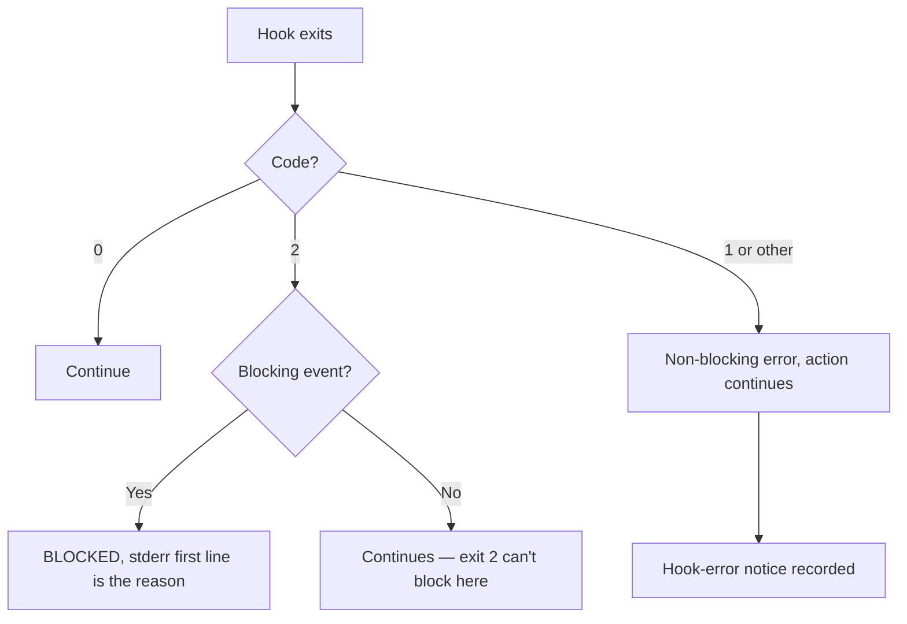

# The Exit-1-vs-2 Trap

> Exit 1 is an error. Exit 2 is a decision. Everything you build in this phase
> rides on knowing which one your script just did.

**Type:** Learn
**Prerequisites:** Lesson 57, Hook Script Shape
**Time:** ~30 minutes

---

## Learning Objectives

- Say which of the three exit codes means "block" and which means "crashed"
- Predict, from the event's name alone, whether exit 2 will stop the action
- Choose a fail-open or fail-closed failure mode deliberately, and write it down
- Explain why a guardrail that fails open is the more dangerous default

---

## The Problem

Your guardrail is correct. The script reads the command, sees `rm -rf`, decides
to block, and writes the reason:

```sh
echo "Blocked: destructive command"   # no >&2
exit 1
```

The command runs anyway.

`exit 1` is the code every shell script uses to say "something went wrong." To
the harness it means: *this hook crashed, here is the first line of its stderr,
carry on.* The action continues. Your guardrail is a warning label on a door.

The line that would have worked is `exit 2`. Same script, same message, opposite
outcome.

This is the single most common way a hook silently fails, because it fails
**open**. A guardrail that lets everything through when it's broken is worse
than no guardrail, because you stop looking at it.

---

## The Concept

Three exit codes. Every other code behaves the same as 1.

| Code | Means | The action |
|---|---|---|
| `0` | Success. Structured decisions, if any, were printed | Continues |
| `2` | **Blocking error.** First line of stderr is the reason | **Blocked**, on blocking events |
| anything else, incl. `1` | Non-blocking error | Continues |



Read that flow once more. **Exit 2 does nothing on a non-blocking event.**
`PostToolUse`, `SessionStart`, `Setup`, `Notification`, `MessageDisplay`,
`StopFailure`, `PermissionDenied` — none of them block, whatever you exit with.

### The trap, stated as a rule

**If you mean "stop", you must exit 2. If you mean "something broke", exit 1 or
anything else. Never let a crash produce exit 2.**

That last clause is the sharp edge. A guardrail script that dies halfway —
`set -e` plus a bad `jq` on unexpected input — exits non-zero. If you wrote the
guard path as `exit 2` and the crash path as `exit 1`, the crash is loud and
visible. If you wrote the crash path as `exit 2` because it was "the failure
branch", a broken script silently becomes a total lockout.

> **ponytail:** a guardrail that fails *open* is fine during development —
> you want to be able to work while you debug it. It is not fine once you trust
> it. Decide which failure mode you want and write it down.

### Four ways to get it wrong

**1. Reason on stdout instead of stderr.**

```sh
echo "Blocked: no git push"      # stdout — the user sees nothing useful
echo "Blocked: no git push" >&2  # stderr — first line becomes the reason
```

On exit 2 the *first line of stderr* is the blocking reason shown to the user.
On stdout it's ignored.

**2. Print JSON you didn't mean to print.**

Valid JSON on stdout is treated as a successful structured decision, and then
the exit code is ignored. If a hook exits 3 and prints valid JSON, the JSON
wins and the hook doesn't fail. This is convenient and it is how an `echo`
debug line turns into a hook that "succeeds" while blocking nothing.

**3. Assume exit 2 blocks everywhere.** Covered above, and it's the one that
makes a `PostToolUse` guardrail feel broken when the script is fine.

**4. Ignore hook failures entirely.**

```json
{
  "type": "command",
  "command": "node",
  "args": ["${CLAUDE_PROJECT_DIR}/.claude/hooks/check-command.js"],
  "onFailure": "block"
}
```

By default a hook failure, a timeout, or invalid JSON lets the action continue.
`onFailure: "block"` converts failures, crashes, timeouts, connection failures,
and schema-invalid output into blocks. It needs Claude Code v2.1.295 or later —
check your version before relying on it.

Note what it does **not** cover: plain-text stdout is not a failure.

### Where exit 2 actually stops something

Blocking: `PreToolUse`, `UserPromptSubmit`, `UserPromptExpansion`, `Stop`,
`SubagentStop`, `TeammateIdle`, `TaskCreated`, `TaskCompleted`,
`PostToolBatch`, `ConfigChange`, `PreCompact`, `PreModelSwitch`, `Elicitation`,
`ElicitationResult`.

Not blocking: `PostToolUse`, `PostToolUseFailure`, `PermissionRequest`,
`PermissionDenied`, `Notification`, `SessionStart`, `Setup`, `StopFailure`,
`MessageDisplay`, `PostCompact`, `PostModelSwitch`, `SubagentStart`.

One idiom worth knowing: on `PostToolUse`, exit 2 is the way to send **stderr
into the model's context** — feedback on a tool that already ran. It doesn't
block the tool; it hands the model the error. Same code, different effect,
different event. That's the one place the two halves of this lesson meet.

> **The reframe:** exit 1 is the code for "I have no opinion" and exit 2 is the
> code for "no" — and a guardrail whose failure path uses the wrong one doesn't
> announce that it stopped working, it just stops working.

---

## Build It

### 1. See exit 1 fail open, for real

Take the blocking hook from Lesson 57, change `exit 2` to `exit 1`, and ask the
agent to run the blocked command.

✅ You pass when the command runs, and you can point to the hook-error notice in
the session showing a failure that nobody intended.

### 2. See exit 2 block, on the same script

Change it back to `exit 2`. Same command.

✅ You pass when the command does not run and your stderr line appears verbatim
as the reason.

### 3. Feed it the reason channel

Move the `echo` to stdout, keep `exit 2`.

✅ You pass when the block still happens but the reason shown to the user is
missing or wrong, and you can say which stream carries it.

### 4. See exit 2 do nothing

Move the same script from `PreToolUse` to `PostToolUse`, matcher `Edit|Write`,
and have it exit 2 on a path under `dist/`. Edit a file there.

✅ You pass when the edit lands and the hook still ran, and you can name which
column of the blocking list each event sits in.

### 5. Decide your failure mode, and write it down

Make your guardrail crash on purpose — malformed input to `jq`, or a file the
script reads that isn't there — and observe the code it exits with.

Then decide: fail open (stay usable while broken) or fail closed (`onFailure:
"block"`, or an explicit crash path)?

✅ You pass when you have a written line somewhere in the script saying which,
and you can say what a user of your hook would observe under each.

---

## Use It

| You mean | Write |
|---|---|
| Allow | `exit 0`, no output |
| Block | reason on stderr, `exit 2` |
| Block on a non-blocking event | Nothing. Pick a blocking event instead |
| Report a crash | stderr message, `exit 1` (or anything non-zero) |
| Turn every failure into a block | `"onFailure": "block"` in the handler |
| Send a tool's error to the model | `PostToolUse` + exit 2 |
| Hand the model context | `exit 0` + `additionalContext` |

---

## Exercises

1. Write one script that handles three cases — allow, block, crash — and
   exercise all three by piping events at it, recording `$?` for each.
   ✅ You pass when you have three distinct codes recorded, each matching the
   intent you wrote in a comment beside it.

2. Take a working guardrail and reproduce the "JSON on stdout beats the exit
   code" behaviour: print a valid object then exit 1.
   ✅ You pass when you can state, from the observed behaviour, that the exit
   code was ignored and the JSON decided instead.

3. Find a hook in your own settings that would fail *open* on a crash, and
   either fix it or write down why you're choosing to leave it.
   ✅ You pass when your note names the specific failure and what a user would
   observe when it happens.

---

## Key Terms

| Term | What people say | What it actually means |
|---|---|---|
| exit 2 | "an error" | A blocking **decision**. Cancels a pending action on blocking events. |
| exit 1 | "a failure" | Correct. A non-blocking error. The action continues. |
| non-blocking error | "it broke" | Any non-0, non-2 exit, plus a process that can't start, plus a timeout |
| fail open | "it's broken" | A broken guardrail that permits. The dangerous default. |
| fail closed | "it's strict" | A broken guardrail that stops. Safer, and it can lock you out of your own session. |
| `onFailure: "block"` | "strict mode" | Converts failures, timeouts, and invalid output into blocks. Recent feature; check your version. |
| blocking reason | "the output" | The **first line of stderr** on exit 2. Not stdout. |

---

## What this lesson skipped

**The JSON decision fields per event.** Exit 2 and structured JSON are two
different doors into the same decision. Lesson 57 covers the three you'll write
by hand.

**Async hooks and their exit codes.** A background hook's exit code arrives
after the harness stopped waiting — it can't retroactively block. `asyncRewake`
is the exception: it wakes Claude on exit 2. Lesson 60.

**Timeouts as failures.** A timed-out `PreToolUse` normally lets the call
through. Combined with `onFailure: "block"`, it stops. This is a debugging
story more than a design one, so it's in Lesson 60.

**Version specifics.** `onFailure` requires v2.1.295+. Exit codes 0/1/2 are far
older and stable. Check
[the hooks page](https://code.claude.com/docs/en/hooks) for the current floor
before you depend on the newer field.

Blocking-event membership was verified against
[the hooks page](https://code.claude.com/docs/en/hooks) on 2026-10-15. Re-check
`https://code.claude.com/docs/llms.txt` — events get added, and a new event's
blocking behaviour is exactly the thing you'd get wrong by trusting this list.