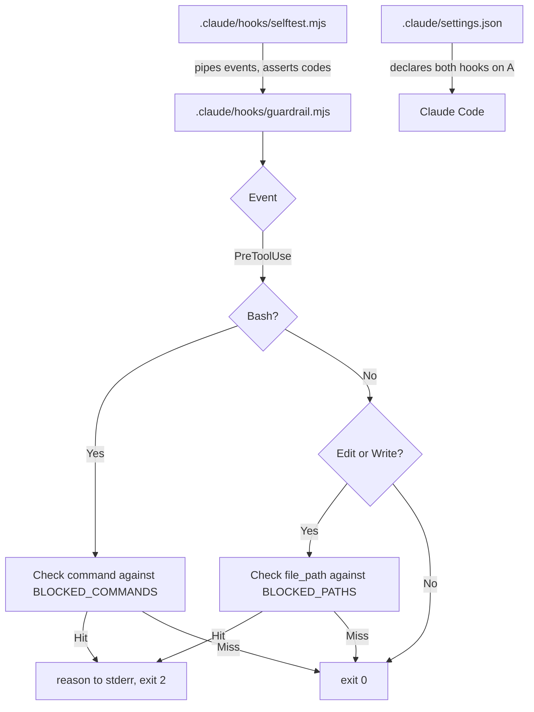

# Build a Guardrail Hook

> Four rules, one settings file, one script — and a test you can run without
> Claude Code, so you know which way it fails before the agent does.

**Type:** Build
**Prerequisites:** Lesson 58, The Exit-1-vs-2 Trap
**Time:** ~45 minutes

---

## Learning Objectives

- Write a `PreToolUse` guardrail that blocks by exit code and explains by stderr
- Cover Bash and Edit/Write in one script without confusing the two payload shapes
- Add a `PostToolUse` reminder that costs nothing and never blocks
- Build a self-test that pipes events at your hook and asserts exit codes

---

## The Problem

You write the rules you keep re-explaining. "Don't push." "Don't force-push." "Don't
edit generated files." "Commit before you make a worktree."

They live in `CLAUDE.md`. They get honored most of the time. The time they don't
get honored is exactly the time it matters — an agent three hours into a
session, mid-flow, told to create worktrees, does create worktrees, and creates
four of them uncommitted.

Nothing about that failure is a model problem. It's a mechanism problem. A rule
in a window is a request; you need something that runs whether or not the model
is attending.

The naive guardrail — four separate scripts, copy-pasted, no tests — fails a
different way. Six weeks later one has a bug, the bug fails *open*, and you
have four scripts of varying strictness and no idea which one is lying.

So: one script, one place for policy, and a test that tells you how it fails.

---

## The Concept

The artifact is three files:



Three rules make this survive contact with a real repo:

**One script, all events.** It branches on `hook_event_name` and `tool_name`
rather than assuming. A policy file that's scattered across scripts is a policy
file nobody can update.

**Blocked things are data, not code.** A list at the top of the file. Adding a
rule is adding a line, not adding a branch — which means adding a rule can't
introduce a new way to fail.

**The test is not optional.** Every rule has an allowed case and a blocked case,
and the test asserts the exit code for both. Without it, "is the guardrail
working?" is a question you answer by pushing and seeing what happens.

> **The reframe:** a guardrail is enforcement only when it blocks the dangerous
> thing *and* leaves its safe neighbour alone — and the self-test, not the block
> list, is what tells you which of the two you actually built.

---

## Build It

The full files are in `code/`. Copy them into your repo.

### 1. Write the guardrail

Create `.claude/hooks/guardrail.mjs`:

```js
#!/usr/bin/env node
// One script, one policy. Reads the event on stdin; exits 2 to block.
import { readFileSync } from 'node:fs';

const BLOCKED_COMMANDS = [
  { pattern: /^git\s+push\b(?!.*--force-with-lease)/, reason: 'Pushing is a human decision here. Use --force-with-lease if you really must.' },
  { pattern: /--force(?!-with-lease)/, reason: 'Force-push can destroy a colleague's work.' },
  { pattern: /\brm\s+-rf?\b/, reason: 'Recursive delete. Delete one path at a time.' },
  { pattern: /\bgit\s+reset\s+--hard\b/, reason: 'Uncommitted work dies there.' },
];

const BLOCKED_PATHS = [/(^|\/)dist\//, /(^|\/)node_modules\//, /\.min\.(js|css)$/];

let raw = '';
process.stdin.on('data', (c) => (raw += c));
process.stdin.on('end', () => {
  let event;
  try {
    event = JSON.parse(raw);
  } catch {
    process.stderr.write('guardrail: unreadable event, allowing\n');
    process.exit(0); // see the fail-open note below
  }

  if (event.hook_event_name === 'PreToolUse') {
    if (event.tool_name === 'Bash') {
      const cmd = event.tool_input?.command ?? '';
      const hit = BLOCKED_COMMANDS.find((r) => r.pattern.test(cmd));
      if (hit) {
        process.stderr.write(`Blocked: ${hit.reason}\n`);
        process.exit(2);
      }
    } else if (event.tool_name === 'Edit' || event.tool_name === 'Write') {
      const file = event.tool_input?.file_path ?? '';
      const hit = BLOCKED_PATHS.find((p) => p.test(file));
      if (hit) {
        process.stderr.write(`Blocked: ${file} is generated or build output.\n`);
        process.exit(2);
      }
    }
  }
  process.exit(0);
});
```

Three details that matter more than the pattern list:

- `?? ''` on both fields. An `Edit` event has no `.command` and a `Bash` event
  has no `.file_path`. Without it, `undefined` hits `test()` and throws.
- `/--force(?!-with-lease)/` excludes `--force-with-lease`. If you block plain
  `--force`, you block the safe variant too, and your team will route around
  the guardrail rather than through it. A guardrail that blocks the right thing
  gets obeyed; one that blocks the annoying thing gets worked around.

That last point is not hypothetical, and it's the reason step 4 exists. The
first version of this script blocked **all** pushes with `/^git\s+push\b/` and
carried a separate `--force-with-lease` exception. The self-test failed on the
allow case, because rule one fired first and the exception was dead code
underneath it. Two lessons in one failure: the exception had to live in the
rule that actually matches, and **the test earned its place on the same day it
was written** — before it shipped.
- The catch block **exits 0**. That's deliberate for development — you can
  still work while you fix a bug — and wrong for production. Change it, or add
  `"onFailure": "block"` in the settings, once you trust it. Lesson 58 covers
  the trade-off; make the choice deliberately.

### 2. Declare it

`.claude/settings.json`:

```json
{
  "hooks": {
    "PreToolUse": [
      {
        "matcher": "Bash",
        "hooks": [
          {
            "type": "command",
            "command": "node",
            "args": ["${CLAUDE_PROJECT_DIR}/.claude/hooks/guardrail.mjs"],
            "timeout": 5
          }
        ]
      },
      {
        "matcher": "Edit|Write",
        "hooks": [
          {
            "type": "command",
            "command": "node",
            "args": ["${CLAUDE_PROJECT_DIR}/.claude/hooks/guardrail.mjs"],
            "timeout": 5
          }
        ]
      }
    ]
  }
}
```

Two matcher groups, one script. `Edit|Write` uses the pipe-separated exact-match
syntax (Lesson 56), not regex. The script doesn't need to know which group
fired it.

`timeout: 5` because this script does two regex tests. The default is 600
seconds — a hang there is a hang in your session.

### 3. Add the reminder, which is not a guardrail

`PostToolUse` on `Edit|Write`, emitting `additionalContext` when a generated
file was written:

```json
"PostToolUse": [
  {
    "matcher": "Edit|Write",
    "hooks": [
      {
        "type": "command",
        "command": "node",
        "args": ["${CLAUDE_PROJECT_DIR}/.claude/hooks/generated-warning.mjs"]
      }
    ]
  }
]
```

`.claude/hooks/generated-warning.mjs` prints one JSON object and nothing else.
Note it does **not** try to block — `PostToolUse` can't, and a script that
attempts it teaches you the wrong lesson. Its job is to tell the model something
it can't know.

### 4. Write the self-test

`.claude/hooks/selftest.mjs`. This is the part people skip.

```js
#!/usr/bin/env node
// Runs the guardrail against fabricated events. No Claude Code required.
import { spawnSync } from 'node:child_process';
import { fileURLToPath } from 'node:url';
import { dirname, join } from 'node:path';

const here = dirname(fileURLToPath(import.meta.url));
const guardrail = join(here, 'guardrail.mjs');

const cases = [
  { name: 'allows git status',        event: { hook_event_name: 'PreToolUse', tool_name: 'Bash', tool_input: { command: 'git status' } },              expect: 0 },
  { name: 'allows --force-with-lease', event: { hook_event_name: 'PreToolUse', tool_name: 'Bash', tool_input: { command: 'git push --force-with-lease' } }, expect: 0 },
  { name: 'allows Read on dist/',     event: { hook_event_name: 'PreToolUse', tool_name: 'Read', tool_input: { file_path: '/repo/dist/app.js' } },   expect: 0 },
  { name: 'blocks git push',          event: { hook_event_name: 'PreToolUse', tool_name: 'Bash', tool_input: { command: 'git push origin main' } },    expect: 2 },
  { name: 'blocks git push --force',  event: { hook_event_name: 'PreToolUse', tool_name: 'Bash', tool_input: { command: 'git push --force' } },       expect: 2 },
  { name: 'blocks reset --hard',      event: { hook_event_name: 'PreToolUse', tool_name: 'Bash', tool_input: { command: 'git reset --hard HEAD~1' } }, expect: 2 },
  { name: 'blocks Write to dist/',    event: { hook_event_name: 'PreToolUse', tool_name: 'Write', tool_input: { file_path: '/repo/dist/app.js' } },   expect: 2 },
  { name: 'ignores PostToolUse',      event: { hook_event_name: 'PostToolUse', tool_name: 'Bash', tool_input: { command: 'git push' } },           expect: 0 },
  { name: 'survives empty tool_input', event: { hook_event_name: 'PreToolUse', tool_name: 'Bash' },                                       expect: 0 },
];

let failed = 0;
for (const c of cases) {
  const r = spawnSync(process.execPath, [guardrail], { input: JSON.stringify(c.event), encoding: 'utf8' });
  const ok = r.status === c.expect;
  if (!ok) failed++;
  console.log(`${ok ? 'ok  ' : 'FAIL'} ${c.name} (exit ${r.status}, want ${c.expect})${ok ? '' : ` — ${r.stderr.trim()}`}`);
}
console.log(`\n${cases.length - failed}/${cases.length} passed`);
process.exit(failed ? 1 : 0);
```

Run it:

```sh
node .claude/hooks/selftest.mjs
```

✅ You pass when it prints `9/9 passed` and exits 0.

### 5. Wire it to an actual command

Add `"command": "node selftest.mjs"` to `package.json` scripts as
`test:guardrails`, and keep it in the loop. A guardrail with a test that runs
once is a guardrail you've already broken.

✅ You pass when `npm run test:guardrails` fails when you add a deliberately
wrong expectation, and you watched it fail.

### 6. Prove it end to end

Restart Claude Code, then ask it to run `git push`. Then ask it to write a file
under `dist/`. Then ask it to run `git status`.

✅ You pass when the first two are refused with your stderr text as the reason
and the third goes through.

---

## Use It

| Piece | When |
|---|---|
| `BLOCKED_COMMANDS` array | Every time you add a forbidden command |
| `--force(?!-with-lease)` | Whenever a pattern would swallow a safe variant |
| `?? ''` on every optional field | Any time an event's shape varies by tool |
| Two matcher groups, one script | Any time two tools need the same policy |
| `timeout: 5` | Any script doing real work; the default is 600s |
| `selftest.mjs` in package.json | Once, at setup, and after every rule change |
| `additionalContext` on `PostToolUse` | Facts the model can't derive from the tool result |

---

## Exercises

1. Add a rule blocking `git commit --amend` on a shared branch, and add the
   matching test cases before you add the rule.
   ✅ You pass when the self-test reports 11/11 and the amend is blocked live,
   and you can show the test failed before the rule existed.

2. Break your guardrail on purpose — delete a `}` — and run the self-test.
   Note the exit code and what the self-test reports.
   ✅ You pass when you can state which way it failed and whether that matches
   the fail-open choice you wrote in step 1.

3. Add a fourth hook: `Stop`, refusing to end the turn while `git status` shows
   uncommitted changes, using `last_assistant_message` from stdin.
   ✅ You pass when a turn with a dirty tree gets one continuation, and it stops
   nagging once the tree is clean.

---

## Key Terms

| Term | What people say | What it actually means |
|---|---|---|
| guardrail | "a lint rule for the agent" | A hook on a blocking event, before the action. Enforcement, not feedback. |
| policy as data | "config" | Forbidden things in an array, so adding a rule can't add a failure mode. |
| self-test | "unit tests" | Fabricated events piped into the script, asserting exit codes. No Claude Code in the loop. |
| fail open | "it lets things through" | Broken guardrail permits. The default, and dangerous once you trust it. |
| `--force-with-lease` | "force push, safer" | Force-push that checks the remote hasn't moved. Block plain `--force`, not this. |
| generated file | "build output" | Anything under `dist/`, `node_modules/`, or minified. Edited by a generator, never by hand. |

---

## What this lesson skipped

**Hook scope.** This guardrail lives in `.claude/settings.json`, so it ships to
everyone who clones the repo — including people who don't want it. A per-user
rule belongs in `.claude/settings.local.json`. Lesson 55 has the scope table.

**An `agent` handler for judgement.** A regex can't tell whether
`git rebase -i` is a disaster or routine. An `agent` handler can, at the cost of
a model call on every Bash invocation. Worth it for a small, expensive repo;
not worth it for the four rules above. Lesson 56 has the type table.

**Time-based and permission-mode guards.** `permission_mode` is on stdin and
lets a guardrail relax under `bypassPermissions`. Real, and a genuine
trade-off — skipped because the mechanics are identical to what you just built.

**Async.** A slow check that must block cannot be async. A slow check that only
logs should be. Lesson 60.

**Cross-platform invocation.** The settings use exec form (`"command": "node"`
plus `args`), which sidesteps Windows `.cmd` resolution. Shell form needs
`sh -c` and quoting discipline. Lesson 57 explains the difference.

The `${CLAUDE_PROJECT_DIR}` placeholder and exec-form `args` are current
behaviour, verified against
[the hooks page](https://code.claude.com/docs/en/hooks) on 2026-10-15. Re-check
`https://code.claude.com/docs/llms.txt` before copying this config verbatim into
a repo you care about.