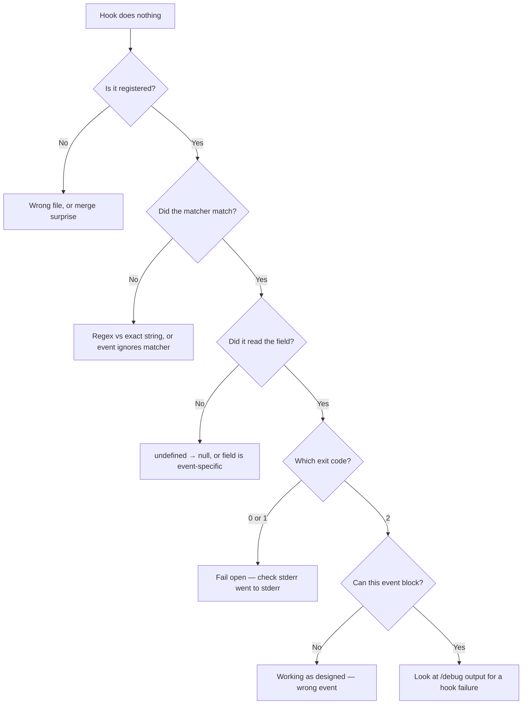

# Debugging Hooks

> A hook that fails silently is the default failure mode, so the skill is
> narrowing: is it not firing, is it firing and misreading, or is it firing and
> being ignored?

**Type:** Learn
**Prerequisites:** Lesson 59, Build a Guardrail Hook
**Time:** ~30 minutes

---

## Learning Objectives

- Debug a silent hook in the order it actually fails: registration, matcher, payload, exit code, event
- Tell a matcher bug from a payload bug from a wiring bug
- Test a hook without Claude Code by piping a fabricated event into it
- Read `claude --debug` for registration, matcher evaluation, skips, and crashes

---

## The Problem

Your guardrail doesn't work. The agent ran `git push` and nothing happened. Or
something happened — a line of text appeared, an action was refused — and it
wasn't the refusal you wrote.

There are at least four places it can be wrong, and they look identical from the
outside:

1. The hook is registered but its matcher never matches.
2. It matches and runs, but reads the wrong field and decides nothing.
3. It decides, and you used the wrong channel — exit 1 instead of 2, stdout
   instead of stderr.
4. It ran and was correct, on an event that can't block.

The debug loop that wastes an hour is checking the script. Nine times out of ten
the script is fine, and the wiring is wrong — a matcher that looks like a regex
and isn't, a settings file that merged with another, an event that can't block.

Learn the order. Check registration, then matching, then the payload, then the
exit code, then the event's capability. In that order.

---

## The Concept



### Step 1 — is it registered?

```
/hooks
```

Lists every hook, which settings file it came from, whether it's enabled, and
its matcher, type, and timeout. If it isn't here, nothing else matters.

Two reasons it won't be, and both bite:

- **Wrong settings file.** `.claude/settings.json` vs
  `.claude/settings.local.json` vs `~/.claude/settings.json`. Settings merge
  (Phase 04, Lesson 34), so a hook can be live from a file you forgot exists.
- **Settings changed after the session started.** Restart Claude Code. This is
  the single most common "my hook doesn't work" and it costs people real time.

### Step 2 — did the matcher match?

The matcher is not a substring filter. Three behaviours, one string decides
which (Lesson 56):

- Only letters, digits, `_`, `-`, spaces, `,`, `|` → **exact string**, or
  alternatives split on `|` / `,`.
- Anything else → **unanchored regex**.

So `"Edit"` matches `Edit` and nothing else. `"Edit.*"` also matches
`NotebookEdit`. `"^Edit$"` means exactly `Edit`.

Two more:

- An event with no matcher support **ignores** the matcher and runs every time.
- `FileChanged` and `StopFailure` use a stricter matcher syntax — a space,
  comma, or hyphen pushes them onto the regex path.

### Step 3 — read the payload

Don't guess the field names. Print them.

```sh
#!/bin/sh
cat
```

Wire it to the event, trigger one occurrence, and read what actually arrives.
Then log just what you need:

```sh
input=$(cat)
printf '%s\n' "$input" | jq '{event: .hook_event_name, tool: .tool_name, cmd: .tool_input.command, file: .tool_input.file_path}'
```

The failure this catches most often: `.tool_input.command` is absent on an
`Edit` event, and bare `jq -r` prints the literal string `null`. That `null`
then fails to match anything, so the hook decides nothing and exits 0. Use
`// empty` or `?? ''`.

### Step 4 — exit codes

Lesson 58 in one line: `exit 2` blocks, `exit 1` and everything else non-zero
fails open, and the reason comes from the **first line of stderr**.

If exit 2 "isn't blocking", check the event next. `PostToolUse`,
`PostToolUseFailure`, `SessionStart`, `Setup`, `Notification`, `MessageDisplay`,
`StopFailure`, `PermissionDenied` cannot block. A `PostToolUse` hook exiting 2
does not undo the tool — it sends its stderr into the model's context.

### Step 5 — the debug log

```
claude --debug
```

For a persistent one:

```
claude --debug-file /tmp/claude-debug.log
```

Look for: hook registration, matcher evaluation, handler execution, whether a
hook was **skipped**, and input/output processing errors. A hook that never ran
says so there; a hook that ran and crashed says that too.

Useful when you're only checking startup:

```
claude --debug-file /tmp/claude-debug.log --init-only
```

### Step 6 — test the script alone

The move that saves the most time: **the script does not need Claude Code.**
Pipe it an event.

```sh
printf '%s\n' '{"hook_event_name":"PreToolUse","tool_name":"Bash","tool_input":{"command":"git push"}}' \
  | .claude/hooks/guardrail.sh; echo "exit=$?"
```

If that produces exit 2, the script is correct and the problem is wiring. If it
produces 0, the problem is the script. Two minutes, no restart, no guessing.

### Two things that fail with no error at all

**Async hooks that decide too late.** `"async": true` runs in the background and
the harness doesn't wait. A decision printed after that arrives too late to
control anything. If an async hook must ever block, use `"asyncRewake": true`,
which wakes Claude on exit 2 and hands it the stderr. `onFailure` does nothing
for async handlers.

**Timeouts fail open.** Default is 600s for command hooks, 30s on several
events, 10s on `MessageDisplay`. A `PreToolUse` timeout normally lets the call
through. If it must block, set `"onFailure": "block"` (needs v2.1.295+). And a
hook that runs on every Bash call should carry a short explicit `timeout: 5` —
the default exists for slow work and gives you a six-minute hang when your
script has a bug.

> **The reframe:** hooks fail in a fixed order — registration, match, payload,
> exit code, event capability — and checking them in that order beats reading
> your script, because a correct script wired to the wrong matcher produces
> exactly the same silence as a broken one.

---

## Build It

### 1. Get the ground truth before touching anything

Take your guardrail from Lesson 59 and run `/hooks`.

✅ You pass when you can state, for each hook, which settings file supplied it
and whether it's enabled.

### 2. Break it four ways, on purpose

In order: (a) restart-needed stale settings — add a hook and don't restart;
(b) change the matcher from `Edit` to `Edit.*` and trigger `NotebookEdit`;
(c) delete `.tool_input?.file_path ?? ''` from the Edit branch;
(d) change `exit 2` to `exit 1`.

Trigger each and record what you observe.

✅ You pass when you have four observations and each one matches the diagram
above — including the one where nothing visibly happens at all.

### 3. Take the script out of the loop

Pipe a fabricated `git push` event into the guardrail. Then pipe an `Edit`
event with no `command` field.

✅ You pass when the first gives `exit=2` and the second gives `exit=0` with no
crash, and you can say which of your four breakages each one would have caught.

### 4. Find it in the debug log

```
claude --debug-file /tmp/claude-debug.log
```

Trigger one blocked action, quit, and search the log for the hook's name.

✅ You pass when you have quoted the line showing the hook registered and the
line showing the matcher evaluated — and, for one deliberately-skipped hook, the
line that says it was skipped.

### 5. Prove you can find a hook you didn't write

Add a `PostToolUse` hook to `~/.claude/settings.json` on an event you use
nothing else on. Trigger it. Then check whether removing it from the *project*
settings changes anything.

✅ You pass when you can state which file was actually responsible and why your
removal attempt did nothing.

---

## Use It

| Symptom | Look at first |
|---|---|
| Nothing happens at all | `/hooks` — registered? Settings changed since session start? |
| Fires on some tools, not others | The matcher. Exact string vs unanchored regex |
| Fires, decides nothing | `// empty` / `?? ''` — is the field even present for this event? |
| Blocks on the wrong reason | stderr vs stdout. First line of stderr is the reason |
| Reason is empty | You printed to stdout |
| Exit 2 does nothing | Is the event blocking? |
| Worked in the shell, not in Claude Code | Wiring: `/hooks`, matcher, stale settings |
| Hangs for minutes | Missing `timeout`; default is 600s |
| Fine at first, breaks later | `if` on a non-tool event — silently never runs |

---

## Exercises

1. Take a hook that isn't firing and run the six-step order above, writing down
   where it actually broke.
   ✅ You pass when you can name the step that found it and say what the
   previous step would have told you if you'd trusted it.

2. Write a hook that fails open on purpose — malformed input exits 1 — then
   convert it to fail closed and record both observations by piping events at
   it.
   ✅ You pass when you can state what a user of your hook would experience under
   each, without reading the source.

3. Find a hook in your settings or your user's settings that you did not
   remember adding, using `/hooks`, and determine which file it came from.
   ✅ You pass when you have the file path and one sentence on why that file
   exists.

---

## Key Terms

| Term | What people say | What it actually means |
|---|---|---|
| debug log | "the logs" | `claude --debug` or `--debug-file`. Shows registration, matcher evaluation, skips, and crashes. |
| `--init-only` | "startup check" | Debug-file mode for checking that `Setup` / `SessionStart` hooks ran, without a full session. |
| skipped | "it didn't run" | The log says *why*. Usually the matcher, not an error. |
| stale settings | "I edited the file" | Settings load at session start. Edit and restart, or you're debugging the old copy. |
| async hook | "a background hook" | Can't block. A decision printed after the harness stopped waiting controls nothing. |
| `asyncRewake` | "async that can block" | Wakes Claude on exit 2 and hands it stderr. The one background mode with teeth. |
| fail open | "it's not strict" | A timeout or crash lets the action through. The default for every failure mode. |

---

## What this lesson skipped

**Reading an `agent` or `http` hook's failure.** These fail differently —
connection failures, non-2xx responses, model timeouts — and each has its own
diagnostics. Worth it only once you're using one; Lesson 56 names the types.

**Hook input/output validation schemas.** The harness logs schema-invalid JSON
as a failure. What's valid per event is in the docs, not taught here.

**`InstructionsLoaded` and `FileChanged` observability hooks.** These exist for
auditing what got loaded or changed, which is Phase 10's problem, not this
phase's.

**Multi-platform debugging.** Windows `shell: "powershell"` vs `sh`, `.cmd`
resolution, and path quoting all produce hook failures that look like logic
bugs. Real; a rabbit hole if you hit it; exec form avoids most of it (Lesson 57).

**`stop_hook_active`.** `Stop` and `SubagentStop` carry it so your hook can tell
whether it's re-entering after its own continuation, which prevents an infinite
loop. It's a two-line guard, but it's a lesson in itself and no hook in this
phase needs it.

Timeout defaults and the `onFailure` version floor were verified against
[the hooks page](https://code.claude.com/docs/en/hooks) on 2026-10-15. Timeouts
have changed before. Check `https://code.claude.com/docs/llms.txt`.