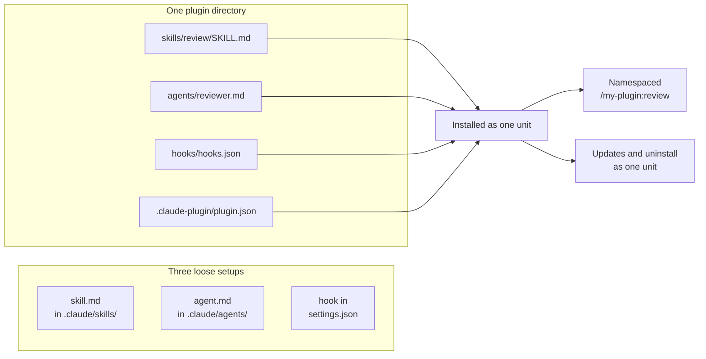

# *"Plugins Are the Packaging Layer"* — and why

> You can stop hand-copying a skill, a subagent, and a hook between machines, and
> hand over one directory instead — with names that can't collide and updates
> that reach everyone at once.

**Type:** Learn
**Prerequisites:** Phase 05 (Lesson 44, Author a Skill), Phase 06 (Lesson 47,
Author a Subagent), Phase 08 (Lesson 59, Build a Guardrail Hook)
**Time:** ~30 minutes

---

## Learning Objectives

- Decide, for a given setup, whether it needs a plugin or is fine as loose files
- Explain what changes about a component when a plugin owns it, and what does not
- Predict the name a component will have once it moves inside a plugin
- Hand a whole setup to a teammate as one directory

---

## The Problem

You built three things: a skill that reviews a diff, a subagent that only reads
one file type, and a hook that blocks `git push --force`. They work. A teammate
wants them.

You send the skill file. They send it back — "where does this go?" You send the
subagent. They put it in the wrong directory and it silently never loads. You
send the hook as a snippet to paste into their `settings.json`. They paste it.
You paste yours. Now every `git push --force` triggers the block twice, and the
duplicated output makes it look like the hook is broken.

Three weeks later you fix a bug in the hook. The teammate's copy still has the
bug. Nobody knows which of the four files on four machines is current. The
setup drifted, and drift is invisible until it costs you an afternoon.

None of that is a Claude Code failure. It is what happens when you ship a
*configuration* instead of a *package*.

---

## The Concept

A plugin is a directory of components — skills, subagents, hooks, MCP servers —
that Claude Code installs and loads **as one unit**.

Everything inside it already exists. You built each piece in an earlier phase.
The plugin adds no capability. It adds a unit of installation.



Three properties fall out of "one unit", and they are the whole reason plugins
exist:

**1. Namespacing.** Every skill and agent the plugin provides gets the plugin
name as a prefix. Inside a plugin named `guardrail-kit`, a skill named `review`
becomes `/guardrail-kit:review`, and an agent named `reviewer` becomes
`guardrail-kit:reviewer`. Two plugins can each ship a `review` skill without
fighting over the name. Loose files cannot do this — `review` is just `review`,
and the second one loses.

**2. Lifecycle together.** Enable, disable, update, uninstall: all four act on
the whole directory. You never again track which of the four pieces a teammate
has.

**3. Portability.** The directory is the deliverable. Zip it, drop it in a
folder, or list it in a marketplace. Nothing in it is specific to your machine.

Hooks are the exception to (1), and this is the trap from the problem section:
**hooks have no prefix.** A hook in a plugin and the same hook in
`settings.json` both fire. That's the double-block.

### Do you need a plugin?

Skills, subagents, hooks, and MCP servers all work on their own. A plugin is not
the upgrade path from "no setup" to "setup". It's the move from *my machine* to
*anyone's machine*.

| Situation | Use |
|---|---|
| Just for you, in one project | Loose files in `.claude/`. Stop here. |
| Just for you, in every project | Loose files in `~/.claude/` |
| A teammate needs the same three things | Plugin |
| Same setup, several repos, versioned | Plugin |
| You're publishing to others | Plugin |

If you only ever need it yourself, a plugin is packaging you don't need. The
files are the product; the plugin is the shipping container.

### Why this phase comes after skills, subagents, and hooks

Because there is nothing to package until you have something worth packaging.
A plugin whose only component is one skill is a directory with a JSON file in
it — you would learn the format and none of the reason. The reason only shows
up once you have a skill, a subagent, and a hook that have to travel together
and not collide on the way.

> **The reframe:** a plugin adds no capability — it adds a *unit*. Every
> component you already have keeps working exactly as it did; what changes is
> that from now on they install, collide-proof, update, and uninstall as one
> thing, which is the only reason to reach for one.

---

## Build It

### 1. Inventory what you already have

You wrote a skill in Phase 05, a subagent in Phase 06, and a hook in Phase 08.
Find all three:

```
ls ~/.claude/skills/ .claude/skills/ 2>/dev/null
ls .claude/agents/ 2>/dev/null
cat .claude/settings.json 2>/dev/null | head -40
```

✅ You pass when you can point at a file path for each of the three, or name
which one you never built.

### 2. See a plugin's shape without writing one

```
claude plugin list
```

Any marketplace plugin that shows a version is a directory on your disk. Lesson
62 opens one up. For now just confirm there is one to look at.

✅ You pass when `claude plugin list` prints at least one plugin with a
`Status: loaded` line.

### 3. Watch the prefix do its job

Install nothing. Start a session with a plugin loaded from disk — you'll build
one in Lesson 63, so use any marketplace plugin you already have:

```
claude --plugin-dir ./path/to/some-plugin
```

In the session, type `/` and look. Components from the plugin appear under
`/<plugin-name>:`. A loose skill of the same name appears bare.

✅ You pass when you can name one component that shows the plugin prefix and
one that does not, and say why the difference exists.

### 4. Predict the name before you move a file

Pick the skill you wrote in Phase 05. Its frontmatter `name` is, say, `review`.
Write down, without running anything, the command it will answer to after it
moves into a plugin called `guardrail-kit`.

✅ You pass when your prediction is written down before Lesson 63 tests it.

---

## Use It

| Command / concept | When you reach for it |
|---|---|
| `/<plugin>:<skill>` | Invoking a skill a plugin shipped |
| `<plugin>:<agent>` | Asking for a subagent a plugin shipped |
| Plugin directory as deliverable | Handing a setup to someone |
| Marketplace listing | Same setup, many machines, with updates |
| `claude plugin list` | What is loaded right now |
| Loose files in `.claude/` | The setup is yours alone |
| Plugin hooks have no prefix | Remember this before you paste a hook twice |

---

## Exercises

1. Take the three files you found in step 1 and answer: which of the three would
   *collide* if two people installed them independently, and which would
   *double-fire*? Name each one.
   ✅ You pass when you can name the skill as the collision risk, the hook as
   the double-fire risk, and say what namespacing fixes and does not.

2. Pick a teammate-shaped scenario: someone on a different machine, different OS,
   no access to your `~/.claude/`. Write the one-sentence description of what
   you would hand them, and what it must contain.
   ✅ You pass when the description names a directory, not three files, and
   names the manifest inside it.

3. Argue the opposite case. Pick one of your own setups and write down why it
   should stay as loose files. Then say what would have to change for you to
   package it.
   ✅ You pass when you can state a trigger — "when a second person needs it",
   "when it spans two repos" — not "when it gets big".

---

## Key Terms

| Term | What people say | What it actually means |
|---|---|---|
| plugin | "an extension" | A directory of components Claude Code loads as one unit. Nothing new; a unit. |
| packaging layer | "it's just a zip" | One install, one update, one uninstall, and names that cannot collide. |
| namespace prefix | "it's named differently" | Plugin name on the front of every skill and agent it provides. Hooks are excluded. |
| marketplace | "the plugin store" | A repo or directory with a `marketplace.json` listing plugins and where to fetch them. A catalog you add, not a hosted store. |
| loose files | "my setup" | Skills, agents, and hooks in `.claude/` or `~/.claude/`. Fine when nobody else needs them. |
| mod | "a JS plugin" | A plugin that ships a JavaScript hooks module. Mentioned in docs; not this lesson. |

---

## What this lesson skipped

**The manifest and the file layout.** What goes where, what `plugin.json` does,
and which paths are legal. That is Lesson 62, and it needs the frame this lesson
sets.

**Installing and publishing.** The actual commands, and how to get a plugin onto
someone else's machine. Lesson 63.

**What every enabled plugin costs you.** An enabled plugin is present in every
session, not just the ones you use it in — and that has a price. Lesson 64 is
the only one in this phase that is about restraint rather than capability.

**MCP servers as plugin components.** Phase 07 built one. It can ride inside a
plugin, but nothing in this lesson needs it, and lesson 63 leaves it out on
purpose — three component types is already enough to show the packaging idea.

**Mods.** JavaScript hook modules that can add panes and commands. Real, in the
docs, and deliberately not taught. Come back when you need a plugin to draw
something rather than guard something.