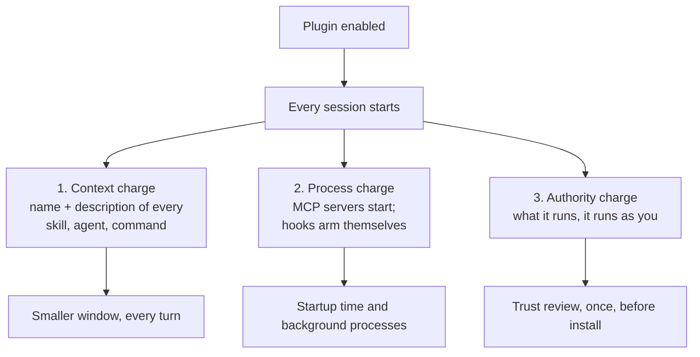

# Plugin Economics — What Every Enabled Plugin Costs

> You can read what each installed plugin is charging you right now, name which
> component is responsible, and decide which ones to turn off without losing
> anything you actually use.

**Type:** Learn
**Prerequisites:** Lesson 63, Install and Author One; and Lesson 8, The Context
Window
**Time:** ~30 minutes

---

## Learning Objectives

- Explain why an enabled plugin is present in sessions that never use it
- Read `claude plugin details` and separate always-on cost from on-invoke cost
- Rank your installed plugins by what they charge versus what you use them for
- Decide, for one plugin, whether to keep it, split it, or disable it

---

## The Problem

You installed four plugins in March. By July you had used two of them once
each. All four are enabled, so all four are in every session: their skill and
agent names and descriptions sit in your context on every turn, their MCP
servers have started as background processes in every session you've opened
since March, and their hooks are matched on every event you trigger.

None of that is visible while you work. It shows up as a window that fills
faster than the work justifies, and `/context` where `MCP tools` is a row you
have learned not to look at.

The failure is not that a plugin is expensive. A plugin that does its job is
worth any price. The failure is that **you cannot tell which of your plugins
are doing a job.** Four enabled, two used, no list. That is the same shape as
the setup-drift problem from Lesson 61, moved from your files to your startup.

---

## The Concept

An enabled plugin is part of **every** session, not only the sessions where you
use it. Three charges follow from that, and they are different currencies.



### 1. The context charge

For each skill, agent, and command Claude can invoke on its own, the **name and
description** are in context on every turn. The model's job is to know those
things exist so it can match a request to them — so it has to know they exist
*before* any request.

The full body loads only when the component actually runs. So a plugin's cost
splits cleanly:

| | What it is | When you pay |
|---|---|---|
| **Always-on** | Name + `description` + `when_to_use` for each skill, agent, command | Every turn, in every session, whether or not anything runs |
| **On-invoke** | The body, once it loads | Each time the skill or agent fires |

Always-on is the number that matters. It is what a plugin you never touch still
charges you.

`claude plugin details <name>` prints it, with a per-component breakdown so you
can see which description is the expensive one:

```
Always-on:   ~146 tok   added to every session

Per-component (rounded)
  component       always-on  on-invoke
  format-code           ~40        ~30
  style-reviewer        ~40        ~40
```

### What is *not* charged to context

**Hooks are free of model context.** `claude plugin details` says so explicitly
and gives hooks no per-component row. A `PostToolUse` formatter costs process
time and nothing in your window. That makes hooks the cheapest kind of plugin
component to enable and the easiest to justify.

**MCP tool schemas aren't in that estimate either.** They resolve at runtime and
get counted against the `MCP tools` category in `/context`. So the true cost of
a plugin that ships a server is: `details` undercounts it, `/context` is the
place to see it.

### 2. The process charge

MCP servers the plugin defines run alongside each session where it's enabled. A
plugin with four servers is four more processes, every session, whether or not
you talk to any of them. This is a wall-clock and memory cost, not a token cost,
and `/context` will not show it to you.

### 3. The authority charge

A plugin's hooks and MCP servers run as **you**, with your credentials and your
filesystem access. There is no sandbox between "something you installed" and
"something acting on your behalf". This is why the install step shows you what a
plugin will install, and why a marketplace's tier matters:

| Tier | What it means |
|---|---|
| Official | Published by Anthropic under a known marketplace name |
| Community | Anthropic-hosted community name |
| Third-party | Everything else — including a marketplace your coworker published |

Being third-party is not an accusation. It means the trust decision is yours,
once, before install — and it should be a decision, not a reflex.

### Auditing what you have

| Command | Answers |
|---|---|
| `claude plugin details <name>` | What does this one cost, and which component pays it |
| `claude plugin list` | What's enabled, from where, at what scope |
| `/context` | What MCP tools are in the window right now |
| `/plugin` → Installed → Not used recently | What you've been carrying for nothing |
| `/skill-doctor` | Which skills have never run, and what they cost |
| `/doctor` | Same idea, plugins included |
| `/usage` | Usage attributed across skills, agents, plugins, servers — where your plan supports it |

A plugin unused for 14 days and 10 sessions moves under **Not used recently** in
`/plugin`. That threshold is a prompt to look, not a verdict — a plugin used
seasonally will show up there and deserve to stay.

### Lowering the number, if you maintain the plugin

Always-on is driven by each component's `description` and `when_to_use`. Shorter
descriptions lower it directly. The catch, and it is real: **the description is
what Claude matches a request against.** Trim it too far and the skill stops
triggering. If you maintain a plugin, trim descriptions and then check
triggering — that's what `claude plugin eval` is for, and it's a Phase 18 topic,
not this lesson.

The other lever is structural: split the plugin so users install only what they
need.

> **The reframe:** an enabled plugin is not a tool sitting in a drawer waiting
> for you to reach in — it is a standing charge on every session you will ever
> start, and you pay it whether or not anything from it ever runs.

---

## Build It

### 1. Get the list

```
claude plugin list
```

Count what's enabled. Then, in a session, open `/plugin` → **Installed** and
note which ones are under **Not used recently**.

✅ You pass when you can say how many are enabled and how many you have
actually used in the last month.

### 2. Price one plugin

```
claude plugin details <some-plugin>
```

Read the `Always-on` line, then find the largest per-component always-on row.

✅ You pass when you can name one component responsible for most of the plugin's
charge, and say which file that number comes from.

### 3. Check the part `details` won't tell you

In a session with your plugins enabled:

```
/context
```

Look at the `MCP tools` row.

✅ You pass when you can say whether MCP tools are a material share of your
window, and which plugin contributes them.

### 4. Turn one off and measure

Pick a plugin you have not used. `/plugin` → Installed → Space to disable. Then
`/reload-plugins` if prompted, and run `/context` again. Compare the
`Skills`/`Agents` and `MCP tools` rows.

✅ You pass when you have a before-and-after number, and can say what the plugin
cost you per session in tokens.

### 5. Price your own plugin

You built one in Lesson 63. From its directory:

```
claude --plugin-dir ./guardrail-kit plugin details guardrail-kit
```

Note that the hook has no cost row at all.

✅ You pass when you can say which of your three components costs the most, and
that it isn't the hook.

### 6. Read a details pane before you would install

Open a plugin's details in `/plugin` and find its **Context cost** section:
**Every turn** and **When invoked**. Official-marketplace plugins show these
before install; your own marketplace's entries do not.

✅ You pass when you can state which line you'd compare two candidate plugins on
before choosing one, and say which marketplace won't show you that number.

---

## Use It

| Command / concept | When you reach for it |
|---|---|
| `claude plugin details <name>` | Before installing anything; before keeping anything |
| Always-on tokens | The charge you pay whether or not the plugin is used |
| On-invoke tokens | What it costs when it actually runs |
| `claude plugin list` | What is enabled, from where |
| `/context` → `MCP tools` | The cost `details` doesn't count |
| `/plugin` → Not used recently | Your audit list, every few weeks |
| `/skill-doctor` | Skills that never run, with their cost |
| Hooks: no context cost | Why a hook-heavy plugin is cheap to enable |
| Marketplace tier | How much review you owe before install |
| Disable before uninstall | Stop the charge without losing the install |

---

## Exercises

1. Make a table: one row per installed plugin, columns for always-on tokens, what
   it ships (skills / agents / hooks / MCP servers), when you last used it, and
   keep or disable. Do not guess the last column — check `Last used:` in the
   details pane.
   ✅ You pass when every row has a keep-or-disable decision with a reason, and
   you can name the plugin whose removal frees the most window.

2. Take the plugin you built in Lesson 63. Double the length of one skill's
   `description` without changing what the skill does, and re-run
   `plugin details`. Then shorten a different description by half.
   ✅ You pass when you have both numbers and can say which edit moved the
   always-on figure and why the body length was never part of it.

3. Find a plugin with an MCP server. Price it with `plugin details`, then find
   its actual contribution in `/context`. Write one sentence on why the two
   numbers differ.
   ✅ You pass when your sentence names runtime resolution as the reason the
   `details` estimate excludes it.

4. Argue for turning one of your plugins **off** permanently, not just
   disabling it — including what you would lose and how you'd get it back.
   ✅ You pass when you can name the actual capability you'd give up, and can
   say how long reinstalling would take.

---

## Key Terms

| Term | What people say | What it actually means |
|---|---|---|
| always-on cost | "the startup cost" | Tokens a plugin's skill and agent names and descriptions add to every session it's enabled in, whether or not anything runs. |
| on-invoke cost | "what it costs to use" | The body, paid each time the component fires. Zero times if it never fires. |
| hook context cost | "hooks are free" | Hooks add **no** model context. They cost process time. `details` gives them no row. |
| MCP tools | "the tool definitions" | Counted in `/context` under `MCP tools`, not in a plugin's `details` estimate, because schemas resolve at runtime. |
| process charge | "the overhead" | MCP servers start every session the plugin is enabled. Wall-clock and memory, invisible to `/context`. |
| authority charge | "the risk" | Plugin hooks and servers run as you. There is no sandbox. |
| Not used recently | "unused" | 14 days and 10 sessions without use. A prompt to look, not a verdict. |
| disable vs uninstall | "turn it off" | Disable stops the charge and keeps the install. Uninstall also removes it from disk. |

---

## What this lesson skipped

**Evaluating whether a plugin changes behaviour.** `claude plugin eval` runs
test cases with and without the plugin and scores the difference — the real test
of a plugin that steers the model rather than one that runs a script. It is a
Phase 18 concern.

**Prompt-cache invalidation.** Enabling or disabling a plugin mid-session can
invalidate the cache, which is why `/reload-plugins` sometimes declines and asks
for `--force`. A Phase 03 cost concern; the word is here so the message isn't a
mystery later.

**Fleet-level measurement.** OpenTelemetry events and the Analytics API give an
organization plugin usage across every machine. Overkill for one person, and
administrative rather than educational.

**`userConfig` values as a cost.** Whether a value you were prompted for is
masked and stored in a credential store rather than `settings.json`. A
security property, not an economic one — come back when a plugin asks you for a
token.