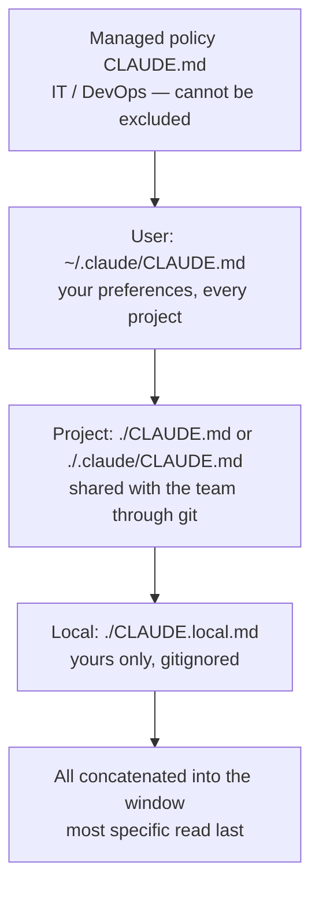

# CLAUDE.md — the 200-Line Rule

> You can leave a file in your repo that every future session reads before it acts — and keep it short enough that the session still follows it.

**Type:** Learn
**Prerequisites:** Lesson 32, What Loads Into the Window; Lesson 64, Plugin Economics
**Time:** ~30 minutes

---

## Learning Objectives

- Put a project `CLAUDE.md` where every session loads it, and confirm it loaded
- Write instructions concrete enough that the agent can check itself against them
- Predict which file wins when a user, project, and local `CLAUDE.md` disagree
- Move an instruction that only matters in one folder out of the always-on file
- Explain why an edit to `CLAUDE.md` doesn't reach a session already running

---

## The Problem

You keep typing the same correction into chat. "Run the tests before you commit." "Use 2-space indent." "Don't touch the generated files." Monday's session, then Tuesday's, then Wednesday's — each one starts fresh and knows none of it.

So you write it down. You open `CLAUDE.md` and add the rules. Then you add more. Six months later the file is 600 lines and the agent still commits without running the tests.

The file didn't fail. Its length did. A 600-line file gets skimmed, not read — and `CLAUDE.md` is a suggestion the session reads once at the top, not a setting that enforces anything.

---

## The Concept

`CLAUDE.md` is a markdown file Claude Code reads at the start of every session. You write it. It carries what you'd otherwise re-explain: build commands, conventions, where things live, "always do X."

It is not the only file that loads. Claude Code looks in four places, broadest scope to most specific:

They don't override each other. Every one that is found is concatenated into the session, ordered from the filesystem root down to where you launched. When two disagree, the one closer to your working directory is read later — and later wins in practice, because it is the last thing in view.

**The 200-line rule.** The docs target under 200 lines per file. This is not a storage limit; it is an attention limit. Longer files consume more context *and* reduce adherence — the agent follows less of a long file than a short one. There is a hard skip at 4 MiB, but by then the file is useless anyway.

Two more facts change how you write it:

- **It loads once, at the start.** Edit it mid-session and the running session keeps the old copy. You see the change next session, not this one.
- **It survives compaction.** The project-root `CLAUDE.md` is re-read from disk and re-injected after `/compact` (Lesson 30). Nested files in subdirectories, and path-scoped rules, reload only when they match again.

> **The reframe:** `CLAUDE.md` is not a settings file — it is the note a new teammate reads on day one, so every line you add competes with every other line for the session's attention, and past 200 the file starts losing to its own length.

### What belongs in it, and what doesn't

| Belongs in `CLAUDE.md` | Belongs somewhere else |
|---|---|
| Build, test, and lint commands | A multi-step procedure — a **skill** (Lesson 40) |
| Conventions that differ from tool defaults | Anything only one folder needs — a **path-scoped rule** (Lesson 67) |
| "Always do X" rules the whole team shares | Something that must happen every time — a **hook** (Lesson 55) |
| Project layout and architectural context | A second file you import (Lesson 70) — it organises, it doesn't save context |

### Confirming it loaded

Writing the file is half the job. `CLAUDE.md` is delivered as a message after the system prompt, not as part of it, so there is no guarantee it is *followed* — only that it was *read*. The check is `/context`: the files that actually loaded appear under **Memory files**. A file not listed there cannot be followed, however good it is.

`/memory` opens the files themselves. `/init` writes a starting `CLAUDE.md` from your codebase. `/doctor prompt-audit` reviews your instruction files for contradictions (Claude Code v2.1.283 or later, checked October 2026).

---

## Build It

1. In a project you actually work in, run `/init`. Read what it wrote. It will list commands and conventions it found — delete anything the agent could already see by opening the code.

   ✅ You pass when you have a `CLAUDE.md` and can say which lines you removed and why.

2. Trim it to under 200 lines. For every instruction, ask: does this matter in *every* session, or only when working in one folder? Move folder-specific lines into rules (Lesson 67). Move multi-step procedures into skills (Lesson 40).

   ✅ You pass when the file is under 200 lines and each remaining line is something you would tell every new session.

3. Add one instruction concrete enough to check. Not "format code properly" — "use 2-space indentation." Not "test your changes" — "run `npm test` before committing."

   ✅ You pass when you can point at the line and say how the agent would know it failed.

4. Run `/context` and find **Memory files**. Confirm your file is listed.

   ✅ You pass when you can name every memory file loaded, in order, and which one is closest to your working directory.

5. Edit the file mid-session, then ask the agent to follow the new line. Watch it use the old copy. Start a fresh session and watch it use the new one.

   ✅ You pass when you can explain why the edit didn't apply to the running session.

---

## Use It

| Command / concept | When you reach for it |
|---|---|
| `./CLAUDE.md` or `./.claude/CLAUDE.md` | Project instructions the whole team shares |
| `~/.claude/CLAUDE.md` | Your preferences, every project |
| `./CLAUDE.local.md` | Personal, project-specific, gitignored |
| `/init` | Generate a first draft from the codebase |
| `/context` → Memory files | Confirm what actually loaded |
| `/memory` | Open and edit a memory file from inside a session |
| 200 lines | The target. Past it, adherence drops |
| `/doctor prompt-audit` | Find contradictions across your instruction files |
| Subdirectory `CLAUDE.md` | Loads on demand, when a file there is touched |
| `/compact` | Root `CLAUDE.md` is re-injected after it |

---

## Exercises

1. Take a `CLAUDE.md` over 200 lines — yours, or one from a public repo. Split it: every instruction that only matters in one directory becomes a `.claude/rules/` file (Lesson 67), every multi-step procedure becomes a skill (Lesson 40). Leave only always-on facts.
   ✅ You pass when the main file is under 200 lines and you can say, for each line you moved, which session it now loads in and which it doesn't.

2. Write a deliberately vague instruction and a concrete version of the same instruction. Ask a fresh session to do the task twice, once with each. Record what the agent did differently.
   ✅ You pass when you can point at the concrete version and name the observable behavior it changed.

3. Create a `CLAUDE.md` in a subdirectory of your working directory. Ask the agent to read a file in that subdirectory, then run `/context`.
   ✅ You pass when the nested file was *not* under **Memory files** at launch, and you can explain when it loaded instead.

---

## Key Terms

| Term | What people say | What it actually means |
|---|---|---|
| `CLAUDE.md` | "the config file" | Instructions you write, read at the start of every session. Context the agent follows, not configuration that is enforced. |
| the 200-line rule | "a hard limit" | A target. Past it the file still loads, but adherence drops. The hard skip is 4 MiB, by which point nothing works. |
| load order | "the project one overrides the user one" | They are concatenated, not overridden. The file closest to your working directory is read last. |
| Memory files | "the CLAUDE.md" | Every instruction file that actually loaded, listed by `/context`. If it isn't there, the agent can't see it. |
| `CLAUDE.local.md` | "a private CLAUDE.md" | Same content, same loading — but gitignored and yours alone. |
| mid-session edit | "it updated" | It did not. The session read the file once, at the start. |

---

## What this lesson skipped

- **Auto memory** — the file Claude writes for itself. Lesson 68.
- **`AGENTS.md`** — when Claude reads it instead of `CLAUDE.md`, and how the two coexist. Lesson 66.
- **Rules and path-scoped rules** — loading an instruction only when matching files are touched. Lesson 67.
- **Imports** — `@path` syntax, and why it organises without saving context. Lesson 70.
- **Output styles** — changing tone and role, not knowledge. Lesson 69.

The behaviour above is from [How Claude remembers your project](https://code.claude.com/docs/en/memory). Claude Code ships weekly; re-check before relying on a version-gated line.
