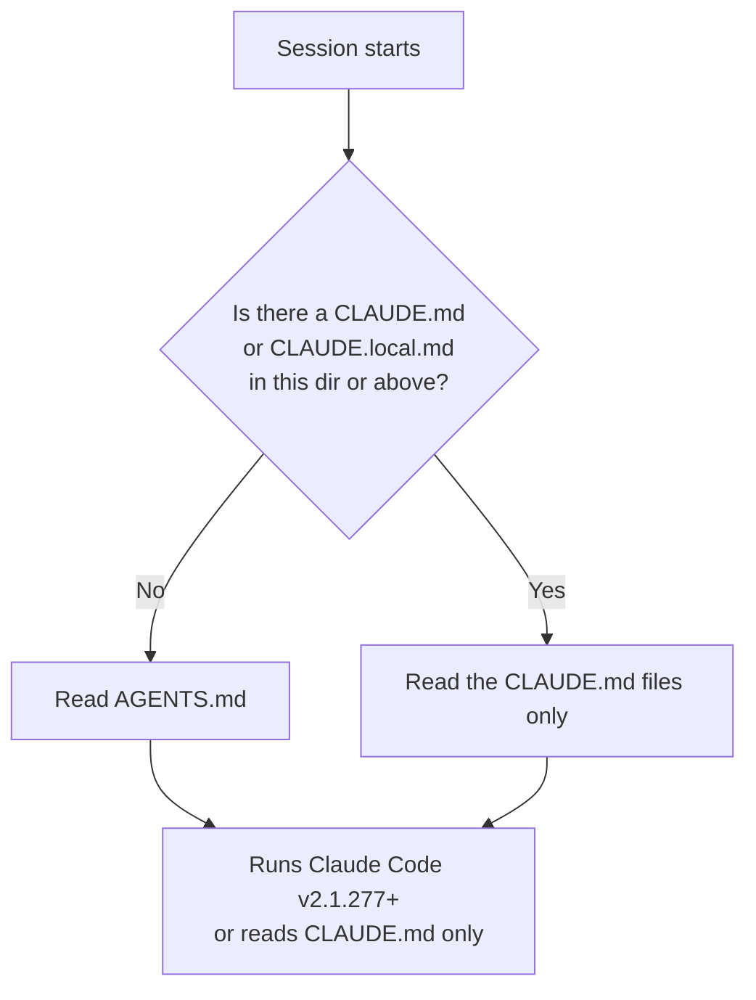

# AGENTS.md, CLAUDE.local.md

> You can keep one instruction file for every coding agent you use, and one private file that never gets committed — without loading the wrong one twice.

**Type:** Learn
**Prerequisites:** Lesson 65, CLAUDE.md — the 200-Line Rule
**Time:** ~30 minutes

---

## Learning Objectives

- Predict whether Claude reads your `AGENTS.md` or your `CLAUDE.md`, from what is in the repo
- Keep a `CLAUDE.local.md` out of git, and share the same personal notes across worktrees
- Change which instruction files load with the **Project instructions** setting
- Choose between an `@AGENTS.md` import and a symlink, and say why Windows changes the answer
- Explain what a `CLAUDE.local.md` does to a repo that relies on `AGENTS.md`

---

## The Problem

You set up `AGENTS.md` for the other coding agents you use. You set up `CLAUDE.md` for Claude Code. Now the same conventions live in two files, and one of them is quietly being ignored.

Or the opposite problem: you keep personal notes — your sandbox URL, your test login — in a `CLAUDE.local.md` at the project root. You commit it by accident. Your sandbox URL is now in the team's repository, and the next person to open the file is confused about whose URL it is.

Both failures come from the same misunderstanding: which file loads is not a matter of preference. It is decided by what is present in the repo.

---

## The Concept

Claude Code can read a repository's `AGENTS.md` as its project instructions, so a repo already set up for other agents works without adding a `CLAUDE.md`. But it does not read *both* by default. It picks, based on what it finds:

The full default rule, from the docs:

| Your repository has | Claude reads |
|---|---|
| An `AGENTS.md`, and no `CLAUDE.md` or `CLAUDE.local.md` in the working directory or above it | Your `AGENTS.md` |
| An `AGENTS.md` **and** a `CLAUDE.md` or `CLAUDE.local.md` in the working directory or above it | Your `CLAUDE.md` files only |
| A `CLAUDE.md` that imports `AGENTS.md` with `@AGENTS.md` | Your `CLAUDE.md`, with `AGENTS.md` included through the import |

Read the middle row twice. **A `CLAUDE.local.md` counts as a `CLAUDE.md` for this check.** Adding one to keep your own uncommitted notes in an `AGENTS.md` repo silently stops Claude from reading `AGENTS.md` at all. That is the trap this lesson exists for.

You can change the default with the **Project instructions** setting — open `/config` and pick one:

| Value | What Claude reads |
|---|---|
| `claude-md-or-agents-md` | `CLAUDE.md`, or `AGENTS.md` when no `CLAUDE.md`/`CLAUDE.local.md` is present. The default |
| `claude-md-and-agents-md` | Both, each directory's `CLAUDE.md` first, then its `AGENTS.md` |
| `claude-md` | `CLAUDE.md` files only |
| `managed-only` | Only the organization's managed `CLAUDE.md` and auto memory |

Two footnotes. `AGENTS.local.md`, `AGENTS.override.md`, and anything under a `.agents/` directory are **never** read. And a `CLAUDE.local.md` in a worktree — a second checkout of the same repo — is gitignored, so it exists only in the worktree where you made it.

> **The reframe:** `AGENTS.md` and `CLAUDE.md` are not two names for one thing you keep in sync — Claude reads whichever the repo's file inventory selects, and the presence of a `CLAUDE.local.md` silently flips the switch.

### `CLAUDE.local.md`

`CLAUDE.local.md` is personal, project-specific, and loaded exactly like `CLAUDE.md`: same parsing, same position in the order, appended after `CLAUDE.md` in each directory. The only difference is that you are expected to gitignore it. With `CLAUDE_CODE_NEW_INIT=1` set, `/init` and choosing the personal option adds it to `.gitignore` for you.

### Keeping one file for every tool

If you want a single file that all your agents share, keep `AGENTS.md` and put `@AGENTS.md` at the top of a `CLAUDE.md` next to it. Claude reads the import first, then any Claude-specific lines you add below it.

A symlink — `ln -s AGENTS.md CLAUDE.md` — also works, but check two things first:

- **Editing:** Claude reads `CLAUDE.md` through the link, but the Edit and Write tools refuse to write through a symlink and will redirect to `AGENTS.md`.
- **Windows:** if anyone on the team uses Windows, use the import instead. Creating a symlink needs Administrator or Developer Mode, and Git checks a committed symlink out as a plain text file unless `core.symlinks` is enabled — leaving that clone with a one-line `CLAUDE.md`.

### Where the two differ

An `AGENTS.md` read through the **Project instructions** setting behaves differently from a `CLAUDE.md` in two places worth remembering: `InstructionsLoaded` hooks fire for `CLAUDE.md` but not for a directly-read `AGENTS.md` (they still fire for an imported one), and an `@path` import inside `AGENTS.md` that reaches outside your working directory loads without the approval prompt once you have approved external imports for the project.

Direct `AGENTS.md` reading requires Claude Code v2.1.277 or later, and some sessions — notably some on Amazon Bedrock, or with telemetry disabled, before v2.1.281 — read `CLAUDE.md` only (checked October 2026).

---

## Build It

1. In a repo you work in, list the instruction files: `ls CLAUDE.md AGENTS.md CLAUDE.local.md` (some will be absent). Using the table above, write down which one Claude reads by default.

   ✅ You pass when you can name the file that loads and the one that is ignored, and why.

2. If you have an `AGENTS.md` and want Claude to read it, either remove the stray `CLAUDE.md`/`CLAUDE.local.md` or set **Project instructions** to `claude-md-and-agents-md` in `/config`.

   ✅ You pass when a fresh session's `/context` shows the file you intended under **Memory files**.

3. Create a `CLAUDE.local.md` with one personal preference. Add it to `.gitignore`. Run `git status`.

   ✅ You pass when `git status` does not list the file, and a fresh session still loads its content.

4. Now that `CLAUDE.local.md` exists, re-check the `AGENTS.md` case from step 1. Run `/context`.

   ✅ You pass when you can explain why the `AGENTS.md` stopped loading even though you changed nothing about it.

5. If your project keeps `AGENTS.md` for other tools, add `@AGENTS.md` at the top of `CLAUDE.md` and confirm the content appears once.

   ✅ You pass when `/context` shows `CLAUDE.md` under **Memory files** and you can say the `AGENTS.md` content is there through the import, not twice.

---

## Use It

| Command / concept | When you reach for it |
|---|---|
| `AGENTS.md` | One instruction file shared with other coding agents |
| `CLAUDE.md` | Instructions for Claude Code specifically |
| `CLAUDE.local.md` | Your personal, project-specific, gitignored notes |
| `/config` → Project instructions | Choose which files load, and whether both do |
| `@AGENTS.md` in `CLAUDE.md` | Keep `AGENTS.md` as the one shared file |
| `ln -s AGENTS.md CLAUDE.md` | Symlink alternative — skip it on Windows |
| `InstructionsLoaded` hook | Logs which files loaded — fires for `CLAUDE.md`, not a direct `AGENTS.md` |
| `/import` | Bring another agent's config in once (v2.1.213 or later) |

---

## Exercises

1. You have a repo with both `AGENTS.md` and `CLAUDE.md`, and you want Claude to read both without merging them by hand. Change the setting, start a fresh session, and prove the order with `/context`.
   ✅ You pass when both files are listed and you can state which directory's `CLAUDE.md` is read before its `AGENTS.md`.

2. A teammate clones your repo on Windows and their `CLAUDE.md` is one line pointing at `AGENTS.md` instead of the instructions. Diagnose what happened and fix it so it works on their machine.
   ✅ You pass when you can name the cause (a committed symlink checked out as text) and the fix (an `@AGENTS.md` import).

3. You want your personal notes in an `AGENTS.md` repo without losing `AGENTS.md`. Set it up, then verify with `/context`.
   ✅ You pass when both your `CLAUDE.local.md` content and your `AGENTS.md` content are loaded, and you can say which setting made that possible.

---

## Key Terms

| Term | What people say | What it actually means |
|---|---|---|
| `AGENTS.md` | "the file for other agents" | A shared instruction file Claude Code can read as project instructions — but only when no `CLAUDE.md`/`CLAUDE.local.md` is present, unless you change the setting. |
| Project instructions | "which file wins" | The `/config` setting that decides whether Claude reads `CLAUDE.md`, `AGENTS.md`, both, or managed instructions only. |
| `CLAUDE.local.md` | "just a private CLAUDE.md" | Loaded exactly like `CLAUDE.md` — and counted as one, so it suppresses `AGENTS.md`. |
| symlink vs import | "the same thing" | A symlink is a link the tools may refuse to write through and Windows may not check out; an import copies the content in at launch. |
| `.agents/` directory | "another place for agents" | Not read. Neither is `AGENTS.local.md` or `AGENTS.override.md`. |
| worktree | "another checkout" | A second working copy of the same repo. A gitignored `CLAUDE.local.md` exists only in the one where you made it. |

---

## What this lesson skipped

- **The mechanics of `CLAUDE.md`** — load order, the 200-line rule, confirming with `/context`. Lesson 65.
- **Rules** — splitting instructions into topic files and scoping them to file paths. Lesson 67.
- **Auto memory** — the file Claude writes for itself, which also loads every session. Lesson 68.
- **Imports in depth** — external imports and the approval dialog. Lesson 70.

The behaviour above is from [How Claude remembers your project](https://code.claude.com/docs/en/memory#agents-md). `AGENTS.md` support is version-gated; check the page before relying on a specific version.
