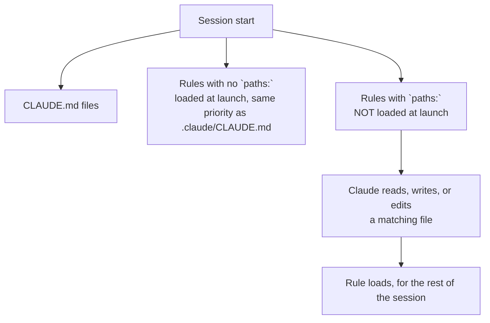

# Rules and Path-Scoped Rules

> You can split your instructions into topic files and make each one load only when the agent touches the files it is about.

**Type:** Learn
**Prerequisites:** Lesson 65, CLAUDE.md — the 200-Line Rule
**Time:** ~30 minutes

---

## Learning Objectives

- Split a long `CLAUDE.md` into `.claude/rules/` topic files
- Write `paths:` frontmatter so a rule loads only for matching files
- Predict which rules are in the window at launch and which load on demand
- Choose between a rule and a skill for a given instruction
- Explain why a rule is guidance the agent follows, not enforcement

---

## The Problem

Your API conventions live in `CLAUDE.md`. So does the test convention, and the React convention, and the CSS convention. The agent working on a CSS file is carrying 40 lines of API rules it will never use — every turn, in every session.

That is the 200-line problem from Lesson 65, but the fix is not to delete the rules. It is to make them load only when they are relevant. An instruction that matters for `src/api/**` has no business in the window while the agent edits a stylesheet.

---

## The Concept

A **rule** is a markdown file in a `.claude/rules/` directory. It is an instruction file like `CLAUDE.md`, with one addition: it can carry a `paths:` field that decides *when* it loads.



Rules live in two places:

- **Project:** `.claude/rules/` — committed, shared with the team.
- **User:** `~/.claude/rules/` — yours, every project. Loaded before project rules, so a project rule appears later in context. Neither overrides the other; if they conflict, the agent may follow either.

All `.md` files under the directory are discovered recursively, so `frontend/react.md` and `backend/api.md` are both found.

### Path-scoped rules

A rule without frontmatter loads at launch. A rule with a `paths:` field loads only when the agent works with a matching file — read, write, or edit, including a Bash command like `cat` or `head` that counts as a read.

```markdown
---
paths:
  - "src/api/**/*.ts"
  - "tests/**/*.test.ts"
---

# API rules

- Every endpoint validates input with a schema
- Return shape is `{ data }` or `{ error }`
```

`paths` accepts a YAML list or a comma-separated string. Glob patterns cover extensions, directories, or both:

| Pattern | Matches |
|---|---|
| `**/*.ts` | All TypeScript files, any directory |
| `src/**/*` | Everything under `src/` |
| `*.md` | Markdown in the project root |
| `src/components/*.tsx` | React components in one directory |

Brace expansion works: `"src/**/*.{ts,tsx}"`. One detail with teeth — `paths` is the **only** field Claude Code reads from a rule. Any other frontmatter key is ignored without an error. And if the YAML between the `---` markers doesn't parse, the rule loads as if it had no `paths` at all, quietly becoming always-on.

### Rules are not enforcement

Like `CLAUDE.md`, a rule is guidance the agent reads. It is not a permission and not a hook. If an instruction must happen *every time*, a rule is the wrong tool — that is a hook (Lesson 55). If an instruction is a procedure the agent runs on demand, that is a skill (Lesson 40).

| You want | Use | Why |
|---|---|---|
| Always-on project knowledge | `CLAUDE.md` or an unconditional rule | Loads every session |
| Knowledge only when certain files are touched | A `paths:` rule | Loads on match, saves context otherwise |
| A procedure for one kind of task | A skill | Loads on invoke |
| Something that must happen, every time | A hook | Enforced, not requested |

> **The reframe:** a rule is not a smaller `CLAUDE.md` — it is a `CLAUDE.md` with a condition, and the condition is the whole point: it loads exactly when the files it talks about come into view.

### A few sharp edges

- **Symlinks work**, but a link whose target is outside your working directory is treated like an external import and needs approval once per project (Lesson 70).
- **Excluding files:** `claudeMdExcludes` in a settings file skips specific `CLAUDE.md` and rules files by path or glob — useful in a monorepo where another team's rules leak in.
- **Prompt caching:** loading a new rule mid-session changes what is in the window, so the cache is rebuilt. That is a small cost paid once, not every turn.

---

## Build It

1. Create `.claude/rules/testing.md` with a `paths:` frontmatter scoped to your test files.

   ✅ You pass when the file exists with valid `paths:` frontmatter.

2. Start a fresh session and run `/context`. Look for the rule.

   ✅ You pass when the rule is *not* under the loaded memory files at launch.

3. Ask the agent to edit a file matching the glob. Watch for a `Loaded` line naming the rule, then run `/context` again.

   ✅ You pass when the rule now appears, and you can say which file triggered it.

4. Add a second rule with no frontmatter. Restart and run `/context`.

   ✅ You pass when the unconditional rule is loaded at launch and the scoped one is not.

5. Break the YAML between the `---` markers in the scoped rule (leave a field unclosed). Restart.

   ✅ You pass when you can explain why the rule loaded unconditionally despite the `paths:` you wrote.

---

## Use It

| Command / concept | When you reach for it |
|---|---|
| `.claude/rules/` | Project rules, committed and shared |
| `~/.claude/rules/` | Personal rules for every project |
| `paths:` frontmatter | Load a rule only for matching files |
| Rule with no `paths:` | Always-on, like `CLAUDE.md` |
| `/context` | Confirm which rules are in the window right now |
| `claudeMdExcludes` | Skip a rule or `CLAUDE.md` in a monorepo |
| `InstructionsLoaded` hook | Log which rules loaded, when, and why |
| Subdirectories in `rules/` | Organise by area; still discovered recursively |

---

## Exercises

1. Take one section out of a long `CLAUDE.md` — say, the API conventions — and move it into `.claude/rules/api-design.md` scoped to your API directory. Prove it stops loading in a session that never touches those files.
   ✅ You pass when `/context` shows the rule absent at launch and present after the agent reads a matching file.

2. Write two rules that both claim to govern the same file — one user-level, one project-level — with different guidance. Open the file and observe which the agent follows.
   ✅ You pass when you can explain that both loaded and neither overrides the other, so the agent may follow either, and you have removed the conflict.

3. You have an instruction that must run after every edit, not just when the agent is in a certain folder. Write it as a rule first, watch it get skipped, then convert it to the right mechanism.
   ✅ You pass when you can name why the rule failed and which mechanism you used instead.

---

## Key Terms

| Term | What people say | What it actually means |
|---|---|---|
| rule | "a small CLAUDE.md" | An instruction file in `.claude/rules/` that can be scoped with `paths:`. |
| `paths:` | "a filter" | The only frontmatter field a rule reads. Globs that decide when the rule loads. |
| path-scoped rule | "a rule for one folder" | A rule that stays out of the window until the agent touches a matching file. |
| load at launch | "it's always on" | Rules without `paths:`, loaded every session like `.claude/CLAUDE.md`. |
| user vs project rules | "project overrides user" | They concatenate; user rules load first. Conflicts are not resolved for you. |
| rules vs skills | "both are instructions" | Rules load at launch or on a file match; skills load when invoked. |

---

## What this lesson skipped

- **`CLAUDE.md` itself** — placement, load order, the 200-line rule. Lesson 65.
- **Imports and external context** — including how a symlinked rule's external target needs approval. Lesson 70.
- **Hooks** — the mechanism for instructions that must happen every time. Lesson 55.
- **Skills** — the mechanism for on-invoke procedures. Lesson 40.
- **Prompt-cache behaviour** when the window changes mid-session. Phase 13.

The behaviour above is from [Organize rules with `.claude/rules/`](https://code.claude.com/docs/en/memory#organize-rules-with-claude/rules/). The `paths` expansion budget and brace handling are version-gated; check the page before relying on an exact figure.
