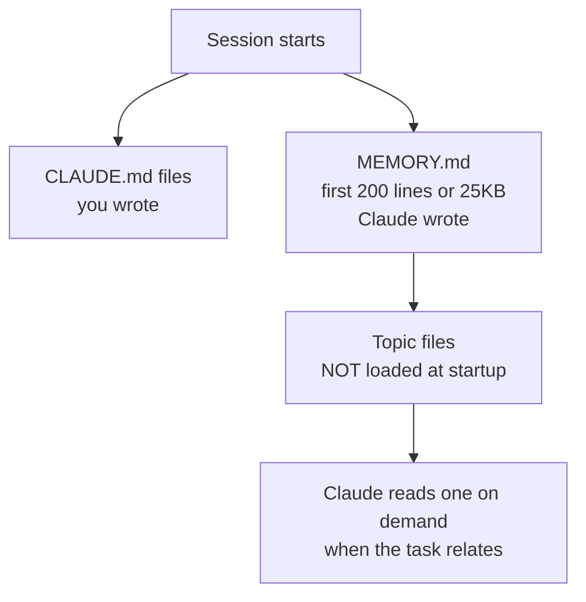

# Auto Memory and `MEMORY.md`

> You can let Claude take its own notes between sessions — and read, edit, or delete every one of them.

**Type:** Learn
**Prerequisites:** Lesson 65, CLAUDE.md — the 200-Line Rule
**Time:** ~30 minutes

---

## Learning Objectives

- Find the auto memory directory for a project and read what Claude saved
- Separate auto memory (Claude writes) from `CLAUDE.md` (you write)
- Name the four kinds of note and what each is for
- Predict what is *not* saved, and why
- Turn auto memory off for one project or one session

---

## The Problem

You correct the agent: "we use pnpm, not npm." It says "got it." Next session, it runs `npm install` again. You correct it again. Fifth time this month.

The agent has no memory of its own. Every session starts from a fresh window with nothing from the last one. `CLAUDE.md` fixes this when *you* remember to write the rule down. Auto memory is the other half: the agent writes the rule down for itself when you correct it.

---

## The Concept

Two systems load at the start of every session, and they are complements:

| | `CLAUDE.md` files | Auto memory |
|---|---|---|
| **Who writes it** | You | Claude |
| **What it holds** | Instructions and rules | Learnings and patterns |
| **Scope** | Project, user, or org | Per repository, shared across worktrees |
| **Loaded into** | Every session | Every session — first 200 lines or 25KB of the index |

Auto memory is a directory Claude maintains as it works. Each project gets one at `~/.claude/projects/<project>/memory/`, keyed by the repository, so every worktree and subdirectory of the same repo shares it. The directory holds an index and one file per memory:

Claude records what kind of note each memory is in a `type` field:

- **`user`** — your role, expertise, working preferences
- **`feedback`** — corrections you gave, and approaches you confirmed
- **`project`** — ongoing work, deadlines, decisions the code and git history don't show
- **`reference`** — where to find things outside the project, like an issue tracker

It skips anything it can derive from the codebase — architecture, file paths, debugging fixes — and anything your `CLAUDE.md` already says. It also doesn't save something every session; it decides whether a note would help a *future* conversation.

> **The reframe:** auto memory is not the agent remembering — it is the agent writing a file it will read next time, which means you can audit, edit, and delete its memory like any other file.

### The index and the topic files

`MEMORY.md` is an index: one line per memory, pointing at a topic file for detail. Only its first 200 lines, or 25KB, whichever comes first, load at session start. Everything past that threshold is dropped on the next load, so Claude keeps the index short by pushing detail into topic files like `feedback_testing.md`.

Topic files are **not** loaded at startup. Claude reads one on demand, with its normal file tools, when the task relates to it. That is the same progressive-disclosure idea as a skill (Lesson 40): a small always-on index, detail fetched when needed.

When Claude writes a memory file that begins with YAML frontmatter, Claude Code records a `modified` timestamp — so both you and Claude can see how current a fact is (Claude Code v2.1.214 or later, checked October 2026).

### Turning it off

Auto memory is on by default in local sessions. It is off by default in a self-hosted environment, and a background session — one another session started — cannot turn it back on. To change it:

- `/memory` → the auto memory toggle, which writes `autoMemoryEnabled` to `~/.claude/settings.json`
- `"autoMemoryEnabled": false` in one project's settings, to disable it there only
- `CLAUDE_CODE_DISABLE_AUTO_MEMORY=1` to disable it by environment variable

### What it is not

- **Not shared.** Auto memory is machine-local. It does not travel to another machine or a cloud environment. For that, use a committed `CLAUDE.md`.
- **Not loaded into subagents.** A subagent runs its own context; the main session's auto memory is not in it, except for a fork (Lesson 47). A subagent that sets its own `memory` field gets a *separate* directory.
- **Not exempt from you.** It is plain markdown. `/memory` opens the folder; you can edit or delete anything in it.
- **Not deleted on a schedule.** The session-transcript retention sweep skips the memory directory, so `MEMORY.md` and its topic files stay until you or Claude change them.

---

## Build It

1. In a project, run `/memory` and open the auto memory folder. Read `MEMORY.md`.

   ✅ You pass when you can name every entry in the index and say what topic file each points at.

2. Give the agent a real correction — something it got wrong about your setup. Watch for a "Saved" message.

   ✅ You pass when a new topic file exists and you can read the note in it.

3. Open the new file and find its `type` field. Decide whether it is `user`, `feedback`, `project`, or `reference`.

   ✅ You pass when you can say why Claude chose that type, and whether you agree.

4. Give the agent a fact it can derive from the code — a file path, say. Then check whether it saved anything.

   ✅ You pass when you can explain why it did *not* save a fact it could read from the repo.

5. Turn auto memory off in a project's settings, start a fresh session, and confirm.

   ✅ You pass when `/memory` shows the toggle off and no new memory is written in that session.

---

## Use It

| Command / concept | When you reach for it |
|---|---|
| `/memory` | Browse, open, edit, or delete memory files; toggle auto memory |
| `MEMORY.md` | The index loaded every session — first 200 lines or 25KB |
| Topic files | Detail Claude reads on demand, not at startup |
| `type` field | `user`, `feedback`, `project`, or `reference` |
| `autoMemoryEnabled` | Off for one project, or globally in user settings |
| `CLAUDE_CODE_DISABLE_AUTO_MEMORY=1` | Off by environment variable |
| `~/.claude/projects/<project>/memory/` | Where the files live |
| `modified` timestamp | How current a memory is |

---

## Exercises

1. Read every file in a project's auto memory directory. For each, classify it as one of the four types and decide whether it is still true. Delete or correct the stale ones.
   ✅ You pass when you have removed at least one stale entry and can say what made it stale.

2. Correct the agent about something the code does not reveal — a preference, or a convention that differs from the default. Then start a fresh session and check whether it applies the correction without you repeating it.
   ✅ You pass when the fresh session applies the correction and you can point at the memory file that carried it.

3. You work across two machines. Prove that a preference saved by auto memory on one does not reach the other, then set it up so it does.
   ✅ You pass when you can name why the auto-memory note didn't travel, and which file you used to make the preference portable.

---

## Key Terms

| Term | What people say | What it actually means |
|---|---|---|
| auto memory | "the agent remembers" | A directory of markdown files Claude writes and reads back. You can edit or delete it. |
| `MEMORY.md` | "the memory file" | An index. Only its first 200 lines or 25KB load at session start. |
| topic file | "a memory" | Detail Claude reads on demand, not at startup. |
| `type` field | "a tag" | Which kind of note it is: `user`, `feedback`, `project`, or `reference`. |
| machine-local | "synced" | Auto memory does not cross machines or cloud environments. |
| `CLAUDE.md` vs auto memory | "the same thing" | You write `CLAUDE.md`; Claude writes auto memory. Both load every session. |

---

## What this lesson skipped

- **`CLAUDE.md` mechanics** — placement, load order, confirming with `/context`. Lesson 65.
- **Subagent memory** — a subagent's own `memory` field and directory. Lesson 47.
- **Auto memory in the context budget** — what it costs and how it interacts with compaction. Phase 13.
- **Cloud and org-wide memory** — how managed settings interact with instruction files. Phase 17.

The behaviour above is from [Auto memory](https://code.claude.com/docs/en/memory#auto-memory). The 200-line and 25KB thresholds and the `modified` field are version-gated; check the page before relying on an exact figure.
