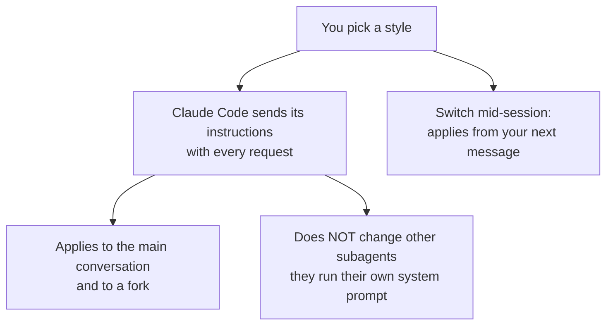

# Output Styles

> You can change how the agent talks and what role it plays for a whole session — without changing what it knows.

**Type:** Learn
**Prerequisites:** Lesson 68, Auto Memory and MEMORY.md
**Time:** ~30 minutes

---

## Learning Objectives

- Switch between the built-in output styles and say what each one changes
- Write a custom output style with frontmatter
- Decide between `keep-coding-instructions: true` and leaving it out
- Choose between an output style, `CLAUDE.md`, and a hook for a given need
- Explain why an output style is a request the agent follows, not a guarantee

---

## The Problem

You want short answers. So every session you type "be concise" before your first real question. Every session. Thirty times a month, the same sentence, and it wears off the moment the conversation gets long.

Or the other one: you are using Claude Code to draft documentation, not code. It keeps behaving like a software engineer — scoping changes, writing comments, verifying work — because that is the default role it was given. You want a writing assistant, not a coder with a documentation task.

Both are the same problem: you are trying to change *how* the agent works, one message at a time.

---

## The Concept

An **output style** is a set of instructions that sets Claude's role, tone, and response format for every response in a session. You pick one, and it applies until you change it — so you stop repeating the request.

Claude Code ships four built-in styles besides its default:

| Style | What changes | Use it when |
|---|---|---|
| Default | Nothing extra — standard software-engineering instructions | Normal work |
| Proactive | Starts work immediately, assumes on routine decisions, doesn't enter plan mode unless asked | You'll correct course rather than pre-approve |
| Concise | Leads with the result, drops preamble and recaps, one to three sentences for a simple question | Default answers are longer than you want |
| Explanatory | Adds short `Insight` blocks explaining choices behind the code | You're learning a codebase |
| Learning | Adds `Insight` blocks and leaves small pieces of code for you to write (`TODO(human)`) | You want hands-on practice while the task still gets done |

Switch with `/output-style <name>`, or `/config` → **Output style**, or the `outputStyle` field in a settings file. The command and the menus save the choice to `.claude/settings.local.json`.



> **The reframe:** an output style changes the agent's voice, not its knowledge — and unlike a rule in `CLAUDE.md`, it can replace the agent's whole job, which is why the built-in coding instructions come out unless you ask for them back.

### Writing a custom style

A custom output style is a markdown file: optional YAML frontmatter, then the instructions. Save it at one of three levels:

- **User:** `~/.claude/output-styles` — every project
- **Project:** `.claude/output-styles` — committed, shared
- **Managed policy:** `.claude/output-styles` inside the managed settings directory

The file name becomes the style name unless you set `name` in the frontmatter. The frontmatter fields:

| Field | What it does |
|---|---|
| `name` | Shown in the `/config` picker. Defaults to the file name |
| `description` | Shown in the picker |
| `keep-coding-instructions` | Set `true` to keep Claude Code's built-in software-engineering instructions alongside your style |
| `force-for-plugin` | Plugin styles only — apply automatically when the plugin is enabled |

`keep-coding-instructions` is the field that bites. Leave it out and your custom style **replaces** the software-engineering instructions — right if Claude is now a writing assistant, wrong if you only wanted a different tone. Set it `true` when you are changing how Claude communicates but still want it coding the same way.

```markdown
---
name: Diagrams first
description: Lead every explanation with a diagram
keep-coding-instructions: true
---

When explaining code, architecture, or data flow, start with a Mermaid diagram
showing the structure, then explain in prose.
```

### What an output style is not

- **Not enforcement.** It is an instruction the agent follows. For something that must happen every time, use a hook (Lesson 55). For what the agent should *know* about your project, use `CLAUDE.md` (Lesson 65).
- **Not for subagents.** Styles apply to the main conversation and to a fork (Lesson 47). Other subagents run their own system prompt, so a style doesn't change how they respond.
- **Not a permission change.** The Proactive style doesn't change your permission mode; prompts appear the same way.
- **Not instant for a new file.** In the terminal, style files are read at startup. Create or edit one mid-session and you restart to pick it up. Switching between existing styles applies from your next message (Claude Code v2.1.251 or later, checked October 2026).

---

## Build It

1. Run `/output-style concise`, then ask a question with a factual answer. Note the length.

   ✅ You pass when the reply leads with the result and you can say what was left out compared with the default.

2. Run `/output-style explanatory`, make a small code change, and look for an `Insight` block.

   ✅ You pass when you can point at the block and say it explains a choice rather than narrating the steps.

3. Write a custom style in `~/.claude/output-styles/` with `keep-coding-instructions: true`. Restart Claude Code and select it with `/output-style`.

   ✅ You pass when the style is in the picker and the agent still codes with its normal care.

4. Write a second custom style without `keep-coding-instructions`. Select it and ask for a code change.

   ✅ You pass when you can describe what the agent stopped doing, and say why the field was responsible.

5. With a style active, ask the agent to do something destructive but reversible. Watch for the confirmation.

   ✅ You pass when you can explain that the style is an instruction, not a lock, and that permissions still apply.

---

## Use It

| Command / concept | When you reach for it |
|---|---|
| `/output-style <name>` | Switch styles; list them with no argument |
| `/config` → Output style | Pick from a menu |
| `outputStyle` in settings | Set a default, or set it per project |
| `~/.claude/output-styles/` | Your styles, every project |
| `.claude/output-styles/` | Team styles, committed |
| `keep-coding-instructions: true` | Change tone, keep the coding behaviour |
| `force-for-plugin` | Plugin styles that apply on enable |
| Concise / Explanatory / Learning | Built-ins for shorter, teaching, and hands-on sessions |

---

## Exercises

1. Your team wants every explanation to start with a diagram, but the agent must still work like a careful engineer. Write the style and prove both halves.
   ✅ You pass when explanations start with a diagram and the agent still scopes and verifies its code changes.

2. You draft documentation in Claude Code, not code. Write a style for that job and decide, out loud, whether to keep the coding instructions. Then test a coding task under that style.
   ✅ You pass when you can say what the style gained you on documentation and what it cost you on the coding task.

3. A teammate says "just put 'be concise' in `CLAUDE.md`." Compare the two approaches on one task and write down which is better and why.
   ✅ You pass when you can name a case where a rule in `CLAUDE.md` is right and a case where a style is right.

---

## Key Terms

| Term | What people say | What it actually means |
|---|---|---|
| output style | "a prompt preset" | Instructions that set role, tone, and format for every response in a session. |
| `keep-coding-instructions` | "keep the defaults" | Whether your custom style keeps Claude Code's built-in software-engineering instructions. Defaults to false. |
| built-in styles | "the four modes" | Proactive, Concise, Explanatory, Learning — each adds to the default. |
| `force-for-plugin` | "always on" | A plugin style that applies automatically when the plugin is enabled. |
| style vs hook | "both change behaviour" | A style is an instruction the agent follows; a hook runs regardless of what it decides. |
| style vs CLAUDE.md | "both set context" | A style shapes how it responds; `CLAUDE.md` says what it should know. |

---

## What this lesson skipped

- **`CLAUDE.md`** — project knowledge that stays loaded whichever style is active. Lesson 65.
- **Hooks** — the mechanism for guaranteed actions. Lesson 55.
- **Subagents** — why they ignore the active style. Lesson 47.
- **Plugins shipping styles** — packaging a style for distribution. Lesson 63.
- **Prompt-cache cost of switching styles mid-session.** Phase 13.

The behaviour above is from [Output styles](https://code.claude.com/docs/en/output-styles). Which styles exist, and the `Concise` style's version requirement, are version-gated; check the page before relying on an exact name.
