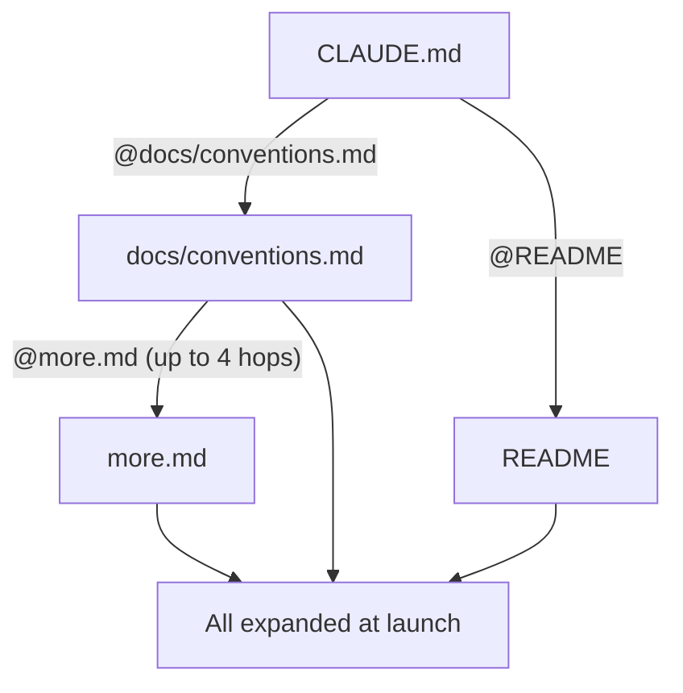

# Imports and External Context

> You can pull other files into a session's memory without copying them in — and see exactly when Claude asks before trusting a file from outside your project.

**Type:** Learn
**Prerequisites:** Lesson 69, Output Styles
**Time:** ~30 minutes

---

## Learning Objectives

- Compose a `CLAUDE.md` from several files with `@path` imports
- Predict the context cost of an import — and why it isn't cheaper
- Recognise when an import is external, and what approval it needs
- Avoid the two syntax traps: spaces and quotes
- Explain why an import from your home directory is safer than a committed one

---

## The Problem

You split `CLAUDE.md` into tidy topic files, then copied them back in so the agent would see them. Now there are two copies of every file, and they drift. You fix a convention in the topic file and forget the copy, and the agent follows the stale one.

Then the other problem. A teammate commits a `CLAUDE.md` with a line that reaches into their home directory for a config file. You open the repo and Claude asks whether it can read a file outside your project. You don't know what that file is, or why a project you cloned wants it. You approve without looking, or you decline and wonder what broke.

Both come from the same feature: `@path` imports.

---

## The Concept

A `CLAUDE.md` can pull in other files with `@path/to/import` syntax. The imported file is **expanded and loaded into context at launch**, alongside the `CLAUDE.md` that references it — as if you had typed its contents in.

The rules:

- **Relative paths resolve relative to the file containing the import**, not the working directory. An import in `docs/guide.md` of `@setup.md` looks for `docs/setup.md`.
- **Recursion goes up to four hops.** Imported files can import other files, to a depth of four.
- **Import parsing skips code spans and fenced code blocks.** To mention a path without importing it, wrap it in backticks: `` `@README` `` stays literal, `@README` imports.
- **Spaces need backslashes.** Put a `\` before each space: `@Design\ Docs/api-conventions.md`. Without them the path ends at the first space.
- **Quotes break it.** A path wrapped in quotes is not imported at all, with or without backslashes.

### Imports do not save context

This is the part people get wrong. Splitting a long `CLAUDE.md` into imports makes it *easier to organise* — but every imported file still loads at launch. The cost is the same, and each imported file counts as a separate file against the combined-size warning. If the goal is a smaller window, imports are the wrong tool; path-scoped rules (Lesson 67) are the right one.

> **The reframe:** an import is not a link the agent follows when it needs to — it is the file's contents pasted into memory at launch, so it organises your writing without shrinking your context, and an import that reaches outside your project is the moment the trust decision moves to you.

### External imports and the approval dialog

An import is **external** when its path resolves outside your working directory — the home-directory example above, for instance. The first time Claude Code sees external imports in a project, it shows an approval dialog listing the files. Decline and the imports stay disabled; the dialog doesn't appear again.

User-scope memory files are treated differently. `~/.claude/CLAUDE.md` and `~/.claude/rules/` are files you wrote, so their imports load without the dialog — except in Cowork sessions on your desktop, which skip any import that resolves outside the session's working directory.

That asymmetry is the reason an import from `~` is safer than one committed by someone else: a committed import into a teammate's home directory is a file the repo asks you to trust, and the dialog is the repo asking.

### Symlinks are imports

A symlink under `.claude/rules/` whose target is outside your working directory is treated like an external import: it doesn't load until you approve external imports for the project, and after that only the rules without a `paths:` field load. Rules in `~/.claude/rules/` avoid the prompt because they apply to every project anyway.

### Related switches

- **`claudeMdExcludes`** skips specific `CLAUDE.md` and rules files by path or glob — useful when an ancestor `CLAUDE.md` imports things you don't want.
- **`--add-dir`** gives Claude access to a directory outside the working directory, but its `CLAUDE.md` does not load unless you set `CLAUDE_CODE_ADDITIONAL_DIRECTORIES_CLAUDE_MD=1`.
- **`AGENTS.md`** imports are expanded too, and a `claudeMdExcludes` pattern applies to them.

---

## Build It

1. Create `docs/conventions.md` with a convention. Reference it from `CLAUDE.md` with `@docs/conventions.md`. Start a fresh session and run `/context`.

   ✅ You pass when both files appear under **Memory files**, as separate files.

2. Move `CLAUDE.md` into a subdirectory and import `@conventions.md` (no path prefix). Observe which file is found.

   ✅ You pass when you can state that the path resolved relative to the importing file, not the working directory.

3. Import a file from a folder whose name has a space, using backslashes before each space.

   ✅ You pass when the file loads and you can say what happens without the backslashes.

4. Wrap the same import in quotes and restart.

   ✅ You pass when you can explain why the quoted path was not imported.

5. Add an import that resolves into your home directory to a project `CLAUDE.md`. Restart and read the approval dialog. Decline, then restart again.

   ✅ You pass when you can say which files the dialog listed, and that it did not appear a second time after you declined.

---

## Use It

| Command / concept | When you reach for it |
|---|---|
| `@path/to/file` | Compose a `CLAUDE.md` from several files |
| Relative path | Resolves against the importing file, not the working directory |
| `` `@README` `` | Mention a path without importing it |
| `@Design\ Docs/file.md` | Import a path containing spaces |
| Four hops | The recursion depth limit for imports |
| External import dialog | Approve files a project reaches for outside your working directory |
| `claudeMdExcludes` | Skip a `CLAUDE.md` or rules file by path or glob |
| `--add-dir` + env var | Load memory files from an additional directory |

---

## Exercises

1. Build a `CLAUDE.md` that is entirely imports — one file for commands, one for conventions, one for architecture. Then measure its context cost against a single file with the same content.
   ✅ You pass when you can show the imported version is not smaller, and explain why the split still helped you.

2. A teammate's committed `CLAUDE.md` imports a file from their home directory. Decide whether to approve it. Write down what you would check first.
   ✅ You pass when you can name the risk (a file you didn't write, reaching into a repo you cloned) and the safe alternative (keep personal imports in your own user-scope file).

3. You want your personal project instructions to work across every worktree of a repo. Set it up without committing anything.
   ✅ You pass when a fresh session in a second worktree loads your notes and `git status` shows nothing new to commit.

---

## Key Terms

| Term | What people say | What it actually means |
|---|---|---|
| import | "a link" | The file's contents expanded into context at launch, not fetched on demand. |
| external import | "a file outside the project" | An import whose path resolves outside your working directory. It needs approval once. |
| four hops | "recursive imports" | Imported files may import others, to a depth of four. |
| backtick trick | "escaping" | `` `@README` `` stays literal; only a bare `@README` imports. |
| import cost | "it's split up now" | The same as one file — every import loads at launch. Organisation, not economy. |
| user-scope imports | "trusted" | Imports in `~/.claude/CLAUDE.md` and `~/.claude/rules/` load without the dialog (except in Cowork). |

---

## What this lesson skipped

- **`CLAUDE.md` mechanics** — load order, the 200-line rule, `/context`. Lesson 65.
- **Rules** — the path-scoped alternative when you want a smaller window. Lesson 67.
- **`AGENTS.md`** — which file loads, and imports inside it. Lesson 66.
- **The combined-size warning and trimming a bloated context.** Phase 13.
- **Managed and org-wide instruction files.** Phase 17.

The behaviour above is from [Import additional files](https://code.claude.com/docs/en/memory#import-additional-files). The external-import dialog and the Cowork exceptions are version- and surface-gated; check the page before relying on an exact behaviour.
