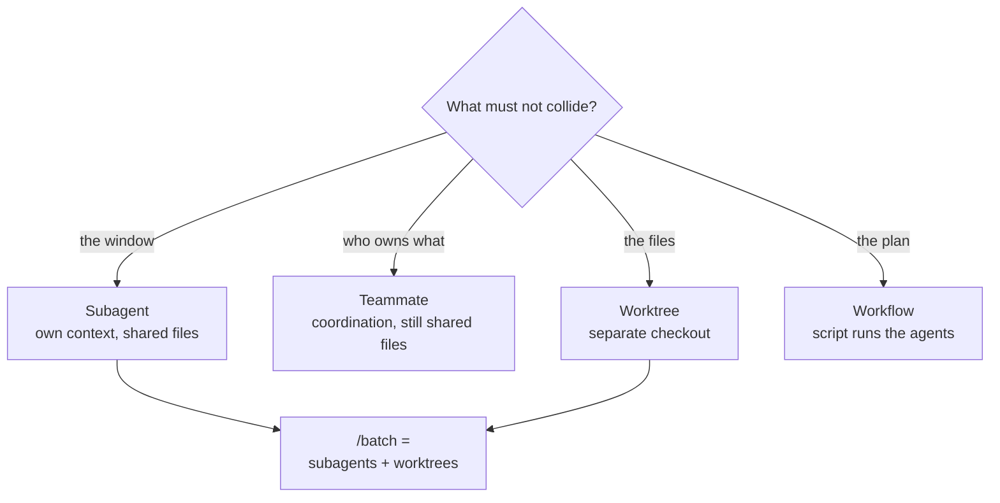

# The Five Names

> You can name the mechanism a task needs before you run it — and say what each
> one isolates.

**Type:** Learn
**Prerequisites:** Phase 02 Lesson 13 (Branches Are Movable Labels); Phase 04 Lesson 31 (The Agentic Loop); Phase 06 Lesson 45 (Subagent Markdown Format)
**Time:** ~30 minutes

---

## Learning Objectives

- Name the five mechanisms and, for each, say what it isolates
- Choose a mechanism from the isolation a task needs, not from a feature name
- Explain why "many agents" is the wrong question to start from
- Say which of the five a task does *not* need, in one sentence

---

## The Problem

A change touched twenty files. The instinct was "spawn agents." Five subagents
went out, all editing the same checkout. Two of them wrote the same file. The
work that survived was fine. The work that didn't was a merge with no branch to
merge.

Recovering it cost a restart and a manual re-apply. Nothing was wrong with the
subagents. The wrong name was chosen for the job.

Four words were in play — *subagent*, *team*, *worktree*, *workflow* — plus a
fifth that isn't a mechanism at all. They read like synonyms when you are
holding a task and deciding. They are not synonyms. Each one is a different
answer to "what must not collide?"

---

## The Concept

Claude Code ships several things that look like "run work in parallel." Five
names cover almost everything a learner reaches for. They are not five settings
on one dial. They are five different axes of isolation.

| Name | What it actually is | What it isolates | Who holds the plan |
|---|---|---|---|
| **Subagent** | A worker inside your one session | Its context window | Claude, turn by turn |
| **Teammate** (an agent team) | Peer sessions a lead runs | Who owns which task | The lead, over a shared task list |
| **Worktree** | A second checkout of the repo | The files on disk | You, or the harness for you |
| **Workflow** | A script that runs many subagents | The plan itself | The script |
| **`/batch`** | A packaged fan-out | Both: it uses subagents *and* worktrees | The skill's plan |

Read the middle column, not the name. That column is the whole lesson.

- A **subagent** keeps its mess out of your window. It does not keep it out of
  your files. Two subagents in one session share one working directory.
- A **teammate** is a full session that can message its peers and claim work. It
  gives you coordination, not file isolation — teams do not isolate teammates in
  worktrees, so you partition the files yourself.
- A **worktree** is the only one of the five that isolates files. It is not a
  worker. It is a copy of the repository where a worker can safely run.
- A **workflow** moves the loop out of Claude's turn-by-turn judgment and into a
  script. What it isolates is the plan, so a 500-file job doesn't have to fit in
  one conversation.
- **`/batch`** is not a sixth mechanism. It is a skill: it decomposes a change
  into units and runs one isolated subagent per unit.



Two more names exist, and this lesson is honest about leaving them out.
**Agent view** (background sessions you dispatch and watch) is Phase 12 — it is
mostly how you *monitor* work, and it has nothing to say about what collides.
**Projects** runs in the cloud and is out of scope for this course, which is
local-first. Neither is one of the five you pick between at the keyboard.

> **The reframe:** the five names do not differ by how many agents they run —
> they differ by what they isolate, and choosing one is choosing which collision
> you are trying to prevent.

Claude Code ships weekly and these names move. The comparison this lesson is
built on lives at
[Run agents in parallel](https://code.claude.com/docs/en/agents); check it before
trusting a row. Workflows are also off by default on some plans.

---

## Build It

### 1. Inventory what your install actually has

```bash
claude --version
env | grep CLAUDE_CODE_EXPERIMENTAL_AGENT_TEAMS || echo "agent teams: off"
```

Open a session and run `/agents`, then `/batch` with no argument. One lists your
subagent files; the other tells you what it needs before it runs.

✅ You pass when you can say which of the five names are available in *your*
build right now, and which need turning on.

### 2. Take three real tasks and assign each an axis

Write them down before choosing a name. For each task, answer **one** question:
what must not collide?

```
Task: "read every file under src/ and report the two that log a secret"
Collision to prevent: my context window filling with 400 file reads
Axis: context
Name: subagent

Task: "rewrite the import style in 30 files"
Collision to prevent: two editors writing one file at once
Axis: files
Name: worktrees

Task: "audit the whole codebase for the same bug, cross-checking findings"
Collision to prevent: a job too big for one turn, needing verification
Axis: the plan
Name: workflow
```

✅ You pass when each task has an axis written next to it, and the axis was
decided before the name.

### 3. Try the wrong axis on purpose

Take the import-rewrite task and do it as five subagents with no worktrees. Watch
them share one directory. Then do it again with `isolation: worktree` (Phase 11,
Lesson 74).

✅ You pass when you can point at the run that collided and name the column in
the table above that would have prevented it.

---

## Use It

| Reach for | When the thing that must not collide is… |
|---|---|
| A **subagent** | Your context window. Big searches, logs, file dumps you won't quote again. |
| A **teammate** | Who owns which task, and the workers need to talk to each other. |
| A **worktree** | The files. Any time two writers touch the same checkout. |
| A **workflow** | The plan. Dozens to hundreds of agents, or findings that must be cross-checked. |
| **`/batch`** | A large mechanical change you'd otherwise script by hand. It is subagents plus worktrees, packaged. |
| Nothing | The task is one file and one decision. |
| Agent view | You want to dispatch and watch several independent sessions. Phase 12. |

---

## Exercises

1. Write the five names in a column. Next to each, write the one thing it
   isolates, in three words or fewer. Do it from memory first, then check the
   table.
   ✅ You pass when all five rows name a *different* thing, and none of them says
   "files" except the worktree row.

2. Take a task from this week that you ran (or could have run) with an agent.
   Name the mechanism you used and the axis it isolated. If you used "none,"
   name the axis that didn't need isolating.
   ✅ You pass when your answer names the collision you were or weren't
   preventing, not the feature you clicked.

3. A colleague says "let's spin up a team to land this 12-file refactor."
   Write two sentences back: what team gives you, and what it doesn't.
   ✅ You pass when your reply says teams share files, so the 12 files need
   partitioning or worktrees — not just coordination.

---

## Key Terms

| Term | What people say | What it actually means |
|---|---|---|
| subagent | "a parallel agent" | A worker inside one session. Isolates context, not files. |
| teammate | "another agent" | A full session in an agent team, coordinated through a shared task list and a mailbox. Not worktree-isolated. |
| worktree | "a branch" | A second working directory with its own checkout. The only one of the five that isolates files. |
| workflow | "a big prompt" | A script that holds the plan and runs many subagents. Isolates the plan from your conversation. |
| `/batch` | "run it everywhere" | A skill that splits one change into units and runs one worktree-isolated subagent per unit. Subagents plus worktrees, packaged. |
| axis of isolation | "how parallel it is" | The single thing a mechanism keeps from colliding. The word that actually decides your choice. |
| agent view | "the agent dashboard" | A screen for dispatching and watching background sessions. A monitoring surface, not an isolation axis. Phase 12. |

---

## What this lesson skipped

**Worktrees in depth.** Branch names, base refs, `.worktreeinclude`, cleanup,
and per-agent isolation are Lessons 74 and 75, and all of Phase 16.

**Agent teams' mechanics.** The mailbox, the task list, and the documented
limits are Lesson 73.

**Workflows.** The script API, `parallel()` vs `pipeline()`, and the
completion-order trap are all of Phase 12.

**Projects and cloud sessions.** Out of scope for a local-first course. If you
move work to the cloud, read
[Claude Code in the cloud](https://code.claude.com/docs/en/claude-code-on-the-web).

**Cost.** Every name here multiplies token usage. Phase 03 Lesson 11 owns the
budget side; this lesson is about collisions, not spend.
