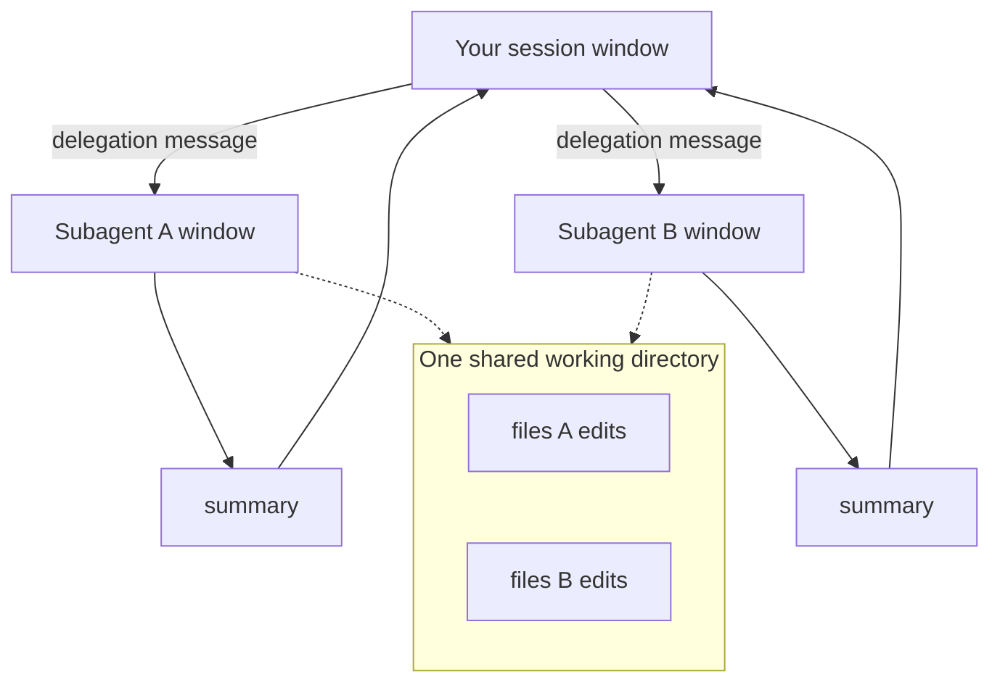

# Subagents as Isolation

> You can say exactly what a subagent isolates and what it shares — and stop
> mistaking context isolation for file isolation.

**Type:** Learn
**Prerequisites:** Lesson 71 (The Five Names); Phase 01 Lesson 8 (The Context Window); Phase 04 Lesson 30 (Sessions, `/clear`, `/compact`); Phase 06 Lesson 47 (Author a Subagent)
**Time:** ~35 minutes

---

## Learning Objectives

- Explain what isolation a subagent actually provides, and name the one it doesn't
- Watch a subagent's work stay out of your context window instead of trusting that it does
- Predict where two parallel subagents will collide before you run them
- Turn on per-agent file isolation with one frontmatter line

---

## The Problem

You delegated a 400-file search to a subagent. It worked exactly as advertised:
your window stayed small, the answer came back in five lines, the 400 reads
evaporated when the subagent finished. That is the demo everyone sees.

So you delegated the next job the same way — three subagents, each editing its
own set of files in the same repo. They ran at the same time. Two of them
touched one file. The second write won, and the first agent's edit was simply
gone.

The mistake wasn't parallel agents. It was believing that "isolated" was one
property. A subagent is isolated in the only place the demo showed you — its
context window — and completely unisolated everywhere else. Both filesystems it
ran against were the same filesystem.

---

## The Concept

Isolation is not a badge a mechanism carries. It is a list of things, and each
mechanism covers a different subset.

A subagent covers the **context window** (Lesson 8 — the one budget that
limits everything). Give it a task, it spends its own budget on the search, the
logs, the failed attempts, and the compaction that follows (Lesson 30), and it
hands back a summary. Your window never saw the mess. That is a real and large
win, and it is what makes parallelism worth doing at all: separate windows are
why four agents can hold four problems at once.

| | Subagent's window | Your files |
|---|---|---|
| **A subagent** | Separate. Its own budget, its own compaction. | **Shared.** It starts in your working directory. |
| **Two parallel subagents** | Separate from each other. | **Shared with each other.** Same directory. |
| **A subagent with `isolation: worktree`** | Separate. | Separate checkout. Collisions become merges. |



The dotted arrows are the part the demo hid. Both subagents write to `FS`. If
they touch the same path, the harness does not stop them — the second write is
just later.

### What the subagent starts with

Isolation does not mean empty. A non-fork subagent starts with its own system
prompt (the Markdown body), the delegation message Claude writes from your
request, your `CLAUDE.md` files, a git status snapshot, and any preloaded skills.
Then nothing else. Not your conversation, not the files you already read. The
full list is Phase 06, Lesson 47.

Its window size comes from *its own* model. Delegate to `haiku` and you quietly
hand it a smaller room, which is a fine trade until the task outgrows it.

### The one line that fixes files

Put this in a subagent's frontmatter and the agent gets its own checkout before
it edits anything:

```yaml
---
name: refactorer
description: Applies mechanical refactors across many files
isolation: worktree
---
```

Now the collision is a merge instead of an overwrite. That is Lesson 74's
subject; here it is enough to know the switch exists and that it defaults to
*off*.

> **The reframe:** a subagent isolates the conversation, not the filesystem —
> parallel subagents still share one working directory, and that shared
> directory is the collision you will actually hit.

Claude Code ships weekly. The mechanics of what a subagent loads and where it
runs are at
[Create custom subagents](https://code.claude.com/docs/en/sub-agents); the file
field that changes it is documented under `isolation`.

---

## Build It

### 1. Watch context isolation actually happen

Create a read-only subagent and give it a job that reads a lot:

```markdown
---
name: wide-reader
description: Reads many files and returns a short list of matches. Use for broad searches.
tools: Read, Grep, Glob
model: haiku
---

Search the paths you are given for the pattern in the request. Return only the
file paths that match and one line of context each. Nothing else.
```

Run `/context` before and after delegating a wide search to it.

✅ You pass when your own window's file-read count barely moves while the
subagent's summary arrives.

### 2. Predict the collision before you run it

Write down four file paths. Give two subagents the job of editing the same repo
at once, with one overlapping path in their lists. Before you run it, circle the
overlap.

✅ You pass when you named the colliding path before the run and can point at it
in the output afterwards.

### 3. Close the gap with one line

Add `isolation: worktree` to both agents, run the same two jobs, and compare.

✅ You pass when each agent's edits land on its own branch, no write was lost,
and you can say which mechanism — not which prompt — prevented the overwrite.

---

## Use It

| Situation | Move |
|---|---|
| A side task would flood your window | Subagent. Nothing else needed. |
| Two subagents will write the same file | `isolation: worktree` on each, or split the paths so they don't overlap. |
| The subagent's search came back empty or truncated | It probably ran out of its own model's window. Use a larger model or split the job. |
| You want the result interleaved in your own thinking | A skill, not a subagent (Phase 06, Lesson 47). |
| You need the subagent to see your conversation | A fork — the opposite trade. Phase 06, Lesson 47. |
| You want to see the background subagents you've spawned | `/tasks`. |

---

## Exercises

1. Build a read-only subagent and delegate two searches in one turn. Then run
   `/context` and `/tasks`.
   ✅ You pass when you can name what each subagent used of *its own* window and
   confirm your window grew by roughly the summaries, not the reads.

2. Take the same subagent and add `Write` to its tools, then have two copies
   edit one shared file simultaneously. Record what each copy reported versus
   what ended up on disk.
   ✅ You pass when you can show the disk state diverging from at least one
   copy's report.

3. Add `isolation: worktree`, rerun exercise 2, and inspect `git worktree list`
   plus the branches involved.
   ✅ You pass when the two writes survive on two branches and you can explain
   why the earlier overwrite is now a merge.

---

## Key Terms

| Term | What people say | What it actually means |
|---|---|---|
| isolation | "the agent can't touch my stuff" | A specific thing kept separate. For a subagent, that thing is its context window — not your files. |
| context isolation | "separate memory" | The subagent spends its own window on the work and returns only a summary. The reason parallel agents help at all. |
| shared working directory | "where it runs" | Parallel subagents start in your directory. Same paths, same writes, no guard. |
| `isolation: worktree` | "make it safe" | Gives that subagent its own git checkout, so its edits land on their own branch. Off by default. |
| delegation message | "the prompt" | Written by Claude from your request. The only channel into a fresh subagent. |
| window from its own model | "it has your window" | A subagent's budget comes from the model in its definition, which may be smaller than yours. |
| summary return | "the answer" | What crosses back into your window. Everything else stays in the subagent's, and is gone. |

---

## What this lesson skipped

**Worktrees, properly.** Branch naming, base refs, and cleanup are Lessons 74
and 75. This lesson only established that `isolation: worktree` is the switch.

**Agent teams.** How multiple sessions coordinate, and why teams do *not* get
worktree isolation, is Lesson 73.

**Forks.** A subagent that inherits your whole conversation instead of starting
fresh is Phase 06, Lesson 47 — the opposite of isolation.

**Cross-session messaging.** Passing findings between sessions you run yourself
is Phase 12, Lesson 77.

**The concurrency limit.** How many subagents can run at once is a number that
moves; check
[the subagents page](https://code.claude.com/docs/en/sub-agents) rather than a
figure quoted here.
