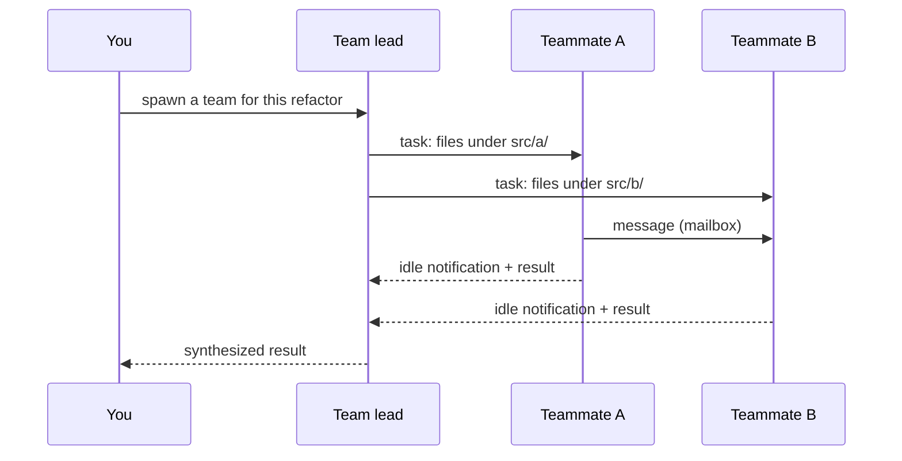

# Agent Teams — Mailbox, Task List, Documented Limits

> You can read a team's on-disk state, name what it buys you over subagents, and
> state the limits before you trust one with work.

**Type:** Learn
**Prerequisites:** Lesson 72 (Subagents as Isolation); Phase 04 Lesson 31 (The Agentic Loop); Phase 06 Lesson 45 (Subagent Markdown Format)
**Time:** ~35 minutes

---

## Learning Objectives

- Enable agent teams and tell whether you actually got a team or three subagents
- Read a teammate's state from the shared task list and the mailbox, not from the panel alone
- Say why teams add coordination but no file isolation, and what to do about it
- List the documented limits that will bite a real run, and which one bites first

---

## The Problem

You asked for three teammates to land a refactor across nine files. The panel
filled with three names. It felt coordinated.

Then two of them edited the same file. Agent teams do not put teammates in
separate checkouts — they share the repository, the way parallel subagents do.
The shared task list told each teammate *what* to do; nothing told them *which
directory* to do it in. One teammate's change overwrote another's, and the
overwrite was invisible until the diff.

The other trap came later. You resumed the session the next morning and asked
the lead to check on the researcher. The researcher no longer existed. `/resume`
does not bring in-process teammates back.

Neither failure is a bug. Both are documented limits, and both come from reading
"team" as "safety" instead of "coordination."

---

## The Concept

An agent team is four parts, not one.

| Part | What it is |
|---|---|
| **Team lead** | The one session you talk to. It plans, assigns, and synthesizes. Fixed for the team's life. |
| **Teammates** | Separate Claude Code sessions, each with its own context window. |
| **Task list** | A shared list of work items: pending, in progress, completed, with dependencies. |
| **Mailbox** | A per-agent inbox for messages between agents. |

Two of those parts live as files you can read. A team is named `session-` plus
the first eight characters of the session ID:

```
~/.claude/teams/{team-name}/config.json          runtime state (don't hand-edit)
~/.claude/teams/{team-name}/inboxes/{name}.json  each agent's mailbox
~/.claude/tasks/{team-name}/                     the shared task list
```

The task list is the coordination. A teammate that finishes a task picks up the
next unblocked one on its own, or the lead assigns it. Claiming uses file locking
so two teammates can't grab the same task — but the lock is on the *task*, not on
the file the task edits.



Note what the diagram does **not** contain: any boundary between the files A and
B write. That boundary is your job to draw before you spawn.

### Teams versus subagents

Both give each worker its own context. They differ in who coordinates:

| | Subagents | Agent teams |
|---|---|---|
| Coordinator | Claude, turn by turn, inside one session | A lead session, over a shared task list |
| Workers talk to each other | Only if Claude named them | Yes, directly, by name |
| File isolation | Shared dir by default; `isolation: worktree` available | **None.** Partition the files yourself. |
| Best for | Focused tasks where you want the result | Work that needs discussion and self-assignment |
| Cost | Lower | Higher — each teammate is a full session |

### Turning it on changes ordinary delegation

Teams are experimental and off by default. Enable them with an environment
variable in `settings.json`:

```json
{
  "env": {
    "CLAUDE_CODE_EXPERIMENTAL_AGENT_TEAMS": "1"
  }
}
```

While enabled, a subagent that Claude *names* launches as a teammate. Claude
names subagents on its own for later messaging, so a team can form during
delegation you never framed as team work. If you wanted a plain subagent, that
is a surprise worth knowing before it happens.

Spawning teammates also needs an interactive session. With `claude -p` or the
Agent SDK, Claude doesn't spawn teammates and a named subagent stays a subagent.

### The limits that bite, in the order they bite

1. **No worktree isolation.** Partition files between teammates. This is the one
   that corrupts work.
2. **Task status can lag.** A teammate finishes but doesn't mark the task done,
   so dependents stay blocked. Nudge the lead.
3. **No session resumption with in-process teammates.** After `/resume`, tell the
   lead to spawn new teammates. Messages to the old ones go nowhere.
4. **One team per session, and no nested teams.** Only the lead manages the team;
   teammates can't spawn teammates.
5. **No background subagents from in-process teammates.** A teammate's background
   work can't outlive the lead's process.
6. **Shutdown is slow.** A teammate finishes its current call first.
7. **Split panes need tmux or iTerm2.** The default in-process mode works
   anywhere.

> **The reframe:** an agent team is a shared task list plus a mailbox — it buys
> coordination, not isolation, so the files it touches still need partitioning.

Agent teams are experimental and the limit list moves. Read
[Orchestrate teams](https://code.claude.com/docs/en/agent-teams) before relying
on a specific limitation; the version-gated notes on that page change fastest.

---

## Build It

### 1. Turn teams on and confirm they're on

Add the env block above to `.claude/settings.json`, restart, and ask for two
teammates on a small, read-only task. Run `/tasks` and open the task list with
`Ctrl+T`.

✅ You pass when the task list shows tasks with owners, not just a chat log.

### 2. Read the on-disk state

Before you close the session, find the team directory:

```bash
ls ~/.claude/teams/ ~/.claude/tasks/
```

Open a mailbox file and the config. Then change nothing — the config is runtime
state and your edits get overwritten.

✅ You pass when you can point at the mailbox for one teammate and name the
file that holds the task list.

### 3. Prove the file-sharing limit

Give two teammates overlapping file lists on purpose. Watch what lands. Then give
them disjoint lists.

✅ You pass when you can show the overlap producing a lost or merged change, and
the disjoint split producing none — and explain that the difference was
partitioning, not the task list.

### 4. Hit the resumption limit

Finish a run with an in-process teammate, exit, and `--resume`. Ask the lead to
message that teammate.

✅ You pass when you can report what happens to a message sent to a teammate that
resumption did not restore.

---

## Use It

| Situation | Move |
|---|---|
| Work needs discussion and self-assignment | Agent team. |
| Work is independent and you just want results | Subagents. Cheaper, no coordination overhead. |
| Two teammates might touch one file | Give them disjoint paths. Teams won't isolate them. |
| A dependent task is stuck | The status lagged. Tell the lead to nudge or update it. |
| You need to define a reusable teammate role | A subagent definition, referenced as the agent type. |
| You want to reach one teammate directly | Select it in the panel (in-process) or click its pane (split). |
| You need to pass findings between your *own* sessions | Cross-session messaging. Phase 12, Lesson 77. |
| Quality gates on a teammate's work | Hooks: `TeammateIdle`, `TaskCreated`, `TaskCompleted`. Phase 08. |

---

## Exercises

1. Spawn a three-teammate team on a read-only research task and one on an
   implementation task. For each, write the file boundaries you'd need before
   spawning.
   ✅ You pass when the research task needs none and the implementation task has
   an explicit per-teammate path list.

2. Deliberately let two teammates share a file. Record the diff and identify
   whose change was lost.
   ✅ You pass when you can name the lost change and the mechanism that would
   have prevented it (worktrees, per Lesson 74).

3. Resume a session that had in-process teammates and try to message one.
   ✅ You pass when you can state the documented behavior from your own run, not
   from this page.

---

## Key Terms

| Term | What people say | What it actually means |
|---|---|---|
| agent team | "parallel agents that cooperate" | A lead session plus peer sessions sharing a task list and a mailbox. Coordination, not isolation. |
| team lead | "the main agent" | The one session you talk to. Fixed for the team's life; can't be transferred. |
| task list | "the plan" | Shared work items with states and dependencies, under `~/.claude/tasks/`. Claiming is lock-protected; the files aren't. |
| mailbox | "the chat" | A per-agent inbox JSON under `~/.claude/teams/`. How teammates message each other by name. |
| self-claim | "picking up work" | A teammate grabbing the next unblocked task without the lead assigning it. |
| idle notification | "it told me it's done" | The message a teammate sends the lead when it stops, including its result. |
| task status lag | "it's stuck" | A finished task marked not-done, blocking its dependents. |
| named subagent | "a teammate" | With teams on, a subagent Claude names launches as a teammate. The cause of teams forming unasked. |

---

## What this lesson skipped

**Worktrees.** The fix for the file-collision limit. That is Lesson 74.

**Workflows.** When the plan itself should be a script instead of a lead's
turn-by-turn judgment. All of Phase 12.

**Cross-session messaging.** Talking between sessions you run yourself, outside
any team. Phase 12, Lesson 77.

**Hooks for teams.** `TeammateIdle`, `TaskCreated`, and `TaskCompleted` are hook
events; the hook model is Phase 08, and team hooks are a Phase 12 topic.

**Cost.** Teams use significantly more tokens than a single session. Phase 03,
Lesson 11 owns the budget.
