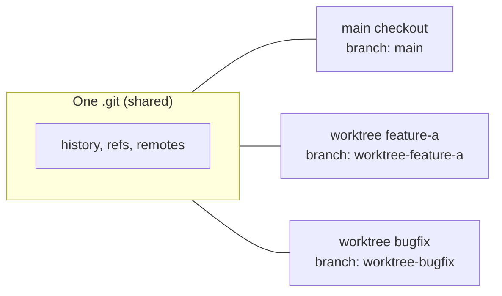

# Worktrees, Deep — session vs per-agent

> You can give a session or a single agent its own checkout, know exactly what
> that isolates, and know what it still shares.

**Type:** Learn
**Prerequisites:** Lesson 73 (Agent Teams); Phase 02 Lesson 13 (Branches Are Movable Labels); Phase 02 Lesson 14 (Merge and Rebase)
**Time:** ~45 minutes

---

## Learning Objectives

- Start a session in a worktree and read its path and branch out of git
- Choose between a session worktree and a per-agent worktree for a given job
- Say what a worktree shares with the main checkout even though the files are separate
- Predict what Claude Code does to a worktree when you exit, and when it refuses to clean up

---

## The Problem

You wanted two things done at once, so you opened a second terminal and ran
`claude` again in the same folder. Both sessions read the same files. Both wrote
the same files. The second save landed on top of the first, and nothing warned
either of you — they were editing one working tree.

The tempting fix is "keep them in different branches." It doesn't help. A branch
is a movable label (Phase 02, Lesson 13); it says where commits go, not which
files on disk are being written right now. Two sessions on two branches still
share one working tree.

What you actually need is a second working tree. The word `worktree` contains
`working tree`, and that is precisely what it gives you.

---

## The Concept

A git worktree is a **separate working directory with its own files and branch
that shares the repository's history and remote**. Not a copy of the repository.
A copy of the *checkout*. The `.git` directory is shared; the files are not.

```
repo/                       main checkout, one working tree
  .git/                     shared: history, refs, objects
  src/
repo/.claude/worktrees/
  feature-a/                second working tree, branch worktree-feature-a
  bugfix/                   third working tree, branch worktree-bugfix
```

You get one like this:

```bash
claude --worktree feature-a      # or -w
```

By default it lands at `.claude/worktrees/feature-a/` on a new branch named
`worktree-feature-a`. Omit the name and Claude generates one, such as
`bright-running-fox`.



### Session worktree vs per-agent worktree

There are two scopes, and they nest.

| | Session worktree | Per-agent worktree |
|---|---|---|
| Started by | `claude --worktree <name>`, or Claude entering one during a session | `isolation: worktree` in a subagent's frontmatter |
| Isolates | The whole session | One subagent |
| Lifetime | Until you exit (with a prompt if there's work) | Until the subagent finishes; auto-removed if it made no changes |
| Scope | Everything the session does | Only that agent's edits |

They nest in one direction: **a session already inside a worktree extends the
same isolation to every subagent it spawns**, whether or not that subagent sets
`isolation: worktree`. So the cheapest safe setup is usually one session
worktree and ordinary subagents inside it.

A per-agent worktree is for the case where the session itself is *not* isolated
and you want only one risky agent walled off — or where several agents each need
their own checkout to edit overlapping files and merge afterwards.

### What a worktree shares anyway

The files are separate. These are not, and they cause surprises:

- **The `.git` directory.** Git commands inside a worktree write to the shared
  repository. That is why `git commit` works from inside one.
- **Plugins** enabled at project scope from the main checkout.
- **Permission approvals.** A "don't ask again" you answer in a worktree is saved
  to the main checkout's local settings and applies everywhere in the repo.
- **Untracked skills, agents, and commands.** If the worktree has no
  `.claude/skills/` at its root, Claude reads the main checkout's.

Also untracked files like `.env` are **not** in a fresh checkout. To carry them
in automatically, add a `.worktreeinclude` at the repo root:

```text
.env
.env.local
config/secrets.json
```

It uses `.gitignore` syntax, and only files that are *also* gitignored are
copied — tracked files are never duplicated.

### What happens on exit

Claude Code checks the worktree for work that removal would delete:

- **Clean, unnamed** → removed, branch and all.
- **Clean, named** → you're prompted, so you can keep it for later.
- **Has changes, untracked files, or new commits** → you're prompted to keep or
  remove.
- **State can't be verified** → prompted rather than removed.

Keeping preserves the directory and branch; Claude prints the
`claude --worktree <name> --resume` command to return. Non-interactive `-p`
runs have no exit prompt and don't clean up at all.

> **The reframe:** a worktree is the only mechanism that isolates files —
> `--worktree` isolates one session, `isolation: worktree` isolates one agent,
> and a session inside a worktree extends that isolation to every agent it
> spawns.

Claude Code ships weekly and the worktree page changes fast. Before trusting a
default, read
[Run parallel sessions with worktrees](https://code.claude.com/docs/en/worktrees).

---

## Build It

### 1. Start a session in a worktree and read its identity

```bash
git worktree list
```

Then:

```bash
claude --worktree feature-a
```

From inside the session:

```bash
pwd
git branch --show-current
```

✅ You pass when you can point at the worktree's path, name its branch, and
explain why that branch is not the isolation — the *directory* is.

### 2. Stop it from polluting `git status`

Add this to `.gitignore` in the main checkout:

```text
.claude/worktrees/
```

✅ You pass when `git status` in the main checkout no longer lists worktree
contents as untracked.

### 3. Carry a gitignored file in

Create `.worktreeinclude` at the repo root naming a real gitignored file, start
a fresh worktree, and list its contents.

✅ You pass when the named file is present in the new worktree and a *tracked*
file is not duplicated by the pattern.

### 4. Register two agents on their own worktrees

Add `isolation: worktree` to two subagents and run both. Inside the session:

```bash
git worktree list
```

✅ You pass when two temporary worktrees appear with their own branches.

### 5. Watch cleanup refuse to delete work

In a worktree session, make an uncommitted change, then exit.

✅ You pass when Claude Code prompts you instead of removing the worktree, and
you can say which condition triggered the prompt.

---

## Use It

| Situation | Move |
|---|---|
| Two sessions must edit at once | `claude --worktree <name>` for each. |
| One risky agent, session stays put | `isolation: worktree` on that subagent. |
| Several agents editing overlapping files | Per-agent worktrees, then merge the branches. |
| `.env` or secrets missing in a worktree | Add a `.worktreeinclude` at the repo root. |
| Starting from a specific PR | `claude --worktree "#1234"`. |
| A specific existing branch | `git worktree add ../path <branch>`, then `cd` and run `claude`. |
| Worktree leftover after a crash | `git worktree remove`, `--force` if needed, `git worktree unlock` first if locked. |
| Listing what exists | `git worktree list`. |
| Non-git version control | A `WorktreeCreate` hook replaces the git logic. Phase 08 for hooks. |

---

## Exercises

1. Run a session in a worktree and another session in the main checkout. Save a
   change to the same file from both, at the same time.
   ✅ You pass when the two working trees hold different content for the same
   path, and you can explain which one the *shared* `.git` would commit from
   each.

2. Start a worktree, make a commit on its branch, then from the main checkout run
   `git log --oneline worktree-<name>`.
   ✅ You pass when the commit is visible from the main checkout, confirming they
   share history even though the files are separate.

3. Delete a worktree directory by hand while a session thinks it's still in it,
   then run a git command from that session.
   ✅ You pass when you can describe the failure and why the session's
   working-directory identity mattered.

---

## Key Terms

| Term | What people say | What it actually means |
|---|---|---|
| worktree | "a branch, but isolated" | A separate working directory with its own files and branch, sharing one `.git` with the main checkout. |
| `--worktree` / `-w` | "open a parallel session" | Starts a session in its own worktree under `.claude/worktrees/`. |
| session worktree | "my other window" | A worktree that isolates one whole session. |
| per-agent worktree | "isolated subagent" | `isolation: worktree` — a temporary worktree for one subagent. |
| `.worktreeinclude` | "copy my env" | A gitignore-syntax list of gitignored files to copy into each new worktree. |
| shared `.git` | "it's copied too" | It isn't. Worktrees share history, refs, and remotes with the main checkout. |
| cleanup prompt | "it asks to keep the worktree" | Claude Code's check before removal: work present, or state unverifiable. |
| `EnterWorktree` | "switch worktrees mid-session" | The tool Claude uses to enter a worktree; outside `.claude/worktrees/` it asks first. |

---

## What this lesson skipped

**Base ref and cleanup policy.** What a worktree branches *from*, retention, and
the retention sweep are Lesson 75.

**The enforcement checks.** Worktrees claim to isolate files; Lesson 76 shows
the four checks that make it true, and the one gap.

**Manual worktree workflows in depth.** Merge strategy for agent branches,
and the empty-branch bug, are Phase 16.

**Non-git version control.** SVN, Perforce, and Mercurial need a `WorktreeCreate`
hook. Hooks are Phase 08; the example is on the worktrees page.

**Desktop-app worktrees.** The desktop app reads project config from the main
checkout. That is Phase 17's surface material.
