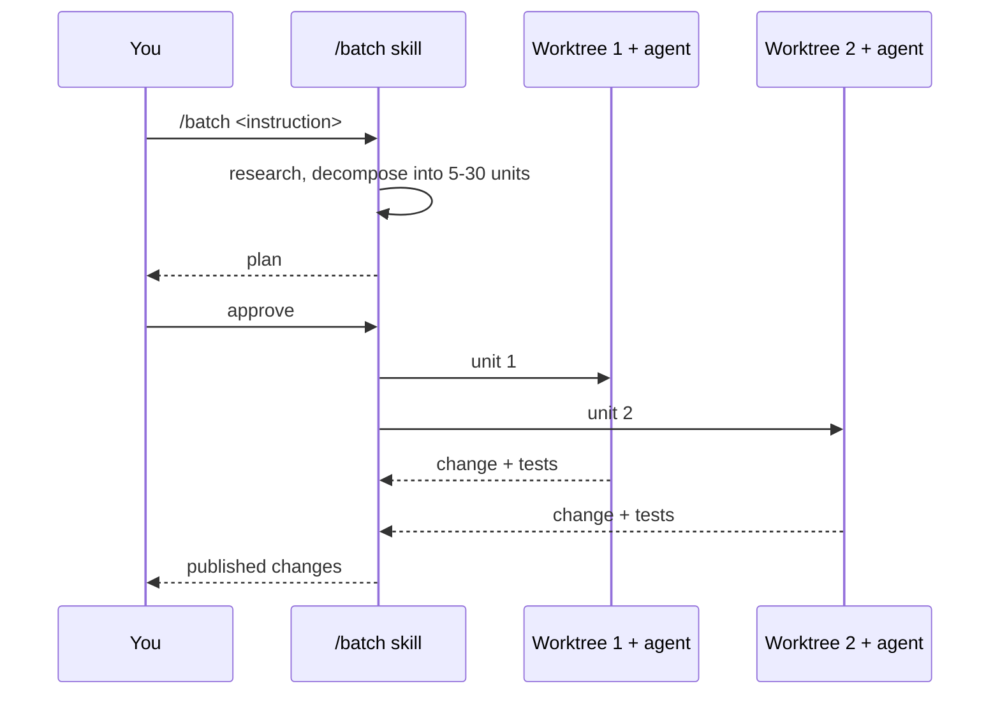

# Base Ref, Cleanup, and the /batch Path

> You can say what a fresh worktree starts from, what happens to it when you're
> done, and when to reach for `/batch` instead of wiring agents up by hand.

**Type:** Learn
**Prerequisites:** Lesson 74 (Worktrees, Deep); Phase 02 Lesson 16 (Recovering Lost Work)
**Time:** ~40 minutes

---

## Learning Objectives

- Choose `worktree.baseRef` from what the agent needs to see, and predict the stale-code bug when you choose wrong
- State what the retention sweep keeps and what it removes, and which of those loses work
- Run `/batch` on a real change and read the plan it proposes before approving
- Say how many worktrees a given `/batch` run will create, and where they go

---

## The Problem

An agent was sent into a worktree to fix a bug in a feature branch. The fix looked
right. It also undid a change someone had made that morning, because the worktree
had branched from the repository's *default* branch, not from the feature branch
the session was on. The fix was correct against a tree that no longer existed.

Nothing errored. That is the shape of this bug: `fresh` is the default, and
`fresh` means "branch from the repository's default branch on the remote,
usually main." If your work lives on a feature branch and hasn't been pushed,
every worktree starts blind to it.

The second half of the problem is what happens after the run. A worktree with
uncommitted work is *kept*, not deleted — which sounds safe until you learn that
a worktree holding an unpushed commit can also be kept indefinitely, locked, and
eventually forgotten. And a worktree a background session left behind can stay
locked until something clears it.

---

## The Concept

### What a fresh worktree starts from

`worktree.baseRef` in settings decides the base:

| Value | Branches from | Use when |
|---|---|---|
| `"fresh"` (default) | The repository's default branch on the remote, usually `main` | The agent should work against a clean, up-to-date tree |
| `"head"` | Your current local `HEAD` | The agent must see your unpushed commits and feature-branch state |

```json .claude/settings.json
{
  "worktree": {
    "baseRef": "head"
  }
}
```

Two rules fall out of this:

- You **can't** set `baseRef` to a branch name. For a specific existing branch,
  create the worktree with `git worktree add` yourself (Lesson 74).
- Inside a worktree, `"head"` resolves to *that worktree's* `HEAD`, not the main
  checkout's. The setting is a rule, not a snapshot.

For `"fresh"`, Claude Code keeps `origin/HEAD` current, fetching the default
branch if the repo hasn't been fetched in 24 hours. If there's no remote or the
fetch fails, it falls back to your local `HEAD`.

### What the retention sweep keeps

Claude Code runs a periodic sweep that removes worktrees it created for subagents
and background sessions, once they're older than `cleanupPeriodDays`. It keeps a
worktree in place when:

- It still holds work: changed or untracked files, or **unpushed commits**.
- A checked-out submodule has changes, or the submodules can't be inspected.
- It belongs to a `--worktree` session you haven't backgrounded, whatever its age.
- You created it yourself with `git worktree add`.

Claude writes a marker into the git metadata of every worktree it creates, and
the sweep keeps anything without one. While an agent runs, Claude holds a
`git worktree lock`, released when the agent finishes; the sweep releases locks
left by exited processes, but never a lock you set yourself.

To clean one up by hand:

```bash
git worktree remove <path>            # add --force for uncommitted work
git worktree unlock <path>            # if git refuses because it's locked
```

### The `/batch` path

`/batch` is a skill that turns one large change into many isolated agents. It
researches the codebase, decomposes the work into **5 to 30 independent units**,
and shows you the plan. Once approved, it spawns one background subagent per unit
in its own worktree. Each implements its unit, runs tests, and publishes its
change.

```bash
/batch migrate src/ from JavaScript to TypeScript
```



It needs a git repository, or a `WorktreeCreate` hook that creates the worktrees
for you. Outside git, that hook also changes how each subagent publishes — it
reports what it published instead of opening a pull request.

> **The reframe:** a worktree is only as good as what it starts from and what
> happens to it after — `baseRef` decides the tree the agent sees, and the
> retention rules decide whether its work is still there tomorrow.

Worktree defaults and `/batch` requirements are version-gated and move. Confirm
against
[Run parallel sessions with worktrees](https://code.claude.com/docs/en/worktrees)
and [Commands](https://code.claude.com/docs/en/commands).

---

## Build It

### 1. Feel the `fresh` bug

On a feature branch with an unpushed commit, create a worktree with the default
base:

```bash
git switch -c feature-x
git commit --allow-empty -m "unpushed work"
claude --worktree demo
```

From inside the worktree:

```bash
git log --oneline -1
```

✅ You pass when the worktree's tip is the default branch, and the commit you
just made is *not* visible there.

### 2. Fix it with `baseRef: head`

Add the setting from this lesson, remove the demo worktree, and repeat.

✅ You pass when the worktree now contains your unpushed commit, and you can say
which value the setting changed.

### 3. Watch the lock

With an agent still running in a worktree, run `git worktree list` from another
terminal.

✅ You pass when you can see the worktree marked locked, and explain why `git
worktree remove` would refuse until the agent finishes or you unlock it.

### 4. Read a `/batch` plan before approving

Run `/batch` on a change small enough to judge — a rename across a folder.

✅ You pass when you can state how many units it proposed, whether each maps to
one worktree, and what it will do with each unit's change (publish, or open a PR).

---

## Use It

| Situation | Move |
|---|---|
| Agent must see your unpushed work | `worktree.baseRef: "head"`. |
| Agent should work from a clean `main` | Leave `"fresh"` (the default). |
| Start from a specific existing branch | `git worktree add` manually, not `baseRef`. |
| One mechanical change across many folders | `/batch <instruction>`. |
| A few independent edits you want to steer | Subagents or a team, not `/batch`. |
| A worktree lingering after a crash | `git worktree remove`, unlock first if needed. |
| No git repository | A `WorktreeCreate` hook; `/batch` then reports its published change. |
| A shipped PR to review | `claude --worktree "#1234"`. |

---

## Exercises

1. Run the same `/batch`-style change twice: once on `"fresh"`, once on
   `"head"`, with an unpushed commit on your branch.
   ✅ You pass when you can point at the run that built on stale code and name
   the setting that caused it.

2. Create a worktree, make an unpushed commit, and let the retention window
   elapse (or simulate it). Determine whether the sweep keeps it.
   ✅ You pass when you can state the rule and confirm it against `git worktree
   list`.

3. Run `/batch` on a change you can verify, and before approving, write down how
   many worktrees you expect.
   ✅ You pass when the run creates one worktree per unit and your predicted count
   matches, or you can explain why the decomposition differed.

---

## Key Terms

| Term | What people say | What it actually means |
|---|---|---|
| `worktree.baseRef` | "where the branch starts" | `"fresh"` (default) from the remote default branch, or `"head"` from your current local `HEAD`. Never a branch name. |
| fresh worktree | "a clean copy" | One branched from the default branch. It does not see unpushed work — the stale-code trap. |
| retention sweep | "cleanup" | A periodic removal of Claude-created worktrees older than `cleanupPeriodDays`, skipping any that hold work. |
| worktree lock | "it won't delete while running" | Held while an agent runs; released on finish, and for exited processes. Never releases a lock you set. |
| `/batch` | "mass edit" | A skill that decomposes one change into 5–30 units and runs one worktree-isolated subagent per unit. |
| publish | "push the change" | What each `/batch` subagent does with its result — a PR in git, or a reported change under a `WorktreeCreate` hook. |
| `cleanupPeriodDays` | "how long worktrees live" | The age after which the sweep may remove an idle worktree — unless it holds work. |

---

## What this lesson skipped

**The enforcement checks.** Why a worktree session genuinely cannot edit the main
checkout is Lesson 76.

**Merge strategy for agent branches.** Rebasing, squash-merging, and the
empty-branch bug are Phase 16.

**Writing a `WorktreeCreate` hook.** The hooks model is Phase 08; the worktree
page carries the working example.

**Workflow scripts.** `/batch` is one packaged fan-out. Writing your own
orchestration is Phase 12.
