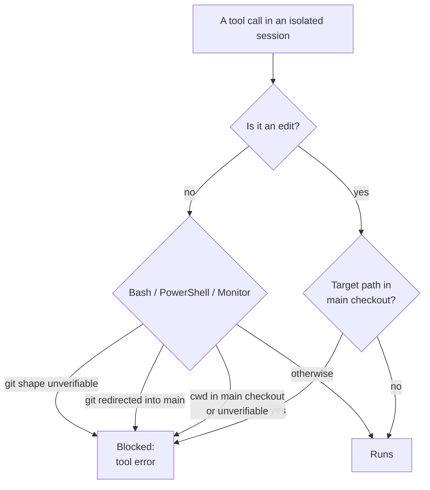

# How Isolation Is Actually Enforced — the blocking checks

> You can name the four checks that make a worktree an isolation boundary, prove
> one of them by hitting it, and name the gap they don't cover.

**Type:** Learn
**Prerequisites:** Lesson 75 (Base Ref, Cleanup, and the `/batch` Path); Phase 04 Lesson 33 (Permissions and Permission Modes)
**Time:** ~40 minutes

---

## Learning Objectives

- List the four checks Claude Code runs on a worktree-isolated session
- Make a blocked edit and a blocked command happen, and read the refusal
- Identify the one class of command the checks do not stop
- Explain why the enforcement lives in the harness rather than in your prompt

---

## The Problem

A team had a rule. It was written in `CLAUDE.md` in bold: *never edit the main
checkout from a worktree session.* Everyone trusted it. The rule held for weeks
because every agent chose to follow it.

Then an agent hit an edge case, decided the main checkout "was probably fine
here," and edited it. Nothing in the harness objected — the rule was prose, and
prose is a request. The work landed in the wrong tree, and the branch that was
supposed to hold it was empty.

The lesson is not "write better prompts." It is that a worktree's isolation is
not a convention the agent agrees to. It is a set of checks the harness runs on
every edit and every command. This lesson shows you the checks, including the one
command shape they don't catch — because knowing the gap is the difference
between trusting isolation and trusting it *correctly*.

---

## The Concept

While a session is isolated in a worktree, Claude Code blocks tool calls that
would reach the main checkout. The same rules apply whether the session started
with `--worktree`, entered one with `EnterWorktree`, or was resumed into one —
and they cover **every subagent the session spawns**, and subagents that have
their own worktree.

Four checks:

| # | Check | What it blocks |
|---|---|---|
| 1 | **File edits** | An `Edit`, `Write`, or `NotebookEdit` that targets a path in the main checkout |
| 2 | **Command working directory** | A `Bash`, `PowerShell`, or `Monitor` command whose working directory resolves to the main checkout, or that can't be verified to stay outside |
| 3 | **Git redirects** | A command that redirects git into the main checkout: `git -C`, `--git-dir`, a `GIT_DIR` or `GIT_WORK_TREE` variable, or a `cd` into the main checkout before running git |
| 4 | **Command shape** | A command where the text doesn't prove any git it runs stays inside the worktree — a command name computed at runtime, unparseable syntax, or an expansion like `${!name}` or `${ command; }` |



Checks 1–3 are about *where* the call acts. Check 4 is about *what the text
proves*, and it is the strict one: Claude Code refuses a command rather than
assume an unreadable command is safe. It tells Claude how to rewrite it — usually
as plain, separate commands. You can't turn check 4 off. On PowerShell, only the
working-directory check applies.

The checks read the path an edit targets, the directory a command runs in, and
the command text. **None of them tracks which files a shell command writes.** So
a command that writes into the main checkout without invoking git there — a
`cp`, or a shell redirect like `> ../main-checkout/file` — is *not* refused by
these checks. It falls under your normal permission and sandboxing settings,
like any other shell command.

That is the gap. It is narrow, but it is real, and it is why "the harness stops
me" is a statement to make precisely.

> **The reframe:** isolation isn't a promise you make in a prompt — it's four
> checks the harness runs on every edit and command, and the one gap in them is
> a shell command that writes outside git.

The check list and the exact refusal messages are version-gated. Confirm against
[How Claude Code enforces isolation](https://code.claude.com/docs/en/worktrees)
and
[the error reference](https://code.claude.com/docs/en/errors) before teaching a
specific message.

---

## Build It

Do this in a worktree session (`claude --worktree checks`) so the checks are
live. Keep the main checkout path handy.

### 1. Hit the file-edit check

Ask Claude to edit a file in the main checkout:

```text
Edit ../<repo>/README.md and add a line at the top.
```

✅ You pass when the edit is refused and the refusal names the worktree, rather
than happening silently.

### 2. Hit the working-directory check

```text
Run `cd ../<repo> && git status` for me.
```

The `cd` into the main checkout is a redirect into the main checkout.

✅ You pass when the command is blocked and you can say which of checks 2 and 3
fired.

### 3. Find the gap

```text
Run `cp my-file.txt ../<repo>/stolen.txt` (no git involved).
```

This one is about shell file writes, not git.

✅ You pass when you can state whether it was blocked by the isolation checks or
handled as an ordinary shell command under permissions — and why that differs
from step 2.

### 4. Watch the shape check refuse a safe-looking command

Run something whose command name is built at runtime:

```bash
CMD=git; $CMD status
```

✅ You pass when it is refused even though it would have been harmless, and you
can explain that the check prompts a rewrite rather than guessing.

---

## Use It

| Situation | Move |
|---|---|
| A worktree edit was blocked | That's check 1. Edit inside the worktree instead. |
| A command was blocked for its directory | Checks 2/3. Run it from inside the worktree. |
| A read-only shell command was refused | Check 4. Rewrite as plain, separate commands, as the refusal suggests. |
| You need to move a file out of a worktree without git | The checks don't stop it; your permission and sandbox settings do. Use them. |
| You want a rule to be impossible, not requested | A hook or a tool-pool restriction, not prose. Phase 08. |
| You're on PowerShell | Only the working-directory check applies. The others are Bash-side. |
| Subagents seem to escape the rules | They don't — the checks cover every subagent the isolated session spawns, including its own worktree ones. |

---

## Exercises

1. In a worktree session, trigger checks 1 and 3 and capture both refusal
   messages verbatim.
   ✅ You pass when you have the two messages and can match each to the check that
   produced it.

2. Demonstrate the gap: write a file into the main checkout with a plain shell
   redirect, no git.
   ✅ You pass when you can show the write succeeding and state clearly that you
   did it *outside* the isolation checks, not through a hole in them.

3. Turn one of the four checks into a rule that survives an unattended run — a
   `PreToolUse` hook or a narrowed tool pool — and show the same attempt now
   failing structurally.
   ✅ You pass when the second run fails for a reason that isn't the model
   choosing to comply.

---

## Key Terms

| Term | What people say | What it actually means |
|---|---|---|
| isolation check | "the worktree protects me" | One of four harness rules that block a tool call reaching the main checkout from an isolated session. |
| file-edit check | "it can't edit there" | Blocks `Edit`/`Write`/`NotebookEdit` targeting a main-checkout path. |
| working-directory check | "it can't run there" | Blocks a command whose cwd resolves to the main checkout, or that can't be verified outside it. |
| git redirect | "it can't touch git there" | Blocks commands that point git at the main checkout via `-C`, `--git-dir`, `GIT_DIR`, `GIT_WORK_TREE`, or a `cd`. |
| command shape check | "it refuses safe commands" | Blocks a command whose text can't prove its git stays inside the worktree. Can't be turned off. |
| the gap | "isolation is absolute" | Shell writes into the main checkout that don't invoke git (`cp`, redirects) aren't refused by these checks; permissions and sandboxing govern them. |
| tool error | "it just failed" | How Claude sees a refusal — it names the worktree and how to proceed. |

---

## What this lesson skipped

**Permissions and sandboxing.** The layer that governs the gap — tool approvals,
paths, and the sandboxed Bash tool — is Phase 04, Lesson 33 and Phase 17.

**Hooks.** Turning a request into an impossibility with a `PreToolUse` guardrail
is Phase 08. That is the general form of the fix in Exercise 3.

**Isolation without a commit.** A worktree that holds perfect work and no commit
is not a backup. That is Phase 16, Lesson 110, and the whole point of this
phase's practice module.

**The refusal-message catalogue.** Each message has a named cause and recovery in
[the error reference](https://code.claude.com/docs/en/errors); those strings
change across versions, so this lesson teaches the checks, not the text.
