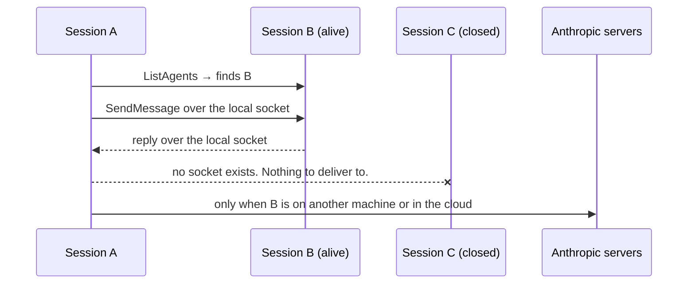

# Cross-Session Messaging

> One session can tell another session something without you copy-pasting it —
> and the channel only exists while the receiving session does.

**Type:** Build
**Prerequisites:** Phase 11 (Lessons 71–76), Phase 04 Lesson 30 (Sessions)
**Time:** ~35 minutes

---

## Learning Objectives

- Send one session a finding by asking a *different* session to send it
- Read `/list-agents` and say which rows are reachable, and why
- Prove the channel is a per-session socket by closing a session and watching the address stop working
- Choose between `accept`, `hold`, and `refuse` for inbound messages, and predict what each does
- Subscribe to an idle notice so a long task tells you when it is done

---

## The Problem

Two sessions were running in two terminals. One changed a database column. The
other was halfway through building against the old name.

Nothing told the second session. The user alt-tabbed, retyped the finding in the
other terminal, and lost the thread they were holding in their head to do it.

Then they asked the obvious follow-up: "if I close that terminal, can your other
session still send it a message?" I said yes. That was wrong.

The docs are specific. The transport on this machine is a **per-session socket**
— a Unix domain socket, or a named pipe on Windows. A closed session has no
socket. There is no inbox waiting behind it. A message to a session that is gone
is not queued and not retried; there is nothing to retry it to.

That distinction is the whole lesson. Messaging is not mail. It is text pushed at
a process that has to still be running.

Related: this repo already has a scar from exactly this mistake. A claim that
cross-session workers "survive closing the tab" was made in conversation and
corrected later, because the docs say the opposite. Read this one as the
correction, written down.

---

## The Concept

Every Claude Code session that has messaging available binds one socket for
*itself*. Other sessions on the same machine deliver into it. The socket is the
session's address.



Three things follow from "the address is a socket bound to a live process."

**One: nothing is stored.** A message is delivered and consumed. It is not a
transcript and not a queue you can read later. If you want the *conversation* in
another session, you resume the session — that is a different mechanism and
Lesson 30 already taught it.

**Two: the message is text, not context.** Another Claude writes it. Your history,
your open files, your uncommitted diff do not travel with it. The receiving
session sees a sentence with a sender name and a reply address, and can open any
path you mention with its own tools and its own permissions.

**Three: it can't act for you.** A message is not your consent. It cannot approve
a permission prompt, cannot change settings or `CLAUDE.md`, and a `/compact` in
the body arrives as literal characters. If acting on the message needs a
permission the receiving session lacks, you get the same prompt you would get
anyway.

### Who you can reach

`/list-agents` (also `/peers`) prints the machine's reachable set. The first line,
when it exists, is *this* session's own name — that is what other sessions type to
reach you.

| Row | What it is |
|---|---|
| Subagents | Agents inside the current session. Reachable, but messaging them is the same as addressing them directly |
| Teammates | This session's own agent-team peers (Phase 11, Lesson 73). These also share a task list |
| Your other local sessions | Other sessions on this machine — including background ones. Listed only when they bound a socket |
| Cloud sessions | Only while this session is connected to Remote Control |
| Remote Control sessions on other machines | Same condition; labelled `Remote Control`, and can read `offline` |

A name with a space or punctuation needs quotes: `@"release notes"`. When the
typeahead can't tell two sessions apart, Claude Code attaches a short identifier
and addresses the message with that instead.

### The doorbell

A message arrives as a dim one-line preview, and the preview stays in the
transcript. `Ctrl+O` opens the full text. Claude reads all of it either way — the
`…` is only what *you* see.

Delivery timing is the part worth internalising: the receiving Claude reads the
message **between tool calls** during an active turn, so a running tool is never
interrupted. An idle session starts a new turn to read it.

> **The reframe:** a message is text pushed at a socket that only exists while
> the receiving session is alive — so "send it a note" and "send it a note later"
> are not the same request, and only one of them is possible.

---

## Build It

You need two sessions for this. Open a second one in another terminal in this
repo, or use a background session.

### 1. Give both sessions names

An unnamed session gets an autogenerated name, which is useless as an address.

```
/rename schema-work
```

In the other session:

```
/rename payments-api
```

✅ You pass when `/list-agents` in either session shows both names.

### 2. Rehearse the reachability question before you need it

In `schema-work`:

```
/list-agents
```

Read every row out loud and say what it is. Then answer this before moving on:
*which of these rows would disappear if you closed that terminal?*

✅ You pass when you can name the row that stops existing when a session exits,
and say why in terms of the socket rather than in terms of permission.

### 3. Send one, without writing it yourself

In `schema-work`, cause the change, then ask Claude to pass it on:

```
Explain what we just did to the session working on the payments API.
```

Claude discovers the target with `ListAgents` and sends with `SendMessage`. You
never call either tool. Notice that the *wording* is Claude's, so a vague request
gives a vague message.

Then try the direct address:

```
Let @payments-api know the schema migration finished.
```

✅ You pass when the preview line appears in the second session and you can say
which part of your prompt Claude could have dropped and still succeeded.

### 4. Prove it is a socket, the hard way

In `payments-api`, run `/status`. Find the `Peer address` row. It is prefixed
`uds:` and it is the path of that session's socket.

Now close that session. In `schema-work`:

```
Tell payments-api the schema changed again.
```

✅ You pass when the send does not arrive, and you can state what did *not*
happen: no queue, no retry, no stored message.

### 5. Choose what this session does with inbound messages

`crossSessionInbound` has three values.

```
/config crossSessionInbound=hold
```

Careful — the docs say the `/config` shorthand form is rejected for *this* key.
Set it in the row named **Messages from your other sessions**, or in a settings
file. Send yourself a message from the other session either way.

✅ You pass when the message is held rather than delivered, and you can say what
releases it later.

### 6. Ask to be told when a long task ends

`SendMessage` can carry `notify_when_idle`. In the session that is waiting:

```
Tell me when the schema-work session finishes what it's working on.
```

Two limits worth knowing before you rely on it: only the Claude in your *main*
conversation can subscribe, only to sessions on this machine, and the
subscription is dropped unanswered after 12 hours.

✅ You pass when the notice arrives, and you can name what happens to the
subscription if it never does.

### 7. Post into your own session from a hook

The socket path and a per-session token are exported to hooks and Bash commands
as `CLAUDE_CODE_MESSAGING_SOCKET` and `CLAUDE_CODE_MESSAGING_TOKEN`. That is how
a script running *inside* a session can put a line back in front of Claude.

```sh
{
  printf '%s\n' "{\"type\":\"auth\",\"token\":\"$CLAUDE_CODE_MESSAGING_TOKEN\"}"
  printf '%s\n' "build finished: 3 failures, see /tmp/build.log"
} > "$CLAUDE_CODE_MESSAGING_SOCKET"
```

One connection, both lines. Two separate `>` redirects would open two
connections, and only the first one would carry the auth line.

Two traps. On native Windows the auth line is **required** — a connection whose
first line is not a valid auth line is closed and delivers nothing. And the
connection is dropped if it hasn't sent a complete line within 30 seconds, so
capture slow output *before* you open it.

✅ You pass when the line appears in your own session, and you can say why the
token matters more on Windows than on macOS or Linux.

> Claude Code ships weekly and this feature is young. The version gates are real:
> v2.1.224+ on macOS, Linux, and WSL 2, v2.1.234+ on native Windows, and v2.1.248+
> for same-machine messaging on non-Anthropic providers. Verified against
> [the cross-session messaging page](https://code.claude.com/docs/en/cross-session-messaging)
> on 2026-10-15. Check `https://code.claude.com/docs/llms.txt` before trusting a
> number here.

---

## Use It

| Need | Reach for | Note |
|---|---|---|
| A session needs a finding from another | Ask Claude to send it | Claude writes the text; be specific or get a vague message |
| Address a session yourself | `@name` in your prompt | Typeahead; requires v2.1.232+ |
| Name a session so it can be addressed | `/rename`, or `--name` at launch | An autogenerated name is not an address |
| See what's reachable | `/list-agents` (alias `/peers`) | Also shows your own name |
| Find your socket | `/status` → `Peer address` | Prefixed `uds:` |
| Notice when another session goes idle | Ask for it; `SendMessage`'s `notify_when_idle` | 12-hour expiry, main conversation only, same machine only |
| Decide what you accept | `crossSessionInbound`: `accept` / `hold` / `refuse` | Default is derived from the two sessions' permission modes |
| Post from a hook or script | `$CLAUDE_CODE_MESSAGING_SOCKET` + token | Native Windows requires the auth line |
| Stop sending and listing | Deny `SendMessage` and `ListAgents` | Both take the bare tool name |

---

## Exercises

1. Break the "later" assumption on purpose. Start two sessions. Send one message
   while both are alive. Then close the target, send again, and reopen a session
   with the same name.
   ✅ You pass when the message sent to the closed session never turns up in the
   reopened one, and your explanation names the socket rather than the clock.

2. Set `crossSessionInbound` to `refuse` in one session and try to message it from
   the other. Then set `hold`, try again, and change the mode so the held message
   is released.
   ✅ You pass when you can describe all three outcomes — delivered, held,
   refused — and say which one takes your permission to become delivered.

3. Predict before you test. Two sessions, one in `bypassPermissions` and one in
   the default mode, with no `crossSessionInbound` value set anywhere. Without
   running it, write down which direction ends up held. Then check.
   ✅ You pass when your prediction matches, or your note explains precisely
   which mode-class rule you had backwards.

4. A teammate is not a peer session. Start an agent team (Phase 11, Lesson 73) and
   message a teammate. Then ask what the message can carry that a peer-session
   message can't.
   ✅ You pass when you can say which wire the teammate message uses and why
   structured protocol messages don't travel cross-session.

---

## Key Terms

| Term | What people say | What it actually means |
|---|---|---|
| cross-session messaging | "chat between agents" | Text pushed into a *running* session's socket. Not mail, not stored |
| the inbox socket | "the session's inbox" | A per-session Unix socket or Windows named pipe. Gone when the session exits |
| `SendMessage` | "the message tool" | Claude's send call. Takes plain text, max ~1M characters same-machine |
| `ListAgents` | "the address book" | Discovery. Lists subagents, teammates, local sessions, and reachable remote ones |
| `notify_when_idle` | "ping me when it's done" | A one-shot notice when the watched session next goes idle or exits. 12-hour expiry |
| `crossSessionInbound` | "a permission setting" | `accept` / `hold` / `refuse` for *arriving* messages. The default comes from both sessions' permission classes |
| own-child message | "a message from myself" | A hook or Bash command posting into its own session. Needs process evidence, or the token |
| reply address | "the return path" | Attached to every message except a one-way cross-machine one |

---

## What this lesson skipped

**Cross-machine and cloud delivery.** Messages to your sessions on another
machine, or in the cloud, travel through Anthropic servers over Remote Control
and need a claude.ai sign-in. That is the provider-and-connectivity layer, and it
is Phase 17's territory. Same-machine messaging, which is what this lesson
teaches, never leaves your computer.

**Channels.** The other direction — an external event pushing *into* a session —
is a different mechanism with its own contract. Lesson 83 shows where it sits
next to hooks; the full contract is Phase 17.

**Agent-team protocol messages.** Teammates exchange structured messages that
stay inside the team. Plain text is the cross-session wire.

**Routines and scheduled tasks.** Messaging is not scheduling, and Lesson 82 is
the one that covers timers. The two combine, and it is worth knowing they are
separate.

**What a burst looks like when it fails.** Rapid sends to one session get refused
at the *sender*, and message loops are throttled at the receiver. If you build
something chatty, read the limitations section of the page above before you
design around it.
