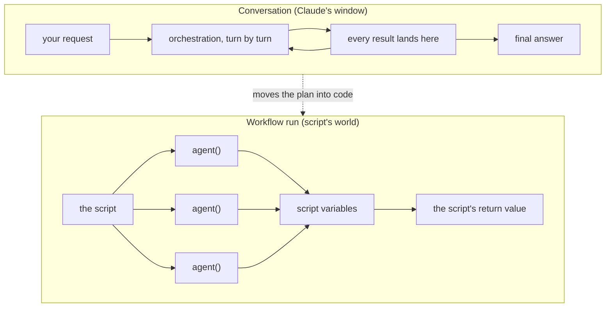

# Dynamic Workflows — the Script Decides

> The plan moves out of Claude's window and into a JavaScript file that a runtime
> executes in the background — and that one move is what makes a big fan-out
> repeatable and cheap.

**Type:** Build
**Prerequisites:** Phase 11 (Lessons 71–76), Phase 04 Lesson 30 (Compaction), Phase 06 (Subagents)
**Time:** ~45 minutes

---

## Learning Objectives

- Run a bundled workflow and read its progress view without steering it
- Find the script a run generated, and read its `meta` block, `agent()` calls, and phases
- Ask Claude to write a workflow for a task of your own, and approve it deliberately
- Save a run as a reusable `/<name>` command, and pass it input through `args`
- Say what a workflow cannot do that a conversation can

---

## The Problem

You have 400 files to migrate. Claude spawns five subagents, each migrates a
file, and each returns a summary into your conversation. Then it spawns five
more. By file twenty, your window holds twenty summaries and three stack traces,
and one of them was long enough to trigger a compaction.

The plan — which files, in what order, what to do when one fails — lived in
Claude's window. Compaction summarized the window. The plan is now a summary of
a plan.

That is not a bug. It is what subagents are: the *results* come back into the
window, and the window is the one budget that fills (Lesson 08). Five delegated
tasks per turn is the scale that fits.

The other shape is to stop asking Claude to hold the loop. Write the loop down.

---

## The Concept

A **dynamic workflow** is a JavaScript script that orchestrates subagents. Claude
writes the script for the task you describe. A runtime executes it in the
background, in an isolated environment, while your session stays responsive.

The intermediate results stay in **script variables**. That is the part that
matters. The script holds the list of files, the results so far, the branching,
and the retries. Your conversation holds the final answer.



### The trade, in one table

| | Subagents | Skills | Agent teams | Workflows |
|---|---|---|---|---|
| What it is | A worker Claude spawns | Instructions Claude follows | A lead supervising peer sessions | A script the runtime executes |
| Who decides what runs next | Claude, turn by turn | Claude, following the prompt | The lead, turn by turn | The script |
| Where intermediate results live | Claude's window | Claude's window | A shared task list | Script variables |
| What's repeatable | The worker definition | The instructions | The team definition | The orchestration itself |
| Scale | A few delegated tasks per turn | Same as subagents | A handful of long-running peers | Dozens to hundreds per run |
| Interruption | Restarts the turn | Restarts the turn | Teammates keep running | Resumable in the same session |

Read the second row twice. Subagents, skills, and teams all leave the *decision*
with Claude — it looks at the last result and picks the next move. A workflow
takes that decision away from the model and puts it in `if` statements.

The fourth row is the payoff: a workflow you saved runs the *same* orchestration
next time. That is the difference between "Claude is good at migrations" and "we
have a migration."

> **The reframe:** with subagents Claude is the orchestrator and the plan lives in
> its window; with a workflow the script is the orchestrator and the plan lives in
> code — decide which of those two you want before you decide how many agents.

---

## Build It

### 1. Run the bundled one first

`/deep-research` ships with Claude Code. Give it a question with a real answer.

```
/deep-research What changed in the Node.js permission model between v20 and v22?
```

Approve the launch when asked. Then open the run:

```
/workflows
```

The view shows each phase and its agent count. `↑`/`↓` moves, `Enter` drills in,
`Esc` backs out, `p` pauses and resumes, `x` stops an agent or the whole run, and
`s` saves.

✅ You pass when you can name the phases the run used, without having typed a
single prompt into it after the first one.

### 2. Read the script it wrote

Every run writes its script to a file under your session's directory in
`~/.claude/projects/`. Claude receives the path when the run starts, so you can
just ask for it.

```
Show me the script for that run.
```

You are looking for four things:

```javascript
export const meta = {
  name: 'audit-routes',
  description: 'Audit every route handler for missing auth checks',
}

const found = await agent('List every .ts file under src/routes/.', {
  schema: { type: 'object', required: ['files'], properties: { files: { type: 'array', items: { type: 'string' } } } },
})

const audits = await pipeline(found.files, file =>
  agent(`Audit ${file} for missing authentication checks.`, { label: file }),
)

return audits.filter(Boolean)
```

`agent()` spawns one subagent. `pipeline()` runs one per item in a list.
`parallel()` runs a set of tasks at once. `phase()` groups the agents that
follow under a title. `log()` prints above the phases. `args` is the input a
saved workflow was called with.

Three rules the runtime enforces, and each one will bite you once: no `import()`
— the body is plain JavaScript; no direct filesystem or shell access — agents do
the work and the script coordinates; and `Date.now()`, `Math.random()`, and a
no-argument `new Date()` **throw**, so that a relaunched run repeats the same
calls. Pass a timestamp in through `args` instead of reading the clock.

✅ You pass when you can point at the line that decided *how many* agents would
run, and say what would change it.

### 3. Ask for one of your own

The keyword opts in for a single prompt:

```
ultracode: audit every API endpoint under src/routes/ for missing auth checks
```

Asking in your own words — "use a workflow", "run a workflow" — is treated the
same. For a session-wide setting, `/effort ultracode` makes Claude plan a
workflow for each substantive task, which uses more tokens and takes longer per
request. Turn it off with `/effort ultracode off` when you go back to routine
work.

The keyword only opts in from a prompt **you** type: the interactive prompt, an
IDE panel, a Remote Control client, or an SDK app that stamps the input as human.
It does *not* start a workflow from `-p`, from a scheduled task prompt, or from a
webhook or pull-request comment relayed into the conversation. Before v2.1.210 it
did, which is why old notes may say otherwise.

✅ You pass when a workflow starts from a keyworded prompt you typed, and you can
name one route that would *not* have triggered it.

### 4. Approve it deliberately

The per-run prompt shows the planned phases and four options:

| Choice | What it does |
|---|---|
| Yes, run it | Starts the run |
| Yes, and don't ask again for `<name>` in `<path>` | Offered for bundled, saved, and plugin workflows — not for a one-off script Claude just wrote |
| View raw script | Read it before deciding. `Ctrl+G` opens it in your editor |
| No | Cancels |

Which prompt you see depends on your permission mode: **auto** prompts once and
records consent; **manual** and **accept edits** prompt every run unless you
chose "don't ask again"; **bypass permissions** never prompts; and `claude -p`
and the Agent SDK never prompt — the `Workflow` call goes through the ordinary
permission evaluation instead, so an allow rule of `Workflow` or
`Workflow(<name>)` is how you let it start there.

✅ You pass when you have read a generated script *before* running it and found
something in it you would have changed.

### 5. Save the one worth repeating

`/workflows` → select the run → `s`. The save dialog toggles between two places:

- `.claude/workflows/` — this project, shared with everyone who clones it
- `~/.claude/workflows/` — every project, visible only to you

It runs as `/<name>` from then on. A saved workflow can read the `args` global, so
the same script takes a different list each time:

```
Run /triage-issues on issues 1024, 1025, and 1030
```

Claude passes that as structured data — an array or an object, not a string you
have to parse.

✅ You pass when the saved name appears in `/` autocomplete and a second run with
different `args` produces different work.

### 6. Bound the next run before it starts

A workflow spawns many agents, so one run can use meaningfully more tokens than
doing the same task in conversation. Two settings bound it:

- **Size guideline** — `small` (under 5 agents), `medium` (under 10), `large`
  (under 50), or `unrestricted`. Default is `medium`, or `small` on Pro accounts
  at recent versions. Set `workflowSizeGuideline` in a settings file, or the
  Dynamic workflow size row in `/config`.
- **A large-run warning** — above 25 agents, or a projected 1.5 million tokens,
  the run's progress line grows a `Large workflow` warning. It is advisory: it
  does not pause anything.

✅ You pass when you can state your session's current guideline and where you
found it, and you have run once on a small slice before committing to the whole
repo.

> Workflows are young and version-gated. Verified against
> [the workflows page](https://code.claude.com/docs/en/workflows) on 2026-10-15.
> The runtime caps — concurrency, list length, total agents — get their own
> treatment in Lesson 81. Check `https://code.claude.com/docs/llms.txt` before
> trusting a number on this page.

---

## Use It

| Need | Reach for | Note |
|---|---|---|
| See a workflow work | `/deep-research` | The bundled one. Read its script afterwards |
| Watch or steer a run | `/workflows` | `p` pause, `x` stop, `r` restart an agent, `s` save |
| One task as a workflow | `ultracode` in a prompt you type | Own words like "use a workflow" work too |
| Every substantive task as a workflow | `/effort ultracode` | Costs more per request. Off with `/effort ultracode off` |
| Make one permanent | `/workflows` → `s` | `.claude/workflows/` or `~/.claude/workflows/` |
| Give a saved workflow input | `args` in the script | Passed as structured data, not a string |
| Change a saved script | `/workflow-authoring`, then `/reload-skills` | The skill loads the script-writing reference |
| Ship one to a team | A plugin's `workflows/` directory | Namespaced as `/<plugin>:<name>` |
| Bound the size | `workflowSizeGuideline` setting or `/config` | Advice to Claude, not a hard cap |
| Turn it all off | `/config`, `disableWorkflows`, or `CLAUDE_CODE_DISABLE_WORKFLOWS=1` | A run already in progress keeps going |

---

## Exercises

1. Take a task you have done in conversation and that took more than ten tool
   calls. Ask for it as a workflow, then read the generated script and count the
   agent calls before you run it.
   ✅ You pass when your prediction of the agent count is within one of what the
   progress view shows, and you can say which line set it.

2. Run a workflow that fans out over a directory, then stop one agent mid-run
   with `x` and let the run finish.
   ✅ You pass when you can say what the stopped agent's result became, and
   whether the run ended or carried on.

3. Save a workflow, then run it twice with different `args` — one list of three
   items, one of ten.
   ✅ You pass when both runs complete from the same script and the second does
   visibly more work, with no edit to the file between runs.

4. Explain, in your own words, why `Date.now()` throws inside a workflow script,
   and what you would do instead if you genuinely needed the run's timestamp.
   ✅ You pass when your answer names both the reason (a relaunch must repeat the
   same calls) and the mechanism (`args`).

---

## Key Terms

| Term | What people say | What it actually means |
|---|---|---|
| dynamic workflow | "an ultracode thing" | A JavaScript script the runtime executes to orchestrate many subagents |
| `agent()` | "a subagent call" | Spawns one subagent. Resolves to its result, or `null` if it was stopped or hit an unrecoverable error |
| `pipeline()` | "the loop" | One agent per item in a list. Keeps a `null` in the slot of an item that failed |
| `parallel()` | "run them all" | A set of tasks at once. Waits for all of them |
| `meta` | "the header" | A plain object literal with `name` and `description`, as the first statement. Non-literals drop it from autocomplete |
| `args` | "the parameter" | The structured input a saved workflow was invoked with. `undefined` if omitted |
| `ultracode` | "a magic word" | The opt-in keyword. Works only in a prompt you typed yourself |
| size guideline | "a cap" | Advice to Claude about how many agents to aim for. The runtime caps still apply separately |
| resumable | "it remembers" | Within one session, a relaunched run replays agents and returns saved results for the ones that completed |

---

## What this lesson skipped

**The two combinators in depth.** `parallel()` versus `pipeline()` looks like a
one-line difference and is not. Lesson 79 is entirely that.

**What happens to a fan-out's *order*.** This lesson's example ends in
`.filter(Boolean)` and does not explain why that is a loaded line. Lesson 80 is
about the ordering trap hiding in it.

**The runtime's numbers.** Sixteen concurrent agents, 4,096 items per call, 1,000
agents per run, stall windows and restarts. Lesson 81.

**Running agents on a schedule.** A workflow is a plan, not a timer. `/loop` and
the cron tools are Lesson 82.

**Plugin distribution in full.** The `workflows` directory and its manifest
field, and what a plugin's namespace does to names, is Phase 09 Lesson 62.

**The Agent SDK's `Workflow` tool.** Same script, different host and permission
model. Phase 17.
