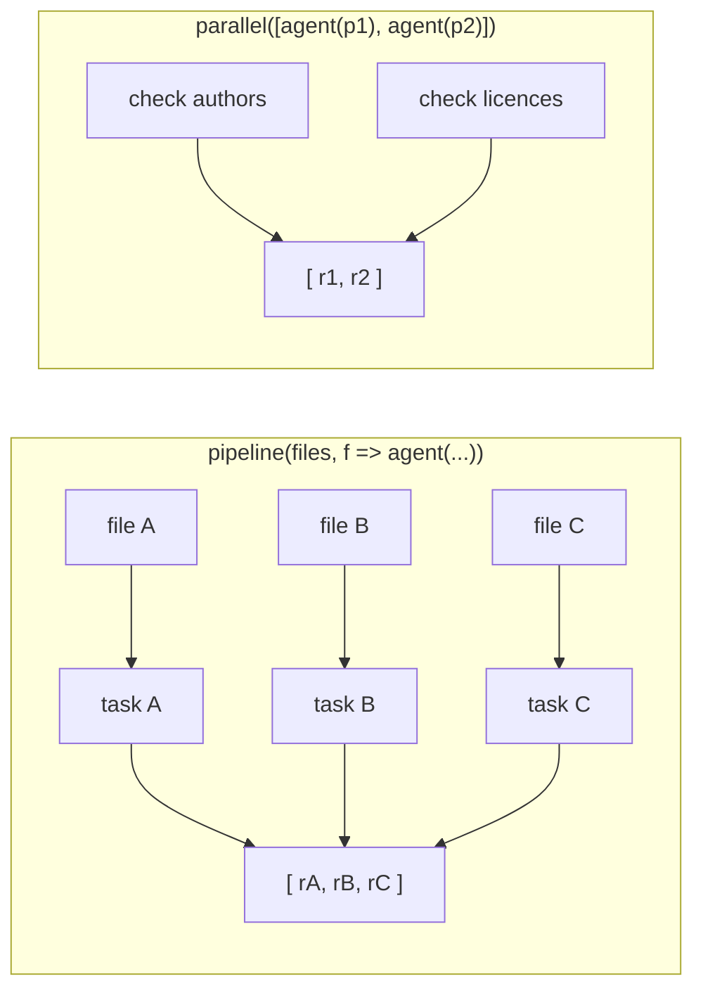

# `parallel()` vs `pipeline()`

> They look like two speeds of one thing. They are two shapes of input, and both
> of them wait for everything.

**Type:** Build
**Prerequisites:** Lesson 78 (Dynamic Workflows)
**Time:** ~40 minutes

---

## Learning Objectives

- Choose between `agent()`, `pipeline()`, and `parallel()` from the shape of the work
- Predict what a failed or stopped agent does to the returned array, per call shape
- Make a result slot nameable with `label` instead of matching on position alone
- State what the runtime does *not* give you, and what you would build instead

---

## The Problem

A migration workflow fanned out over 412 files and returned an array of results.
Sixteen of them were `null`.

The user could not say which sixteen files had failed. The script had built its
tasks by mapping over a list, and the returned array had one entry per file — in
the right order, in fact. But the entries were bare strings from the agents, and
twenty of the strings were empty, and the retry note from one agent had been
logged by Claude Code rather than returned, and the mapping from *slot* back to
*file* lived in a variable the script had thrown away.

Nobody had thought about what a slot in that array was supposed to **mean**,
because the choice had been made by reaching for the combinator that sounded
right: `parallel()`, because "parallel" was the word in the feature's name.

Two things would have fixed it in one line each. Neither is about parallelism.

---

## The Concept

Three call shapes, and the difference between the first two is small — much
smaller than the names suggest.

| Call | Takes | Returns | When you reach for it |
|---|---|---|---|
| `agent(prompt, opts)` | One task | That agent's result, or `null` | One job, done once |
| `pipeline(list, fn)` | A **list**, and a function from item → task | One entry per item, in the list's order | The item varies, the job is the same |
| `parallel(tasks)` | A **set of tasks** | One entry per task | The job varies, and there is no list |



### What actually differs

**`pipeline()` is for one job across many items.** The file list is the input; the
per-file task is the function. Change the item, and you have asked a different
question of the same machinery.

**`parallel()` is for many jobs at once.** A security review, a licence audit, and
a dependency check are not three iterations of anything. They are three tasks,
and there is no list behind them.

That is it. That is the whole distinction the docs draw.

### What does not differ, and this is the trap

Both combinators **wait for all of them.** Neither is "give me whichever finishes
first." If you need a race, you do not have a combinator for it in the
documented surface — check the script-writing reference for your version before
assuming one exists, and otherwise build it from `agent()` calls yourself.

Both combinators are **subject to the same runtime concurrency cap** — sixteen
agents by default, fewer when the machine has fewer CPUs. The cap belongs to the
runtime, not to the combinator you picked. If you believe `pipeline()` serialises
and `parallel()` does not, measure it in your own session before you design
around it; nothing in the docs promises you that difference.

Both put a **`null` in the slot** of an agent that was stopped, stalled out, or
hit an unrecoverable error. The contrast that actually changes your code is not
between the two combinators — it is between either of them and a bare `agent()`:

| Where the agent call sits | What a lost agent does |
|---|---|
| Inside `pipeline()` or `parallel()` | The run carries on, with `null` in that slot |
| Awaited directly | The whole run ends with the error |

So the structure question is bigger than the combinator question. *Is this agent
one of many, or is it load-bearing?* Put load-bearing calls outside the fan-out,
where failing loudly is what you want.

### Make a slot nameable

An `agent()` call takes a `label`. The docs' own example passes the file being
worked on:

```javascript
const audits = await pipeline(found.files, file =>
  agent(`Audit ${file} for missing authentication checks.`, { label: file }),
)
```

Without it, a slot is a position. With it, a slot is a name — and since sixteen
`null`s in a list of anonymous strings is exactly the failure above, this is not
decoration. It is the difference between a result you can act on and a result you
have to re-derive.

> **The reframe:** `parallel()` and `pipeline()` are not two speeds of the same
> thing — they are two shapes of input, and both wait for everything, so the
> choice is about what varies and what a result slot is allowed to mean.

---

## Build It

You need a recent Claude Code with workflows available (Lesson 78 covers turning
them on). If your plan does not have them, read the steps and run the equivalent
by hand; the shapes are the lesson.

### 1. One job, one call

Start with the boring shape. Ask for a workflow over a single file:

```
use a workflow to summarize src/routes/auth.ts and list its exported symbols
```

Read the generated script. It should be one `agent()` call and a `return`.

✅ You pass when you can say what the script would do if that one agent returned
`null`, without running it.

### 2. The item varies

Now the pipeline shape. Point it at a list:

```
use a workflow to check every file under src/routes/ for missing auth checks,
one agent per file
```

Find the `pipeline()` line. Note what the function takes — one item — and what it
returns for that item.

✅ You pass when the length of the input list and the length of the returned
array are the same number, and you can point at the line that made them match.

### 3. The job varies

Now the other shape. Three checks that share nothing but the repository:

```
use a workflow to audit this repo for (1) unused exports, (2) missing licence
headers, and (3) dependencies with no lockfile entry
```

This should come back as a `parallel()` — or as three awaited `agent()` calls, if
Claude judged them load-bearing. Both are defensible. What is *not* defensible is
three separate `pipeline()` calls over the same file list, one per check, each
called in sequence.

✅ You pass when you can name, from the script, whether the three audits run
concurrently or in sequence, and why that choice was right for this task.

### 4. Add a label, and prove it matters

Take the pipeline from step 2. Add `{ label: file }` to the agent call and rerun.
Then read the progress view with `/workflows`.

✅ You pass when each agent in the view is identified by the file it is working
on rather than by an index, and you can say which line in the results array the
label does *not* change.

### 5. Break it in both places

This is the step that pays for the lesson. Find a fan-out and stop one agent
mid-run by selecting it in `/workflows` and pressing `x`. Let the run finish.

```
Show me the array the script returned, including any null entries.
```

Now take a *single* `agent()` call that the script awaits directly — the kind at
the top of the script, not inside a combinator — and stop that one the same way.

✅ You pass when you have one run that finished with a `null` in a slot and one
run that ended with an error, and you can say which structural difference caused
which outcome.

### 6. Find the line that would have lost the file names

Go back to step 2's script and look for the join between the input list and the
result array. If it is `.filter(Boolean)`, you have found the line from the
opening story.

✅ You pass when you can write down the index of a dropped entry and the file
that was at that index — and say what a program reading the filtered array
afterwards believes about the two.

> Workflows ship weekly. Verified against
> [the workflows page](https://code.claude.com/docs/en/workflows) on 2026-10-15.
> The call shapes and the 4,096-item cap are current as of that date; the
> runtime's concurrency number is Lesson 81. Check
> `https://code.claude.com/docs/llms.txt` before quoting either.

---

## Use It

| Situation | Call | Why |
|---|---|---|
| One job, once | `agent()` awaited directly | Failures stop the run, which is what you want for a prerequisite step |
| One job, many items | `pipeline(list, fn)` | The item is the axis of variation |
| Many jobs, one repo | `parallel(tasks)` | There is no shared list |
| You need the file names back | `{ label: ... }` on each agent | A position is not a name |
| One step must succeed or the run is pointless | Await it outside the fan-out | A `null` slot hides a broken prerequisite |
| One step is best-effort | Put it inside the fan-out | A `null` slot is a hole you can detect |
| You want the first success | Build it yourself from `agent()` | Neither combinator returns early |
| Long list | Split it | 4,096 items per call is a hard limit, and it is rejected rather than truncated |

---

## Exercises

1. Take a task you have run as a workflow and rewrite its orchestration twice:
   once as `pipeline()` where you had `parallel()`. Run both.
   ✅ You pass when you can describe one thing that changed and one thing that
   did not.

2. Write a workflow where a prerequisite `agent()` is awaited directly, then move
   it inside a `pipeline()` and stop it mid-run in both versions.
   ✅ You pass when one version dies and one continues, and your note names the
   structural difference rather than the tool you clicked.

3. Build the join by hand, without `.filter(Boolean)`. Produce a list of
   `"<file>: <result or MISSING>"` lines.
   ✅ You pass when a stopped agent shows up as `MISSING` against the correct
   file name, and you can say what the filtered version would have printed
   instead.

4. You need "run these five checks and tell me as soon as any one of them
   succeeds." Describe what you would write, and why the answer is not a
   combinator.
   ✅ You pass when your answer names the runtime's wait-for-all behaviour and
   says where you would put the early return.

---

## Key Terms

| Term | What people say | What it actually means |
|---|---|---|
| `pipeline()` | "the parallel loop" | A list plus a function. One agent per item, results in list order |
| `parallel()` | "run them at once" | A set of tasks. No list behind them. Waits for all |
| `agent()` | "one subagent" | One task. Resolves to its result, or `null` if it was lost |
| awaited directly | "outside the fan-out" | The run ends if that agent fails. The opposite of a `null` slot |
| `null` in a slot | "it failed" | The placeholder for a stopped, stalled-out, or unrecoverable agent. The slot stays where it was |
| `label` | "a nicety" | The only name a fan-out slot has. Without it you have an index |
| wait-for-all | "how it works" | Both combinators return after every agent finishes. There is no early return |
| 4,096 | "a big number" | The items-per-call cap. A longer list is rejected, not trimmed |

---

## What this lesson skipped

**Ordering and identity.** This lesson says a slot keeps its *position*. Why that
is the only thing you can trust, what resume does to it, and how a filtered array
misleads you is Lesson 80 — and it is the reason the opening story happened.

**The runtime's numbers.** Sixteen concurrent agents by default, 1,000 agents per
run, stall windows, restarts, the prompt-cache stagger in a fan-out. Lesson 81.

**Structured output.** Passing a `schema` to an `agent()` call makes it return
validated JSON instead of prose, with a bounded retry count. Mentioned here
because the opening story's empty strings are a schema problem wearing an
ordering costume. Details are on the workflows page rather than in this lesson.

**Cost of a large fan-out.** 400 agents is 400 times the tokens. Phase 14
instruments that; the size guideline in Lesson 78 is the crude brake.
