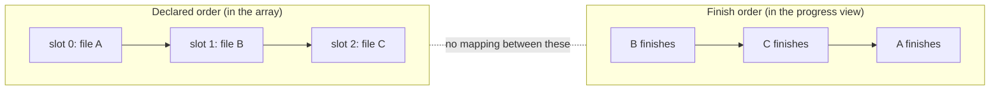

# The Completion-Order Gotcha

> A fan-out hands back results in the order you asked for them. It tells you
> nothing about when they arrived — and nearly everything you add alongside it
> tells you only that.

**Type:** Learn
**Prerequisites:** Lesson 79 (`parallel()` vs `pipeline()`)
**Time:** ~40 minutes

---

## Learning Objectives

- Name the two orders in a fan-out and say which one the returned array uses
- Spot the side channels that silently record arrival order instead
- Keep a failed agent's slot aligned with its input instead of filtering it away
- Predict which agents rerun after a stop, and what reordering a script does to a relaunch

---

## The Problem

This repo ran a parallel authoring pass: one agent per phase, each in its own
worktree, merged in catalog order. Then the test suite came back red.

The obvious reading was that the agents had broken something. Three agents had
written into three separate checkouts, so a red suite looked like three workers
each failing in the same way — which is a strange-enough coincidence that it
reads as a real signal about the *work*.

It wasn't. The suite was red because of a wrong glob in `package.json`. The
runner was misconfigured. The work was fine.

Here is the part worth the lesson. Nothing about the failure was caused by
running things in parallel. But parallelism was what made the *misattribution*
feel obvious — many workers, one red result, so a worker must have done it. The
evidence arrived in one order; the cause lived somewhere else.

The completion-order gotcha is the same shape, one level down. You get a set of
results back, and the array does not carry the thing you assume it carries. Read
the wrong field as the identity of a result and every downstream conclusion is
attached to the wrong piece of work — plausibly, and with good evidence.

---

## The Concept

A fan-out has **two orders**, and only one of them is data.

**Declared order** is the order you wrote the tasks in. It is what the returned
array follows.

**Finish order** is when each agent actually stopped. It is real, and you can
watch it happen in `/workflows` — one agent's row goes green while three others
are still running. It is *not* attached to any result you receive.



That gap is fine as long as nothing else in your run records order. The moment
something does, you have two orderings and one of them is a lie.

### The side channels that record arrival order

Every one of these is a thing you will reach for naturally, and every one of them
is finish order:

- An array you `.push()` to from inside the job instead of writing to a slot
- A log line, or a counter you increment as each result lands
- A file each agent appends a line to
- Your own reading of `/workflows` while the run is going
- A `sort()` you apply because the results "looked jumbled"

None of them is wrong. They are simply a different axis from the one the return
value uses. If you have both, you now have to join them, and the join is the
whole problem.

### The slot is the only identity

A fan-out result has one nameable property: its position. That is why `null` sits
*in the slot* rather than being dropped — a lost agent leaves a hole where it
was, so the file at index 41 is still reported at index 41.

The positional rule is documented directly for `pipeline()`, whose results array
keeps each `null` in place. For `parallel()`, both that it runs a set of tasks at
once and that it waits for all of them are documented; the array's exact ordering
is the part worth confirming in your own build rather than taking on faith. What
does not depend on the reading: what you are handed is not completion order, and a
hole must not be closed.

Which means this line is destructive:

```javascript
return audits.filter(Boolean)
```

The docs' own example ends that way, and for a run that has no failures it is
harmless. After one `null`, everything after it shifts down by one. Slot 41 no
longer belongs to file 41. Nothing errors. The list is shorter and every label in
it is now wrong for at least one later entry.

The safe forms are the boring ones:

```javascript
// Keep the slot, keep the meaning.
return list.map((file, i) => ({ file, verdict: audits[i] ?? null }))

// Drop the holes, but bind them first.
return list
  .map((file, i) => ({ file, verdict: audits[i] ?? null }))
  .filter((row) => row.verdict !== null)
```

Both keep the file name attached to the verdict. That is the whole difference.

### Absence is not emptiness

`null` means **lost** — stopped, stalled out past every attempt, or an
unrecoverable error. An empty result means **the agent ran and found nothing.**

If your workflow can legitimately produce nothing, you need both to survive, or
"no findings" becomes indistinguishable from "no answer". A `schema` on the
`agent()` call is how you make the empty case well-formed; checking for `null` is
how you detect the missing case.

### Then there is resume, where order is load-bearing in a second way

A run is not a set of agents. It is a **sequence** of agent calls, and a relaunch
compares that sequence against the last one:

- An agent whose call matches the previous run returns its **saved result**
- The *first* agent whose prompt differs runs again — and so does **every agent
  after it**, including ones that had completed
- An agent that was still running when you stopped the run **starts over**
- A failed agent runs again, and everything after it runs again too

Read the second bullet again. A failure in the middle of a fan-out reruns work
that already finished. If a script started A, B, C, D and B failed, a relaunch
returns A from the saved results and runs B, C, and D again.

And the sequence — not the individual prompt — is what is compared. If you edit
the script so it starts A, C, B, D, then the second call is now C where it used to
be B. The first divergence is at position 1, so A comes back saved and C, B, and
D all run again.

> **The reframe:** a fan-out returns results in the order you *asked*, never in
> the order they *arrived* — so anything you build that keys a result by when it
> came back has renamed every result, and resume keys a run by where each call
> sits in the sequence.

---

## Build It

This is the shape the phase's practice module asks for. Build it here first.

### 1. Write a propose → verify workflow

Five proposals for one problem, and one independent verifier per proposal. The
point of the pattern is that the verifier does not share the proposer's context,
so a weak idea does not get a friendly review.

Give each proposal a marker that a verifier can echo:

```
use a workflow to propose five different approaches to rate-limiting our API,
then have an independent verifier critique each proposal. Each proposal must
carry a unique marker like PROPOSAL-3, and each verifier must return which
marker it verified.
```

✅ You pass when the script contains one fan-out for the proposals and a second
fan-out for the verifiers, and you can point at the line that passes a proposal
into its verifier.

### 2. Join the two badly, on purpose

Make the join use arrival order. Do it the way it actually happens: filter, then
zip.

```javascript
const proposals = await pipeline(promptList, p => agent(p, { label: p }))
const verdicts  = await pipeline(
  proposals.filter(Boolean),
  p => agent(`Critique this approach: ${p}`, { label: 'verify' }),
)

return verdicts.map((v, i) => `${proposals[i]} → ${v}`)
```

There is a real defect in there and it is not the filter alone. `proposals[i]` is
being used as the identity of `verdicts[i]` while `verdicts` was built from a
*shortened* list.

✅ You pass when you can say, without running it, exactly what happens to the
pairing after the first `null`.

### 3. Make it fail for real

Run it, then stop one of the middle verifiers in `/workflows` by selecting it and
pressing `x`. Let the run finish.

If nothing was lost, stop a *proposer* instead and re-run. Keep going until the
output contains a `null` somewhere in the middle of a fan-out.

✅ You pass when you have printed at least one line where the proposal name and
the verdict disagree — a verdict about PROPOSAL-4 printed next to PROPOSAL-2 —
and you can point at the array index where the misalignment began.

### 4. Fix it by binding before you drop

Rewrite the join so the file name is attached *before* anything is filtered:

```javascript
const rows = proposalList.map((p, i) => ({ proposal: p, result: proposals[i] ?? null }))
const verified = await pipeline(rows, ({ proposal, result }) =>
  result === null
    ? null
    : agent(`Critique this approach: ${result}`, { label: proposal }),
)
return rows.map((r, i) => `${r.proposal} → ${verified[i] ?? 'MISSING'}`)
```

Rerun, stop a middle agent again, and read the output.

✅ You pass when every printed verdict names the proposal it actually critiqued,
or prints `MISSING` against the one that was lost — with no line pairing a verdict
with the wrong proposal.

### 5. Prove absence is not emptiness

Add a proposal that is deliberately vacuous — "take no action" — and a verifier
instructed to return an empty finding when a proposal is unobjectionable.

✅ You pass when your output distinguishes three states: a verdict, an empty
verdict, and `MISSING`, and you can say which one a `null` slot means.

### 6. Feel resume, in the sequence

This is the experiment that makes the last section of the Concept land. You need
a fan-out long enough that it does not finish instantly.

1. Run the workflow. Let the middle fan-out run, then stop the **whole run**.
2. Ask Claude to relaunch it with the same script. Watch which agents return
   instantly and which start again. Write down what you saw.
3. Open the script and swap two adjacent entries in the list you iterate over.
   Relaunch.
4. Write down how many agents returned a saved result the second time.

✅ You pass when you can name the first position at which the two sequences
diverged, and say how many agents reran *because* of a one-line reorder.

> Do not trust the narrative here over your own observation. The replay rules are
> documented behaviour and they are version-gated; you just falsified or confirmed
> them on your machine. Verified against
> [the workflows page](https://code.claude.com/docs/en/workflows) on 2026-10-15,
> and Lesson 81 covers the retries and stall windows that decide *when* an agent
> gets re-run at all.

---

## Use It

| You are about to… | Stop, and instead |
|---|---|
| `.filter(Boolean)` a fan-out result | Map to `{ input, result }` first, then filter |
| `.push()` a result from inside a job | Write into the slot for that input |
| Read `/workflows` to learn the result order | Read the returned array. The view is finish order |
| `sort()` the results into a sensible order | You have already lost the join; sort the *inputs* and fan out again |
| Match a verdict to a proposal by index | Match by a marker the verifier echoed |
| Treat `null` and empty as the same | `null` is a lost agent; empty is a finding of nothing |
| Add an agent in the middle of a long run | Expect everything after it to rerun on the next relaunch |
| Blame a worker for a bad aggregate result | Check the runner. This repo's was a wrong glob in `package.json` |

---

## Exercises

1. Take a workflow you already wrote and find every place a result is ordered by
   anything other than its position in the input list.
   ✅ You pass when you can name each one and say what would print if a result in
   the middle were lost.

2. Write the same join twice — once with a marker echoed by the verifier, once by
   index. Break both with a stopped agent.
   ✅ You pass when you can say which one failed silently and which failed
   visibly, and which you would rather debug at 2am.

3. A fan-out starts A, B, C, D. B fails. You relaunch. Write down which agents
   reuse a saved result before you run it. Then run it and compare.
   ✅ You pass when your prediction matches, or your note explains exactly which
   rule you had backwards.

4. Find a claim in this lesson you have not personally verified, and design the
   smallest experiment that would settle it.
   ✅ You pass when the experiment has an observable outcome you could write down,
   rather than a feeling about whether it worked.

---

## Key Terms

| Term | What people say | What it actually means |
|---|---|---|
| declared order | "the order it ran in" | The order you wrote the task list. The order the returned array follows |
| finish order | "the order it finished" | When each agent stopped. Visible in `/workflows`; attached to no result you receive |
| slot | "an entry" | A position in the returned array. The only identity a result has without a label |
| `null` in a slot | "it failed" | A lost agent. Stopped, stalled past every attempt, or unrecoverable. Kept in place |
| `.filter(Boolean)` | "cleaning up the errors" | Removes the holes *and* shifts every later slot, silently rewiring the join |
| saved result | "it's cached" | What a relaunch returns for an agent whose call matches the previous run |
| first divergence | "the change" | The earliest position where the new run's sequence of calls differs. Everything from there reruns |
| absence vs emptiness | "nothing came back" | A lost agent versus an agent that ran and found nothing. Different facts, different handling |
| misattribution | "the agents broke it" | Reading a failure's evidence as attached to the work instead of the runner |

---

## What this lesson skipped

**The runtime's numbers.** How many agents run at once, how many a call may hold,
how many stall restarts an agent gets before it is declared lost. All of that
decides *when* a slot becomes `null`, and all of it is Lesson 81.

**Prompt caching between fan-out members.** Agents sharing a prefix read each
other's cache, which is why the runtime staggers a fan-out's first requests by up
to five seconds by default. It is a cost mechanism, not an ordering one, and it
matters when a run is expensive rather than when it is wrong.

**Deterministic replay in detail.** Why `Date.now()` and `Math.random()` throw
inside a script, and what `args` is for, is Lesson 78's rule and this lesson's
consequence.

**Joins that span runs.** Nothing here covers merging results from two separate
runs. If you need it, the second run's sequence starts from zero and the first
divergence rule applies from the top — try it on a small list before you trust a
big one.
