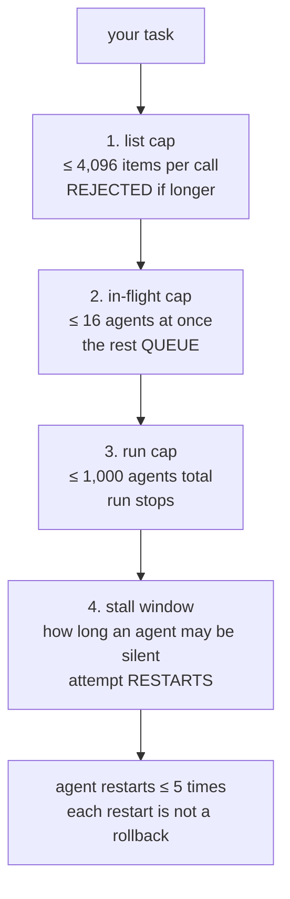

# Workflow Runtime Caps

> The runtime bounds how many agents are in flight, how long an agent may stay
> quiet, and how many agents one run may ever spawn. None of those bounds is
> about the model. All of them are about your script's shape.

**Type:** Learn
**Prerequisites:** Lesson 80 (The Completion-Order Gotcha)
**Time:** ~40 minutes

---

## Learning Objectives

- Name the four caps that bound a run, and which one your script's design has to respect
- Predict what a run does when it crosses the concurrency cap, the list cap, and the total-agent cap
- Say what a restarted agent keeps and what it loses, in terms of files and transcript
- Explain why a stalled agent is not the same as a failed one, for the purposes of a relaunch
- Set the stall window deliberately, for one agent and for the whole run

---

## The Problem

Two incidents, one afternoon.

The first: a workflow was asked to migrate 800 files, one agent per file. The
author had assumed 800 agents would run at once. The run took the better part of
an hour and looked, on the progress line, like nothing was happening — because
sixteen agents were in flight and the rest were queued behind them. Nothing was
stuck. The mental model was wrong.

The second: one agent went quiet. It had made three edits, then started a tool
call that produced no output for long enough that the runtime gave up on the
attempt and **restarted the agent from the same prompt**. The new attempt began
without the stalled attempt's transcript. But — and this is the whole incident —
the three files the first attempt had already changed were still changed. The
restart is not a rollback. The second attempt began on a repo that the first
attempt had half-modified, with no memory that it had.

Both of these are caps. Neither is a model problem, and neither is a bug.

---

## The Concept

Four caps. They bound different things, and each one has a different failure
shape when you hit it.



### 1. The list cap: 4,096 items per call

A single `parallel()` or `pipeline()` call holds at most 4,096 items. A longer
list is **rejected with an error** — not truncated, not split.

The docs say why, and the reason is worth more than the number: a silent cap
would drop part of the workload without telling the script. That is the same
principle as the `null` slot from Lesson 80. The runtime refuses to be quietly
wrong on your behalf.

So if you have more items than that, split the list yourself — and decide what a
batch boundary means for your results, because you are the one who has to rejoin
them.

### 2. The in-flight cap: 16 agents at a time, by default

The runtime runs up to **16 concurrent agents** by default, fewer when the
machine has fewer CPUs — including inside a CPU-limited container. This is the
cap behind the first incident: 800 items is 800 *agents*, but it is 16 *at a
time*.

`CLAUDE_CODE_WORKFLOW_MAX_CONCURRENT_AGENTS` accepts a value from 1 to 256 and
requires a recent version. Raising it does not make the work free: more agents in
flight is more tokens per minute and more load on the machine you are also trying
to use.

This is also where a fan-out's prompt cache lives. Agents that share a prefix —
same model, effort level, agent type, tools, output schema, and working directory
— can read each other's cache. So the runtime holds all but the first agent of a
matching fan-out until the first one's response begins, then releases them
together, up to a cap of five seconds by default. Set
`CLAUDE_CODE_WORKFLOW_PREFIX_STAGGER_MS` to `0` to disable the hold. A workflow
agent's cache lives five minutes by default; `subagentPromptCacheTtl` of `1h`
extends it, and the API bills a one-hour cache write at a higher rate.

You do not have to understand the cache to be bitten by the hold: it is one more
reason a 20-agent fan-out does not start all at once.

### 3. The run cap: 1,000 agents total

A single run may spawn at most 1,000 agents. That is the backstop against a
runaway loop. If your script recurses or retries unboundedly, it hits a wall
instead of your card.

For scale: 4,096 items per call is the *list* cap; 1,000 agents is the *run* cap.
A pipeline over 4,000 items will not get 4,000 agents — it will stop at the run
cap. Know which wall you are closer to before you write the loop.

### 4. The stall window: where a restart is not a rollback

An agent whose output stops arriving for long enough is **restarted from the same
prompt**. In `/workflows` its name gains a `(retry 1)` suffix and its detail shows
`attempt 2 (stalled)`.

What the new attempt inherits, and what it does not:

| | After a stall restart |
|---|---|
| The stalled attempt's transcript | **Gone.** The new attempt starts without it |
| Files the stalled attempt already changed | **Still changed.** No rollback |
| Tokens the stalled attempt spent | **Still counted.** They are in the run's total |

An agent restarts at most five times, counting any restart you ask for with `r`.
If the sixth attempt stalls too, the `agent()` call fails and the error names
which of three ways it went:

- `agent stalled on all 6 attempts` — every attempt was silent for the whole
  window. The agent's work keeps it quiet that long; lengthen the window
- `agent lost its reply on all 6 attempts` — the response stream went silent.
  Lengthening the window will not help; a streaming idle watchdog ended it first
- `agent abandoned after 6 attempts` — the attempts ended in different ways, which
  the error lists in order

Two knobs. Per agent: `agent(prompt, { stallMs: 1800000 })` for a 30-minute
window. Whole run: `CLAUDE_ASYNC_AGENT_STALL_TIMEOUT_MS`, which also applies to
subagents outside workflows.

Time an agent spends waiting on its own tool calls or on a usage-limit reset does
**not** count toward the window. That is deliberate: a legitimately slow command
is not a stall.

### The two things that are not caps

**A run takes no input mid-flight.** It pauses on its own only for agent
permission prompts and a usage-limit wait. For sign-off between stages, run each
stage as its own workflow and let yourself look at the result.

**A workflow has no filesystem and no shell.** Agents read, write, and run
commands; the script coordinates. A script containing `import()` fails before the
run even starts.

### One more number that is advice, not a cap

Above **25 agents**, or a projected **1.5 million tokens**, the run's progress
line shows a `Large workflow` warning. It is advisory — it does not pause
anything. The **size guideline** from Lesson 78 changes the agent-count threshold
when you set it yourself, and the default guideline leaves it at 25. Sessions
with ultracode on do not show the warning at all, because turning ultracode on
already opts you in to large runs.

> **The reframe:** the caps bound how much is *in flight* and how long a single
> attempt may stay silent — not how much work you may describe — so the number
> your script is designed around is concurrency, and the stall window is the
> number that decides whether a restart is cheap or destructive.

---

## Build It

### 1. Count before you run

Take a task you would actually fan out — every file in a directory, every issue
in a tracker. Write down three numbers before touching a workflow: the number of
items, your estimate of the agents the script will spawn, and the number you
expect to be in flight at once.

✅ You pass when all three numbers are different, and you can say which cap each
one is measured against.

### 2. Watch the queue

Run a fan-out over a list comfortably larger than 16 — a directory with 60 or
more files is plenty. Do not wait for it to finish; watch `/workflows` for the
first thirty seconds.

✅ You pass when you can see that some agents have not started, and name the cap
that is holding them rather than the cap that would reject them.

### 3. Hit the list cap cheaply

The list cap is enforced before any agent starts, which makes it the one cap you
can prove for free. Have the workflow build a list of 4,100 items and pass it to
a single `pipeline()` call.

✅ You pass when the call fails with an error naming the list, and no agents were
spawned — verify by checking the run's agent count.

### 4. Kill an agent by being quiet

This one is about the stall window, and you cannot force it directly. What you
*can* do is give an agent a job that legitimately keeps it silent for a long time
— a big build, a long test run — with a short window set through
`CLAUDE_ASYNC_AGENT_STALL_TIMEOUT_MS`, and watch what `/workflows` shows.

```javascript
const slow = await agent('Run the full test suite and report every failure.', { stallMs: 5000 })
```

✅ You pass when the agent's row shows a `(retry 1)` suffix or an `attempt 2
(stalled)` detail, and you can state which of the three error strings you would
get if it did that six times.

### 5. Show that a restart is not a rollback

With an agent that writes a file before going quiet, let it stall, and then check
the file it wrote during the *first* attempt.

✅ You pass when the file is still changed after the restart, and you can say
what the second attempt does *not* know about it.

### 6. Raise the ceiling and measure

Set `CLAUDE_CODE_WORKFLOW_MAX_CONCURRENT_AGENTS` to something larger for one run
— say `32` — and repeat step 2 on the same list.

✅ You pass when the number of agents in flight at the peak is visibly higher and
you have a sentence about what it cost: wall clock, machine load, or tokens.

### 7. Watch a large-run warning appear

A run above 25 agents will announce itself. If your list is smaller, pick a
bigger directory.

✅ You pass when you can point at the warning, and state the one action it offers
you rather than the action it takes for you.

> Every number here is version-gated, and several are environment-gated — the
> concurrency default depends on the machine's CPUs, and the concurrency ceiling
> needs a recent version. Verified against
> [the workflows page](https://code.claude.com/docs/en/workflows) on 2026-10-15.
> Check `https://code.claude.com/docs/llms.txt` before you set any of them in
> something that has to keep working next month.

---

## Use It

| You are about to… | The cap that applies | Do this instead |
|---|---|---|
| Fan out over 5,000 files | List cap, 4,096 per call | Split the list yourself and decide how the parts rejoin |
| Assume a big fan-out is instant | In-flight cap, 16 by default | Budget wall clock as `items ÷ in-flight`, roughly |
| Raise concurrency to make it fast | `CLAUDE_CODE_WORKFLOW_MAX_CONCURRENT_AGENTS`, 1–256 | Expect more load and more tokens per minute |
| Retry forever on a flaky agent | Run cap, 1,000 agents | Bound the loop yourself |
| Give an agent a long silent job | Stall window | `stallMs`, or `CLAUDE_ASYNC_AGENT_STALL_TIMEOUT_MS` for the run |
| Assume a restart undoes edits | It does not | Make the agent's writes idempotent, or check the disk |
| Pause mid-run for sign-off | Not supported | Run each stage as its own workflow |
| Read config inside the script | No filesystem | Give an agent the read; branch on its result |

---

## Exercises

1. Take a real directory in this repo and compute, on paper, how long a
   one-agent-per-file fan-out would take at 16 in flight, assuming each agent is
   roughly as slow as the slowest one you have watched.
   ✅ You pass when your estimate and the actual wall clock are within a factor
   of two, or your note explains what you missed.

2. Find the script for a run that hit a stall restart, and read the stalled
   agent's task. Say what a *retry* of that task would do differently from the
   first attempt, given that its files were not rolled back.
   ✅ You pass when your answer names a concrete side effect the second attempt
   could duplicate rather than a general statement about idempotency.

3. Set the stall window to something absurdly short, then something generous, on
   the same task. Report what changed.
   ✅ You pass when you can say which error string a too-short window produces,
   and why lengthening the window would not fix a silent response stream.

4. A run pauses on a usage-limit wait. List the conditions that have to hold for
   it to pause rather than fail that agent, and one of them that does not apply
   in headless mode.
   ✅ You pass when your list matches the docs and you can name which session
   kinds never get the pause.

---

## Key Terms

| Term | What people say | What it actually means |
|---|---|---|
| list cap | "too many files" | 4,096 items per `parallel()`/`pipeline()` call. Rejected, never truncated |
| in-flight cap | "it should be parallel" | 16 concurrent agents by default, fewer with fewer CPUs. The rest queue |
| run cap | "a safety limit" | 1,000 agents in one run. The backstop against a runaway loop |
| stall window | "a timeout" | How long an agent may produce no output before the attempt is abandoned and restarted |
| restart | "a retry" | A new attempt from the same prompt. No transcript, no rollback, tokens still counted |
| `stallMs` | "a timeout option" | The per-agent override for the stall window, in milliseconds |
| `CLAUDE_ASYNC_AGENT_STALL_TIMEOUT_MS` | "the global timeout" | The run-wide stall window. Also applies outside workflows |
| prefix stagger | "a delay" | Up to 5 seconds of hold so a fan-out's later agents read the first one's prompt cache |
| stall vs failure | "it failed" | A stall retries without the run noticing; a failure reruns the tail on a relaunch. Different mechanisms |
| `Large workflow` | "an error" | An advisory warning above 25 agents or 1.5M projected tokens. It does not stop anything |

---

## What this lesson skipped

**Cost instrumentation.** Knowing which agents spend the tokens is a different
skill, and it is Phase 14. The size guideline here is a crude brake, not a
measurement.

**The full environment-variable surface.** There are more knobs than the four
above, and the env-vars page is the list. Anything you set belongs in a note with
the version you set it on.

**The Agent SDK host.** A run launched through the SDK has its own permission
model and no approval prompt. Phase 17.

**Permission prompts inside a run.** Agents in a run use your permission rules,
and the runtime picks their mode by the same rules it uses for subagents —
Lesson 33 for the modes, the subagents page for the exact selection order.

**Time spent waiting on a usage-limit reset.** It is excluded from the stall
window, and the wait has its own conditions and a two-wait limit. Covered on the
workflows page; not repeated here because it is about your plan, not your script.
